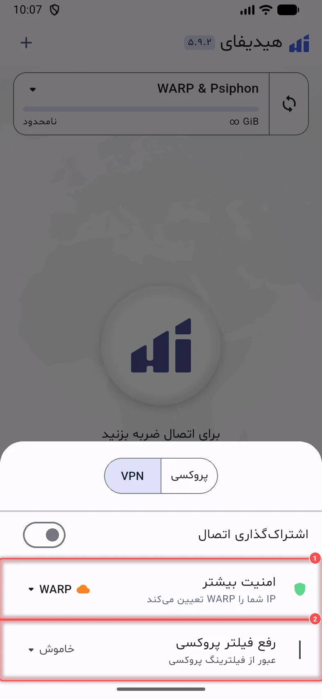
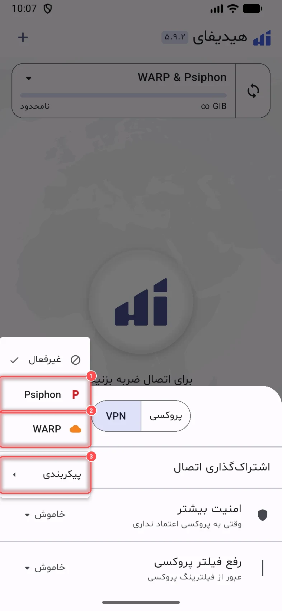
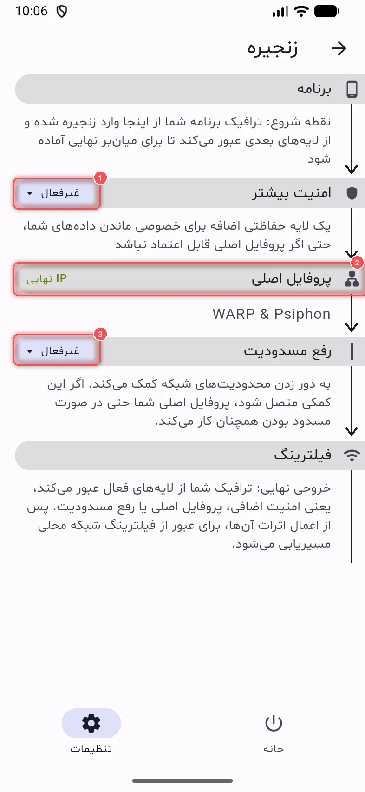
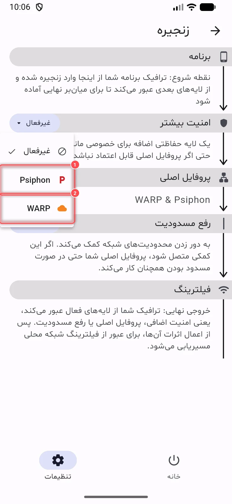
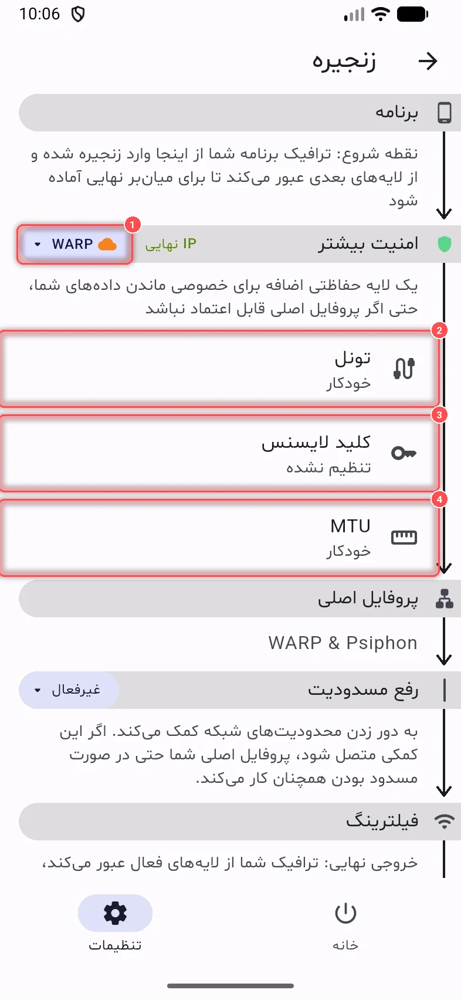

# زنجیره: امنیت بیشتر و رفع فیلتر پروکسی (وارپ و سایفون)

اپ هیدیفای می‌تواند یک تونل رایگان دیگر، یعنی **وارپ** یا **سایفون**، را قبل یا بعد از پروفایل خودتان قرار دهد. به این کار **زنجیره** می‌گوییم. زنجیره دو لایهٔ اختیاری دارد:

- **امنیت بیشتر**: ترافیک شما *بعد از* پروکسی، از وارپ یا سایفون خارج می‌شود. وقتی به پروکسی اعتماد ندارید، مثلاً یک کانفیگ عمومی یا رایگان، از آن استفاده کنید: صاحب پروکسی ترافیک شما را نمی‌بیند و سایت‌ها آی‌پی وارپ یا سایفون را می‌بینند، نه آی‌پی پروکسی را.
- **رفع فیلتر پروکسی** (در صفحهٔ زنجیره: **رفع مسدودیت**): اتصال به پروکسی *از طریق* وارپ یا سایفون انجام می‌شود. وقتی پروکسی شخصی خودتان فیلتر شده، از آن استفاده کنید: این لایه اتصال را از فیلتر عبور می‌دهد.

!!! note "نوشته‌شده برای اپ هیدیفای نسخهٔ ۵.۹"
    این صفحه برای اپ هیدیفای **نسخهٔ ۵.۹** (۵.۹.۲) است. تصویرها از اندروید هستند؛ گزینه‌ها در همهٔ سیستم‌عامل‌ها یکسان‌اند. برای خود پروفایل رایگان وارپ، [آموزش استفاده از وارپ روی اپ هیدیفای](How-to-use-WARP-on-Hiddify-App.md) را ببینید.

## راه سریع: تنظیمات سریع

در صفحهٔ خانه، **تنظیمات سریع** را در پایین صفحه بزنید.

1. **امنیت بیشتر** («وقتی به پروکسی اعتماد نداری»). وقتی روشن باشد، خط زیرش می‌گوید آی‌پی شما را چه کسی تعیین می‌کند، مثلاً **IP شما را WARP تعیین می‌کند**.
2. **رفع فیلتر پروکسی** («عبور از فیلترینگ پروکسی»).

مقدار سمت چپ هر کدام را بزنید و **خاموش**، **Psiphon** یا **WARP** را انتخاب کنید. **پیکربندی** صفحهٔ زنجیره را با همهٔ گزینه‌ها باز می‌کند.

اولین بار که وارپ یا سایفون را انتخاب می‌کنید، اپ شرایط استفاده‌شان را نشان می‌دهد (**رضایت‌نامه Cloudflare WARP** یا **قرارداد لایسنس Psiphon**)؛ برای ادامه آن را بپذیرید.

## صفحهٔ زنجیره

**تنظیمات ← زنجیره** (امنیت بیشتر و رفع مسدودیت) را باز کنید. این صفحه مسیر ترافیک شما را از بالا به پایین نشان می‌دهد:

- **برنامه**: ترافیک برنامه‌های شما از این‌جا وارد زنجیره می‌شود.
- **امنیت بیشتر** (۱): غیرفعال، Psiphon یا WARP.
- **پروفایل اصلی** (۲): پروفایل فعال شما.
- **رفع مسدودیت** (۳): غیرفعال، Psiphon یا WARP.
- **فیلترینگ**: ترافیک به سمت اینترنت می‌رود.

برچسب سبز **IP نهایی** نشان می‌دهد سایت‌ها آی‌پی کدام لایه را می‌بینند.

!!! tip "کدام را انتخاب کنم؟"
    - کانفیگ عمومی یا رایگانی که به آن اعتماد ندارید ← **امنیت بیشتر**. ممکن است سرعت کم شود.
    - کانفیگ خودتان که فیلتر شده ← **رفع فیلتر پروکسی**. فقط برای پروکسی شخصی مفید است، برای پروکسی عمومی مناسب نیست و سرعت پروکسی را کمی کم می‌کند.
    - می‌توانید هر دو را هم‌زمان روشن کنید.

## گزینه‌های وارپ

وقتی یک لایه روی WARP باشد، گزینه‌هایش زیر آن ظاهر می‌شوند:

1. **WARP** انتخاب شده و **IP نهایی** به این لایه منتقل شده است.
2. **تونل**: نحوهٔ اتصال وارپ: **خودکار**، **WireGuard**، **AmneziaWG** یا **MASQUE**. تا وقتی وارپ روی شبکهٔ شما وصل می‌شود، آن را روی **خودکار** بگذارید.
3. **کلید لایسنس**: کلید وارپ‌پلاس، اگر دارید. وارپ رایگان کلید لازم ندارد.
4. **MTU**: روی خودکار بگذارید.

با انتخاب یک نوع تونل، گزینه‌های بیشتری ظاهر می‌شود:

- **WireGuard**: **نقطه‌ی اتصال** (**تعیین‌شده توسط کلادفلر**، **جست‌وجو** برای پیدا کردن آدرسی که کار می‌کند، یا **دستی**)، **IP تمیز**، پورت، و **نویز وایرگارد** (تعداد، حالت، اندازه و تأخیر نویز؛ حالت‌هایی مثل Standard، Random، QUIC، DNS، SIP یا STUN) که شناسایی اتصال را سخت‌تر می‌کند. **جست‌وجوگر** هم گزینه‌های خودش را دارد (حداکثر RTT، مهلت، تعداد آدرس‌ها، پورت‌ها و بازه‌ها).
- **AmneziaWG**: گزینه‌های بسته‌های بی‌محتوا (junk): تعداد و کمترین و بیشترین اندازه.
- **MASQUE**: نسخهٔ HTTP، نام سرور، IPv6، زمان‌بندی‌های UDP و keepalive، Fragment در TLS و **Encrypted Client Hello** (ECH).

برای سایفون می‌توانید **انتخاب منطقه سرور** را بزنید (خودکار، یا یک کشور).

اگر وارپ یا سایفون وصل نشد، **تونل** دیگری را امتحان کنید یا لایه را روی سرویس دیگر بگذارید.

## مقاله‌های مرتبط

- [کار با اپ هیدیفای](How-to-use-Hiddify-app.md): افزودن پروفایل، اتصال و تنظیمات پایه
- [نصب اپ هیدیفای](How-to-install-Hiddify-app.md)
- [پروفایل‌های رایگان اپ هیدیفای](Free-profiles-in-Hiddify-app.md)
- [مسیریابی در اپ هیدیفای](Routing-in-Hiddify-app.md)

