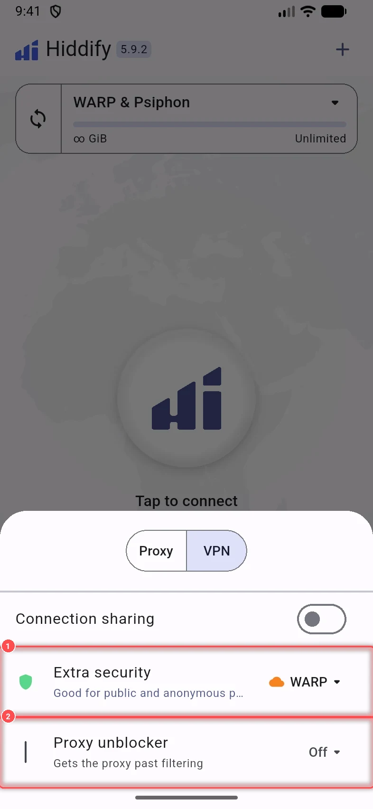
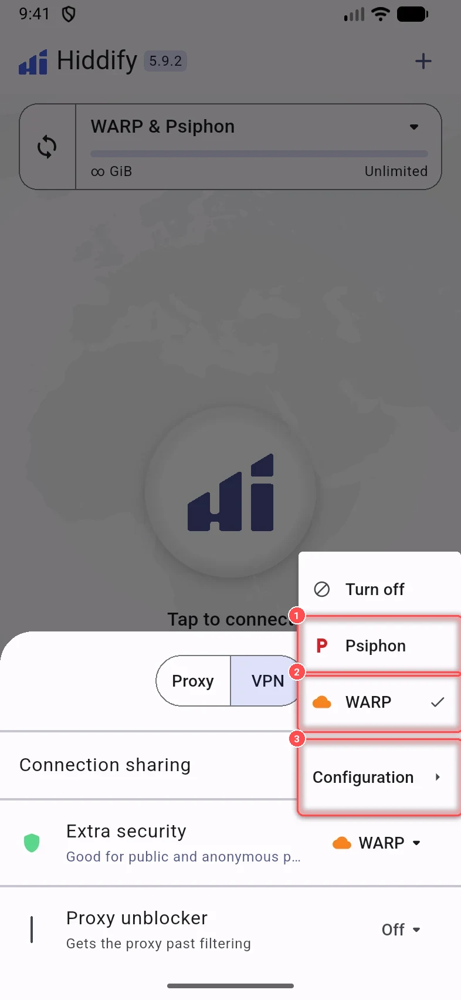
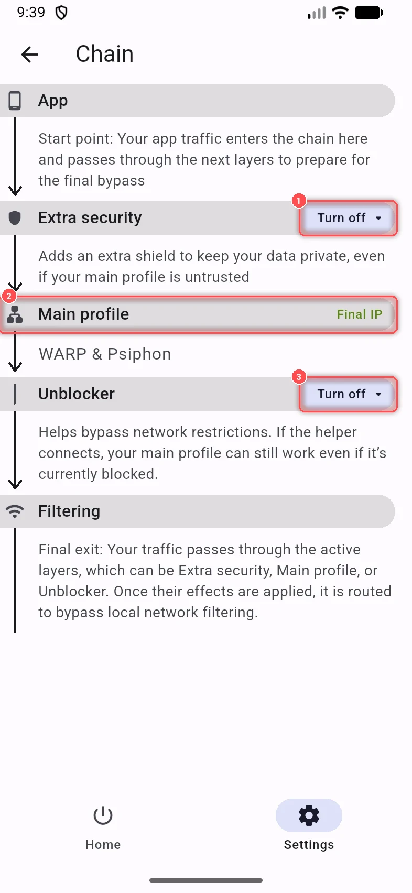
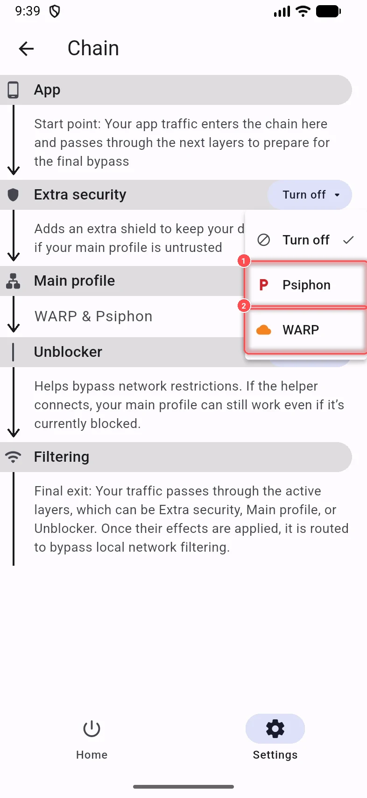
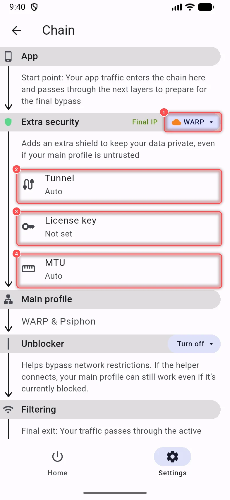

# Chain: Extra security and Proxy unblocker (WARP and Psiphon)

The Hiddify app can put a second free tunnel, **WARP** or **Psiphon**, in front of or behind your own profile. This is called the **chain**. It has two optional layers:

- **Extra security**: your traffic leaves through WARP or Psiphon *after* your proxy. Use it when you don't trust the proxy, for example a public or free config: the proxy's owner can't see your traffic, and sites see the IP of WARP or Psiphon, not of the proxy.
- **Proxy unblocker**: your proxy is reached *through* WARP or Psiphon. Use it when your own (personal) proxy is filtered: the unblocker gets the connection past the filter.

!!! note "Written for Hiddify app 5.9"
    This page is for Hiddify app **5.9** (5.9.2). The screenshots come from Android; the options are the same on every platform. For the free WARP profile itself, see [How to use WARP in the Hiddify app](How-to-use-WARP-on-Hiddify-App.md).

## The quick way: Quick settings

On the Home page, tap **Quick settings** at the bottom.

1. **Extra security** ("When you don't trust the proxy"). Once it is on, the line under it says who sets your IP, for example **Your IP is set by WARP**.
2. **Proxy unblocker** ("Gets the proxy past filtering").

Tap the value on the right of either one to choose **Turn off**, **Psiphon** or **WARP**. **Configuration** opens the Chain page with all the options.

The first time you choose WARP or Psiphon, the app shows its terms (**Cloudflare WARP consent** or **Psiphon license agreement**); accept them to continue.

## The Chain page

Open **Settings → Chain** (Extra security & unblocker). It shows the path of your traffic from top to bottom:

- **App**: your apps' traffic enters the chain here.
- **Extra security** (1): off, Psiphon or WARP.
- **Main profile** (2): your active profile.
- **Unblocker** (3): off, Psiphon or WARP.
- **Filtering**: the traffic leaves for the internet.

The green **Final IP** label shows which layer's IP the sites will see.

!!! tip "Which one should I use?"
    - A public or free config you don't trust → **Extra security**. It may reduce speed.
    - Your own config that is filtered → **Proxy unblocker**. It is only useful for a personal proxy, not for public ones, and makes the proxy a bit slower.
    - You can use both at once.

## WARP options

When a layer is set to WARP, its options appear under it:

1. **WARP** is selected; **Final IP** moves to this layer.
2. **Tunnel**: how WARP connects: **Auto**, **WireGuard**, **AmneziaWG** or **MASQUE**. Leave **Auto** unless WARP does not connect on your network.
3. **License key**: a WARP+ key, if you have one. Free WARP needs none.
4. **MTU**: leave it on **Auto**.

With a set tunnel type, more options appear:

- **WireGuard**: **Endpoint** (**Assigned by Cloudflare**, **Scan** to find a working address, or **Custom**), **Clean IP**, **Port**, and **WireGuard noise** (noise count, mode, size and delay; modes such as Standard, Random, QUIC, DNS, SIP or STUN) to make the connection harder to detect. The **Scanner** has its own options (max RTT, timeout, how many addresses, ports and ranges).
- **AmneziaWG**: the junk packet options (**Junk packets**, **Min junk size**, **Max junk size**).
- **MASQUE**: HTTP version, server name, IPv6, UDP and keepalive timings, TLS fragment and **Encrypted Client Hello** (ECH).

For Psiphon you can **Select server region** (Auto, or a country).

If WARP or Psiphon does not connect, try another **Tunnel**, or switch the layer to the other provider.

## Related articles

- [How to use the Hiddify app](How-to-use-Hiddify-app.md): add a profile, connect, the basic settings
- [How to install the Hiddify app](How-to-install-Hiddify-app.md)
- [Free profiles in the Hiddify app](Free-profiles-in-Hiddify-app.md)
- [Routing in the Hiddify app](Routing-in-Hiddify-app.md)

