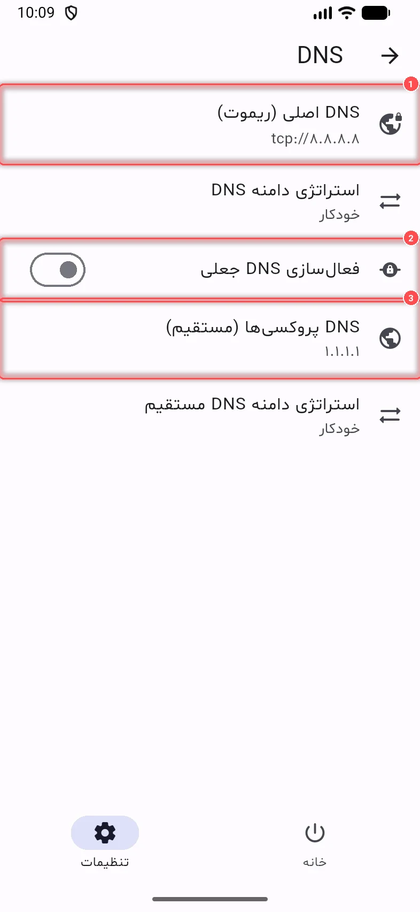
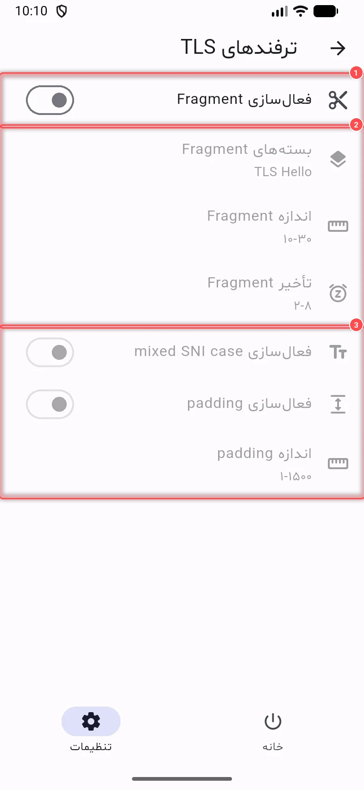

# تنظیمات DNS و ترفندهای TLS در اپ هیدیفای

این صفحه **تنظیمات ← DNS** و **تنظیمات ← ترفندهای TLS** را توضیح می‌دهد. مقدارهای پیش‌فرض برای بیشتر افراد درست کار می‌کنند: فقط وقتی سایتی باز نمی‌شود یا اتصال مسدود است تغییرشان دهید.

!!! note "نوشته‌شده برای اپ هیدیفای نسخهٔ ۵.۹"
    این صفحه برای اپ هیدیفای **نسخهٔ ۵.۹** (۵.۹.۲) است. تصویرها از اندروید هستند؛ گزینه‌ها در همهٔ سیستم‌عامل‌ها یکسان‌اند.

## DNS

DNS اسم سایت (`google.com`) را به آی‌پی تبدیل می‌کند. فیلتر می‌تواند این جواب‌ها را مسدود یا جعل کند، برای همین اپ از طریق پروکسی از یک سرور DNS می‌پرسد.

1. **DNS اصلی (ریموت)**: سرور DNS که **از طریق پروکسی** برای سایت‌هایی که باز می‌کنید استفاده می‌شود. پیش‌فرض: `tcp://8.8.8.8`. می‌توانید یکی دیگر را از فهرست انتخاب کنید (مثلاً `udp://1.1.1.1` یا `https://1.1.1.1/dns-query`) یا خودتان بنویسید. **استراتژی دامنه DNS** انتخاب می‌کند جواب IPv4 باشد یا IPv6 (خودکار، ترجیح IPv6، ترجیح IPv4، فقط IPv4، فقط IPv6).
2. **فعال‌سازی DNS جعلی**: اپ فوراً با آدرس‌های موقت به DNS جواب می‌دهد و آدرس واقعی در سمت پروکسی پیدا می‌شود. ممکن است اتصال را سریع‌تر کند؛ اگر برنامه‌ای درست کار نکرد خاموشش کنید.
3. **DNS پروکسی‌ها (مستقیم)**: سرور DNS که **بدون پروکسی** برای پیدا کردن آدرس خود سرورهای پروکسی استفاده می‌شود. پیش‌فرض: `1.1.1.1` (در چین `223.5.5.5`). **استراتژی دامنه DNS مستقیم** مثل استراتژی بالا کار می‌کند.

!!! tip "نکته"
    اگر سرورهای پروفایل شما با اسم مشخص شده‌اند و اپ به آن‌ها نمی‌رسد، **DNS پروکسی‌ها (مستقیم)** را روی سرور دیگری بگذارید، مثلاً `8.8.8.8`.

## ترفندهای TLS

ترفندهای TLS اولین بستهٔ یک اتصال رمزگذاری‌شده (TLS) را طوری تغییر می‌دهند که فیلتر نتواند اسم سایت را در آن بخواند. به کانفیگ‌هایی کمک می‌کنند که فیلتر از روی SNI، یعنی اسم سایتی که اول TLS فرستاده می‌شود، مسدودشان می‌کند.

1. **فعال‌سازی Fragment**: کلید اصلی. گزینه‌های دیگر فقط وقتی این روشن است قابل تغییرند.
2. گزینه‌های Fragment:
    - **بسته‌های Fragment**: کدام بسته‌ها تکه شوند: **TLS Hello** (اولین بسته، معمولاً کافی است) یا **1-1** تا **1-5**.
    - **اندازه Fragment**: اندازهٔ هر تکه به بایت، به‌صورت بازه (پیش‌فرض `10-30`).
    - **تأخیر Fragment**: مکث بین تکه‌ها به میلی‌ثانیه (پیش‌فرض `2-8`).
3. **فعال‌سازی mixed SNI case** حروف بزرگ و کوچک را در اسم سایت قاطی می‌کند (`gOoGlE.cOm`). **فعال‌سازی padding** بایت‌های تصادفی به اولین بسته اضافه می‌کند؛ **اندازه padding** تعدادشان را تعیین می‌کند (پیش‌فرض `1-1500`).

ترفندها ممکن است اتصال را کندتر کنند. یکی‌یکی روشنشان کنید و اگر کمکی نکردند دوباره خاموششان کنید.

این ترفندها چطور کار می‌کنند و چطور مقدار مناسب پیدا کنید: [کاربرد و نحوهٔ عملکرد ترفند TLS](/fa/manager/basic-concepts-and-troubleshooting/How-the-TLS-Trick-works-and-its-usage/) و [یک روش مناسب برای پیدا کردن مقادیر ترفند TLS](/fa/manager/basic-concepts-and-troubleshooting/A-good-way-to-find-TLS-trick-values/).

!!! info "نکته"
    می‌توانید فقط بعضی سایت‌ها را با ترفند Fragment مستقیم بفرستید: در یک قانون مسیریابی، **مستقیم با Fragment** را انتخاب کنید. [مسیریابی در اپ هیدیفای](Routing-in-Hiddify-app.md) را ببینید.

## مقاله‌های مرتبط

- [کار با اپ هیدیفای](How-to-use-Hiddify-app.md): افزودن پروفایل، اتصال و تنظیمات پایه
- [نصب اپ هیدیفای](How-to-install-Hiddify-app.md)
- [تونل‌های DNS و ریزالورها (Soar، DNSTT، MasterDNS)](DNS-tunnels-in-Hiddify-app.md)

