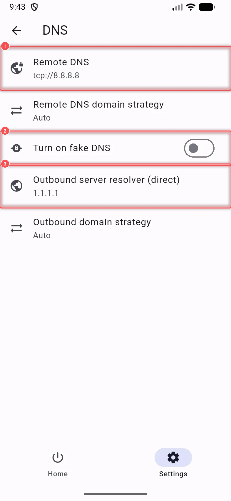
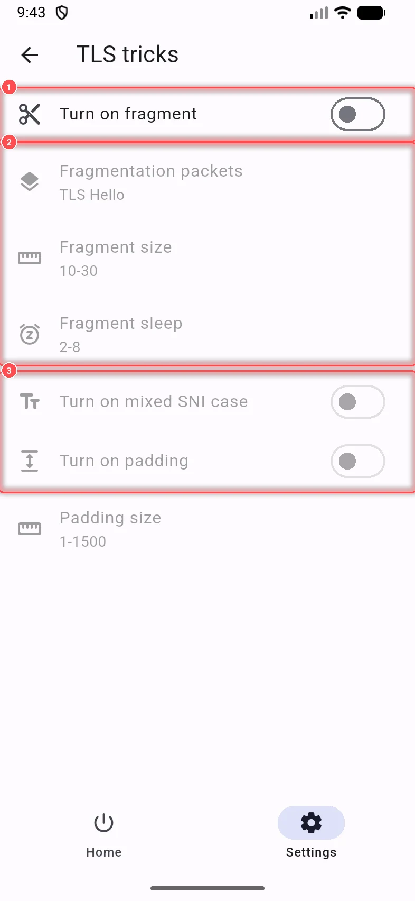

# DNS and TLS tricks settings in the Hiddify app

This page explains **Settings → DNS** and **Settings → TLS tricks**. The defaults work for most people: change these only when a site does not open or your connection is blocked.

!!! note "Written for Hiddify app 5.9"
    This page is for Hiddify app **5.9** (5.9.2). The screenshots come from Android; the options are the same on every platform.

## DNS

DNS turns a site's name (`google.com`) into an IP address. A filter can block or fake these answers, so the app asks a DNS server through the proxy.

1. **Remote DNS**: the DNS server used **through the proxy** for the sites you open. Default: `tcp://8.8.8.8`. You can pick another from the list (for example `udp://1.1.1.1` or `https://1.1.1.1/dns-query`) or type your own. **Remote DNS domain strategy** chooses IPv4 or IPv6 answers (Auto, Prefer IPv6, Prefer IPv4, IPv4 only, IPv6 only).
2. **Turn on fake DNS**: the app answers DNS with placeholder addresses at once and resolves the real address at the proxy's side. It can make connecting faster; turn it off if an app misbehaves.
3. **Outbound server resolver (direct)**: the DNS server used **without the proxy**, to find the address of your proxy servers themselves. Default: `1.1.1.1` (in China `223.5.5.5`). **Outbound domain strategy** works like the strategy above.

!!! tip
    If your profile's servers are given by name and the app can't reach them, change **Outbound server resolver** to another server, for example `8.8.8.8`.

## TLS tricks

TLS tricks change the first packet of an encrypted (TLS) connection so the filter can't read the site's name in it. They help with configs that the filter blocks by their SNI, the site name sent at the start of TLS.

1. **Turn on fragment**: the master switch. The other options can only be changed when it is on.
2. The fragment options:
    - **Fragmentation packets**: which packets are cut: **TLS Hello** (the first one, usually enough) or **1-1** … **1-5**.
    - **Fragment size**: the size of each piece in bytes, as a range (default `10-30`).
    - **Fragment sleep**: the pause between pieces in milliseconds (default `2-8`).
3. **Turn on mixed SNI case** mixes upper and lower case in the site name (`gOoGlE.cOm`). **Turn on padding** adds random bytes to the first packet; **Padding size** sets how many (default `1-1500`).

Tricks can make a connection slower. Turn them on one by one, and turn them off again if they don't help.

How these tricks work, and how to find good values: [How the TLS trick works](/manager/basic-concepts-and-troubleshooting/How-the-TLS-Trick-works-and-its-usage/) and [A good way to find TLS trick values](/manager/basic-concepts-and-troubleshooting/A-good-way-to-find-TLS-trick-values/).

!!! info
    You can also send only some sites direct with the fragment trick: in a routing rule, choose **Direct with fragment**. See [Routing in the Hiddify app](Routing-in-Hiddify-app.md).

## Related articles

- [How to use the Hiddify app](How-to-use-Hiddify-app.md): add a profile, connect, the basic settings
- [How to install the Hiddify app](How-to-install-Hiddify-app.md)
- [DNS tunnels and resolvers (Soar, DNSTT, MasterDNS)](DNS-tunnels-in-Hiddify-app.md)

