

# تونل‌های DNS در اپ هیدیفای: Soar، DNSTT و MasterDNS

وقتی تقریباً همه‌چیز بسته است ولی DNS هنوز کار می‌کند، اپ هیدیفای می‌تواند ترافیک شما را داخل پرسش‌های DNS ببرد. این صفحه می‌گوید تونل DNS چیست، کِی به کارتان می‌آید، و جواب پرسش پرتکرار را می‌دهد: **ریزالورها را کجا اضافه کنم؟**

<figure class="hi-diag">
<picture><source media="(max-width: 700px)" srcset="/assets/app/DNS-tunnels-in-Hiddify-app/fa-diagram-how-m-light.webp">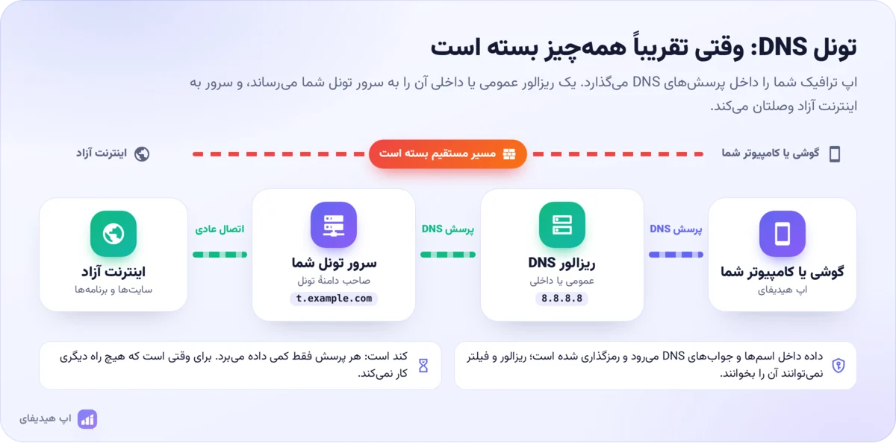</picture>
<picture><source media="(max-width: 700px)" srcset="/assets/app/DNS-tunnels-in-Hiddify-app/fa-diagram-how-m-dark.webp">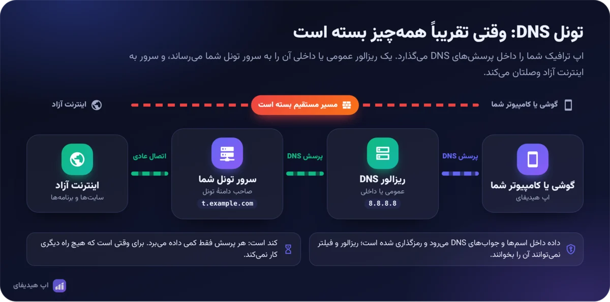</picture>
</figure>

!!! note "نوشته‌شده برای اپ هیدیفای نسخهٔ ۵.۵"
    تصویرها از اپ هیدیفای **نسخهٔ ۵.۵** روی اندروید هستند. صفحهٔ ویرایش پروفایل روی کامپیوتر (ویندوز، مک، لینوکس) هم همین است.

## تونل DNS چیست؟

- **ریزالور DNS** همان سروری است که اسم سایت‌ها را به آدرس تبدیل می‌کند، مثل `8.8.8.8` گوگل یا `1.1.1.1` کلودفلر. در بیشتر شبکه‌ها حتی وقتی همه‌چیز بسته است، پرسیدن از ریزالور آزاد است.
- اپ داده‌های شما را داخل همین پرسش‌ها می‌گذارد. ریزالور آن‌ها را به **سرور تونل** شما می‌رساند (چون سرور صاحب دامنهٔ تونل است)، و سرور شما را به اینترنت آزاد وصل می‌کند.
- داده رمزگذاری شده است؛ ریزالور و فیلتر فقط پرسش‌های DNS معمولی می‌بینند.

!!! warning "کند است"
    هر پرسش DNS فقط کمی داده می‌برد، پس تونل DNS خیلی کندتر از یک پروکسی معمولی است و فقط **TCP** را می‌برد (تماس صوتی و بازی‌هایی که UDP لازم دارند کار نمی‌کنند). از آن فقط وقتی استفاده کنید که هیچ راه دیگری وصل نمی‌شود.

## سه تونل DNS در اپ هیدیفای

<figure class="hi-diag">
<picture><source media="(max-width: 700px)" srcset="/assets/app/DNS-tunnels-in-Hiddify-app/fa-diagram-compare-m-light.webp">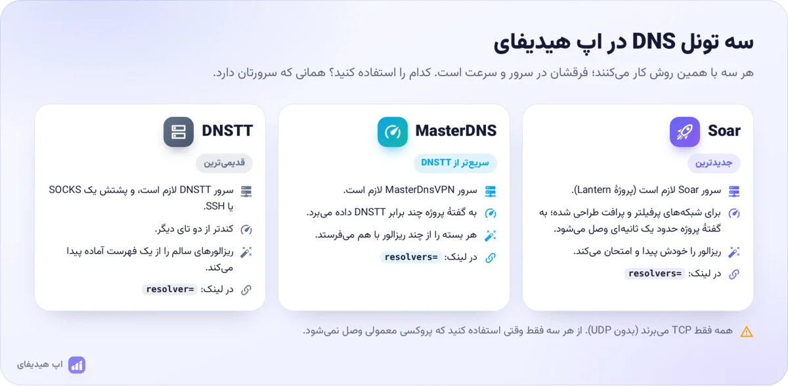</picture>
<picture><source media="(max-width: 700px)" srcset="/assets/app/DNS-tunnels-in-Hiddify-app/fa-diagram-compare-m-dark.webp">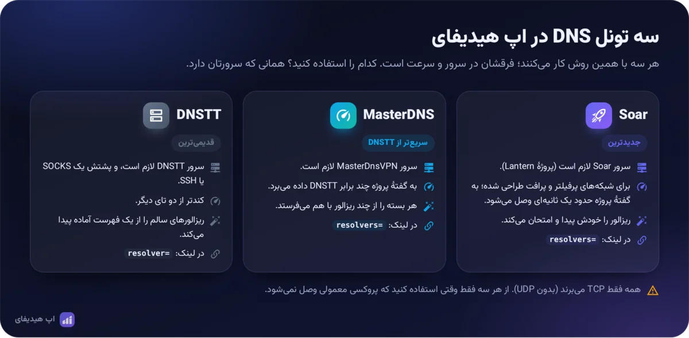</picture>
</figure>

کدام را استفاده کنید؟ همانی که سرورتان دارد. لینکش را از صاحب سرور می‌گیرید و مثل هر لینک دیگری به اپ اضافه می‌کنید (**+** ← **کلیپ‌بورد**). اگر سرور خودتان [هیدیفای‌منیجر](/fa/manager/) نسخهٔ ۱۳ به بعد است، می‌تواند تونل‌های DNSTT و MasterDNS بسازد.

## ریزالورها را کجا اضافه کنم؟

در اپ صفحهٔ جداگانه‌ای به اسم «افزودن ریزالور» **نیست**: ریزالورها بخشی از خود پروفایل‌اند. سه راه دارد:

<figure class="hi-diag">
<picture><source media="(max-width: 700px)" srcset="/assets/app/DNS-tunnels-in-Hiddify-app/fa-diagram-resolvers-m-light.webp">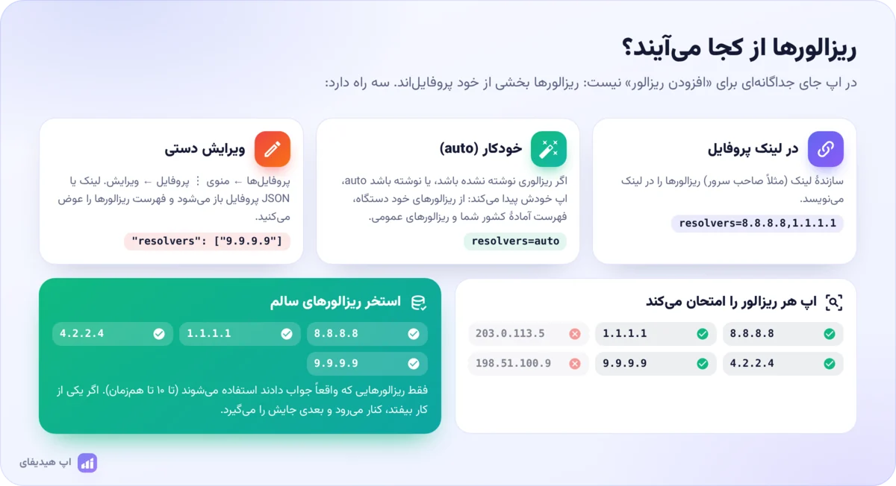</picture>
<picture><source media="(max-width: 700px)" srcset="/assets/app/DNS-tunnels-in-Hiddify-app/fa-diagram-resolvers-m-dark.webp">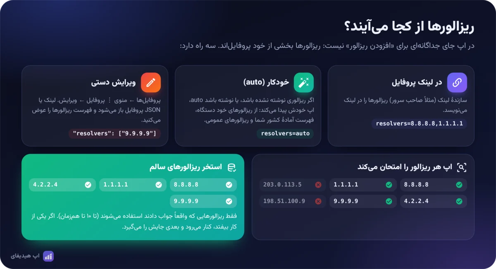</picture>
</figure>

هر راهی که ریزالورها از آن بیایند، اپ **همه را امتحان می‌کند** و فقط آن‌هایی را که واقعاً جواب دادند استفاده می‌کند؛ اگر یکی از کار بیفتد، کنار می‌رود و بعدی جایش را می‌گیرد. پس نوشتن چند ریزالور اضافه ضرری ندارد.

### راه ۱: در لینک پروفایل

سازندهٔ لینک ریزالورها را در خود لینک می‌نویسد. اگر لینک را خودتان می‌سازید یا می‌خواهید پیش از افزودن عوضش کنید، این بخش را پیدا کنید:

<figure class="hi-diag">
<picture><source media="(max-width: 700px)" srcset="/assets/app/DNS-tunnels-in-Hiddify-app/fa-diagram-link-m-light.webp">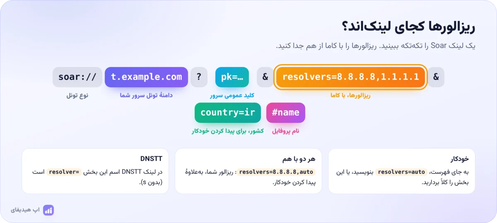</picture>
<picture><source media="(max-width: 700px)" srcset="/assets/app/DNS-tunnels-in-Hiddify-app/fa-diagram-link-m-dark.webp">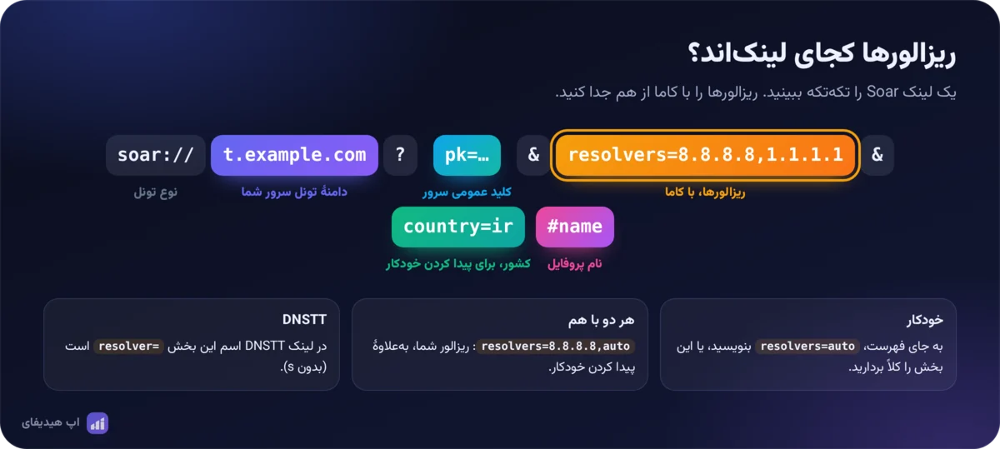</picture>
</figure>

- **Soar** و **MasterDNS**: `resolvers=8.8.8.8,1.1.1.1`
- **DNSTT**: `resolver=8.8.8.8,1.1.1.1` (بدون s)

### راه ۲: خودکار

اگر لینک هیچ ریزالوری ندارد، یا به جای فهرست نوشته `resolvers=auto`، اپ خودش ریزالور پیدا می‌کند: از ریزالورهای خود دستگاه، یک فهرست آماده برای کشور شما (برای ایران، چین و روسیه) و ریزالورهای عمومی. کشور را از **منطقه** در [تنظیمات مسیریابی](Routing-in-Hiddify-app.md) برمی‌دارد، یا از `country=ir` در لینک. `resolvers=8.8.8.8,auto` هم یعنی «این ریزالور، به‌علاوهٔ پیدا کردن خودکار».

### راه ۳: ویرایش دستی در اپ

برای پروفایلی که قبلاً اضافه کرده‌اید:

1. در صفحهٔ اصلی روی اسم پروفایل بزنید تا فهرست پروفایل‌ها باز شود، روی **⋮** کنار پروفایل بزنید و **ویرایش** را انتخاب کنید.

    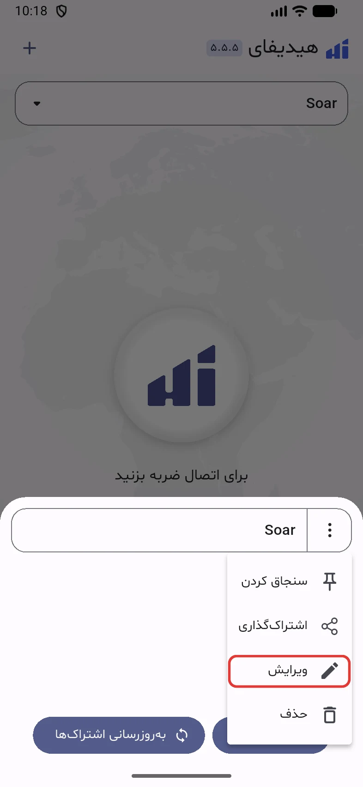

2. در **Config Editor**، `outbounds` ← `0` ← `resolvers` را باز کنید. روی **⋯** کنار `resolvers` بزنید، **Append** و بعد **String** را بزنید تا یک ردیف خالی اضافه شود.

    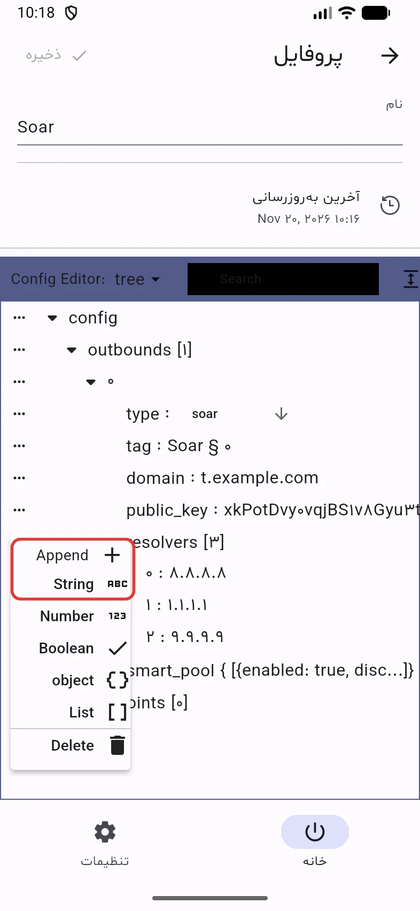

3. ساده‌ترین راه برای نوشتن آدرس: از منوی **tree** بالای ویرایشگر، **text** را انتخاب کنید. حالا کل کانفیگ متنی است: آدرس را داخل `""` ردیف خالی بنویسید، مثلاً `"9.9.9.9"`. هر آدرس داخل کوتیشن است و با کاما از بعدی جدا می‌شود. می‌توانید ریزالوری را هم پاک کنید یا `"auto"` را اضافه کنید.

    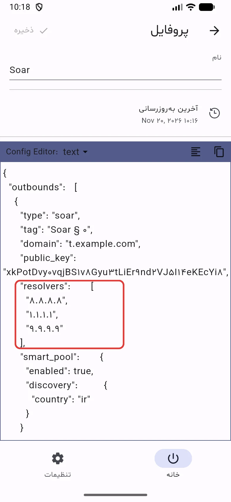

4. **ذخیره** را بالای صفحه بزنید. پیام **پروفایل ذخیره شد** می‌آید.

!!! tip "عددها را انگلیسی بنویسید"
    وقتی زبان اپ فارسی است، ویرایشگر عددها را فارسی **نشان** می‌دهد (مثل `۸.۸.۸.۸`)، ولی آدرس‌ها انگلیسی ذخیره می‌شوند. آدرس تازه را با کیبورد انگلیسی بنویسید.

!!! warning "پروفایل اشتراکی"
    اگر این پروفایل از یک لینک اشتراک (subscription) آمده، با به‌روزرسانی بعدی اشتراک ممکن است تغییر دستی شما پاک شود. در این حالت از صاحب سرور بخواهید ریزالورها را در خود لینک بنویسد.

## چند نکته

- **کدام ریزالورها؟** با `auto` شروع کنید؛ اپ خودش بهترین‌ها را پیدا می‌کند. اگر در شبکه‌تان فقط ریزالورهای داخلی (مثلاً ریزالور اپراتور) جواب می‌دهند، آن‌ها را هم کنار `auto` بنویسید.
- **وصل نمی‌شود؟** اول مطمئن شوید پروکسی معمولی واقعاً کار نمی‌کند؛ بعد چند ریزالور دیگر اضافه کنید یا `auto` بگذارید. اگر هیچ ریزالوری پرسش‌های دامنهٔ تونل را به سرور نرساند، تونل DNS کمکی نمی‌کند.

??? note "برای کاربران حرفه‌ای"
    - آدرس ریزالور می‌تواند `8.8.8.8` یا `1.1.1.1:5353` باشد. با استخر هوشمند ریزالورها (که پیش‌فرض روشن است) `tcp://`، DoT (`dot://host:853`) و DoH (`https://host/dns-query`) هم پذیرفته می‌شود.
    - همهٔ تنظیمات هر تونل، از جمله استخر هوشمند و پیدا کردن خودکار: [Soar](/fa/core/features/protocols/soar/)، [DNSTT](/fa/core/features/protocols/dnstt/)، [MasterDNS](/fa/core/features/protocols/masterdns/) و [استخر هوشمند ریزالورها](/fa/core/features/dns/smart-dns-pool/).

## مقاله‌های مرتبط

- [تونل‌های DNS در هیدیفای (بلاگ)](/fa/blog/2026/03/05/dns-tunnels/)
- [ورود و خروج تنظیمات و ویرایش پروفایل](Import-export-settings-and-edit-profile.md)
- [DNS و ترفندهای TLS](DNS-and-TLS-tricks-in-Hiddify-app.md)
- [مسیریابی در اپ هیدیفای](Routing-in-Hiddify-app.md)

