# DNS tunnels in the Hiddify app: Soar, DNSTT and MasterDNS

When almost everything is blocked but DNS still works, the Hiddify app can carry your traffic inside DNS queries. This page explains what a DNS tunnel is, when it helps, and answers a frequent question: **where do I add resolvers?**

<figure class="hi-diag">
<picture><source media="(max-width: 700px)" srcset="/assets/app/DNS-tunnels-in-Hiddify-app/en-diagram-how-m-light.webp">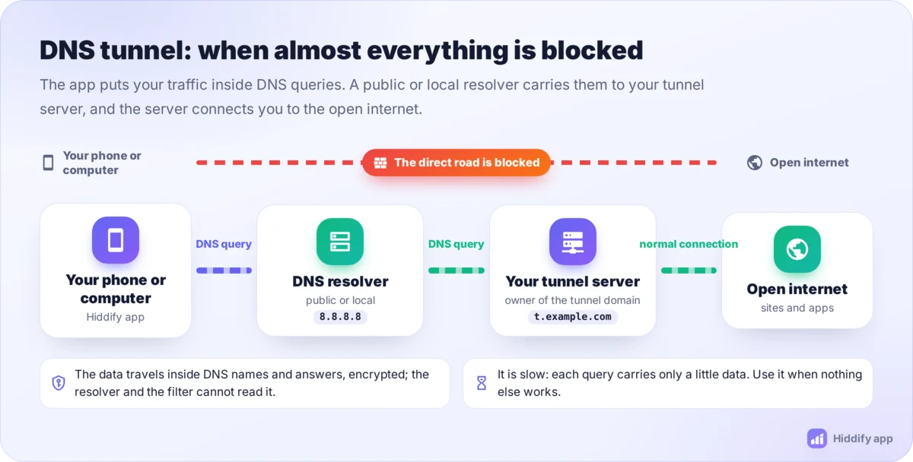</picture>
<picture><source media="(max-width: 700px)" srcset="/assets/app/DNS-tunnels-in-Hiddify-app/en-diagram-how-m-dark.webp">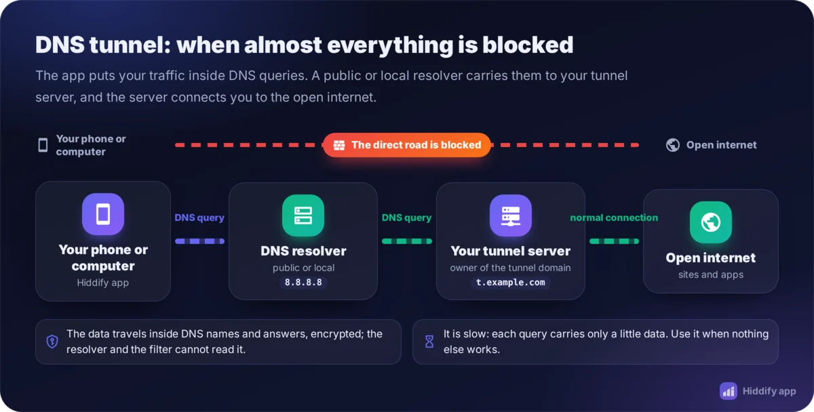</picture>
</figure>

!!! note "Written for Hiddify app 5.5"
    The screenshots come from Hiddify app **5.5** on Android. The profile edit page is the same on computers (Windows, macOS, Linux).

## What is a DNS tunnel?

- A **DNS resolver** is the server that turns site names into addresses, like Google's `8.8.8.8` or Cloudflare's `1.1.1.1`. On most networks, asking a resolver still works even when everything else is blocked.
- The app puts your data inside these queries. The resolver carries them to your **tunnel server** (because the server owns the tunnel domain), and the server connects you to the open internet.
- The data is encrypted; the resolver and the filter only see ordinary DNS queries.

!!! warning "It is slow"
    Each DNS query carries only a little data, so a DNS tunnel is much slower than a normal proxy, and it carries **TCP** only (voice calls and games that need UDP do not work). Use it only when nothing else connects.

## Three DNS tunnels in the Hiddify app

<figure class="hi-diag">
<picture><source media="(max-width: 700px)" srcset="/assets/app/DNS-tunnels-in-Hiddify-app/en-diagram-compare-m-light.webp">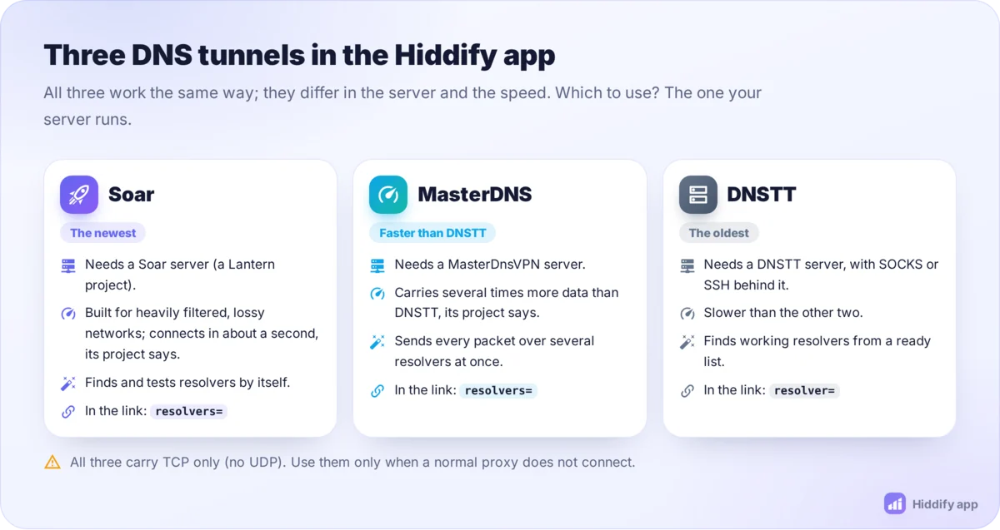</picture>
<picture><source media="(max-width: 700px)" srcset="/assets/app/DNS-tunnels-in-Hiddify-app/en-diagram-compare-m-dark.webp">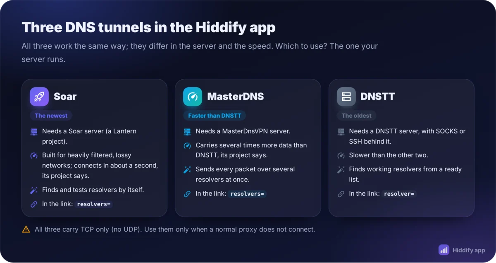</picture>
</figure>

Which one should you use? The one your server runs. You get its link from the server owner and add it like any other link (**+** → **Clipboard**). If your own server is [Hiddify Manager](/manager/) 13 or later, it can make DNSTT and MasterDNS tunnels.

## Where do I add resolvers?

The app has **no** separate "add resolver" screen: resolvers are part of the profile itself. There are three ways:

<figure class="hi-diag">
<picture><source media="(max-width: 700px)" srcset="/assets/app/DNS-tunnels-in-Hiddify-app/en-diagram-resolvers-m-light.webp">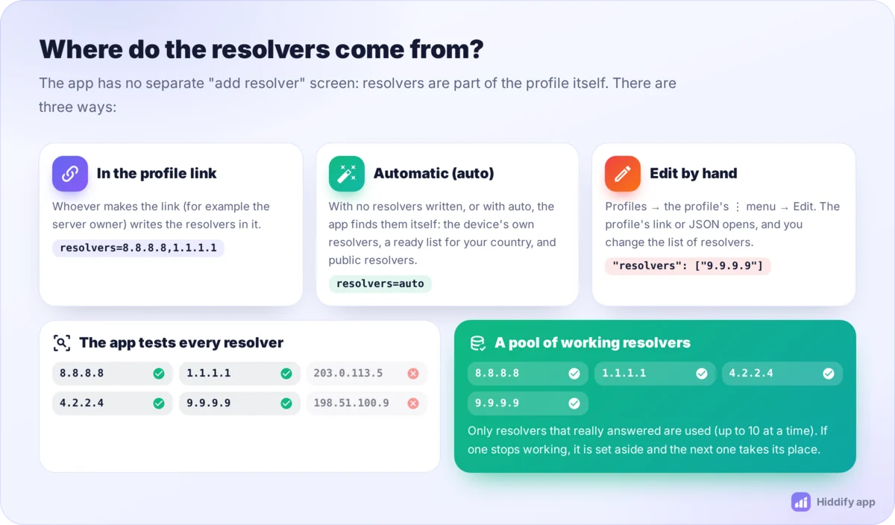</picture>
<picture><source media="(max-width: 700px)" srcset="/assets/app/DNS-tunnels-in-Hiddify-app/en-diagram-resolvers-m-dark.webp">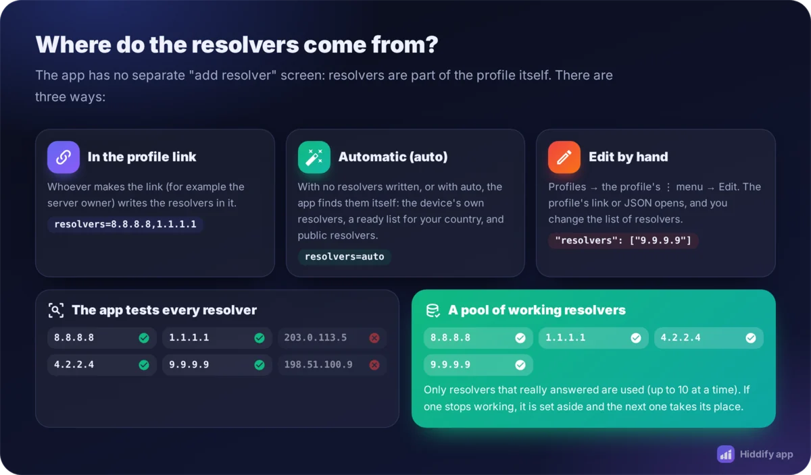</picture>
</figure>

Whichever way the resolvers come in, the app **tests them all** and uses only those that really answered; if one stops working, it is set aside and the next one takes its place. So listing a few extra resolvers does no harm.

### Way 1: in the profile link

Whoever makes the link writes the resolvers in it. If you make the link yourself, or want to change it before adding it, find this part:

<figure class="hi-diag">
<picture><source media="(max-width: 700px)" srcset="/assets/app/DNS-tunnels-in-Hiddify-app/en-diagram-link-m-light.webp">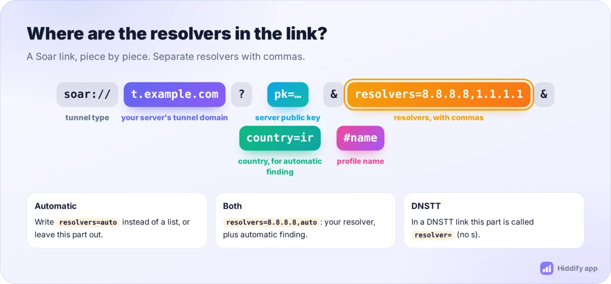</picture>
<picture><source media="(max-width: 700px)" srcset="/assets/app/DNS-tunnels-in-Hiddify-app/en-diagram-link-m-dark.webp">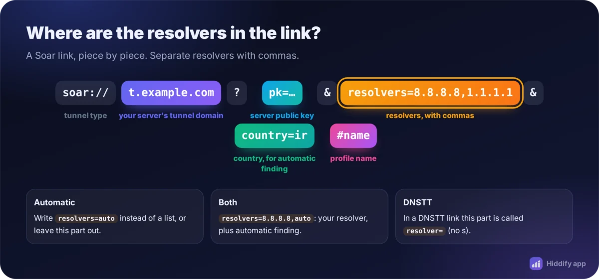</picture>
</figure>

- **Soar** and **MasterDNS**: `resolvers=8.8.8.8,1.1.1.1`
- **DNSTT**: `resolver=8.8.8.8,1.1.1.1` (no s)

### Way 2: automatic

If the link has no resolvers, or says `resolvers=auto` instead of a list, the app finds resolvers itself: the device's own, a ready list for your country (Iran, China and Russia), and public resolvers. It takes the country from **Region** in the [routing settings](Routing-in-Hiddify-app.md), or from `country=ir` in the link. `resolvers=8.8.8.8,auto` means "this resolver, plus automatic finding".

### Way 3: edit by hand in the app

For a profile you have already added:

1. On the home screen, tap the profile name to open the profile list, tap **⋮** next to the profile and choose **Edit**.

    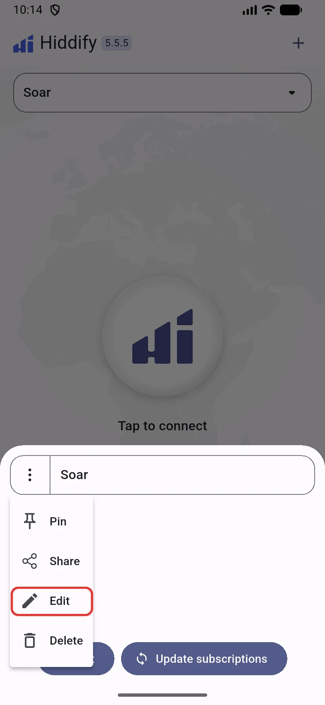

2. In the **Config Editor**, open `outbounds` → `0` → `resolvers`. Tap **⋯** next to `resolvers`, then **Append** and **String**: an empty line is added.

    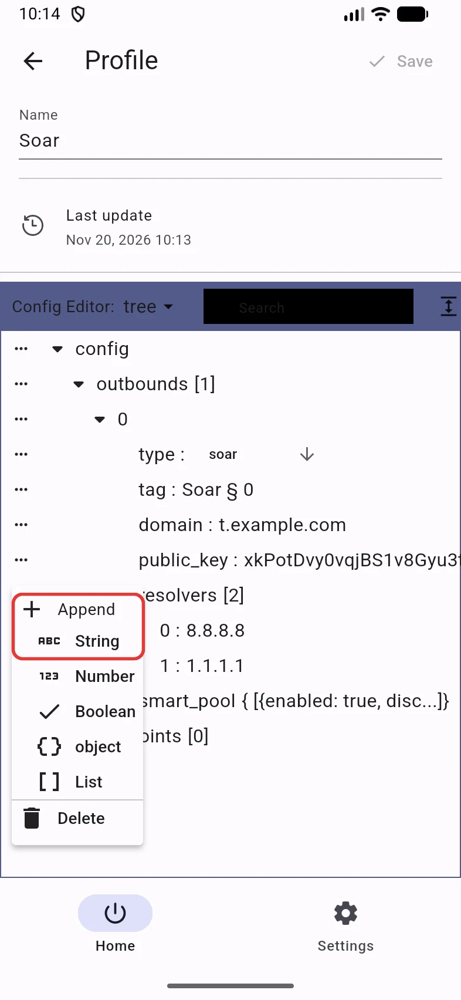

3. The easiest way to type the address: in the **tree** menu above the editor, choose **text**. The whole config is now text: type the address inside the empty `""`, for example `"9.9.9.9"`. Every address is in quotes and separated from the next by a comma. You can also delete a resolver or add `"auto"`.

    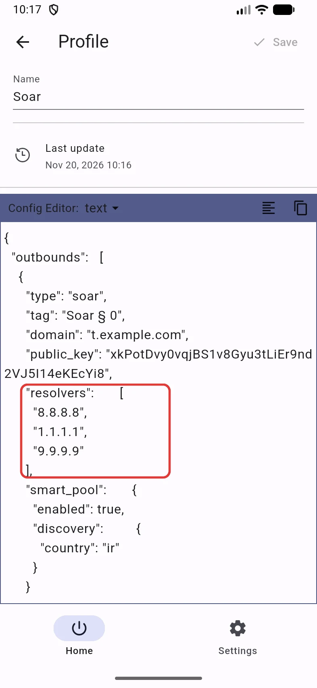

4. Tap **Save** at the top. **Profile saved** appears.

!!! warning "Subscription profiles"
    If this profile came from a subscription link, the next update of the subscription may wipe your edit. In that case, ask the server owner to put the resolvers in the link itself.

## A few tips

- **Which resolvers?** Start with `auto`; the app finds the best ones itself. If on your network only domestic resolvers answer (for example your operator's), add them next to `auto`.
- **Doesn't connect?** First make sure a normal proxy really does not work; then add a few more resolvers or set `auto`. If no resolver forwards the tunnel domain's queries to the server, a DNS tunnel cannot help.

??? note "For experts"
    - A resolver can be `8.8.8.8` or `1.1.1.1:5353`. With the smart resolver pool (on by default), `tcp://`, DoT (`dot://host:853`) and DoH (`https://host/dns-query`) work too.
    - Every setting of each tunnel, including the smart pool and automatic finding: [Soar](/core/features/protocols/soar/), [DNSTT](/core/features/protocols/dnstt/), [MasterDNS](/core/features/protocols/masterdns/) and the [smart resolver pool](/core/features/dns/smart-dns-pool/).

## Related articles

- [DNS tunnels in Hiddify (blog)](/blog/2026/03/05/dns-tunnels/)
- [Import, export settings and edit a profile](Import-export-settings-and-edit-profile.md)
- [DNS and TLS tricks](DNS-and-TLS-tricks-in-Hiddify-app.md)
- [Routing in the Hiddify app](Routing-in-Hiddify-app.md)
