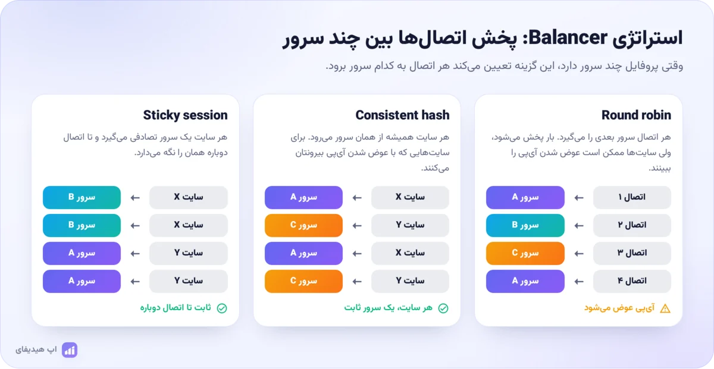
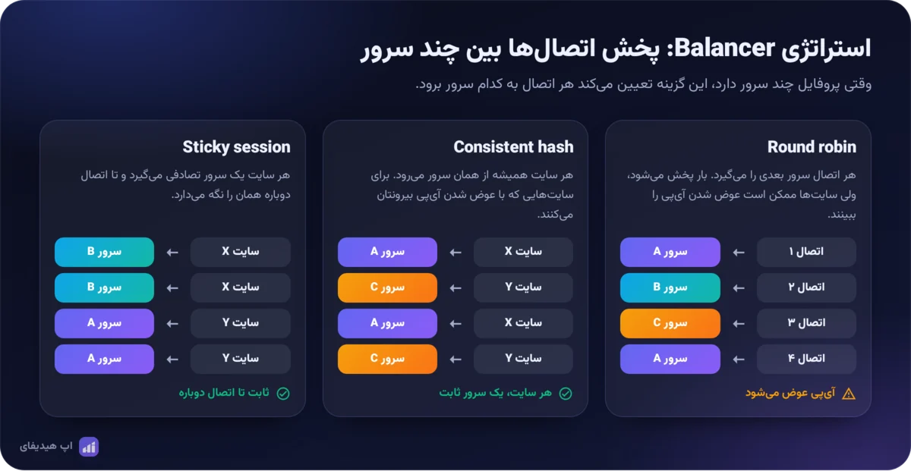

# اپ هیدیفای چطور سرور انتخاب می‌کند

خیلی از پروفایل‌ها بیش از یک سرور دارند. تا وقتی خودتان در صفحهٔ پروکسی‌ها سروری انتخاب نکرده‌اید، اپ تصمیم می‌گیرد ترافیک شما از کدام سرور برود. دو گزینه در **تنظیمات ← مسیریابی** این کار را تعیین می‌کنند:

<svg aria-hidden="true" xmlns="http://www.w3.org/2000/svg" viewBox="0 0 24 24"><path d="M13 19h1a1 1 0 0 1 1 1h7v2h-7a1 1 0 0 1-1 1h-4a1 1 0 0 1-1-1H2v-2h7a1 1 0 0 1 1-1h1v-2H4a1 1 0 0 1-1-1v-4a1 1 0 0 1 1-1h16a1 1 0 0 1 1 1v4a1 1 0 0 1-1 1h-7v2M4 3h16a1 1 0 0 1 1 1v4a1 1 0 0 1-1 1H4a1 1 0 0 1-1-1V4a1 1 0 0 1 1-1m5 4h1V5H9v2m0 8h1v-2H9v2M5 5v2h2V5H5m0 8v2h2v-2H5Z"/></svg>
<b>پروکسی پیش‌فرض</b>از <b>یک</b> سرور استفاده شود (سریع‌ترین یا اولین)، یا ترافیک بین همه <b>پخش</b> شود.

<svg aria-hidden="true" xmlns="http://www.w3.org/2000/svg" viewBox="0 0 24 24"><path d="M12 3c-1.27 0-2.4.8-2.82 2H3v2h1.95L2 14c-.47 2 1 3 3.5 3s4.06-1 3.5-3L6.05 7h3.12c.33.85.98 1.5 1.83 1.83V20H2v2h20v-2h-9V8.82c.85-.32 1.5-.97 1.82-1.82h3.13L15 14c-.47 2 1 3 3.5 3s4.06-1 3.5-3l-2.95-7H21V5h-6.17C14.4 3.8 13.27 3 12 3m0 2a1 1 0 0 1 1 1 1 1 0 0 1-1 1 1 1 0 0 1-1-1 1 1 0 0 1 1-1m-6.5 5.25L7 14H4l1.5-3.75m13 0L20 14h-3l1.5-3.75Z"/></svg>
<b>استراتژی Balancer</b>وقتی ترافیک پخش می‌شود: هر اتصال تازه به کدام سرور برود.

!!! tip "دو کلمه که در این صفحه می‌بینید"
    - **پینگ** مدت زمانی است که سرور طول می‌کشد تا جواب بدهد، به میلی‌ثانیه. هر چه کمتر، سریع‌تر: ۸۵ میلی‌ثانیه از ۴۲۰ میلی‌ثانیه سریع‌تر است. اپ هر چند وقت یک بار خودش آن را اندازه می‌گیرد.
    - **اتصال** یک رشتهٔ ترافیک بین یک برنامه و یک سایت است. باز کردن یک صفحهٔ وب معمولاً چند اتصال را با هم باز می‌کند.

## پروکسی پیش‌فرض { #default-proxy }

<svg aria-hidden="true" xmlns="http://www.w3.org/2000/svg" viewBox="0 0 24 24"><path d="M12 16a3 3 0 0 1-3-3c0-1.12.61-2.1 1.5-2.61l9.71-5.62-5.53 9.58c-.5.98-1.51 1.65-2.68 1.65m0-13c1.81 0 3.5.5 4.97 1.32l-2.1 1.21C14 5.19 13 5 12 5a8 8 0 0 0-8 8c0 2.21.89 4.21 2.34 5.65h.01c.39.39.39 1.02 0 1.41-.39.39-1.03.39-1.42.01A9.969 9.969 0 0 1 2 13 10 10 0 0 1 12 3m10 10c0 2.76-1.12 5.26-2.93 7.07-.39.38-1.02.38-1.41-.01a.996.996 0 0 1 0-1.41A7.95 7.95 0 0 0 20 13c0-1-.19-2-.54-2.9L20.67 8C21.5 9.5 22 11.18 22 13Z"/></svg>
<b>کمترین پینگ</b>همهٔ ترافیک از <b>یک</b> سرور می‌رود: سریع‌ترین. بهترین انتخاب برای بیشتر کاربران.

<svg aria-hidden="true" xmlns="http://www.w3.org/2000/svg" viewBox="0 0 24 24"><path d="M12 3c-1.27 0-2.4.8-2.82 2H3v2h1.95L2 14c-.47 2 1 3 3.5 3s4.06-1 3.5-3L6.05 7h3.12c.33.85.98 1.5 1.83 1.83V20H2v2h20v-2h-9V8.82c.85-.32 1.5-.97 1.82-1.82h3.13L15 14c-.47 2 1 3 3.5 3s4.06-1 3.5-3l-2.95-7H21V5h-6.17C14.4 3.8 13.27 3 12 3m0 2a1 1 0 0 1 1 1 1 1 0 0 1-1 1 1 1 0 0 1-1-1 1 1 0 0 1 1-1m-6.5 5.25L7 14H4l1.5-3.75m13 0L20 14h-3l1.5-3.75Z"/></svg>
<b>توزیع بار</b>اتصال‌ها بین <b>همهٔ</b> سرورها پخش می‌شوند، طبق <a href="#balancer-strategy">استراتژی Balancer</a>.

<svg aria-hidden="true" xmlns="http://www.w3.org/2000/svg" viewBox="0 0 24 24"><path d="M10 7v2h2v8h2V7h-4m2-5a10 10 0 0 1 10 10 10 10 0 0 1-10 10A10 10 0 0 1 2 12 10 10 0 0 1 12 2Z"/></svg>
<b>اولین پروکسی</b>همیشه <b>اولین</b> سرور پروفایل، چه سریع باشد چه نه.

همین که خودتان در صفحهٔ پروکسی‌ها سروری انتخاب کنید، همان سرور استفاده می‌شود و این گزینه در پس‌زمینه منتظر می‌ماند.

### کمترین پینگ: آرام، نه بی‌قرار

سریع‌ترین سرور ممکن است هر دقیقه عوض شود. اگر اپ با هر تغییر کوچک ترافیک شما را جابه‌جا می‌کرد، تماس‌ها و دانلودها مدام قطع می‌شدند؛ برای همین فقط وقتی جابه‌جا می‌شود که واقعاً ارزشش را داشته باشد.

در این مثال پروفایل سه سرور A، B و C دارد:

مثال

۱درست بعد از وصل شدن، پیش از تست سرعت:Aاولین سرور فهرست (ممکن است جواب ندهد)

۲نتیجهٔ تست:A <small>۵۲۰ میلی‌ثانیه</small>B <small>۸۵ میلی‌ثانیه</small>Bهمهٔ ترافیک به سریع‌ترین می‌رود

۳کمی بعد:C <small>۷۰ میلی‌ثانیه</small>BC فقط کمی سریع‌تر است: جابه‌جا نمی‌شود

۴B از کار می‌افتد:BCبعدی فوراً جایش را می‌گیرد

- بعد از هر جابه‌جایی، اپ دست‌کم ۳۰ ثانیه روی سرور تازه می‌ماند.
- فقط وقتی جابه‌جا می‌شود که سرور دیگری واضحاً سریع‌تر باشد: بیش از ۳۰ میلی‌ثانیه **و** بیش از ۲۰٪. اگر سرور از کار بیفتد، فوراً جابه‌جا می‌شود.
- اتصال‌هایی که از قبل باز هستند روی همان سروری که شروع شده‌اند می‌مانند.

## استراتژی Balancer { #balancer-strategy }

وقتی **پروکسی پیش‌فرض** روی **توزیع بار** است، اپ همه‌چیز را از یک سرور نمی‌فرستد: اتصال‌های شما را بین همهٔ سرورهای پروفایل پخش می‌کند. **استراتژی Balancer** تعیین می‌کند هر اتصال تازه به کدام سرور برود.

!!! tip "یک فروشگاه با سه صندوق را تصور کنید"
    سرورهای شما صندوق‌ها هستند و اتصال‌هایتان مشتری‌ها.

    - **Round robin** مشتری‌ها را به نوبت به صندوق‌ها می‌فرستد: اول، دوم، سوم، و دوباره اول.
    - **Consistent hash** به هر خانواده صندوق خودش را می‌دهد، همیشه همان یکی، امروز و فردا.
    - **Sticky session** هر خانواده را بار اول به یک صندوق تصادفی می‌فرستد و آن‌ها تا وقتی از فروشگاه بیرون نرفته‌اند، دوباره سراغ همان صندوق می‌روند.

در مثال‌های پایین، پروفایل سه سرور دارد. عدد کنار هر سرور پینگ آن است: هر چه کمتر، سریع‌تر.

A <small>۸۵ میلی‌ثانیه</small>B <small>۱۲۰ میلی‌ثانیه</small>C <small>۱۹۰ میلی‌ثانیه</small>

<figure class="hi-diag">
<picture><source media="(max-width: 700px)" srcset="/assets/app/Routing-in-Hiddify-app/fa-diagram-balancer-m-light.webp"></picture>
<picture><source media="(max-width: 700px)" srcset="/assets/app/Routing-in-Hiddify-app/fa-diagram-balancer-m-dark.webp"></picture>
</figure>

### Round robin: همه به نوبت

هر اتصال تازه به **سرور بعدی در صف** می‌رود: A، بعد B، بعد C، و دوباره A.

مثال

۱a.comAنوبت A

۲a.comBنوبت B: همان سایت، حالا روی سروری دیگر

۳b.comCنوبت C

۴c.comAدوباره A

۵C خیلی کند می‌شود (۴۲۰ میلی‌ثانیه):Cتا دوباره سریع نشده، نوبتش رد می‌شود

- نوبت با هر **اتصال** جلو می‌رود، نه با هر کلیک. یک صفحه چند اتصال باز می‌کند، پس یک صفحه ممکن است از چند سرور برود.
- برای همین بعضی سایت‌ها از حسابتان خارجتان می‌کنند یا کپچا می‌خواهند: می‌بینند آدرس شما عوض می‌شود.
- سروری که **بیش از دو برابر** سریع‌ترین سرور کند باشد، کنار گذاشته می‌شود و وقتی دوباره به اندازهٔ کافی سریع شد، به نوبت برمی‌گردد.
- تا اولین تست سرعت تمام نشده، همهٔ سرورها نوبت می‌گیرند، حتی سروری که ممکن است جواب ندهد.
- مناسب برای: پخش ترافیک سنگین (دانلود، ویدیوی زیاد) بین همهٔ سرورها.

### Consistent hash: هر سایت، سرور خودش

**اسم سایت** سرورش را تعیین می‌کند. یک سایت همیشه به همان سرور می‌رود، حتی بعد از قطع و وصل.

مثال

۱a.comAهر سایت سرور خودش را دارد

۱b.comB

۱c.comC

۲b.comBبارها و بارها، هر بار

۳B از کار می‌افتد:b.comAفعلاً

۴B برمی‌گردد:b.comBبه سرور خودش برمی‌گردد

- «سایت» یعنی دامنهٔ اصلی: `example.com` شامل `www.example.com` و `mail.example.com` هم می‌شود. اتصالی که اسم ندارد، با آدرس IP‌اش حساب می‌شود.
- اسم تعیین می‌کند، نه سرعت؛ پس ممکن است سایتی سرور کندتری بگیرد (اینجا `c.com` روی C می‌ماند).
- سایت تا وقتی فهرست سرورهایتان عوض نشده، سرورش را نگه می‌دارد؛ اضافه یا کم کردن سرور ممکن است بعضی سایت‌ها را جابه‌جا کند.
- اگر سرورش از کار بیفتد یا بیش از دو برابر سریع‌ترین سرور کند شود، سایت مدتی از سرور دیگری استفاده می‌کند و بعد برمی‌گردد.
- مناسب برای: سایت‌هایی که در آن‌ها وارد حسابتان می‌شوید (بانک، ایمیل، شبکه‌های اجتماعی)، روی همهٔ دستگاه‌ها و بعد از هر قطع و وصل.

### Sticky session: اولین سرور می‌چسبد

اولین بار که سایتی را باز می‌کنید، یک سرور **تصادفی** می‌گیرد و تا وقتی قطع نکرده‌اید، همان را نگه می‌دارد.

مثال

۱a.comBبار اول: تصادفی انتخاب شد

۲a.comBسایت سرورش را نگه می‌دارد

۳B از کار می‌افتد:a.comCبه سرور دیگری می‌رود

۴B برمی‌گردد:a.comCهمان‌جا که هست می‌ماند

۵قطع و وصل می‌کنید: هر سایت یک سرور تصادفی تازه می‌گیرد.

- «سایت» همان معنای Consistent hash را دارد.
- برخلاف Consistent hash، سایتی که جابه‌جا شده **برنمی‌گردد**، و قطع و وصل همهٔ انتخاب‌ها را فراموش می‌کند.
- هر دستگاه جدا انتخاب می‌کند: روی دستگاه دیگری که از اتصال شما استفاده می‌کند، همان سایت ممکن است سرور دیگری بگیرد.
- اپ حداکثر ۱۰۰۰ سایت را به خاطر می‌سپارد؛ بعد از آن، قدیمی‌ترین فراموش می‌شود و دوباره انتخاب می‌شود.
- سروری که بیش از دو برابر سریع‌ترین سرور کند باشد، از کار افتاده حساب می‌شود.
- مناسب برای: ورود به حساب سایت‌ها، و در عین حال پخش سایت‌های مختلف بین سرورهای مختلف.

### کدام را انتخاب کنم؟

| | Round robin | Consistent hash | Sticky session |
|---|---|---|---|
| هر سایت یک سرور؟ | نه | بله | بله |
| بعد از قطع و وصل | — | همان سرور | سرور تازه |
| وقتی سرورش برگشت | — | به آن برمی‌گردد | همان‌جا می‌ماند |
| مناسب برای | دانلود سنگین | ورود به حساب | ورود به حساب، پخش بیشتر |

در همهٔ استراتژی‌ها، اتصال‌هایی که از قبل باز هستند روی همان سروری که شروع شده‌اند می‌مانند (مگر اینکه آن سرور از کار بیفتد)؛ فقط اتصال‌های تازه از استراتژی پیروی می‌کنند. اگر سایت‌ها مدام از حسابتان خارجتان می‌کنند یا کپچا می‌خواهند، از **Round robin** به **Consistent hash** یا **Sticky session** بروید.

## مقاله‌های مرتبط

- [مسیریابی در اپ هیدیفای](Routing-in-Hiddify-app.md)
- [انتخاب برنامه‌هایی که از VPN استفاده می‌کنند](Per-app-routing-in-Hiddify-app.md)
- [زنجیره، امنیت بیشتر و رفع فیلتر پروکسی](Chain-Extra-security-and-Proxy-unblocker.md)
- [آموزش کار با اپ هیدیفای](How-to-use-Hiddify-app.md)

