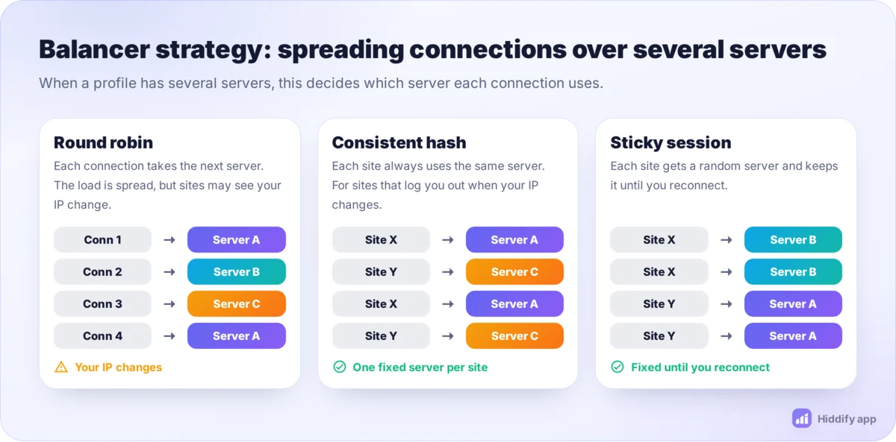
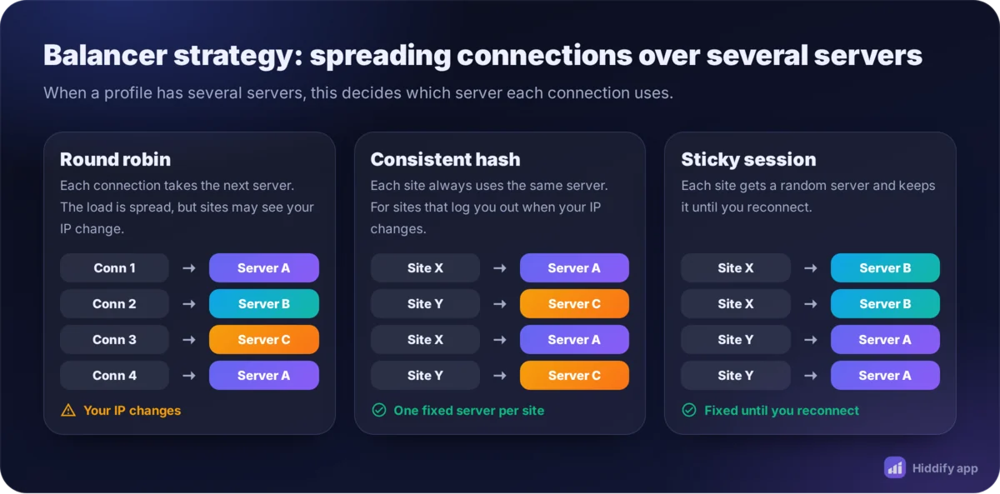

# How the Hiddify app picks a server

Many profiles have more than one server. As long as you don't pick one yourself on the proxies page, the app decides which server your traffic uses. Two settings in **Settings → Routing** control this:

<svg aria-hidden="true" xmlns="http://www.w3.org/2000/svg" viewBox="0 0 24 24"><path d="M13 19h1a1 1 0 0 1 1 1h7v2h-7a1 1 0 0 1-1 1h-4a1 1 0 0 1-1-1H2v-2h7a1 1 0 0 1 1-1h1v-2H4a1 1 0 0 1-1-1v-4a1 1 0 0 1 1-1h16a1 1 0 0 1 1 1v4a1 1 0 0 1-1 1h-7v2M4 3h16a1 1 0 0 1 1 1v4a1 1 0 0 1-1 1H4a1 1 0 0 1-1-1V4a1 1 0 0 1 1-1m5 4h1V5H9v2m0 8h1v-2H9v2M5 5v2h2V5H5m0 8v2h2v-2H5Z"/></svg>
<b>Default proxy</b>Use <b>one</b> server (the fastest, or the first), or <b>spread</b> the traffic over all of them.

<svg aria-hidden="true" xmlns="http://www.w3.org/2000/svg" viewBox="0 0 24 24"><path d="M12 3c-1.27 0-2.4.8-2.82 2H3v2h1.95L2 14c-.47 2 1 3 3.5 3s4.06-1 3.5-3L6.05 7h3.12c.33.85.98 1.5 1.83 1.83V20H2v2h20v-2h-9V8.82c.85-.32 1.5-.97 1.82-1.82h3.13L15 14c-.47 2 1 3 3.5 3s4.06-1 3.5-3l-2.95-7H21V5h-6.17C14.4 3.8 13.27 3 12 3m0 2a1 1 0 0 1 1 1 1 1 0 0 1-1 1 1 1 0 0 1-1-1 1 1 0 0 1 1-1m-6.5 5.25L7 14H4l1.5-3.75m13 0L20 14h-3l1.5-3.75Z"/></svg>
<b>Balancer strategy</b>When the traffic is spread: which server each new connection goes to.

!!! tip "Two words used on this page"
    - **Ping** is how long a server takes to answer, in milliseconds (ms). Lower is faster: 85 ms is quicker than 420 ms. The app measures it by itself every now and then.
    - A **connection** is one line of traffic between an app and a site. Opening one web page usually opens several connections at once.

## Default proxy { #default-proxy }

<svg aria-hidden="true" xmlns="http://www.w3.org/2000/svg" viewBox="0 0 24 24"><path d="M12 16a3 3 0 0 1-3-3c0-1.12.61-2.1 1.5-2.61l9.71-5.62-5.53 9.58c-.5.98-1.51 1.65-2.68 1.65m0-13c1.81 0 3.5.5 4.97 1.32l-2.1 1.21C14 5.19 13 5 12 5a8 8 0 0 0-8 8c0 2.21.89 4.21 2.34 5.65h.01c.39.39.39 1.02 0 1.41-.39.39-1.03.39-1.42.01A9.969 9.969 0 0 1 2 13 10 10 0 0 1 12 3m10 10c0 2.76-1.12 5.26-2.93 7.07-.39.38-1.02.38-1.41-.01a.996.996 0 0 1 0-1.41A7.95 7.95 0 0 0 20 13c0-1-.19-2-.54-2.9L20.67 8C21.5 9.5 22 11.18 22 13Z"/></svg>
<b>Lowest ping</b>All traffic goes through <b>one</b> server: the fastest. The best choice for most people.

<svg aria-hidden="true" xmlns="http://www.w3.org/2000/svg" viewBox="0 0 24 24"><path d="M12 3c-1.27 0-2.4.8-2.82 2H3v2h1.95L2 14c-.47 2 1 3 3.5 3s4.06-1 3.5-3L6.05 7h3.12c.33.85.98 1.5 1.83 1.83V20H2v2h20v-2h-9V8.82c.85-.32 1.5-.97 1.82-1.82h3.13L15 14c-.47 2 1 3 3.5 3s4.06-1 3.5-3l-2.95-7H21V5h-6.17C14.4 3.8 13.27 3 12 3m0 2a1 1 0 0 1 1 1 1 1 0 0 1-1 1 1 1 0 0 1-1-1 1 1 0 0 1 1-1m-6.5 5.25L7 14H4l1.5-3.75m13 0L20 14h-3l1.5-3.75Z"/></svg>
<b>Balance</b>Connections are spread over <b>all</b> the servers, following the <a href="#balancer-strategy">Balancer strategy</a>.

<svg aria-hidden="true" xmlns="http://www.w3.org/2000/svg" viewBox="0 0 24 24"><path d="M10 7v2h2v8h2V7h-4m2-5a10 10 0 0 1 10 10 10 10 0 0 1-10 10A10 10 0 0 1 2 12 10 10 0 0 1 12 2Z"/></svg>
<b>First proxy</b>Always the <b>first</b> server of the profile, fast or not.

As soon as you pick a server yourself on the proxies page, that server is used and this setting waits in the background.

### Lowest ping: calm, not jumpy

The fastest server can change from minute to minute. If the app moved your traffic at every small change, calls and downloads would keep breaking, so it only moves when it is really worth it.

In this example the profile has three servers, A, B and C:

Example

1Right after connecting, before the speed test:Athe first server in the list (it may not answer)

2The test showsA <small>520 ms</small>B <small>85 ms</small>Ball traffic moves to the fastest

3LaterC <small>70 ms</small>BC is only a little faster: no switch

4B stops working:BCthe next one takes over at once

- After a switch, the app stays on the new server for at least 30 seconds.
- It switches only when another server is clearly faster: by more than 30 ms **and** more than 20%. If the server fails, it switches at once.
- Connections that are already open stay on the server they started on.

## Balancer strategy { #balancer-strategy }

When the **Default proxy** is **Balance**, the app does not send everything through one server: it spreads your connections over all the servers of the profile. The **Balancer strategy** decides which server each new connection goes to.

!!! tip "Think of a shop with three checkouts"
    Your servers are the checkouts and your connections are the customers.

    - **Round robin** sends the customers to the checkouts in turn: first, second, third, first again.
    - **Consistent hash** gives each family its own checkout, always the same one, today and tomorrow.
    - **Sticky session** sends each family to a random checkout the first time, and they keep going back to it until they leave the shop.

In the examples below the profile has three servers. The number is the server's ping: lower is faster.

A <small>85 ms</small>B <small>120 ms</small>C <small>190 ms</small>

<figure class="hi-diag">
<picture><source media="(max-width: 700px)" srcset="/assets/app/Routing-in-Hiddify-app/en-diagram-balancer-m-light.webp"></picture>
<picture><source media="(max-width: 700px)" srcset="/assets/app/Routing-in-Hiddify-app/en-diagram-balancer-m-dark.webp"></picture>
</figure>

### Round robin: everyone takes a turn

Each new connection goes to the **next server in line**: A, then B, then C, then A again.

Example

1a.comAA's turn

2a.comBB's turn: the same site, now on another server

3b.comCC's turn

4c.comAback to A

5C gets very slow (420 ms):Cit is skipped until it is fast again

- The turn moves on with each **connection**, not each click. One page opens several connections, so one page can go through several servers.
- That is why some sites sign you out or show a captcha: they see your address change.
- A server **more than twice as slow** as the fastest one is skipped, and it rejoins the turns once it is fast enough again.
- Before the first speed test finishes, every server takes a turn, even one that may not answer.
- Best for: spreading heavy traffic (downloads, many videos) over all your servers.

### Consistent hash: each site has its own server

The **name of the site** decides its server. The same site always goes to the same server, even after you reconnect.

Example

1a.comAeach site has its own server

1b.comB

1c.comC

2b.comBagain and again, every time

3B goes down:b.comAfor now

4B is back:b.comBit returns to its own server

- A "site" is its main domain: `example.com` also covers `www.example.com` and `mail.example.com`. A connection without a name goes by its IP address.
- The name decides, not the speed, so a site may get a slower server (here `c.com` stays on C).
- A site keeps its server as long as your list of servers stays the same; adding or removing a server can move some sites.
- If its server goes down or becomes more than twice as slow as the fastest, the site uses another one for a while and comes back later.
- Best for: sites you log in to (banks, email, social media), on every device and after every reconnect.

### Sticky session: the first server sticks

The first time you open a site, it gets a **random** server, and it keeps that server until you disconnect.

Example

1a.comBfirst visit: picked at random

2a.comBthe site keeps its server

3B goes down:a.comCit moves to another one

4B is back:a.comCit stays where it is now

5You reconnect: every site gets a new random server.

- A "site" means the same as in Consistent hash.
- Unlike Consistent hash, a site that moved does **not** go back, and a reconnect forgets every pick.
- Each device picks for itself: on another device that shares your connection, the same site may use another server.
- The app remembers up to 1000 sites; past that, the oldest one is forgotten and gets a new pick.
- A server more than twice as slow as the fastest counts as down.
- Best for: logging in to sites, while still spreading different sites over different servers.

### Which one should I choose?

| | Round robin | Consistent hash | Sticky session |
|---|---|---|---|
| One site, one server? | No | Yes | Yes |
| After a reconnect | — | Same server | New random server |
| When its server is back | — | Returns to it | Stays where it is |
| Good for | Heavy downloads | Logins | Logins, more mixing |

In every strategy, connections that are already open stay on the server they started on (unless it goes down); only new connections follow the strategy. If sites keep signing you out or asking for a captcha, switch from **Round robin** to **Consistent hash** or **Sticky session**.

## Related articles

- [Routing in the Hiddify app](Routing-in-Hiddify-app.md)
- [Choose which apps use the VPN](Per-app-routing-in-Hiddify-app.md)
- [Chain, Extra security and Proxy unblocker](Chain-Extra-security-and-Proxy-unblocker.md)
- [How to use the Hiddify app](How-to-use-Hiddify-app.md)

