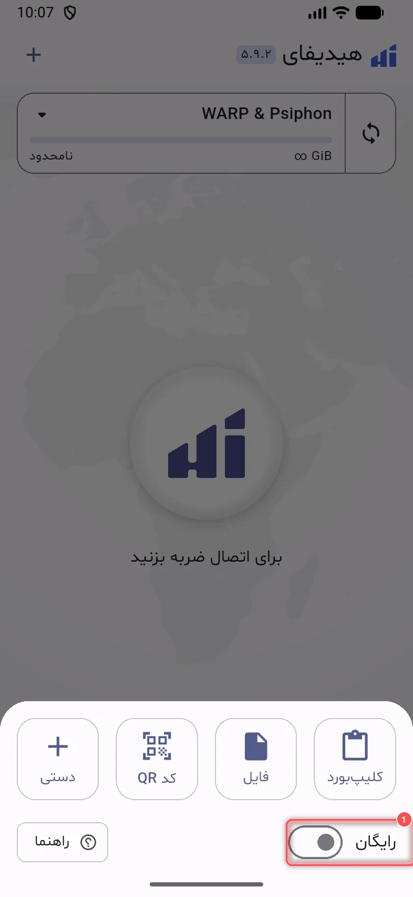
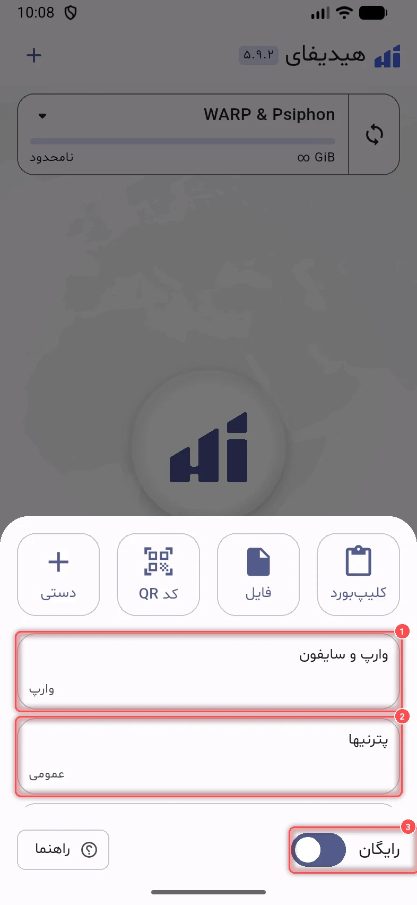
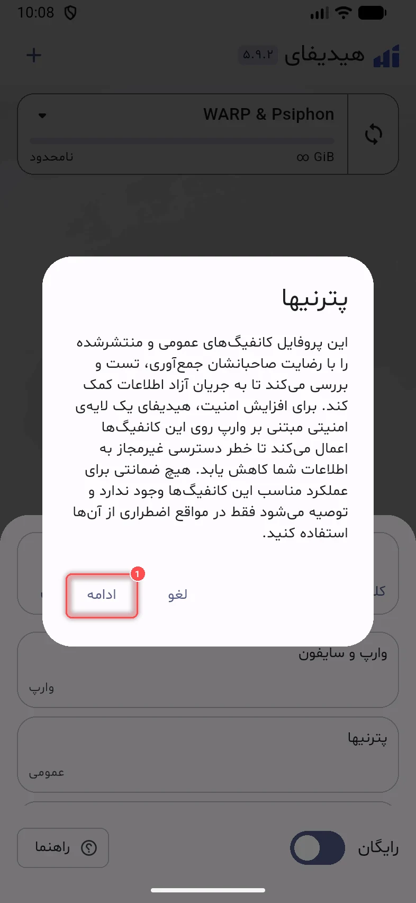

# پروفایل‌های رایگان اپ هیدیفای

هنوز سرور یا لینکی ندارید؟ اپ هیدیفای چند **پروفایل رایگان** دارد که با یک ضربه اضافه می‌شوند. این پروفایل‌ها برای شرایط اضطراری هستند: افراد زیادی هم‌زمان از آن‌ها استفاده می‌کنند و تضمینی برای کار کردنشان نیست.

!!! note "نوشته‌شده برای اپ هیدیفای نسخهٔ ۵.۹"
    این صفحه برای اپ هیدیفای **نسخهٔ ۵.۹** (۵.۹.۲) است. فهرست پروفایل‌های رایگان از اینترنت گرفته می‌شود، پس ممکن است بدون به‌روزرسانی اپ تغییر کند. پروفایل‌هایی که می‌بینید به **منطقه**‌ای بستگی دارد که انتخاب کرده‌اید (تنظیمات ← مسیریابی).

## افزودن پروفایل رایگان

1. در صفحهٔ خانه، **+** (**افزودن پروفایل**) را در بالای صفحه بزنید.
2. کلید **رایگان** را در پایین پنل روشن کنید.

    

3. پروفایل‌های رایگان ظاهر می‌شوند، هر کدام با یک برچسب (**وارپ**، **عمومی** یا **سرورلس**). یکی را بزنید.

    

4. توضیح پروفایل را بخوانید و برای افزودنش **ادامه** را بزنید (یا **لغو**).

    

پروفایل مثل هر پروفایل دیگری اضافه می‌شود و خودش به‌روز می‌شود.

## پروفایل‌های رایگان

| پروفایل | برچسب | برای | چیست |
|---|---|---|---|
| **وارپ و سایفون** | وارپ | ایران، چین و مناطق دیگر | وارپ کلادفلر (یک VPN رایگان مبتنی بر وایرگارد) و سایفون. با افزودنش با شرایط استفاده و سیاست حریم خصوصی وارپ کلادفلر موافقت می‌کنید. |
| **پترنیها** | عمومی | ایران | کانفیگ‌های عمومی که با رضایت صاحبانشان منتشر شده‌اند، جمع‌آوری، تست و بررسی شده‌اند. |
| **انانیموس** | عمومی | ایران | کانفیگ‌های عمومی از مجموعه‌ای دیگر، با همان روش تست شده. |
| **مهسا** | عمومی | ایران | کانفیگ‌های عمومی از مجموعه‌ای دیگر، با همان روش تست شده. |
| **انانیموس سرورلس** | سرورلس | ایران | کانفیگ‌هایی بدون هیچ سرور واسطه: با قابلیت‌های هستهٔ هیدیفای مستقیم به سایت‌ها وصل می‌شوند. فقط برای سرویس‌هایی کار می‌کنند که در سطح آی‌پی مسدود نشده باشند. ممکن است چند نسخه داشته باشد: اگر یکی روی شبکهٔ شما کار نکرد، دیگری را امتحان کنید. |

کانفیگ‌های پروفایل‌های **عمومی** را افراد ناشناس اداره می‌کنند. برای محافظت از ترافیکتان می‌توانید [امنیت بیشتر](Chain-Extra-security-and-Proxy-unblocker.md) را روشن کنید. این گزینه یک لایهٔ **وارپ** یا **سایفون** بعد از کانفیگ اضافه می‌کند: ترافیک شما از وارپ یا سایفون خارج می‌شود و گردانندگان کانفیگ آن را نمی‌بینند. این گزینه خودکار روشن نمی‌شود؛ برای هر کانفیگ عمومی یا رایگان، خودتان روشنش کنید.

!!! warning "هشدار"
    هیچ تضمینی برای کار کردن کانفیگ‌های رایگان نیست. فقط در شرایط اضطراری از آن‌ها استفاده کنید و رمز یا اطلاعات حساس را از کانفیگی که به آن اعتماد ندارید نفرستید.

## مقاله‌های مرتبط

- [نصب اپ هیدیفای](How-to-install-Hiddify-app.md)
- [آموزش کار با اپ هیدیفای](How-to-use-Hiddify-app.md)
- [آموزش استفاده از وارپ روی اپ هیدیفای](How-to-use-WARP-on-Hiddify-App.md)
- پروفایل رایگانی نمی‌بینید؟ **تنظیمات ← مسیریابی ← منطقه** را بررسی کنید: بیشتر پروفایل‌های رایگان برای ایران هستند.

