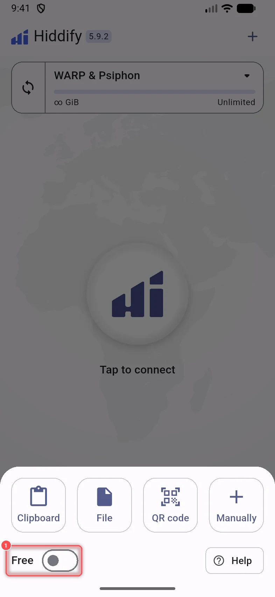
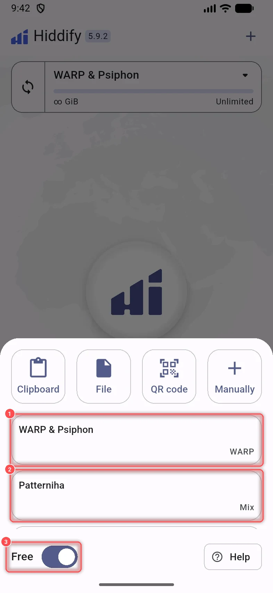
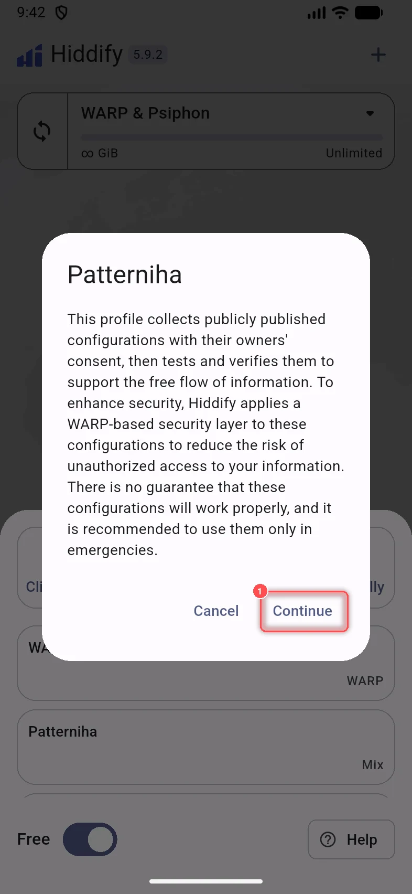

# Free profiles in the Hiddify app

No server and no link yet? The Hiddify app has a few **free profiles** you can add with one tap. They are meant for emergencies: they are shared by many people and there is no guarantee that they work.

!!! note "Written for Hiddify app 5.9"
    This page is for Hiddify app **5.9** (5.9.2). The list of free profiles is loaded from the internet, so it can change without an app update. The profiles shown depend on the **Region** you chose (Settings → Routing).

## Add a free profile

1. On the Home page, tap **+** (**Add profile**) at the top.
2. Turn on **Free** at the bottom of the panel.

    

3. The free profiles appear, each with a tag (**WARP**, **Mix** or **Serverless**). Tap one.

    

4. Read the note about the profile, then tap **Continue** to add it (or **Cancel**).

    

The profile is added like any other profile, and updates itself.

## The free profiles

| Profile | Tag | For | What it is |
|---|---|---|---|
| **WARP & Psiphon** | WARP | Iran, China and other regions | Cloudflare WARP (a free WireGuard VPN) and Psiphon. Adding it means you agree to Cloudflare WARP's terms of service and privacy policy. |
| **Patterniha** | Mix | Iran | Public configs, published with their owners' consent, collected, tested and checked. |
| **Anonymous** | Mix | Iran | Public configs from another collection, tested the same way. |
| **Mahsa** | Mix | Iran | Public configs from another collection, tested the same way. |
| **Anonymous Serverless** | Serverless | Iran | Configs with no server in between: they use features of the Hiddify core to reach sites directly. They only work for services that are not blocked by IP. The profile may have several variants: if one does not work on your network, try another. |

The configs in the **Mix** profiles are run by people you don't know. For more safety, you can turn on [Extra security](Chain-Extra-security-and-Proxy-unblocker.md). It adds a **WARP** or **Psiphon** layer after the config: your traffic leaves through WARP or Psiphon, so the people who run the config cannot see it. It is not turned on automatically; turn it on yourself for any public or free config.

!!! warning
    There is no guarantee that free configs work. Use them only in emergencies, and don't send passwords or other sensitive information through a config you don't trust.

## Related articles

- [How to install the Hiddify app](How-to-install-Hiddify-app.md)
- [How to use the Hiddify app](How-to-use-Hiddify-app.md)
- [How to use WARP in the Hiddify app](How-to-use-WARP-on-Hiddify-App.md)
- No free profile shows up? Check **Settings → Routing → Region**: most free profiles are for Iran.

