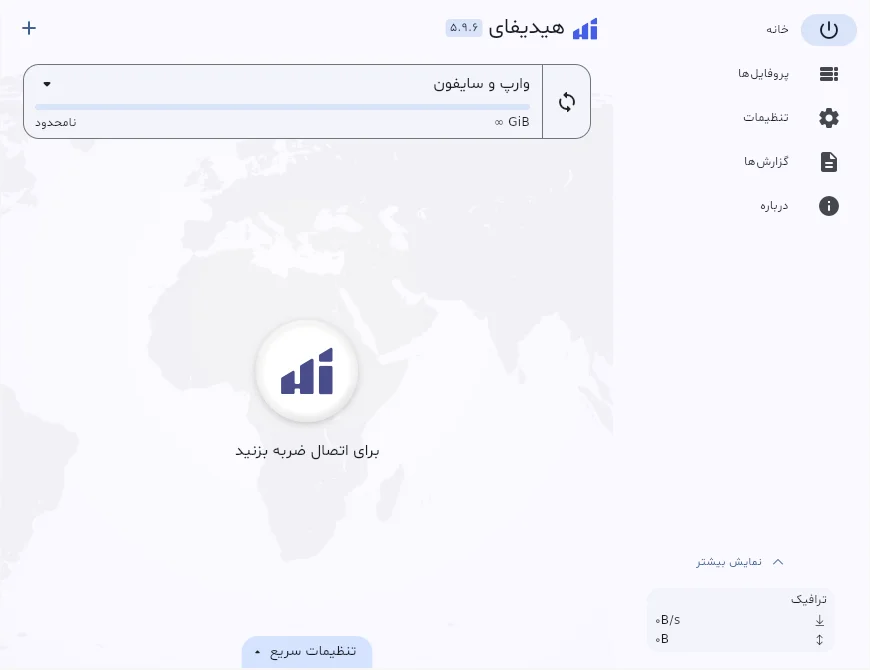
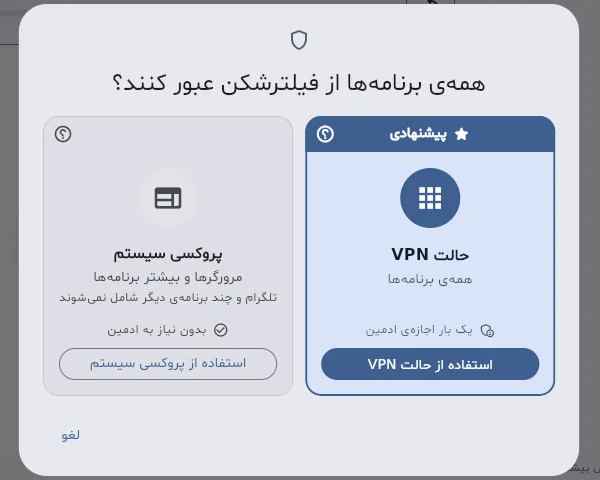
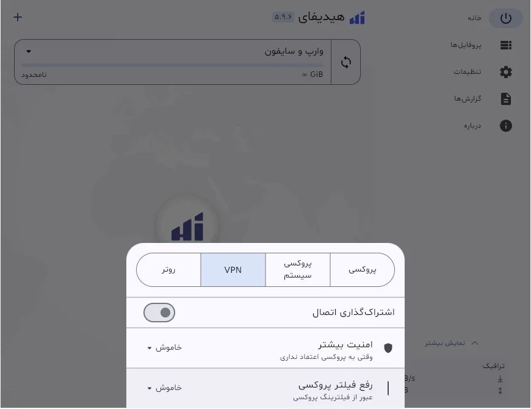

# اپ هیدیفای روی کامپیوتر: VPN یا پروکسی سیستم، مجوز ادمین و آیکون سینی

اپ هیدیفای در ویندوز، مک و لینوکس مثل گوشی کار می‌کند، با چند چیز مخصوص خودش: این‌که ترافیک را چطور می‌فرستد (VPN یا پروکسی سیستم)، مجوز ادمینی که حالت VPN یک بار لازم دارد، آیکون سینی سیستم (tray) و اجرا شدن همراه با کامپیوتر.

!!! note "نوشته‌شده برای اپ هیدیفای نسخهٔ ۵.۹"
    این صفحه برای اپ هیدیفای **نسخهٔ ۵.۹** (۵.۹.۶) است. برای نصب، [آموزش نصب اپ هیدیفای](How-to-install-Hiddify-app.md) را ببینید. در کامپیوتر منو به‌جای برگه‌های پایین صفحه، یک نوار کناری است (**خانه**، **پروفایل‌ها**، **تنظیمات**، **گزارش‌ها**، **درباره**).

## VPN یا پروکسی سیستم؟

از نسخهٔ ۵.۹ اپ در کامپیوتر هم با حالت **VPN** شروع می‌شود. اولین بار که در حالت VPN وصل می‌شوید، می‌پرسد **همه‌ی برنامه‌ها از فیلترشکن عبور کنند؟** و دو انتخاب دارد:

- **استفاده از حالت VPN** (**همه‌ی برنامه‌ها**، پیشنهادی): هیدیفای یک شبکهٔ مجازی به کامپیوتر اضافه می‌کند و ترافیک همهٔ برنامه‌ها خودبه‌خود از آن عبور می‌کند: مرورگر، تلگرام، بازی‌ها، به‌روزرسانی‌ها. جستجوی اسم سایت‌ها (DNS) هم از هیدیفای عبور می‌کند، پس سایت‌هایی که این‌طور مسدود شده‌اند هم باز می‌شوند. **یک بار** مجوز ادمین لازم دارد تا سرویس پس‌زمینهٔ هیدیفای نصب شود؛ بعد از آن بدون پرسیدن وصل می‌شود. (نسخهٔ AppImage لینوکس هر بار هنگام اجرا می‌پرسد.) وقتی از آن استفاده می‌کنید، اپ‌های VPN دیگر را خاموش کنید.
- **استفاده از پروکسی سیستم** (**مرورگرها و بیشتر برنامه‌ها**): هیدیفای تنظیم پروکسی کامپیوتر را عوض می‌کند. برنامه‌هایی که از آن پیروی می‌کنند، مثل مرورگرها، از هیدیفای عبور می‌کنند و بقیه (تلگرام، خیلی از بازی‌ها، برخی ابزارهای به‌روزرسانی) مستقیم وصل می‌شوند. مجوز ادمین لازم ندارد و هیدیفای هنگام قطع اتصال تنظیم را برمی‌گرداند.

**این چیست؟** در همان پنجره هر دو را توضیح می‌دهد. اگر پروکسی سیستم را انتخاب کنید، اپ می‌گوید **به حالت پروکسی سیستم رفت. می‌توانید در تنظیمات آن را تغییر دهید.**

وقتی حالت VPN را انتخاب می‌کنید، سیستم اجازه می‌خواهد: در ویندوز **Yes** را بزنید؛ در مک رمز مک را وارد کنید؛ در لینوکس رمز کاربری‌تان را. اگر آن پنجره را لغو کنید یا رمز را اشتباه بزنید، اپ پیغامی نشان می‌دهد که اجازهٔ ادمین داده نشد و حالت VPN وصل نشد (`Administrator permission was not given, so VPN mode could not connect.`). دوباره روی دکمهٔ اتصال بزنید تا همان دو انتخاب را ببینید، یا **استفاده از پروکسی سیستم** را بزنید.

## تغییر حالت در آینده

- **تنظیمات ← ورودی ← حالت سرویس**: **VPN**، **تنظیم پروکسی سیستم**، **فقط سرویس پروکسی** (فقط برنامه‌هایی که خودتان روی پروکسی محلی، پورت 12334، تنظیم می‌کنید) و در لینوکس **روتر (کل شبکه)**؛ [حالت روتر در لینوکس](Router-mode-on-Linux.md) را ببینید.
- **تنظیمات سریع** در صفحهٔ خانه، یا منوی آیکون سینی.

روی **تنظیمات سریع** پایین صفحهٔ خانه بزنید: چهار دکمهٔ بالای آن حالت را عوض می‌کنند (روتر فقط در لینوکس هست).

## مجوز ادمین برای یک پروفایل

برخی تنظیمات یک پروفایل با مجوز ادمین بهتر کار می‌کنند. آن‌وقت اپ می‌پرسد **مجوز ادمین توصیه می‌شود**: **اجرا با ادمین**، یا **ادامه بدون ادمین** (آن تنظیمات برای این اتصال خاموش می‌شوند). **نمایش پیکربندی‌ها** نشان می‌دهد کدام تنظیمات مجوز لازم دارند و **برای این پروفایل دوباره نپرس** جوابتان را به خاطر می‌سپارد.

این جواب را در صفحهٔ پروفایل (⋮ پروفایل ← **ویرایش**) می‌توانید عوض کنید: **مجوز ادمین**: **هر بار بپرس**، **همیشه از ادمین استفاده کن** یا **همیشه بدون ادمین ادامه بده**.

## آیکون سینی سیستم

اپ یک آیکون در سینی سیستم می‌گذارد (در لینوکس، در نوار بالا). منوی آن این‌ها را دارد:

- **داشبورد** (لینوکس): پنجره را باز می‌کند.
- **اتصال** / **قطع اتصال**.
- **حالت سرویس**: جابه‌جایی بین حالت‌ها.
- **خروج**: اپ را می‌بندد و اتصال را قطع می‌کند.

## اجرا با کامپیوتر و بستن پنجره

در **تنظیمات ← عمومی**:

- **شروع هنگام ورود به سیستم**: اپ وقتی وارد حساب کامپیوتر می‌شوید باز می‌شود.
- **شروع در حالت کمینه**: اپ بدون پنجره، در سینی سیستم شروع می‌شود.
- **هنگام بستن پنجره**: **هر بار بپرس**، پنهان کردن در سینی (اتصال برقرار می‌ماند) یا خروج از اپ. وقتی پرسیده می‌شود (**پنهان کردن یا خروج از برنامه؟**)، **انتخابم را به خاطر بسپار** جوابتان را ذخیره می‌کند.

## تنظیمات دیگری که فقط در کامپیوتر هستند

- **تنظیمات ← عمومی ← استفاده از TLS سیستم در صورت امکان**: اتصال‌هایی که اثرانگشت TLS ندارند از TLS خود ویندوز یا مک استفاده می‌کنند.
- **تنظیمات ← ورودی** پورت‌های اضافه دارد: **پورت مستقیم**، و در لینوکس و مک **پورت پروکسی شفاف** و **پورت تغییر مسیر** هم.
- قانون‌های مسیریابی می‌توانند **نام‌های فرآیند** و **مسیرهای فرآیند** را تطبیق دهند (مثلاً `chrome.exe`): [مسیریابی در اپ هیدیفای](Routing-in-Hiddify-app.md) را ببینید.

## مقاله‌های مرتبط

- [کار با اپ هیدیفای](How-to-use-Hiddify-app.md): افزودن پروفایل، اتصال و تنظیمات پایه

- [اشتراک‌گذاری اتصال](Share-your-connection.md)
- [گزارش‌ها و گزارش مشکل](Logs-and-reporting-a-problem.md)

