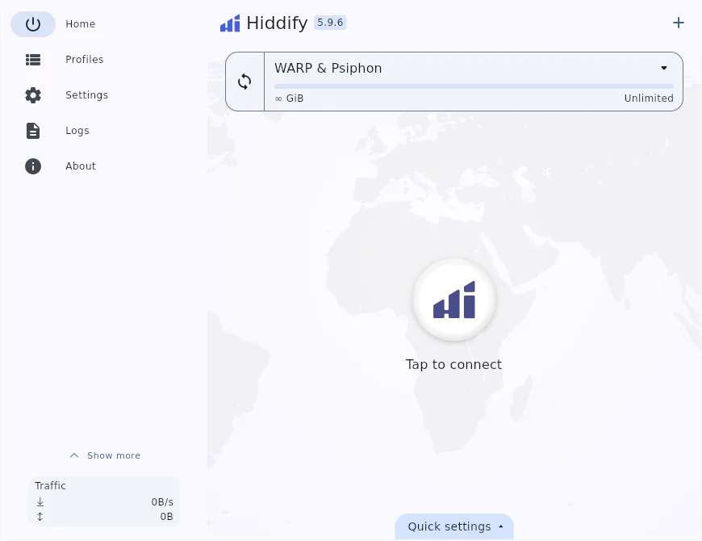
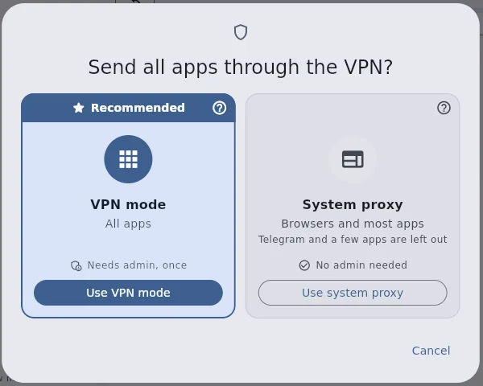
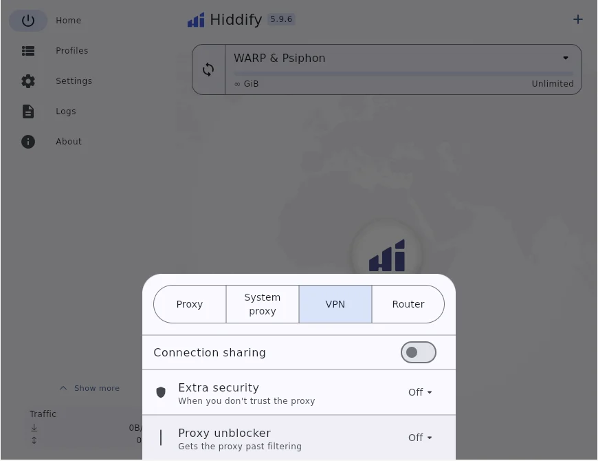

# The Hiddify app on a computer: VPN or system proxy, administrator permission, tray

On Windows, macOS and Linux, the Hiddify app works like on a phone, with a few things of its own: how it sends your traffic (VPN or system proxy), the administrator permission that VPN mode needs once, the tray icon, and starting with your computer.

!!! note "Written for Hiddify app 5.9"
    This page is for Hiddify app **5.9** (5.9.6). To install the app, see [How to install the Hiddify app](How-to-install-Hiddify-app.md). On a computer the menu is a sidebar on the left (**Home**, **Profiles**, **Settings**, **Logs**, **About**) instead of the tabs at the bottom.

## VPN or system proxy?

Since 5.9 the app starts in **VPN** mode on computers too. The first time you connect in VPN mode, it asks **Send all apps through the VPN?** with two choices:

- **Use VPN mode** (**All apps**, recommended): Hiddify adds a virtual network to your computer, and every app goes through it on its own: browsers, Telegram, games, updates. Name lookups (DNS) go through Hiddify too, so sites blocked that way open as well. It needs administrator permission **once**, to install Hiddify's background service; after that it connects without asking. (The Linux AppImage asks at each start.) Turn off other VPN apps while you use it.
- **Use system proxy** (**Browsers and most apps**): Hiddify changes your computer's proxy setting. Apps that follow it, such as browsers, go through Hiddify; the rest (Telegram, many games, some update tools) connect directly. No administrator permission is needed, and Hiddify puts the setting back when you disconnect.

**What is this?** in that window explains both. If you pick the system proxy, the app says **Switched to system proxy mode. You can change it in Settings.**

When you choose VPN mode, the system asks for permission: on Windows click **Yes**; on macOS enter your Mac password; on Linux enter your password. If you cancel that prompt or type a wrong password, the app shows **Administrator permission was not given, so VPN mode could not connect.** Tap connect again to get the same choice, or pick **Use system proxy**.

## Change the mode later

- **Settings → Inbound → Service mode**: **VPN**, **Set system proxy**, **Proxy service only** (only apps you point at the local proxy, port 12334), and on Linux **Router (whole network)**, see [Router mode on Linux](Router-mode-on-Linux.md).
- The **Quick settings** on the Home page, or the tray icon menu.

Click **Quick settings** at the bottom of the Home page: the four buttons at the top switch the mode (Router appears on Linux only).

## Administrator permission for a profile

Some settings of a profile work better with administrator permission. Then the app asks **Administrator permission recommended**: **Run as administrator**, or **Continue without administrator permission** (those settings are turned off for this connection). **Show configurations** lists which settings need it, and **Don't ask again for this profile** remembers your answer.

You can change that answer on the profile's page (profile **⋮ → Edit**): **Administrator permission**: **Ask each time**, **Always use administrator permission** or **Always continue without administrator permission**.

## Tray icon

The app puts an icon in the system tray (on Linux, in the top bar). Its menu has:

- **Dashboard** (Linux): opens the window.
- **Connect** / **Disconnect**.
- **Service mode**: switch between the modes.
- **Quit**: closes the app and disconnects.

## Start with your computer, and closing the window

In **Settings → General**:

- **Start at login**: the app opens when you sign in to your computer.
- **Start minimized**: it starts in the tray, without a window.
- **When closing the window**: **Ask each time**, hide the app to the tray (it stays connected), or exit it. When asked (**Hide or exit the app?**), **Remember this choice** saves your answer.

## Other settings only on computers

- **Settings → General → Use the system's TLS when available**: connections without a TLS fingerprint use the TLS of Windows or macOS.
- **Settings → Inbound** has extra ports: **Direct port**, and on Linux and macOS also **Transparent proxy port** and **Redirect port**.
- Routing rules can match **Process names** and **Process paths** (for example `chrome.exe`): see [Choose which apps use the VPN](Per-app-routing-in-Hiddify-app.md#on-a-computer).

## Related articles

- [How to use the Hiddify app](How-to-use-Hiddify-app.md): add a profile, connect, the basic settings

- [Share your connection](Share-your-connection.md)
- [Logs and reporting a problem](Logs-and-reporting-a-problem.md)

