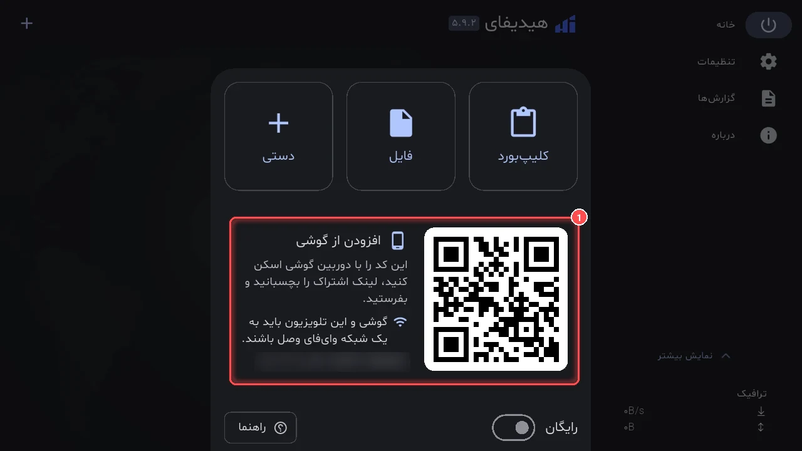
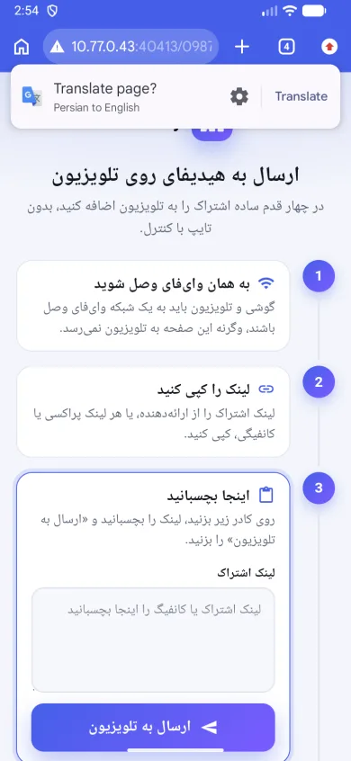
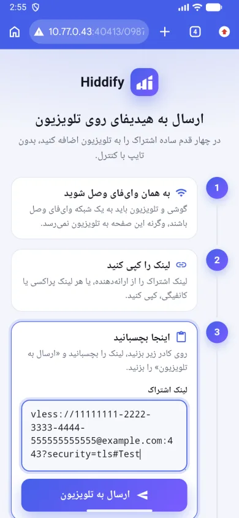
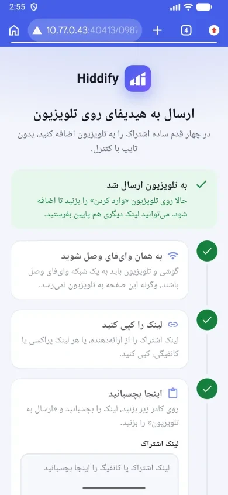
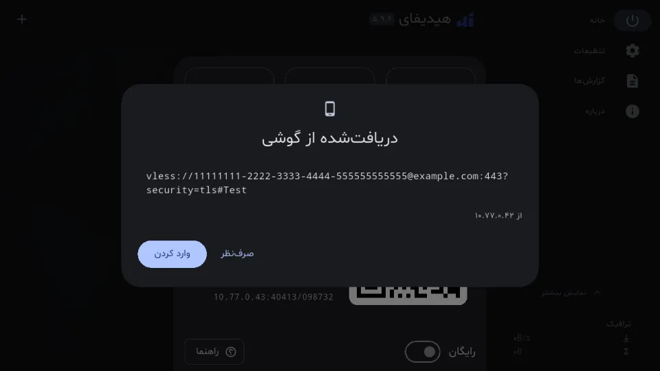
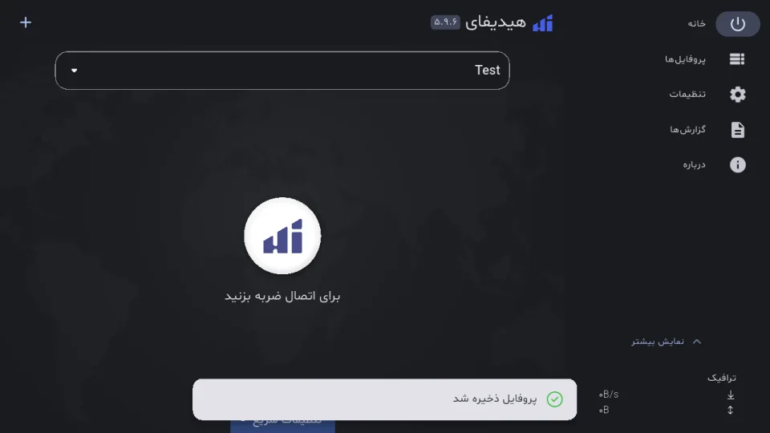
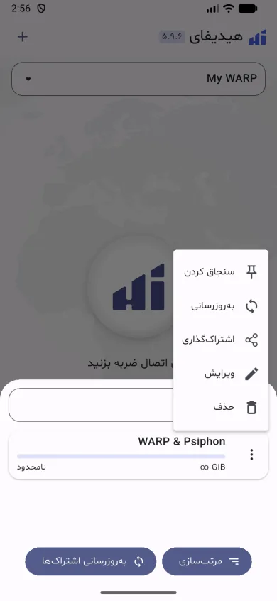
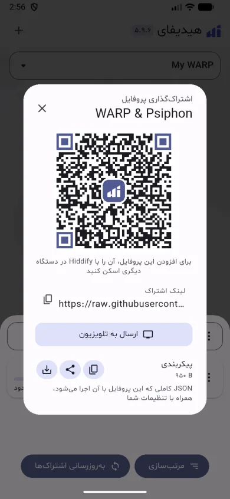

# اپ هیدیفای روی اندروید تی‌وی: افزودن پروفایل از گوشی

تایپ یک لینک اشتراک طولانی با کنترل تلویزیون کند است. از نسخهٔ ۵.۹، اپ هیدیفای روی اندروید تی‌وی می‌تواند لینک را از گوشی بگیرد: کدی را روی تلویزیون اسکن می‌کنید، لینک را در گوشی می‌چسبانید و روی تلویزیون واردش می‌کنید.

!!! note "نوشته‌شده برای اپ هیدیفای نسخهٔ ۵.۹"
    این صفحه برای اپ هیدیفای **نسخهٔ ۵.۹** (۵.۹.۶) روی اندروید تی‌وی و گوگل تی‌وی است. تلویزیون از نسخهٔ اندروید اپ استفاده می‌کند: [آموزش نصب اپ هیدیفای](How-to-install-Hiddify-app.md) را ببینید. در تلویزیون منو یک نوار کناری است: **خانه**، **تنظیمات**، **گزارش‌ها**، **درباره** (و بعد از افزودن اولین پروفایل، **پروفایل‌ها**).

## افزودن پروفایل از گوشی

لازم است: تلویزیون و گوشی به **یک شبکهٔ وای‌فای** وصل باشند و لینک اشتراک روی گوشی باشد.

1. روی تلویزیون، هیدیفای را باز کنید و **+** (**افزودن پروفایل**) را در بالای صفحه انتخاب کنید.
2. پنل، **افزودن از گوشی** را با یک کد QR نشان می‌دهد.

    

3. کد را با دوربین گوشی اسکن کنید. صفحه‌ای روی گوشی باز می‌شود: **ارسال به هیدیفای روی تلویزیون**، با چهار قدم کوتاه. (برنامهٔ دوربین ندارید؟ نشانی‌ای را که زیر کد نوشته شده، مثلاً `192.168.1.20:40413/098732`، در مرورگر گوشی تایپ کنید.)
    

4. روی گوشی لینک اشتراک (یا هر لینک پروکسی یا کانفیگی) را کپی کنید، روی کادر آن صفحه بزنید، لینک را بچسبانید و **ارسال به تلویزیون** را بزنید.
    

    بعد کادر سبز **به تلویزیون ارسال شد** بالای صفحه ظاهر می‌شود و هر سه قدم تیک می‌خورند. صفحه باز می‌ماند تا اگر خواستید لینک دیگری هم بفرستید.

    

5. لینک روی تلویزیون نمایش داده می‌شود (**دریافت‌شده از گوشی**). با کنترل **وارد کردن** را بزنید، یا اگر لینک اشتباه است **صرف‌نظر** را. تا **وارد کردن** را نزنید چیزی اضافه نمی‌شود.
    

    پروفایل در صفحهٔ خانهٔ تلویزیون است و آمادهٔ اتصال:

    

پنل بعد از هر بار وارد کردن بسته می‌شود. برای فرستادن لینک دیگر، **+** (**افزودن پروفایل**) را روی تلویزیون دوباره باز کنید.

!!! info "نکته"
    - صفحهٔ روی گوشی فقط تا وقتی **افزودن پروفایل** روی تلویزیون باز است کار می‌کند، و فقط در شبکهٔ محلی شما. چیزی از اینترنت عبور نمی‌کند.
    - اگر تلویزیون گفت به شبکهٔ محلی وصل نیست، آن را به وای‌فای وصل کنید.
    - بعد از تعداد زیادی کد اشتباه، تلویزیون کد را قفل می‌کند: **افزودن پروفایل** را ببندید و دوباره باز کنید تا کد تازه‌ای بگیرید.

## از اپ هیدیفای روی گوشی

اگر پروفایل از قبل در اپ هیدیفای گوشی هست، لازم نیست لینک را کپی کنید:

1. روی تلویزیون **+** (**افزودن پروفایل**) را باز کنید تا کد نمایش داده شود.
2. روی گوشی منوی **⋮** پروفایل را باز کنید و **اشتراک‌گذاری** را بزنید. پنجرهٔ اشتراک‌گذاری دکمهٔ **ارسال به تلویزیون** دارد: آن را بزنید و کد روی تلویزیون را اسکن کنید.
    

    

    **ارسال به تلویزیون** فقط برای پروفایل‌هایی هست که لینک اشتراک دارند. برای پروفایلی که از یک کانفیگ تکی ساخته‌اید، لینکش را کپی کنید و از صفحهٔ بالا استفاده کنید.

3. روی تلویزیون **وارد کردن** را بزنید.

اگر گوشی گفت به تلویزیون نرسید، بررسی کنید هر دو به یک وای‌فای وصل باشند. اگر گفت کد منقضی شده، **افزودن پروفایل** را روی تلویزیون دوباره باز کنید و کد تازه را اسکن کنید.

## راه‌های دیگر

پنل **افزودن پروفایل** روی تلویزیون **کلیپ‌بورد**، **فایل** و **دستی** را هم دارد، همراه با کلید **رایگان** برای [پروفایل‌های رایگان](Free-profiles-in-Hiddify-app.md).

## بقیهٔ کارها مثل اندروید است

تلویزیون همان اپ اندروید را اجرا می‌کند. بعد از افزودن پروفایل، اتصال، انتخاب سرور، تنظیمات، [مسیریابی](Routing-in-Hiddify-app.md)، [وارپ](How-to-use-WARP-on-Hiddify-App.md)، [ترفندهای DNS و TLS](DNS-and-TLS-tricks-in-Hiddify-app.md) و [اشتراک‌گذاری اتصال](Share-your-connection.md) همه مثل گوشی کار می‌کنند؛ فقط صفحه پهن‌تر است و با کنترل (جهت‌ها و OK) جابه‌جا می‌شوید. برای کارهای پایه، [آموزش کار با اپ هیدیفای](How-to-use-Hiddify-app.md) را ببینید.

## مقاله‌های مرتبط

- [آموزش کار با اپ هیدیفای](How-to-use-Hiddify-app.md)

