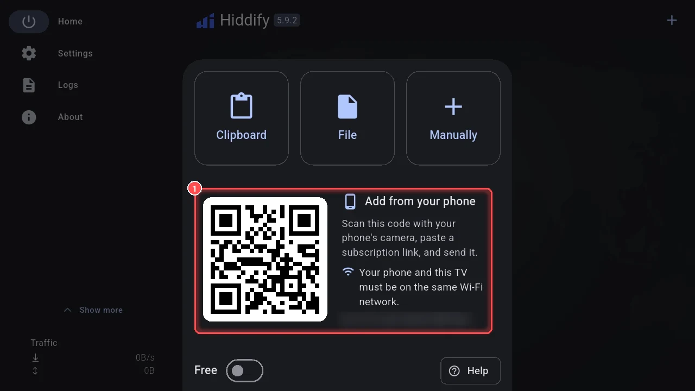
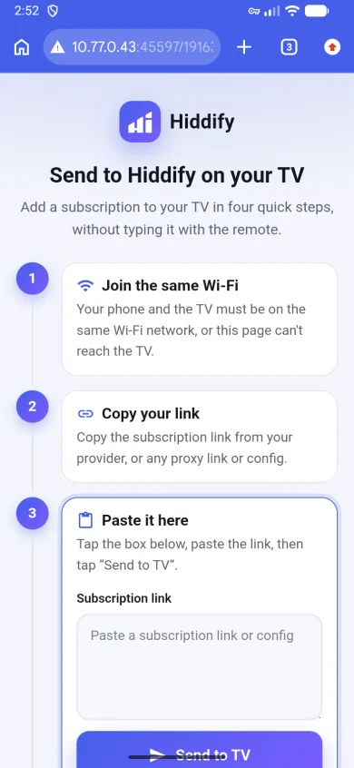
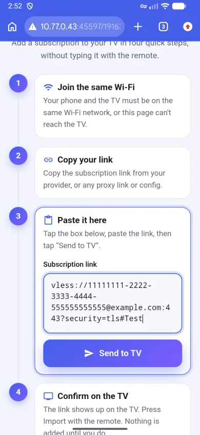
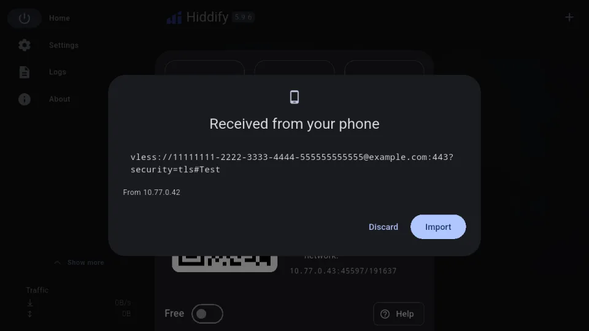
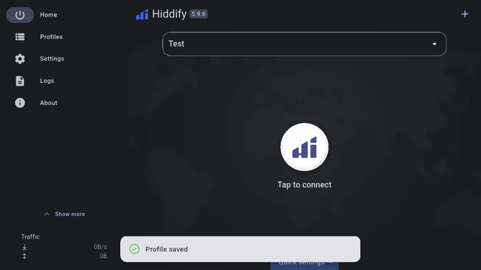
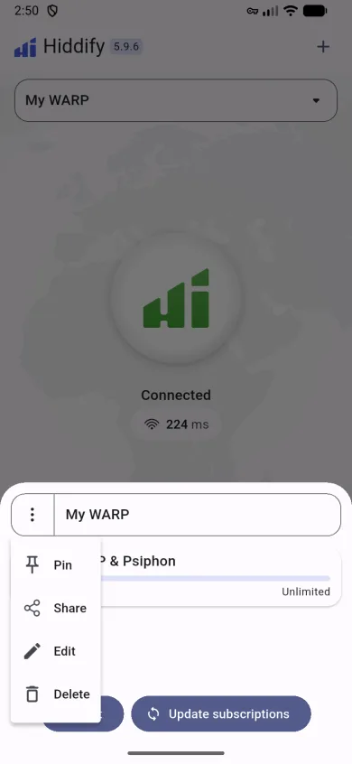
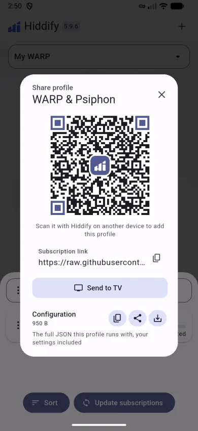

# The Hiddify app on Android TV: add a profile from your phone

Typing a long subscription link with a TV remote is slow. Since version 5.9, the Hiddify app on Android TV can take the link from your phone instead: scan a code on the TV, paste the link on your phone, and import it on the TV.

!!! note "Written for Hiddify app 5.9"
    This page is for Hiddify app **5.9** (5.9.6) on Android TV and Google TV. The TV uses the Android app: see [How to install the Hiddify app](How-to-install-Hiddify-app.md). On the TV the menu is a sidebar on the left: **Home**, **Settings**, **Logs**, **About** (and **Profiles** once you have added a profile).

## Add a profile from your phone

You need: the TV and your phone on the **same Wi-Fi network**, and your subscription link on the phone.

1. On the TV, open Hiddify and choose **+** (**Add profile**) at the top.
2. The panel shows **Add from your phone** with a QR code.

    

3. Scan the code with your phone's camera. A page opens on the phone: **Send to Hiddify on your TV**, with four short steps. (No camera app? Type the address shown under the code, for example `192.168.1.20:40413/098732`, into the phone's browser.)
    

4. On the phone, copy your subscription link (or any proxy link or config), tap the box on that page, paste the link, and tap **Send to TV**. The page then says the link was sent.
    

5. The link shows up on the TV (**Received from your phone**). Press **Import** with the remote, or **Discard** if it is the wrong link. Nothing is added until you press **Import**.
    

    The profile is on the TV's home page, ready to connect:

    

The panel closes after each import. To send another link, open **+** (**Add profile**) on the TV again.

!!! info
    - The page on the phone works only while **Add profile** is open on the TV, and only on your local network. Nothing goes over the internet.
    - If the TV says it is not on a local network, connect it to Wi-Fi.
    - After too many wrong codes the TV locks the code: close **Add profile** and open it again for a new one.

## From the Hiddify app on your phone

If the profile is already in the Hiddify app on your phone, you don't need to copy the link:

1. On the TV, open **+** (**Add profile**) so that the code shows.
2. On the phone, open the profile's **⋮** menu and choose **Share**. The share window has a **Send to TV** button: tap it and scan the code on the TV.
    

    

    **Send to TV** is there only for profiles that have a subscription link. For a profile you made from a single config, copy its link and use the page above instead.

3. Press **Import** on the TV.

If the phone says it couldn't reach the TV, check that both are on the same Wi-Fi. If it says the code expired, open **Add profile** on the TV again and scan the new code.

## Other ways

The **Add profile** panel on the TV also has **Clipboard**, **File** and **Manually**, and the **Free** switch for the [free profiles](Free-profiles-in-Hiddify-app.md).

## Everything else works like on Android

The TV runs the same Android app. After the profile is added, connecting, choosing a server, the settings, [routing](Routing-in-Hiddify-app.md), [WARP](How-to-use-WARP-on-Hiddify-App.md), [DNS and TLS tricks](DNS-and-TLS-tricks-in-Hiddify-app.md) and [sharing the connection](Share-your-connection.md) work as on a phone; only the layout is wider and you move with the remote (arrows and OK). See [How to use the Hiddify app](How-to-use-Hiddify-app.md) for the basics.

## Related articles

- [How to use the Hiddify app](How-to-use-Hiddify-app.md)

