<div markdown="1" dir="rtl">

# آموزش نصب اپ هیدیفای

در این صفحه یاد می‌گیرید برنامهٔ هیدیفای را روی گوشی یا کامپیوتر خود دانلود و نصب کنید. اپ هیدیفای یک برنامهٔ رایگان، بدون تبلیغ و متن‌باز است که شما را به یک سرور پروکسی یا VPN وصل می‌کند تا به اینترنت آزاد دسترسی داشته باشید. اگر کسی (یا سرور هیدیفای خودتان) به شما یک کانفیگ یا لینک سابسکریپشن داده است، به این برنامه نیاز دارید.

اپ هیدیفای بر پایهٔ **sing-box** (موتوری که اتصال‌ها را برقرار می‌کند) ساخته شده است. از پروتکل‌های زیادی پشتیبانی می‌کند، از جمله VLESS، VMess، Trojan، Reality، TUIC، Hysteria، WireGuard، AmneziaWG، Naive و SSH، و لینک‌های سابسکریپشن sing-box، V2ray، Clash و Clash Meta را می‌پذیرد. [فهرست کامل امکانات](https://github.com/hiddify/hiddify-app/blob/main/README_fa.md) را در GitHub ببینید.

!!! note "نوشته‌شده برای اپ هیدیفای نسخهٔ 5.9"
    این صفحه برای اپ هیدیفای نسخهٔ **5.9** (5.9.2) است که فعلاً پیش‌انتشار است. لینک‌های دانلود زیر همیشه آخرین نسخه را می‌دهند. نسخهٔ فروشگاه‌ها (Google Play، App Store و Microsoft Store) ممکن است تا مدتی هنوز نسخهٔ پایدار 5.5.5 باشد.

## پیش از شروع

بررسی کنید که دستگاه شما پشتیبانی می‌شود:

| دستگاه | چه چیزی لازم دارید |
|---|---|
| اندروید | Android 7.0 یا جدیدتر |
| آیفون / آیپد | iOS 15 یا جدیدتر |
| ویندوز | Windows 10 (نسخهٔ 1809) یا Windows 11، نسخهٔ ۶۴ بیتی |
| مک | macOS 10.15 (Catalina) یا جدیدتر، اینتل یا Apple Silicon |
| لینوکس | لینوکس ۶۴ بیتی، x64 یا ARM64 (arm64)؛ توزیع‌های مبتنی بر Debian/Ubuntu و Fedora بهترین پشتیبانی را دارند |

!!! note "ویندوز ۷ و ویندوز ۸"
    اپ هیدیفای از ویندوز ۷ و ۸ پشتیبانی نمی‌کند.

## کدام فایل را دانلود کنم؟

ردیف مربوط به دستگاه خود را انتخاب کنید. نسخه‌های فروشگاهی خودکار به‌روز می‌شوند، اما فایل‌های GitHub نه.

| دستگاه | پیشنهاد ما | گزینه‌های دیگر |
|---|---|---|
| اندروید | [Google Play](https://play.google.com/store/apps/details?id=app.hiddify.com) | فایل APK: [universal](https://github.com/hiddify/hiddify-app/releases/latest/download/Hiddify-Android-universal.apk) (روی همهٔ گوشی‌ها کار می‌کند)، [arm64](https://github.com/hiddify/hiddify-app/releases/latest/download/Hiddify-Android-arm64.apk)، [arm7](https://github.com/hiddify/hiddify-app/releases/latest/download/Hiddify-Android-arm7.apk)، [x86_64](https://github.com/hiddify/hiddify-app/releases/latest/download/Hiddify-Android-x86_64.apk) |
| آیفون / آیپد | [App Store](https://apps.apple.com/us/app/hiddify-proxy-vpn/id6596777532) | — |
| ویندوز | [فایل نصب (.exe)](https://github.com/hiddify/hiddify-app/releases/latest/download/Hiddify-Windows-Setup-x64.exe) | [Microsoft Store](https://apps.microsoft.com/detail/9ndgwm32bnxk)، [بستهٔ MSIX](https://github.com/hiddify/hiddify-app/releases/latest/download/Hiddify-Windows-Setup-x64.Msix)، [نسخهٔ پرتابل ZIP](https://github.com/hiddify/hiddify-app/releases/latest/download/Hiddify-Windows-Portable-x64.zip)، winget |
| مک | [فایل DMG](https://github.com/hiddify/hiddify-app/releases/latest/download/Hiddify-MacOS.dmg) | [نصب‌کنندهٔ PKG](https://github.com/hiddify/hiddify-app/releases/latest/download/Hiddify-MacOS-Installer.pkg)، [App Store](https://apps.apple.com/us/app/hiddify-proxy-vpn/id6596777532) (مک‌های Apple Silicon) |
| لینوکس | دستور نصب (پایین‌تر)، که بستهٔ مناسب سیستم شما را خودش انتخاب می‌کند | [‎.deb x64](https://github.com/hiddify/hiddify-app/releases/latest/download/Hiddify-Debian-x64.deb)، [‎.deb ARM64](https://github.com/hiddify/hiddify-app/releases/latest/download/Hiddify-Debian-arm64.deb) (Debian، Ubuntu، Mint)، [‎.rpm x64](https://github.com/hiddify/hiddify-app/releases/latest/download/Hiddify-rpm-x64.rpm)، [‎.rpm ARM64](https://github.com/hiddify/hiddify-app/releases/latest/download/Hiddify-rpm-arm64.rpm) (Fedora، openSUSE)، [AppImage x64](https://github.com/hiddify/hiddify-app/releases/latest/download/Hiddify-Linux-x64.AppImage)، [AppImage ARM64](https://github.com/hiddify/hiddify-app/releases/latest/download/Hiddify-Linux-arm64.AppImage) |

همهٔ فایل‌ها در [صفحهٔ انتشارها در GitHub](https://github.com/hiddify/hiddify-app/releases/latest) هم هستند.

<div markdown="1" align=center>
 <a href="https://play.google.com/store/apps/details?id=app.hiddify.com"></a>
</div>

## نصب برنامه

بخش مربوط به دستگاه خود را باز کنید.

<details markdown="1"> <summary><b>نصب روی اندروید</b> (کلیک کنید)</summary>

**از Google Play (پیشنهادی)**

1. [صفحهٔ هیدیفای در Google Play](https://play.google.com/store/apps/details?id=app.hiddify.com) را باز کنید.
2. روی `Install` بزنید.
3. پس از پایان نصب، روی `Open` بزنید.

**با فایل APK (اگر به Google Play دسترسی ندارید)**

1. [فایل APK نسخهٔ universal](https://github.com/hiddify/hiddify-app/releases/latest/download/Hiddify-Android-universal.apk) را دانلود کنید. این فایل روی همهٔ گوشی‌های اندرویدی کار می‌کند.
2. فایل دانلودشده را از بخش اعلان‌ها یا پوشهٔ `Downloads` باز کنید.

    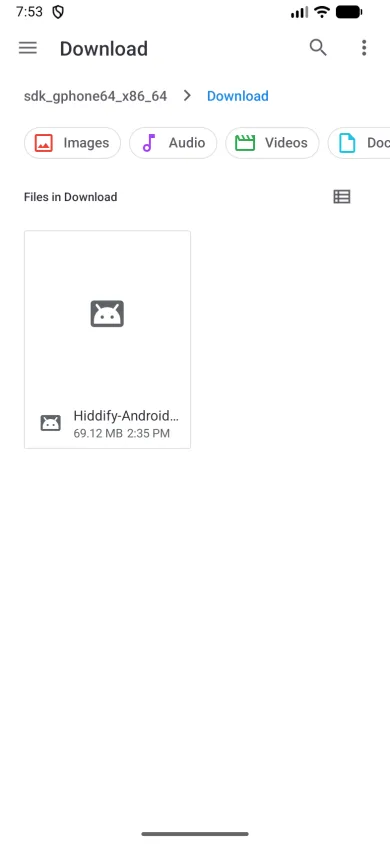

3. اندروید چند لحظه **Preparing app...** را نشان می‌دهد و بعد هشدار می‌دهد که برنامه‌های منبع ناشناس ممکن است خطرناک باشند. روی `Continue` بزنید. (در بعضی گوشی‌ها به‌جایش می‌خواهد گزینهٔ `Allow from this source` را در `Settings` روشن کنید؛ روشنش کنید و برگردید.)

    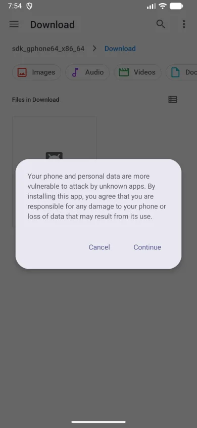

4. اندروید می‌پرسد **Install this app?**. روی `Install` بزنید.

    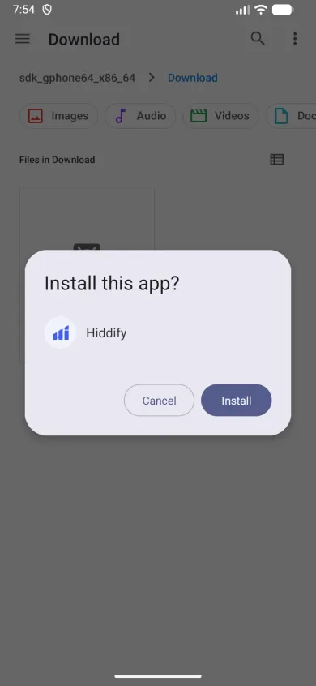

5. وقتی پیغام `App installed` را دیدید، روی `Open` بزنید (یا `Done` برای باز کردن بعدی).

    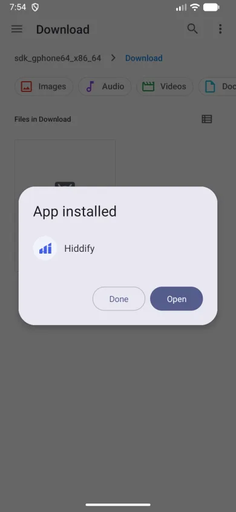

!!! tip "اگر Google Play Protect سؤال کرد"
    ممکن است Google Play Protect دربارهٔ برنامه‌ای که از بیرون Google Play نصب می‌شود هشدار بدهد. روی `More details` و بعد `Install without scanning` بزنید.

</details>
<br>

<details markdown="1"> <summary><b>نصب روی آیفون یا آیپد</b> (کلیک کنید)</summary>

1. [صفحهٔ Hiddify Proxy & VPN در App Store](https://apps.apple.com/us/app/hiddify-proxy-vpn/id6596777532) را باز کنید.
2. روی `Get` بزنید و با Face ID، Touch ID یا رمز عبور تأیید کنید. بعد از نصب، همین دکمه به `Open` تبدیل می‌شود.

    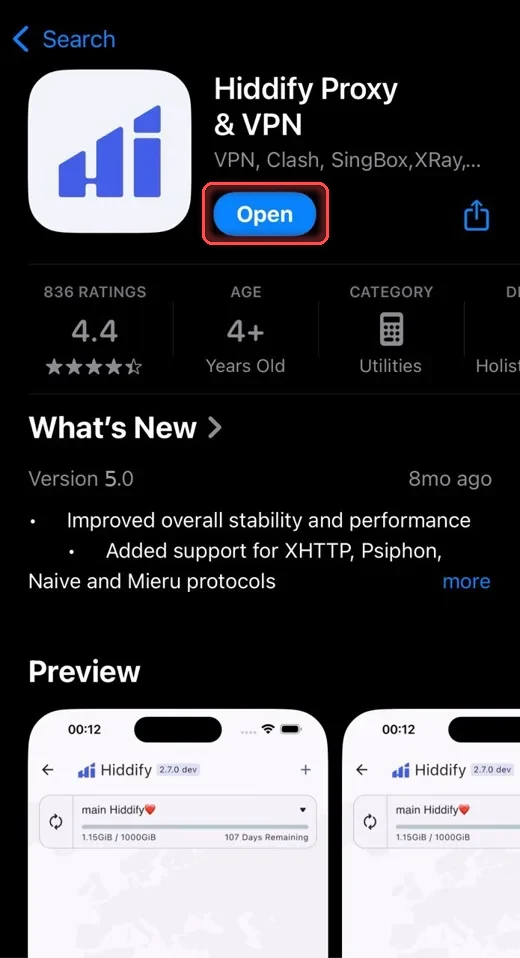

3. برنامه را باز کنید. اولین بار که وصل می‌شوید، iOS می‌پرسد هیدیفای می‌تواند تنظیمات VPN اضافه کند یا نه: روی `Allow` بزنید.

    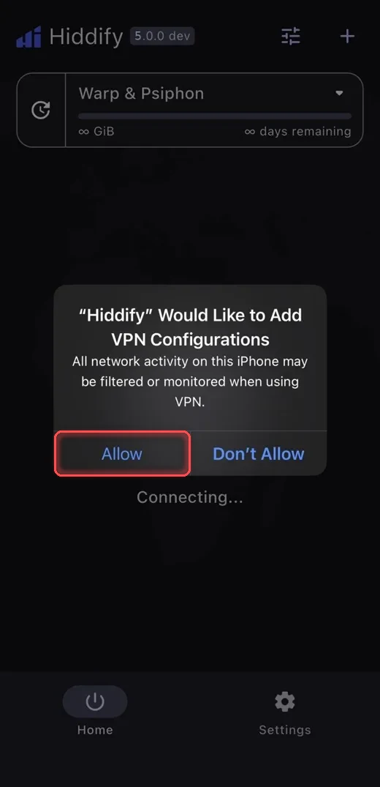

4. رمز آیفون خود را وارد کنید تا این اجازه تأیید شود. این کار فقط یک بار لازم است و دفعه‌های بعد برنامه مستقیم وصل می‌شود.

    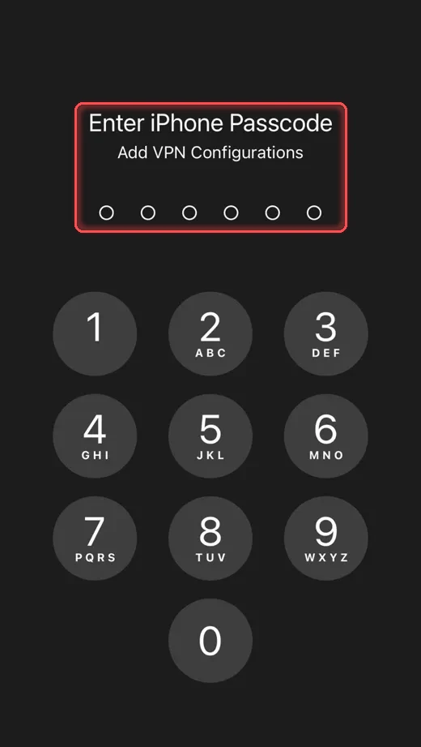

!!! note "نکته"
    این برنامه در App Store همهٔ کشورها در دسترس نیست. اگر آن را پیدا نمی‌کنید، احتمالاً کشور Apple ID شما کشوری است که برنامه در آن ارائه نمی‌شود.

</details>
<br>

<details markdown="1"> <summary><b>نصب روی ویندوز</b> (کلیک کنید)</summary>

می‌توانید برنامه را از [Microsoft Store](https://apps.microsoft.com/detail/9ndgwm32bnxk) هم نصب کنید، یا **Command Prompt** را باز کنید و این دستور را اجرا کنید:

```bash
winget install Hiddify.Next
```

(`Hiddify.Next` نام قدیمی برنامه است، اما همین نسخهٔ فعلی برنامهٔ هیدیفای را نصب می‌کند.)

برای نصب با فایل نصب:

1. [فایل نصب](https://github.com/hiddify/hiddify-app/releases/latest/download/Hiddify-Windows-Setup-x64.exe) (`Hiddify-Windows-Setup-x64.exe`) را دانلود کنید و روی آن دو بار کلیک کنید.
2. اگر پنجرهٔ آبی **Windows protected your PC** ظاهر شد، روی `More info` بزنید. ویندوز این پنجره را برای برنامه‌هایی نشان می‌دهد که هنوز آن‌ها را خوب نمی‌شناسد؛ به این معنی نیست که فایل خطرناک است.

    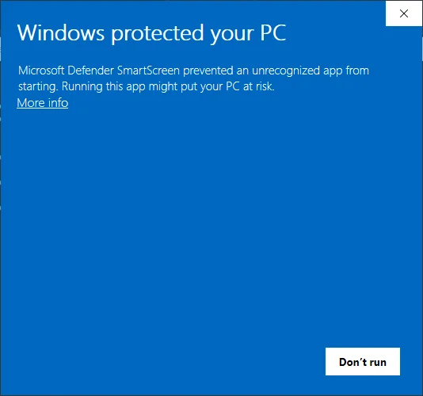

3. روی `Run anyway` بزنید.

    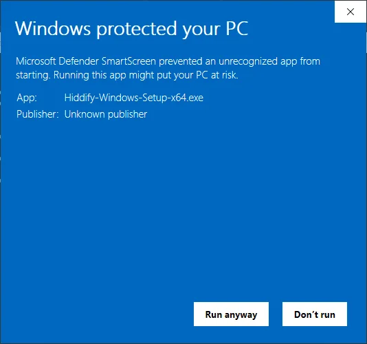

4. ویندوز می‌پرسد «آیا اجازه می‌دهید این برنامه از ناشر ناشناس تغییراتی در دستگاه شما ایجاد کند؟». روی `Yes` بزنید.

    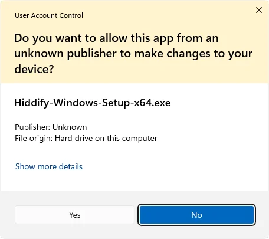

5. زبان برنامهٔ نصب را انتخاب کنید و `OK` را بزنید. (برنامهٔ نصب فارسی ندارد، ولی خود اپ فارسی دارد و زبان آن را در اولین اجرا انتخاب می‌کنید.)

    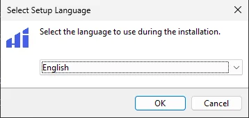

6. برنامهٔ نصب محل نصب را نشان می‌دهد. پوشهٔ پیش‌فرض را نگه دارید و `Next` را بزنید.

    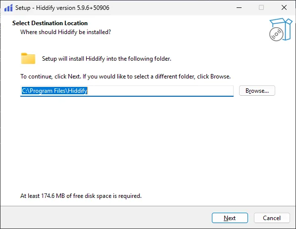

7. گزینه‌های اضافه را انتخاب کنید: میان‌بر روی دسکتاپ، و **Automatically start Hiddify** برای اجرای خودکار با روشن شدن ویندوز. `Next` را بزنید.

    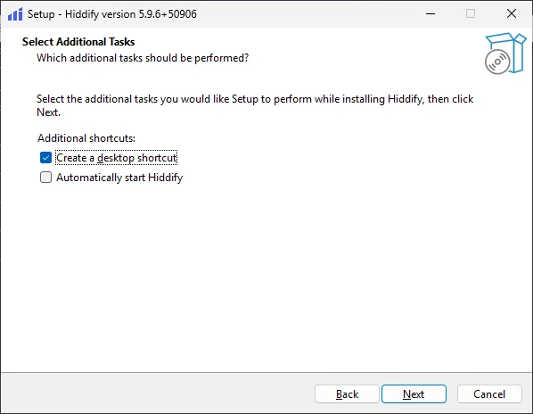

8. `Install` را بزنید و صبر کنید تا فایل‌ها کپی شوند.

    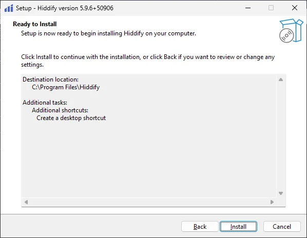

9. وقتی پنجرهٔ **Completing the Hiddify Setup Wizard** را دیدید، تیک `Launch Hiddify` را نگه دارید و `Finish` را بزنید. برنامه باز می‌شود. بعداً می‌توانید آن را از میان‌بر دسکتاپ یا منوی Start باز کنید.

    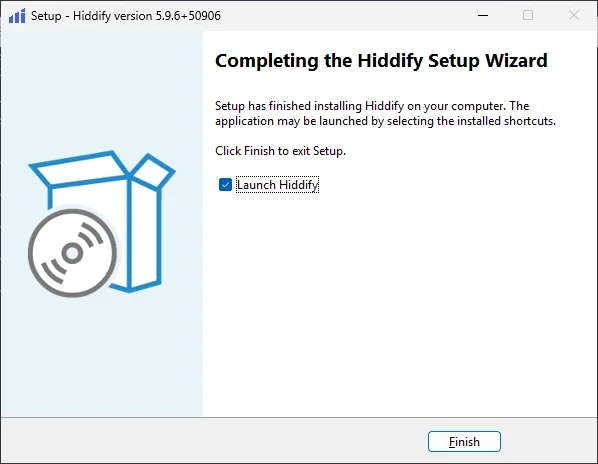

!!! tip "اگر برنامه اجرا نشد"
    اگر ویندوز خطایی دربارهٔ نبودن فایلی مثل `MSVCP140.dll` نشان داد، [Microsoft Visual C++ Redistributable (x64)](https://learn.microsoft.com/en-us/cpp/windows/latest-supported-vc-redist) را نصب کنید و دوباره امتحان کنید.

</details>
<br>

<details markdown="1"> <summary><b>نصب روی مک</b> (کلیک کنید)</summary>

اگر مک شما Apple Silicon (M1 یا جدیدتر) دارد، می‌توانید برنامه را از [App Store](https://apps.apple.com/us/app/hiddify-proxy-vpn/id6596777532) هم نصب کنید.

برای نصب با فایل DMG:

1. [فایل DMG](https://github.com/hiddify/hiddify-app/releases/latest/download/Hiddify-MacOS.dmg) (`Hiddify-MacOS.dmg`) را دانلود کنید. این فایل روی مک‌های اینتل و Apple Silicon کار می‌کند.
2. پوشهٔ `Downloads` را باز کنید و روی فایل دو بار کلیک کنید. پنجره‌ای باز می‌شود که مراحل نصب به فارسی و انگلیسی در آن نوشته شده است.

    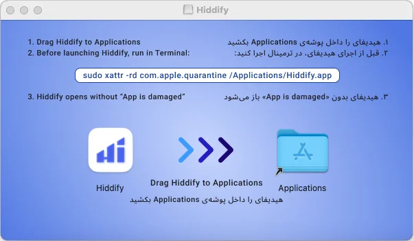

3. آیکون هیدیفای را بگیرید و روی پوشهٔ `Applications` رها کنید. با این کار برنامه روی مک شما کپی می‌شود.
4. قبل از اولین اجرای برنامه، **Terminal** را باز کنید (در `Applications > Utilities`، یا با جست‌وجو در Spotlight) و این دستور را اجرا کنید. این دستور علامت قرنطینه‌ای را که macOS روی برنامه‌های دانلودشده می‌گذارد برمی‌دارد:

    ```bash
    sudo xattr -rd com.apple.quarantine /Applications/Hiddify.app
    ```

    وقتی رمز خواست، رمز مک خود را وارد کنید (هنگام تایپ چیزی نمایش داده نمی‌شود) و `Return` را بزنید.

    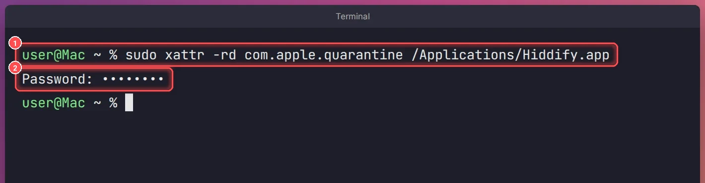

5. پوشهٔ `Applications` را باز کنید و روی هیدیفای دو بار کلیک کنید.

!!! warning "پیغام «"Hiddify" Not Opened» (یا «Hiddify.app is damaged»)"
    اگر مرحلهٔ ۴ را انجام ندهید، macOS برنامه را باز نمی‌کند. در macOS ۱۵ پیغام **"Hiddify" Not Opened: Apple could not verify "Hiddify" is free of malware…** است با دو دکمهٔ `Done` و `Move to Trash`؛ نسخه‌های قدیمی‌تر macOS می‌گویند **"Hiddify.app" is damaged and can't be opened**. برنامه مشکلی ندارد: روی `Done` (یا `Cancel`) بزنید، **نه** `Move to Trash`، دستور مرحلهٔ ۴ را اجرا کنید و برنامه را دوباره باز کنید.

    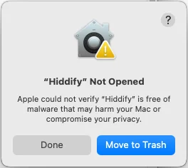

??? tip "راه دیگر: نصب‌کنندهٔ PKG از ترمینال"
    فایل [Hiddify-MacOS-Installer.pkg](https://github.com/hiddify/hiddify-app/releases/latest/download/Hiddify-MacOS-Installer.pkg) را دانلود کنید و از ترمینال نصبش کنید. برنامه بدون علامت قرنطینه نصب می‌شود و مرحلهٔ ۴ لازم نیست:

    ```bash
    sudo installer -pkg ~/Downloads/Hiddify-MacOS-Installer.pkg -target /
    ```

    اگر روی فایل .pkg در Finder دو بار کلیک کنید، همان پیغام «Not Opened» نمایش داده می‌شود، چون نصب‌کننده امضای اپل ندارد.

از این به بعد می‌توانید هیدیفای را مثل هر برنامهٔ دیگری از `Applications` باز کنید.

</details>
<br>

<details markdown="1"> <summary><b>نصب روی لینوکس</b> (کلیک کنید)</summary>

**روش ۱: دستور نصب (ساده‌ترین روش)**

ترمینال را باز کنید و این دستور را اجرا کنید:

```bash
bash <(curl -fsSL https://github.com/hiddify/hiddify-app/releases/latest/download/install.sh)
```

این اسکریپت سیستم شما را تشخیص می‌دهد (x64 یا ARM64؛ Debian/Ubuntu، Fedora/openSUSE یا سیستم‌های دیگر)، فایل مناسب همان نسخه را دانلود و بررسی می‌کند و نصبش می‌کند: در Debian و Ubuntu بستهٔ `.deb`، در Fedora و openSUSE بستهٔ `.rpm` و در سیستم‌های دیگر AppImage را. اگر سیستمتان بیش از یکی را بپذیرد، می‌پرسد کدام را می‌خواهید. اگر رمز عبور خواست، آن را وارد کنید. همین دستور روی مک هم برنامه را نصب می‌کند.

در دبیان و اوبونتو می‌پرسد **Choose 1-2 [1]**: برای **۱**، یعنی بستهٔ `.deb` همراه سرویس VPN (پیشنهادی)، `Enter` را بزنید، یا برای AppImage در `~/.local/bin` (فقط برای کاربر خودتان) عدد `2` را بنویسید. وقتی پیغام **Done. Start Hiddify from the app menu.** را نوشت، هیدیفای را از منوی برنامه‌ها باز کنید.

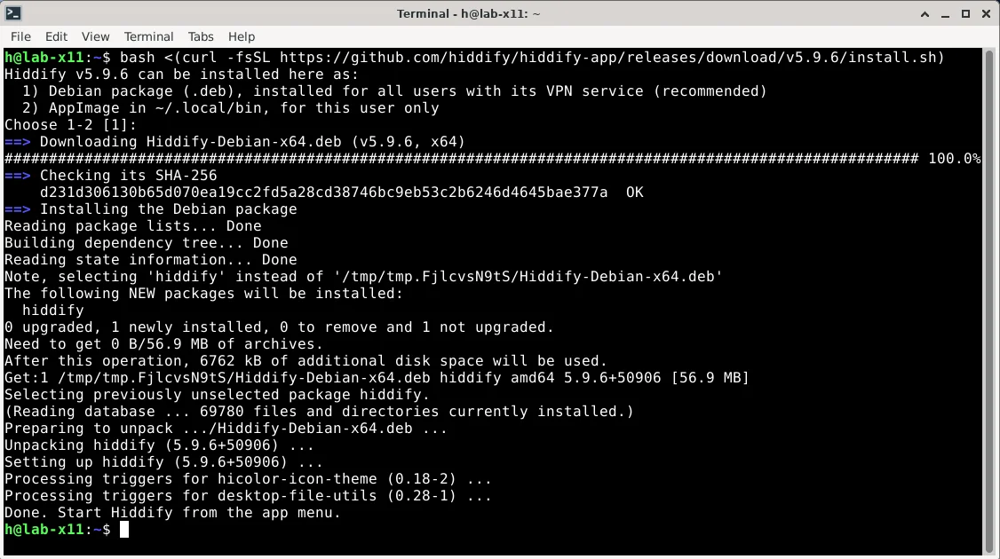


**روش ۲: AppImage (روی بیشتر توزیع‌های ۶۴ بیتی کار می‌کند)**

1. [فایل AppImage](https://github.com/hiddify/hiddify-app/releases/latest/download/Hiddify-Linux-x64.AppImage) (`Hiddify-Linux-x64.AppImage`؛ روی کامپیوتر ARM64، [Hiddify-Linux-arm64.AppImage](https://github.com/hiddify/hiddify-app/releases/latest/download/Hiddify-Linux-arm64.AppImage)) را دانلود کنید. لازم نیست آن را از حالت فشرده خارج کنید.
2. ترمینال را باز کنید و فایل را اجرایی کنید. در این مثال فرض شده فایل در پوشهٔ `Downloads` است:

    ```bash
    chmod +x ~/Downloads/Hiddify-Linux-x64.AppImage
    ```

3. برنامه را اجرا کنید:

    ```bash
    ~/Downloads/Hiddify-Linux-x64.AppImage
    ```

    می‌توانید روی فایل در File Manager هم دو بار کلیک کنید.

اگر اتفاقی نیفتاد یا خطایی دربارهٔ **FUSE** (کتابخانه‌ای از سیستم که فایل‌های AppImage به آن نیاز دارند) دیدید، آن را در ترمینال نصب کنید و دوباره امتحان کنید.

در Ubuntu 22.04:

```bash
sudo apt install libfuse2
```

در Ubuntu 24.04 و جدیدتر:

```bash
sudo apt install libfuse2t64
```

**روش ۳: بستهٔ .deb یا .rpm**

1. [بستهٔ .deb](https://github.com/hiddify/hiddify-app/releases/latest/download/Hiddify-Debian-x64.deb) (برای Debian، Ubuntu و Linux Mint) یا [بستهٔ .rpm](https://github.com/hiddify/hiddify-app/releases/latest/download/Hiddify-rpm-x64.rpm) (برای Fedora و openSUSE) را دانلود کنید. روی کامپیوتر ARM64، [‎.deb ARM64](https://github.com/hiddify/hiddify-app/releases/latest/download/Hiddify-Debian-arm64.deb) یا [‎.rpm ARM64](https://github.com/hiddify/hiddify-app/releases/latest/download/Hiddify-rpm-arm64.rpm) را بردارید.
2. در ترمینال دستور مربوط به بستهٔ خود را اجرا کنید:

    ```bash
    sudo apt install ~/Downloads/Hiddify-Debian-x64.deb
    ```

    ```bash
    sudo dnf install ~/Downloads/Hiddify-rpm-x64.rpm
    ```

3. هیدیفای را از منوی برنامه‌ها باز کنید.

</details>
<br>

## اولین اجرا

اولین بار که برنامه را باز می‌کنید، صفحهٔ خوش‌آمد با سه گزینه باز می‌شود. برنامه زبان را از تنظیمات گوشی برمی‌دارد. سه گزینه را بررسی کنید و بعد روی `شروع` بزنید.

=== "گوشی"

    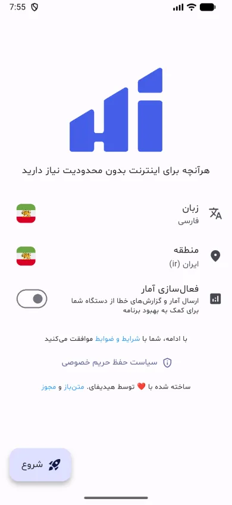

=== "کامپیوتر"

    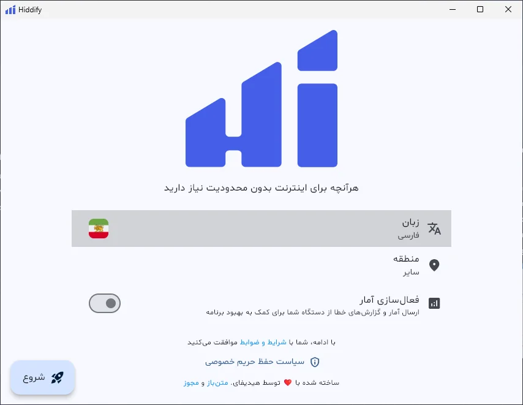

1. **زبان:** اگر زبان برنامه درست نیست، روی `زبان` بزنید و زبان خود را انتخاب کنید.
2. **منطقه:** روی `منطقه` بزنید و کشوری را که در آن هستید (مثلاً `ایران (ir)`) انتخاب کنید. انتخاب زبان فارسی منطقه را خودکار عوض نمی‌کند و پیش‌فرض آن `سایر` است. برنامه با این تنظیم سایت‌های داخلی را مستقیم و بدون پروکسی باز می‌کند. اگر کشورتان در فهرست نیست، `سایر` را انتخاب کنید.
3. **فعال‌سازی آمار:** این کلید به‌طور پیش‌فرض خاموش است. اگر روشنش کنید، برنامه گزارش‌های خطا و آمار ناشناس استفاده را می‌فرستد تا سازندگان آن را بهتر کنند.
4. روی `شروع` بزنید.

<div style="display:flex;flex-wrap:wrap;justify-content:center;gap:16px">
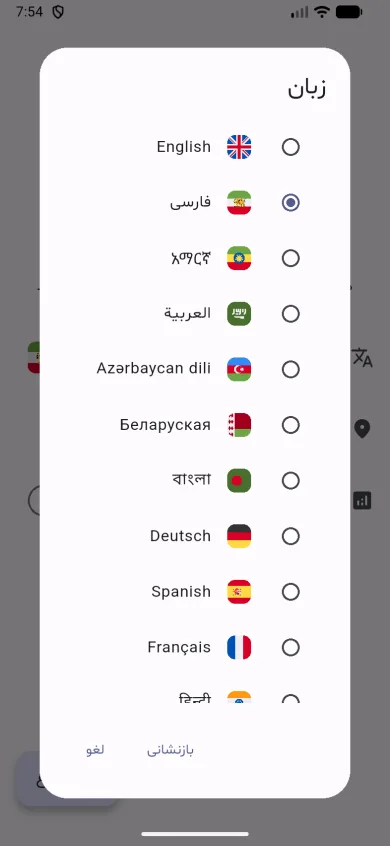
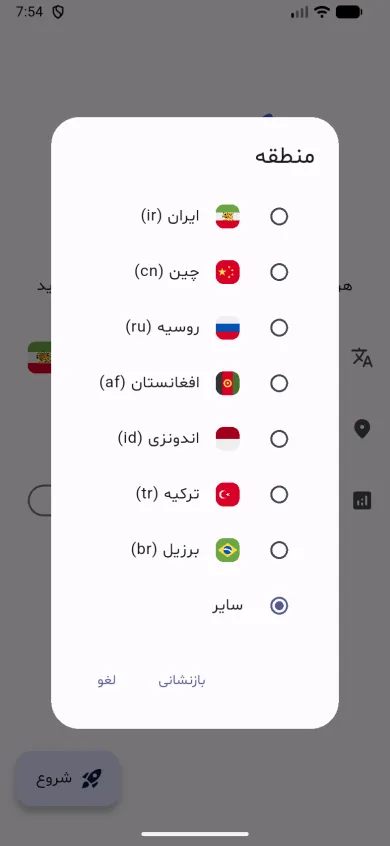
</div>

حالا صفحهٔ اصلی برنامه را می‌بینید. دفعه‌های بعد برنامه مستقیم همین صفحه را باز می‌کند. دکمهٔ `+` در بالای صفحه برای افزودن کانفیگ یا لینک سابسکریپشن است، و دکمهٔ بزرگ وسط صفحه («برای اتصال ضربه بزنید») برای وصل شدن. برچسب کوچک کنار نام برنامه، نسخهٔ برنامهٔ شما را نشان می‌دهد.

<div markdown="1" align=center>
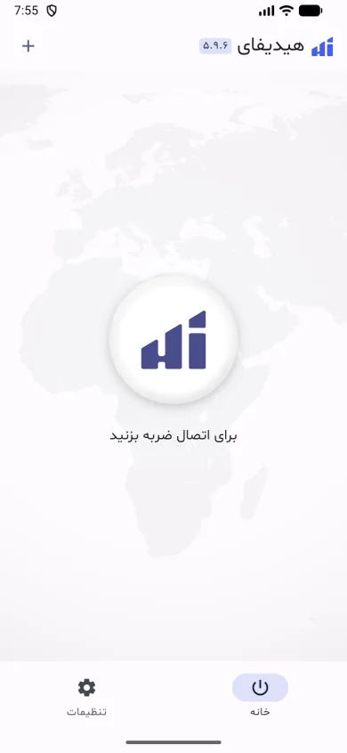
</div>

!!! note "نکته"
    تصویرهای گوشی در این صفحه از نسخهٔ ۵.۹.۶ روی اندروید ۱۷ و تصویرهای کامپیوتر از ویندوز ۱۱ هستند. در گوشی‌های دیگر ظاهر صفحه‌های سیستم ممکن است کمی فرق داشته باشد.

## قدم بعدی

برای افزودن کانفیگ یا لینک سابسکریپشن و وصل شدن، [آموزش کار با اپ هیدیفای](How-to-use-Hiddify-app.md) را بخوانید.

## مقاله‌های مرتبط

- [کار با اپ هیدیفای](/fa/app/How-to-use-Hiddify-app/)
- [پروفایل‌های رایگان](/fa/app/Free-profiles-in-Hiddify-app/)
- [وارپ در اپ هیدیفای](/fa/app/How-to-use-WARP-on-Hiddify-App/)
- [زنجیره، امنیت بیشتر و رفع فیلتر](/fa/app/Chain-Extra-security-and-Proxy-unblocker/)

</div>
