<div dir="ltr" markdown="1">

# How to install the Hiddify app

This page shows you how to download and install Hiddify app on your phone or computer. Hiddify app is a free, ad-free and open-source client that connects you to a proxy or VPN server so you can reach the free internet. You need it if someone (or your own Hiddify server) gave you a config or subscription link.

Hiddify app is built on **sing-box** (the engine that makes the connections). It supports many protocols, including VLESS, VMess, Trojan, Reality, TUIC, Hysteria, WireGuard, AmneziaWG, Naive and SSH, and it accepts sing-box, V2ray, Clash and Clash Meta subscription links. See the [full feature list](https://github.com/hiddify/hiddify-app/blob/main/README.md) on GitHub.

!!! note "Written for Hiddify app 5.9"
    This page is for Hiddify app **5.9** (5.9.2), a pre-release for now. The download links below always give you the latest version. The store versions (Google Play, App Store, Microsoft Store) may still be on the stable version 5.5.5 for a while.

## Before you start

Check that your device is supported:

| Device | What you need |
|---|---|
| Android | Android 7.0 or later |
| iPhone / iPad | iOS 15 or later |
| Windows | Windows 10 (version 1809) or Windows 11, 64-bit |
| macOS | macOS 10.15 (Catalina) or later, Intel or Apple Silicon |
| Linux | 64-bit Linux, x64 or ARM64 (arm64); Debian/Ubuntu and Fedora-based systems are best supported |

!!! note "Windows 7 and Windows 8"
    Hiddify app does not support Windows 7 or 8.

## Which file should I download?

Pick the row for your device. Store versions update themselves; the files from GitHub do not.

| Device | Recommended | Other options |
|---|---|---|
| Android | [Google Play](https://play.google.com/store/apps/details?id=app.hiddify.com) | APK file: [universal](https://github.com/hiddify/hiddify-app/releases/latest/download/Hiddify-Android-universal.apk) (works on every phone), [arm64](https://github.com/hiddify/hiddify-app/releases/latest/download/Hiddify-Android-arm64.apk), [arm7](https://github.com/hiddify/hiddify-app/releases/latest/download/Hiddify-Android-arm7.apk), [x86_64](https://github.com/hiddify/hiddify-app/releases/latest/download/Hiddify-Android-x86_64.apk) |
| iPhone / iPad | [App Store](https://apps.apple.com/us/app/hiddify-proxy-vpn/id6596777532) | — |
| Windows | [Setup file (.exe)](https://github.com/hiddify/hiddify-app/releases/latest/download/Hiddify-Windows-Setup-x64.exe) | [Microsoft Store](https://apps.microsoft.com/detail/9ndgwm32bnxk), [MSIX package](https://github.com/hiddify/hiddify-app/releases/latest/download/Hiddify-Windows-Setup-x64.Msix), [portable ZIP](https://github.com/hiddify/hiddify-app/releases/latest/download/Hiddify-Windows-Portable-x64.zip), winget |
| macOS | [DMG file](https://github.com/hiddify/hiddify-app/releases/latest/download/Hiddify-MacOS.dmg) | [PKG installer](https://github.com/hiddify/hiddify-app/releases/latest/download/Hiddify-MacOS-Installer.pkg), [App Store](https://apps.apple.com/us/app/hiddify-proxy-vpn/id6596777532) (Apple Silicon Macs) |
| Linux | Install command (below), which picks the right package for your system | [.deb x64](https://github.com/hiddify/hiddify-app/releases/latest/download/Hiddify-Debian-x64.deb), [.deb ARM64](https://github.com/hiddify/hiddify-app/releases/latest/download/Hiddify-Debian-arm64.deb) (Debian, Ubuntu, Mint), [.rpm x64](https://github.com/hiddify/hiddify-app/releases/latest/download/Hiddify-rpm-x64.rpm), [.rpm ARM64](https://github.com/hiddify/hiddify-app/releases/latest/download/Hiddify-rpm-arm64.rpm) (Fedora, openSUSE), [AppImage x64](https://github.com/hiddify/hiddify-app/releases/latest/download/Hiddify-Linux-x64.AppImage), [AppImage ARM64](https://github.com/hiddify/hiddify-app/releases/latest/download/Hiddify-Linux-arm64.AppImage) |

All files are also listed on the [GitHub releases page](https://github.com/hiddify/hiddify-app/releases/latest).

<div align=center>
 <a href="https://play.google.com/store/apps/details?id=app.hiddify.com"></a>
</div>

## Install the app

Open the section for your device.

<details markdown="1"> <summary><b>Install on Android</b> (click)</summary>

**From Google Play (recommended)**

1. Open [Hiddify on Google Play](https://play.google.com/store/apps/details?id=app.hiddify.com).
2. Tap `Install`.
3. When the install finishes, tap `Open`.

**From an APK file (if you cannot use Google Play)**

1. Download the [universal APK](https://github.com/hiddify/hiddify-app/releases/latest/download/Hiddify-Android-universal.apk). It works on every Android phone.
2. Open the downloaded file from your notifications or from the `Downloads` folder.

    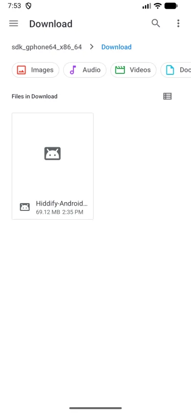

3. Android shows **Preparing app...** for a moment, then a warning that apps from unknown sources can be risky. Tap `Continue`. (On some phones it asks instead to turn on `Allow from this source` in `Settings`; turn it on and go back.)

    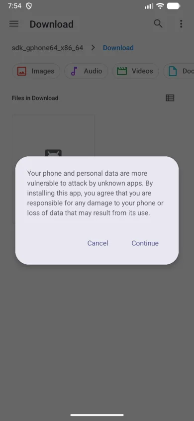

4. Android asks **Install this app?**. Tap `Install`.

    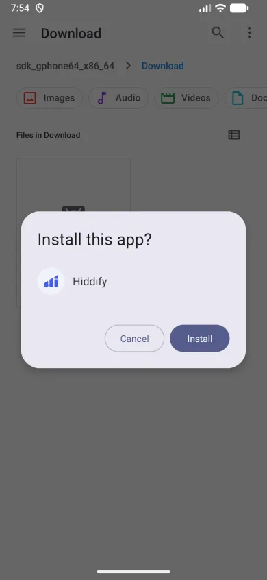

5. When you see `App installed`, tap `Open` (or `Done` to open it later).

    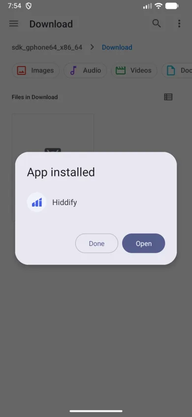

!!! tip "If Google Play Protect asks"
    Google Play Protect may warn about an app from outside Google Play. Tap `More details`, then `Install without scanning`.

</details>
<br>

<details markdown="1"> <summary><b>Install on iPhone or iPad</b> (click)</summary>

1. Open [Hiddify Proxy & VPN on the App Store](https://apps.apple.com/us/app/hiddify-proxy-vpn/id6596777532).
2. Tap `Get` and confirm with Face ID, Touch ID or your password. When it is installed, the button changes to `Open`.

    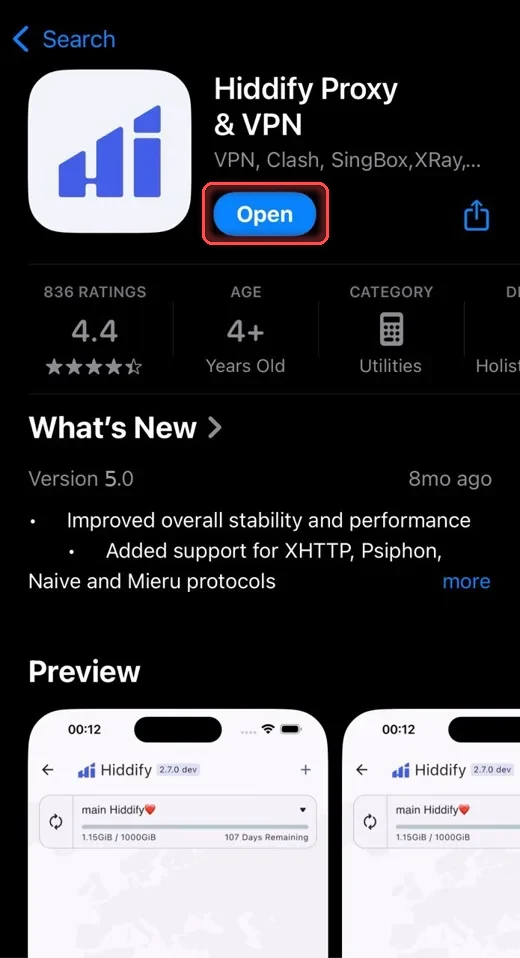

3. Open the app. The first time you connect, iOS asks if Hiddify may add VPN configurations: tap `Allow`.

    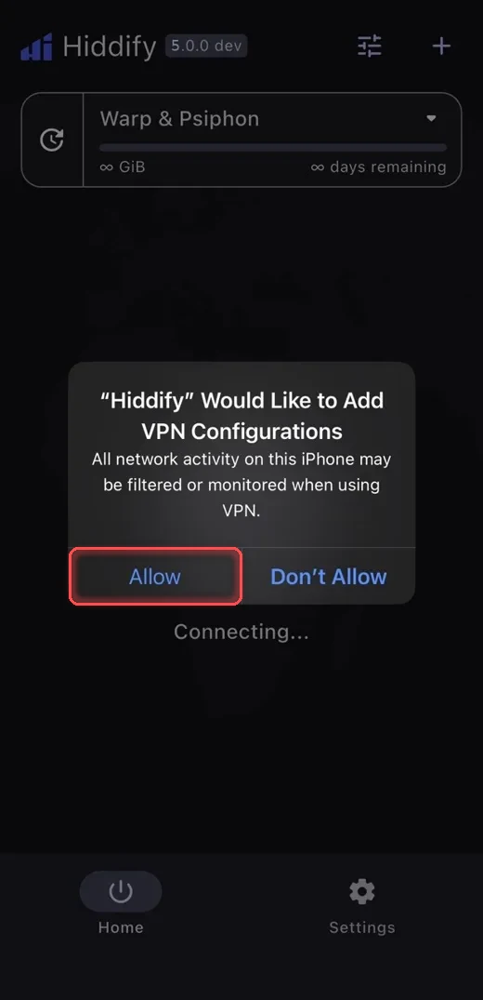

4. Enter your iPhone passcode to confirm. You only do this once; after that, the app connects directly.

    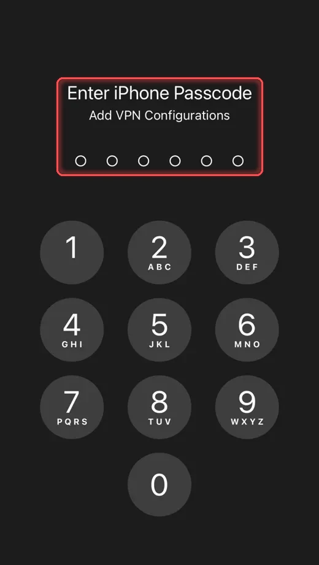

!!! note
    The app is not available in the App Store of every country. If you cannot find it, your Apple ID may be set to a country where it is not offered.

</details>
<br>

<details markdown="1"> <summary><b>Install on Windows</b> (click)</summary>

You can also install from the [Microsoft Store](https://apps.microsoft.com/detail/9ndgwm32bnxk), or open **Command Prompt** and run:

```bash
winget install Hiddify.Next
```

(`Hiddify.Next` is the app's old name; it still installs the current Hiddify app.)

To install with the setup file:

1. Download the [setup file](https://github.com/hiddify/hiddify-app/releases/latest/download/Hiddify-Windows-Setup-x64.exe) (`Hiddify-Windows-Setup-x64.exe`) and double-click it.
2. If a blue **Windows protected your PC** window appears, click `More info`. Windows shows this for apps that are not yet well known to it; it does not mean the file is harmful.

    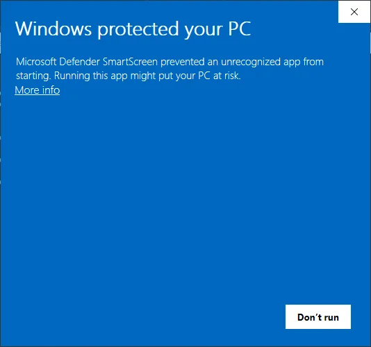

3. Click `Run anyway`.

    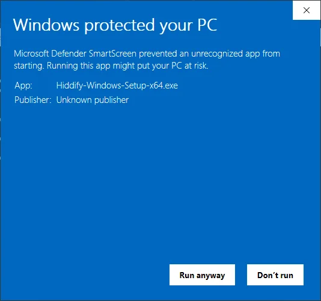

4. Windows asks "Do you want to allow this app from an unknown publisher to make changes to your device?". Click `Yes`.

    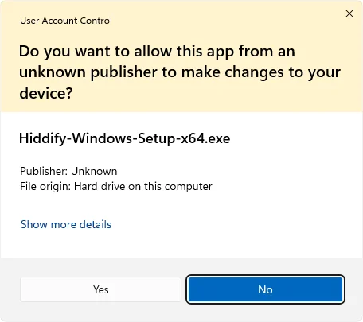

5. Choose the language of the installer and click `OK`. (The installer has no Persian; the app itself does, you choose it on the first start.)

    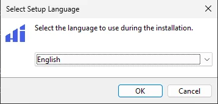

6. The installer shows where the app will be installed. Keep the default folder and click `Next`.

    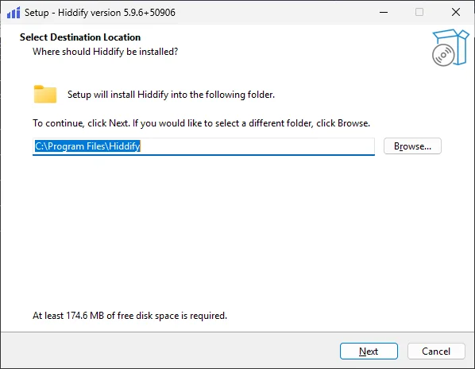

7. Choose extra options: a desktop shortcut, and **Automatically start Hiddify** when Windows starts. Click `Next`.

    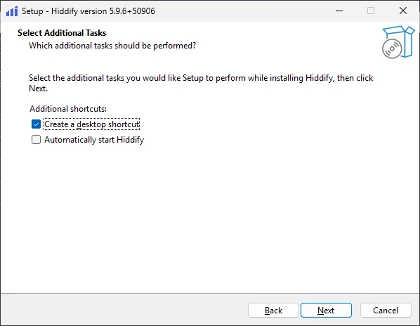

8. Click `Install`, and wait while the files are copied.

    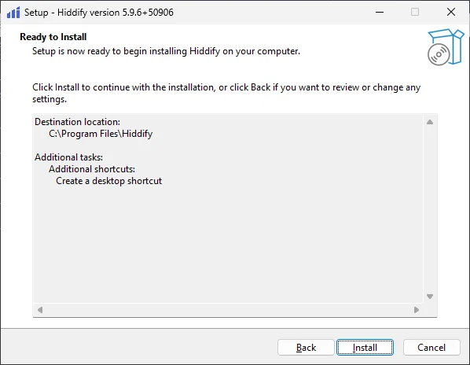

    A green bar shows the progress. It usually takes less than a minute; do not close the window or click `Cancel`.

    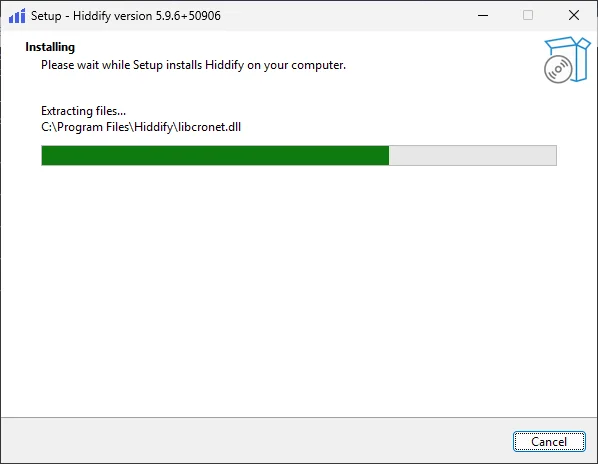

9. When you see **Completing the Hiddify Setup Wizard**, keep `Launch Hiddify` ticked and click `Finish`. The app starts. Later you can start it from the desktop shortcut or the Start menu.

    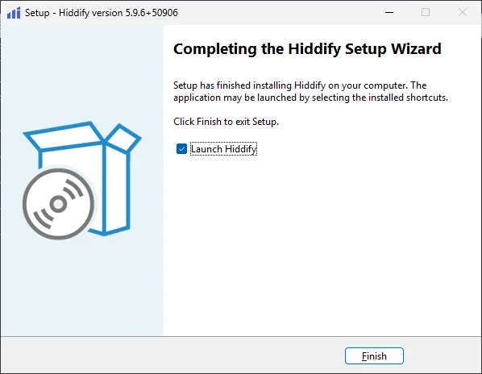

!!! tip "If the app does not start"
    If Windows shows an error about a missing file such as `MSVCP140.dll`, install the [Microsoft Visual C++ Redistributable (x64)](https://learn.microsoft.com/en-us/cpp/windows/latest-supported-vc-redist) and try again.

</details>
<br>

<details markdown="1"> <summary><b>Install on macOS</b> (click)</summary>

On a Mac with Apple Silicon (M1 or newer) you can also install from the [App Store](https://apps.apple.com/us/app/hiddify-proxy-vpn/id6596777532).

To install with the DMG file:

1. Download the [DMG file](https://github.com/hiddify/hiddify-app/releases/latest/download/Hiddify-MacOS.dmg) (`Hiddify-MacOS.dmg`). It works on both Intel and Apple Silicon Macs.
2. Open your `Downloads` folder and double-click the file. A window opens; the install steps are written in it, in English and Persian.

    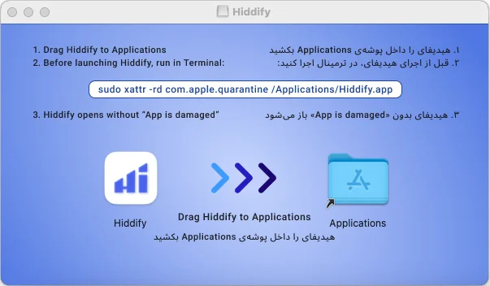

3. Drag the Hiddify icon onto the `Applications` folder. This copies the app to your Mac.
4. Before you open the app for the first time, open **Terminal** (in `Applications > Utilities`, or search for it with Spotlight) and run this command. It removes the quarantine flag that macOS adds to downloaded apps:

    ```bash
    sudo xattr -rd com.apple.quarantine /Applications/Hiddify.app
    ```

    Type your Mac password when asked (nothing appears while you type) and press `Return`.

    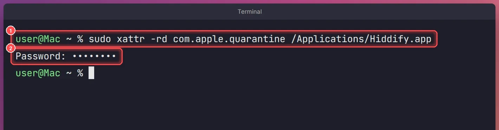

5. Open `Applications` and double-click Hiddify.

!!! warning "\"Hiddify\" Not Opened (or \"Hiddify.app\" is damaged)"
    If you skip step 4, macOS refuses to open the app. On macOS 15 the message is **"Hiddify" Not Opened: Apple could not verify "Hiddify" is free of malware…**, with the buttons `Done` and `Move to Trash`; older macOS versions say **"Hiddify.app" is damaged and can't be opened**. The app is not harmful: click `Done` (or `Cancel`), **not** `Move to Trash`, run the command from step 4, and open the app again.

    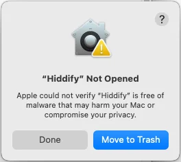

??? tip "Another way: the PKG installer from Terminal"
    Download [Hiddify-MacOS-Installer.pkg](https://github.com/hiddify/hiddify-app/releases/latest/download/Hiddify-MacOS-Installer.pkg) and install it from Terminal. The app is then installed without the quarantine flag, so step 4 is not needed:

    ```bash
    sudo installer -pkg ~/Downloads/Hiddify-MacOS-Installer.pkg -target /
    ```

    Double-clicking the .pkg file in Finder shows the same "Not Opened" message, because the installer is not signed by Apple.

From now on, you can open Hiddify from `Applications` like any other app.

</details>
<br>

<details markdown="1"> <summary><b>Install on Linux</b> (click)</summary>

**Option 1: Install command (easiest)**

Open a terminal and run:

```bash
bash <(curl -fsSL https://github.com/hiddify/hiddify-app/releases/latest/download/install.sh)
```

The script finds your system (x64 or ARM64; Debian/Ubuntu, Fedora/openSUSE or other), downloads the right file of the release, checks it and installs it: the `.deb` package on Debian and Ubuntu, the `.rpm` package on Fedora and openSUSE, and the AppImage on other systems. When your system can use more than one, it asks which one you want. Type your password when asked. The same command also installs the app on macOS.

On Debian and Ubuntu it asks **Choose 1-2 [1]**: press `Enter` for **1**, the `.deb` package with its VPN service (recommended), or type `2` for the AppImage in `~/.local/bin` (for your user only). When it prints **Done. Start Hiddify from the app menu.**, open Hiddify from your applications menu.

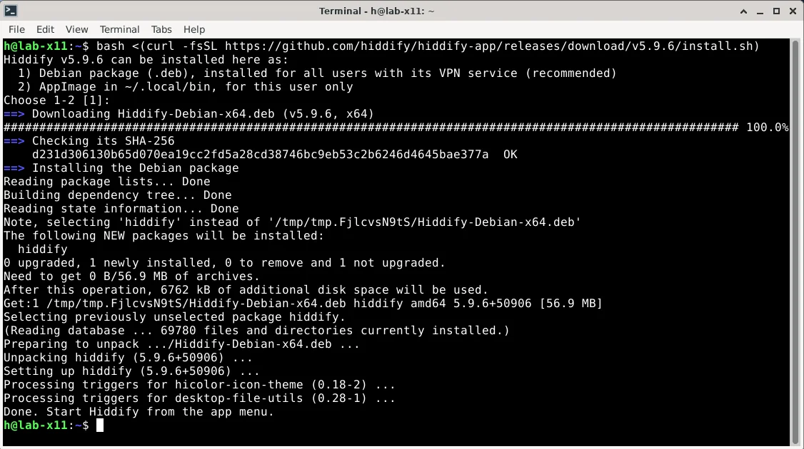


**Option 2: AppImage (works on most 64-bit distributions)**

1. Download the [AppImage file](https://github.com/hiddify/hiddify-app/releases/latest/download/Hiddify-Linux-x64.AppImage) (`Hiddify-Linux-x64.AppImage`; on an ARM64 computer, [Hiddify-Linux-arm64.AppImage](https://github.com/hiddify/hiddify-app/releases/latest/download/Hiddify-Linux-arm64.AppImage)). You do not need to extract it.
2. Open a terminal and make the file executable. This example assumes the file is in your `Downloads` folder:

    ```bash
    chmod +x ~/Downloads/Hiddify-Linux-x64.AppImage
    ```

3. Start the app:

    ```bash
    ~/Downloads/Hiddify-Linux-x64.AppImage
    ```

    You can also double-click the file in your file manager.

If nothing happens or you see an error about **FUSE** (a system library that AppImage files need), install it in a terminal and try again.

On Ubuntu 22.04:

```bash
sudo apt install libfuse2
```

On Ubuntu 24.04 and newer:

```bash
sudo apt install libfuse2t64
```

**Option 3: .deb or .rpm package**

1. Download the [.deb package](https://github.com/hiddify/hiddify-app/releases/latest/download/Hiddify-Debian-x64.deb) (Debian, Ubuntu, Linux Mint) or the [.rpm package](https://github.com/hiddify/hiddify-app/releases/latest/download/Hiddify-rpm-x64.rpm) (Fedora, openSUSE). On an ARM64 computer, take the [ARM64 .deb](https://github.com/hiddify/hiddify-app/releases/latest/download/Hiddify-Debian-arm64.deb) or the [ARM64 .rpm](https://github.com/hiddify/hiddify-app/releases/latest/download/Hiddify-rpm-arm64.rpm).
2. In a terminal, run the command for your package:

    ```bash
    sudo apt install ~/Downloads/Hiddify-Debian-x64.deb
    ```

    ```bash
    sudo dnf install ~/Downloads/Hiddify-rpm-x64.rpm
    ```

3. Open Hiddify from your applications menu.

</details>
<br>

## First start

The first time you open the app, a welcome screen with three options opens. The app picks the language from your phone's settings. Check the three options, then tap `Start`.

=== "Phone"

    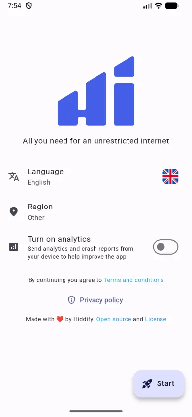

=== "Computer"

    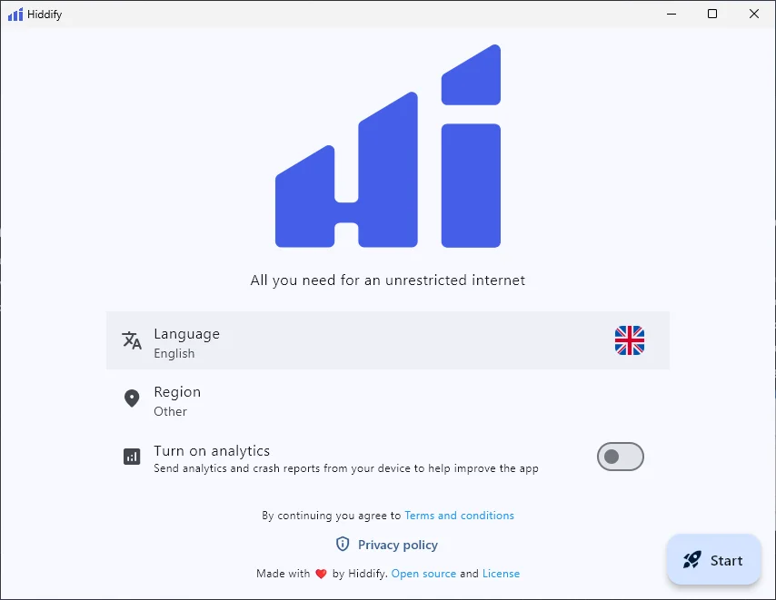

1. **Language:** if the app's language is wrong, tap `Language` and choose yours.
2. **Region:** tap `Region` and choose the country you are in (for example `Iran (ir)`). Choosing Persian as the language does not change the region by itself; the default is `Other`. The app uses this to open local websites directly, without the proxy. If your country is not in the list, choose `Other`.
3. **Turn on analytics:** this switch is off by default. If you turn it on, the app sends anonymous crash and usage data that helps the developers improve it.
4. Tap `Start`.

<div style="display:flex;flex-wrap:wrap;justify-content:center;gap:16px">
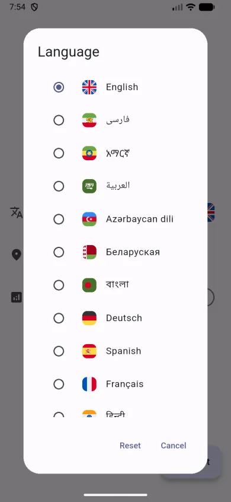
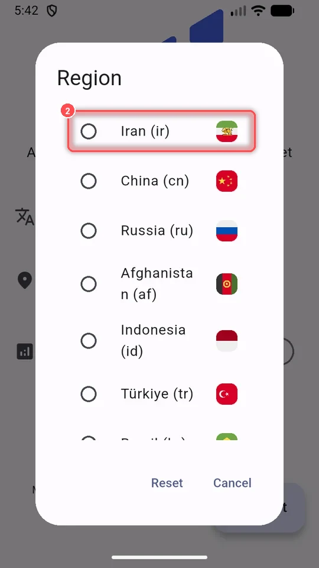
</div>

You should now see the app's home page. Next time you open the app, it goes straight to this page. The `+` button at the top adds a config or subscription link, and the big button in the middle (`Tap to connect`) connects you. The small label next to the name shows your app version.

<div align=center>
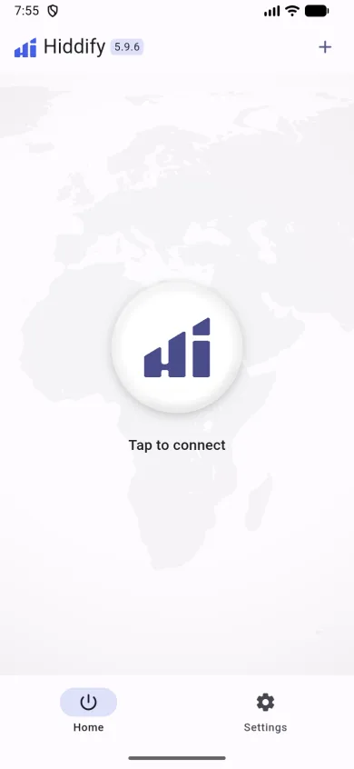
</div>

!!! note
    The phone screenshots on this page come from version 5.9.6 on Android 17, and the computer ones from Windows 11. On other phones the system screens may look a little different.

## Next step

To add your config or subscription link and connect, read [How to use the Hiddify app](How-to-use-Hiddify-app.md).

## Related articles

- [Use the Hiddify app](/app/How-to-use-Hiddify-app/)
- [Free profiles](/app/Free-profiles-in-Hiddify-app/)
- [WARP in the Hiddify app](/app/How-to-use-WARP-on-Hiddify-App/)
- [Chain, Extra security and unblocker](/app/Chain-Extra-security-and-Proxy-unblocker/)

</div>
