<div markdown="1" dir="rtl">

# آموزش کار با اپ هیدیفای

در این صفحه یاد می‌گیرید لینک اتصال خود را به اپ هیدیفای اضافه کنید، وصل شوید، سرور مناسب را انتخاب کنید و تنظیمات مهم را تغییر دهید. این آموزش برای کسی است که برنامه را نصب کرده و از ارائه‌دهندهٔ خود یا سرور هیدیفای خودش یک لینک گرفته است.

## پیش از شروع

به این موارد نیاز دارید:

1. برنامهٔ هیدیفای روی دستگاه شما نصب باشد. اگر هنوز نصب نکرده‌اید، [آموزش نصب اپ هیدیفای](How-to-install-Hiddify-app.md) را دنبال کنید.
2. یک لینک اتصال از ارائه‌دهندهٔ شما. معمولاً این لینک **صفحهٔ کاربری** شماست (صفحهٔ وبی که پنل هیدیفای برای هر کاربر می‌سازد) یا یک **لینک سابسکریپشن**. لینک ندارید؟ برنامه پروفایل رایگان هم دارد: بخش [افزودن پروفایل رایگان](#free) را ببینید.

چند اصطلاح که در این صفحه می‌بینید:

- **پروفایل**: یک لینک اتصال که در برنامه ذخیره شده است. هر پروفایل می‌تواند چند سرور داشته باشد.
- **لینک سابسکریپشن**: لینکی که فهرست سرورها را به برنامه می‌دهد و آن را خودکار به‌روز می‌کند. این لینک باید با `https://` شروع شود؛ برنامه لینک‌های سابسکریپشن `http://` را قبول نمی‌کند.
- **کانفیگ**: تنظیمات یک سرور تکی، مثلاً لینکی که با `vless://` یا `vmess://` شروع می‌شود.
- **پروکسی**: یکی از سرورهای پروفایل شما که ترافیکتان از آن عبور می‌کند.

!!! note "نکته"
    تصاویر برنامه در این صفحه از نسخهٔ 5.5.6 روی اندروید گرفته شده‌اند. روی آیفون و کامپیوتر مراحل همین است، اما ظاهر بعضی صفحه‌ها کمی فرق دارد.

## افزودن پروفایل به برنامه

1. لینک صفحهٔ کاربری خود را باز کنید (آن را از ارائه‌دهنده یا مدیر پنل گرفته‌اید). این صفحه حجم و روزهای باقی‌مانده و یک دکمهٔ بزرگ اتصال را نشان می‌دهد.

    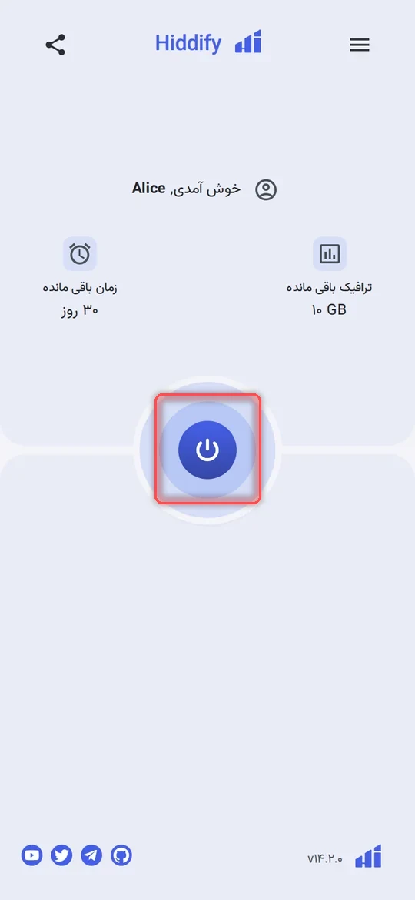

2. روی دکمهٔ بزرگ وسط صفحه بزنید. پنجرهٔ «VPN خود را پیکربندی کنید» باز می‌شود.

    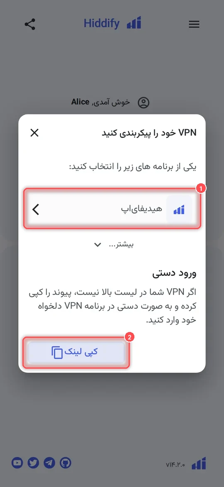

3. روی `هیدیفای‌اپ` بزنید. برنامه باز می‌شود و پروفایل شما را اضافه می‌کند و کار تمام است. اگر برنامه باز نشد، در پایین همین پنجره روی `کپی لینک` بزنید تا لینک پروفایل کپی شود و از مرحلهٔ ۴ ادامه دهید.
4. برنامهٔ هیدیفای را باز کنید. در صفحهٔ `خانه`، روی دکمهٔ `+` در بالای صفحه بزنید. پنل «افزودن پروفایل» از پایین صفحه باز می‌شود.

    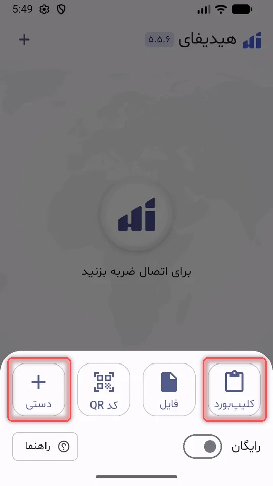

5. لینک کپی‌شده را به یکی از این روش‌ها اضافه کنید:
    - روی `کلیپ‌بورد` بزنید. برنامه لینکی را که کپی کرده‌اید می‌خواند و اضافه می‌کند.
    - یا روی `دستی` بزنید، یک نام دلخواه در `نام` بنویسید، لینک را در `URL` بچسبانید و روی `افزودن` بزنید. اینجا می‌توانید به‌روزرسانی خودکار را هم خاموش کنید یا فاصلهٔ زمانی آن را انتخاب کنید.

        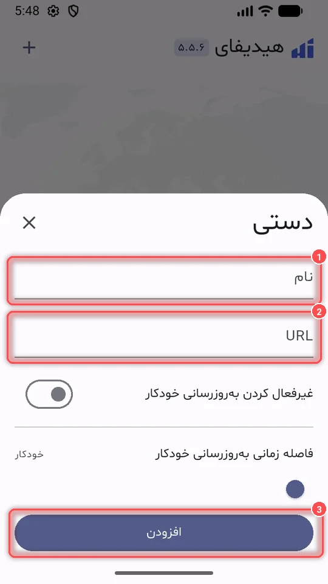

    - یا اگر لینک به شکل کد QR است، روی `کد QR` بزنید و دوربین را به سمت آن بگیرید.
    - یا اگر پروفایل را به شکل فایل گرفته‌اید، روی `فایل` بزنید و آن را انتخاب کنید.

اگر کار درست انجام شده باشد، پروفایل شما بالای صفحهٔ `خانه` نمایش داده می‌شود. اگر پیغام «URL نامعتبر است» یا «افزودن پروفایل ناموفق بود» دیدید، بررسی کنید که کل لینک را کپی کرده باشید و لینک با `https://` شروع شود.

## افزودن پروفایل رایگان { #free }

اگر لینکی ندارید، می‌توانید برنامه را با یک پروفایل رایگان امتحان کنید:

1. در صفحهٔ `خانه` روی `+` بزنید.
2. کلید `رایگان` را در پایین پنل روشن کنید. فهرستی از پروفایل‌های رایگان نمایش داده می‌شود، مثلاً `وارپ و سایفون`.

    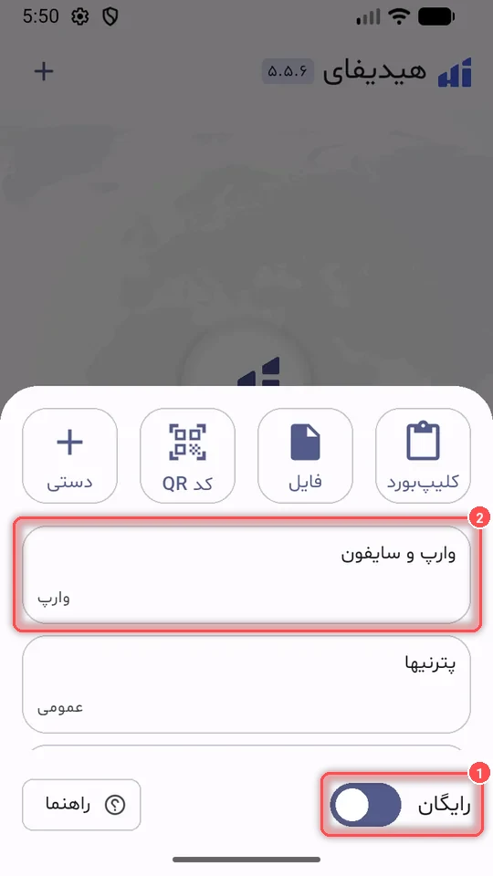

3. روی یک پروفایل بزنید. برنامه اول شرایط استفاده از آن را نشان می‌دهد (برای `وارپ و سایفون`، شرایط Cloudflare WARP). برای پذیرفتن شرایط و افزودن پروفایل روی `ادامه` بزنید.

    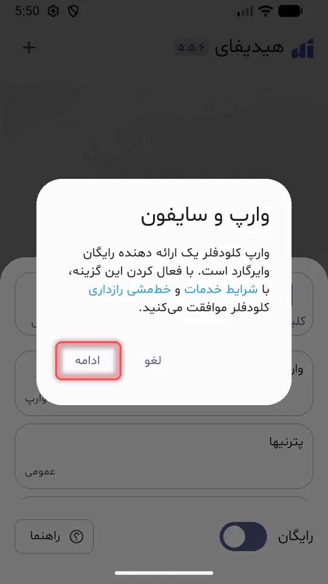

پروفایل‌های رایگان بین افراد زیادی مشترک هستند و همیشه سریع نیستند. وقتی راه دیگری ندارید از آن‌ها استفاده کنید. [آموزش استفاده از WARP در اپ هیدیفای](How-to-use-WARP-on-Hiddify-App.md) را هم ببینید.

## افزودن کانفیگ تکی

اگر می‌خواهید به‌جای کل سابسکریپشن فقط یک سرور اضافه کنید، از این روش استفاده کنید.

1. در صفحهٔ کاربری، روی دکمهٔ منو (☰) در بالای صفحه بزنید و `همه تنظیمات` را انتخاب کنید.

    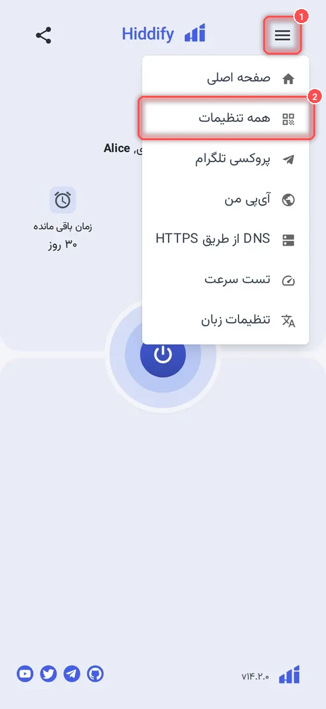

2. این صفحه اول لینک‌های اشتراک و بعد هر کانفیگ تکی را نشان می‌دهد. کنار کانفیگ مورد نظر روی `دریافت لینک` بزنید.

    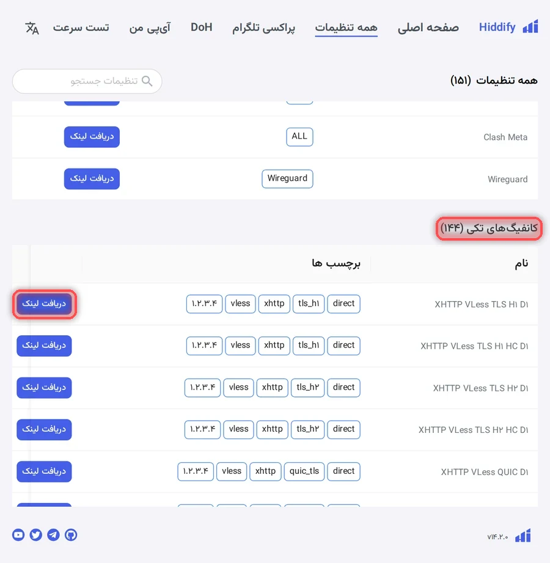

3. در پنجره‌ای که باز می‌شود روی `کپی لینک` بزنید. (گوشی دیگری هم می‌تواند کد QR همین پنجره را اسکن کند.)

    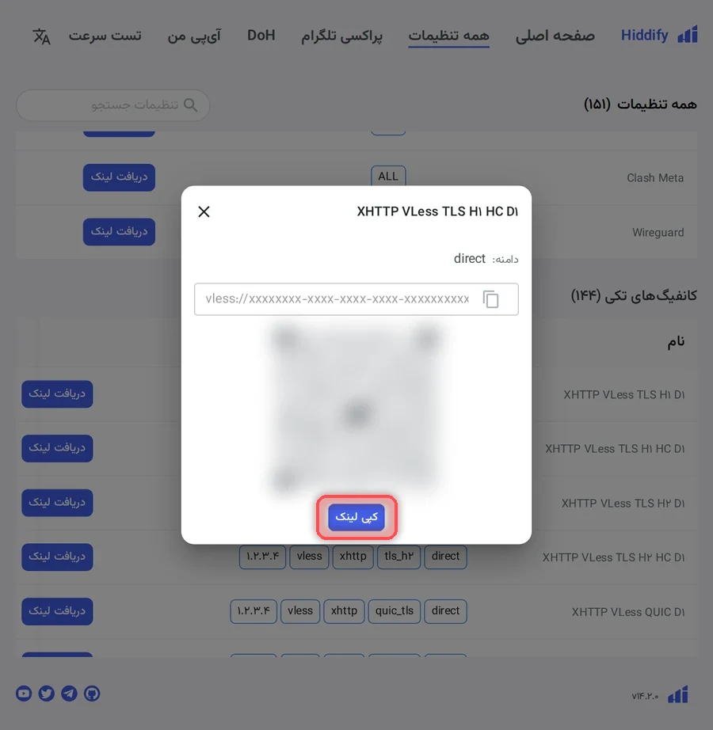

4. برنامهٔ هیدیفای را باز کنید و روی دکمهٔ `+` بزنید.
5. روی `کلیپ‌بورد` بزنید. کانفیگ به برنامه اضافه می‌شود.

## اتصال

1. پس از افزودن پروفایلِ پنل، صفحهٔ `خانه` این شکلی است. کارت بالای صفحه پروفایل فعال را با نامی که به آن داده‌اید نشان می‌دهد، به‌همراه حجم مصرف‌شده از بستهٔ شما (اینجا `۰GiB / ۱۰GiB`) و تعداد روزهای باقی‌مانده.

    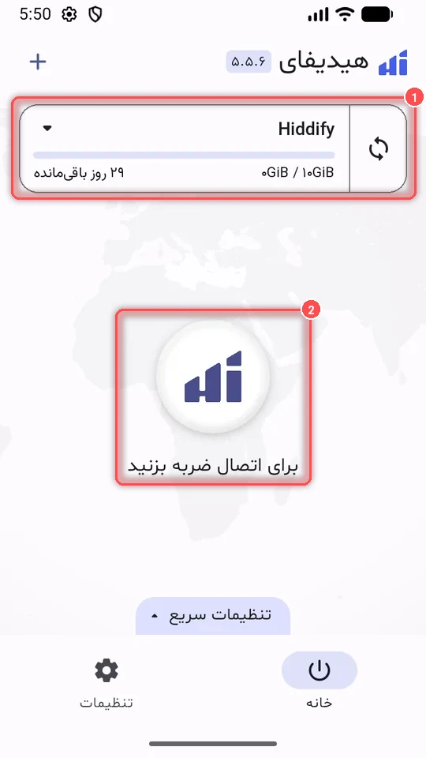

2. روی دکمهٔ بزرگ اتصال در وسط صفحه (`برای اتصال ضربه بزنید`) بزنید.
3. بار اول، گوشی از شما اجازه می‌خواهد:
    - در اندروید، ممکن است برنامه اول اجازهٔ ارسال اعلان بخواهد: روی `Allow` بزنید. بعد اندروید پنجرهٔ «Connection request» را نشان می‌دهد: روی `OK` بزنید.
    - در آیفون، روی `Allow` بزنید و رمز گوشی را وارد کنید ([آموزش نصب اپ هیدیفای](How-to-install-Hiddify-app.md) را ببینید).
    - روی کامپیوتر، بخش [حالت VPN روی کامپیوتر](#vpn) را ببینید.

    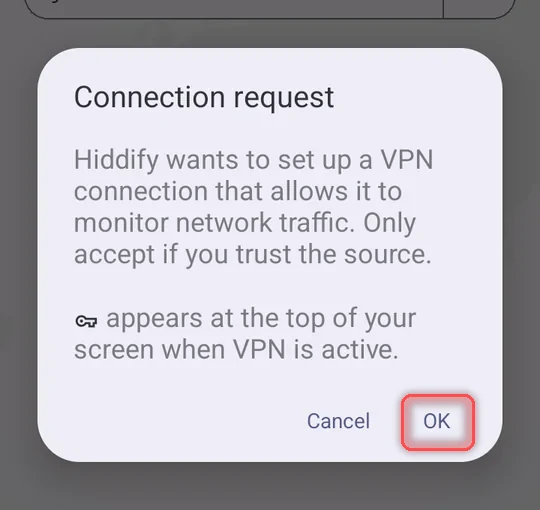

وقتی اتصال برقرار شد، دکمه سبز می‌شود و `متصل شد` را نشان می‌دهد و زیر آن تأخیر (سرعت پاسخ سرور) نوشته می‌شود. پایین‌تر، یک کارت پروکسی‌ای را که الان از آن استفاده می‌کنید نشان می‌دهد. با پروفایل پنل هیدیفای معمولاً `Select · Auto` نوشته می‌شود: گروه `Auto` همهٔ کانفیگ‌های پنل شما را تست می‌کند و از سریع‌ترینشان استفاده می‌کند. برای قطع اتصال، دوباره روی دکمهٔ بزرگ بزنید.

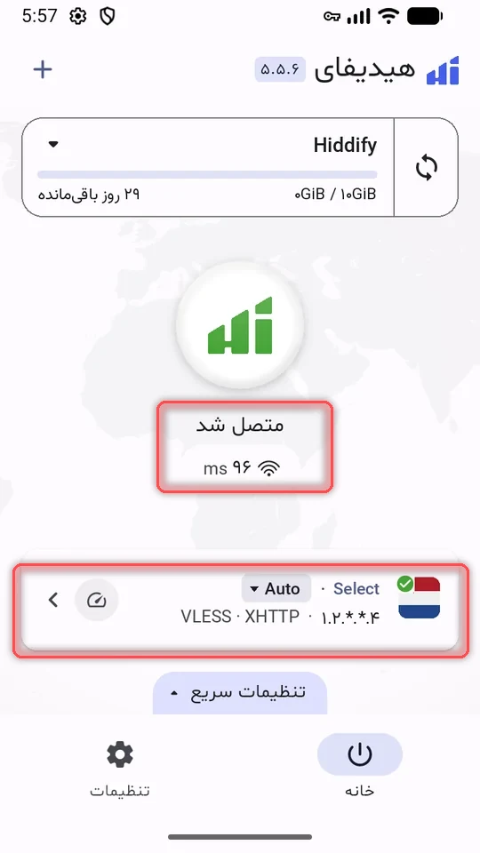

اگر روی `در حال اتصال...` ماند یا خطا داد، در صفحهٔ `پروکسی‌ها` سرور دیگری را امتحان کنید (پایین‌تر توضیح داده شده)، یا دکمهٔ به‌روزرسانی روی کارت پروفایل را بزنید تا فهرست تازهٔ سرورها دانلود شود. اگر باز هم وصل نشد، با ارائه‌دهندهٔ خود تماس بگیرید.

## مدیریت پروفایل‌ها

- **به‌روزرسانی پروفایل**: روی دکمهٔ به‌روزرسانی (دو فلش) در کنار کارت پروفایل بزنید. با این کار جدیدترین فهرست سرورها از ارائه‌دهنده دانلود می‌شود.
- **رفتن به پروفایل دیگر**: روی کارت پروفایل بزنید. فهرست همهٔ پروفایل‌ها باز می‌شود؛ روی پروفایل مورد نظر بزنید. در این فهرست، `مرتب‌سازی` ترتیب را عوض می‌کند و `به‌روزرسانی اشتراک‌ها` همه را با هم به‌روز می‌کند.

    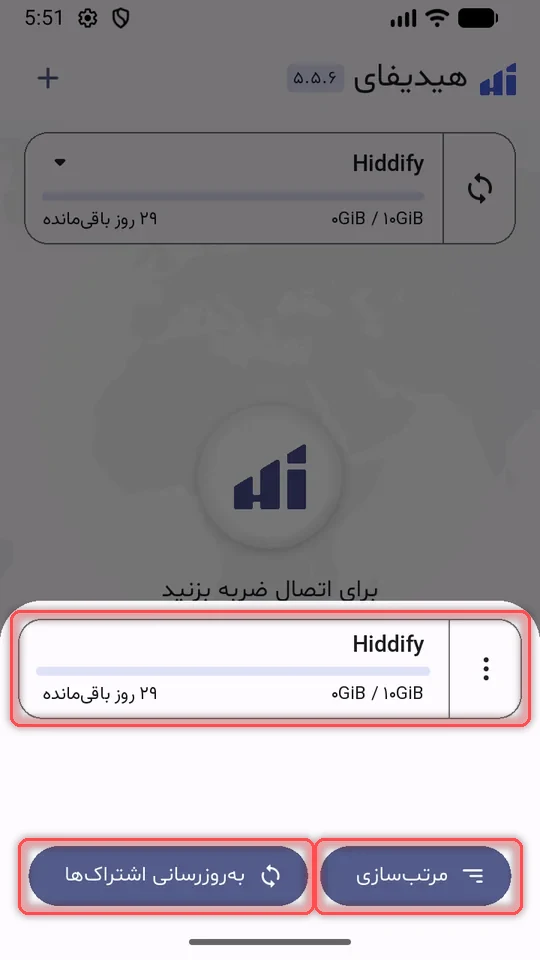

- **سنجاق کردن، به‌روزرسانی، اشتراک‌گذاری، ویرایش یا حذف پروفایل**: در فهرست، روی سه‌نقطهٔ کنار پروفایل بزنید.

    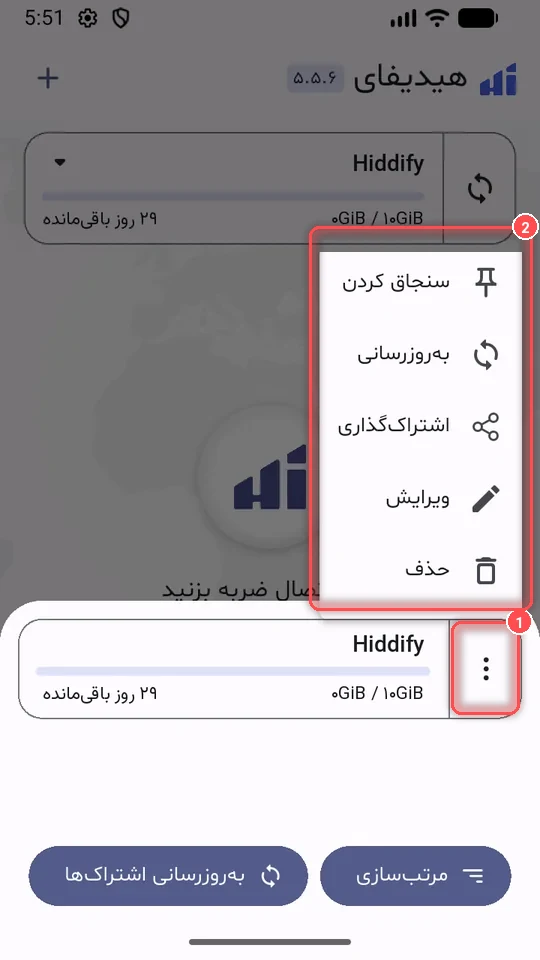

- **اشتراک‌گذاری پروفایل**: گزینهٔ `اشتراک‌گذاری` یک کد QR نشان می‌دهد که گوشی دیگری می‌تواند با هیدیفای اسکن کند، به‌همراه لینک سابسکریپشن برای کپی کردن و دکمهٔ ارسال به تلویزیون برای فرستادن پروفایل به هیدیفای روی Android TV.

## بررسی و انتخاب سرور (پروکسی‌ها)

1. اول وصل شوید. بعد در صفحهٔ `خانه`، روی کارت پروکسی فعال (زیر دکمهٔ اتصال) بزنید. صفحهٔ `پروکسی‌ها` باز می‌شود.

    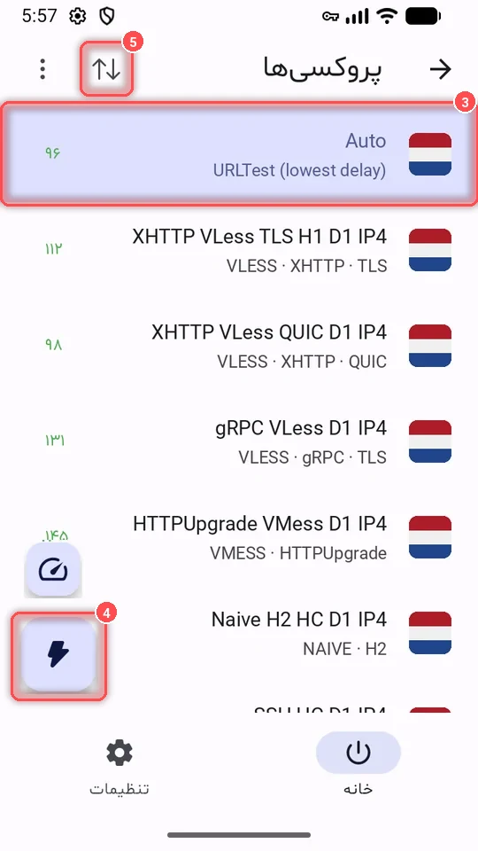

2. همهٔ کانفیگ‌هایی که پنل به شما داده، مثلاً `XHTTP VLess TLS H1 D1 IP4` یا `gRPC VLess D1 IP4`، همراه با **تأخیر** (Delay) هر کدام نمایش داده می‌شود. اولین مورد، `Auto`، سرور نیست: همیشه از سریع‌ترین کانفیگ استفاده می‌کند. تأخیر یعنی سرور چقدر طول می‌کشد تا جواب بدهد، بر حسب میلی‌ثانیه (ms): هر چه کمتر، سریع‌تر.
3. به‌طور پیش‌فرض `Auto` انتخاب شده است. برای استفاده از یک کانفیگ مشخص روی آن بزنید؛ برای برگشتن، روی `Auto` بزنید.
4. برای اندازه‌گیری دوبارهٔ تأخیر، روی دکمهٔ صاعقه در پایین صفحه (`تست تأخیر`) بزنید. دکمهٔ بالای آن (`تست سرعت`) سرعت دانلود و آپلود را اندازه می‌گیرد.
5. برای مرتب کردن فهرست، روی دکمهٔ مرتب‌سازی در بالای صفحه بزنید و یکی از گزینه‌های `پیش‌فرض`، `بر اساس نام`، `بر اساس تأخیر`، `بر اساس استفاده`، `بر اساس سرعت آپلود` یا `بر اساس سرعت دانلود` را انتخاب کنید.

    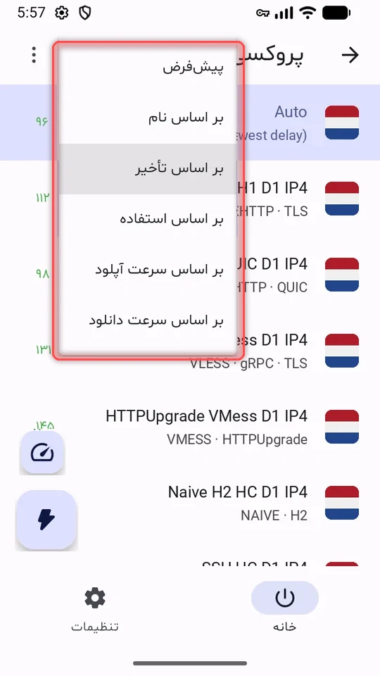

6. برای دیدن جزئیات یک سرور، انگشت خود را روی آن نگه دارید. از همین‌جا می‌توانید همان یک سرور را `اشتراک‌گذاری` یا `ویرایش` کنید (برنامه آن را در یک پروفایل جدید کپی می‌کند).

    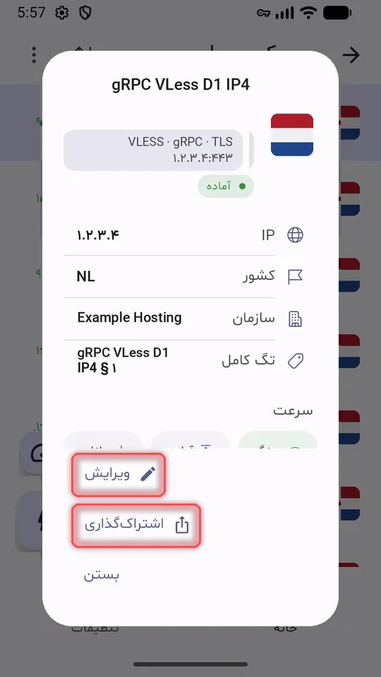

## تنظیمات سریع

در صفحهٔ `خانه`، روی `تنظیمات سریع` در پایین صفحه بزنید. اینجا می‌توانید:

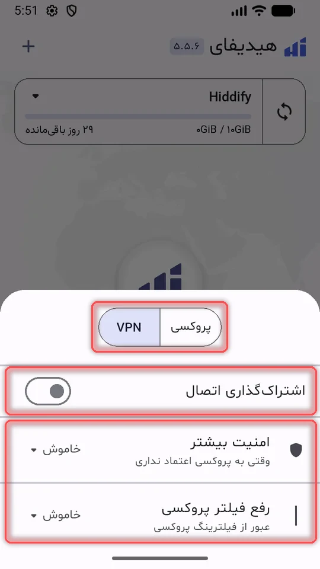

- **حالت سرویس** را انتخاب کنید:
    - `VPN`: همهٔ ترافیک دستگاه از برنامه عبور می‌کند. این حالت پیش‌فرض روی گوشی و کامپیوتر است.
    - `پروکسی`: برنامه فقط یک پروکسی محلی اجرا می‌کند و برنامه‌های دیگر باید برای استفاده از آن تنظیم شوند.
    - `پروکسی سیستم` (فقط کامپیوتر): مرورگرها و بیشتر برنامه‌ها خودکار از پروکسی استفاده می‌کنند. بخش [حالت VPN روی کامپیوتر](#vpn) را ببینید.
- **اشتراک‌گذاری اتصال** را روشن کنید: دستگاه‌های دیگر شبکهٔ شما می‌توانند از اتصال شما استفاده کنند.
- **امنیت بیشتر** (وقتی به پروکسی اعتماد ندارید): یک لایهٔ اضافه می‌گذارد تا صاحب پروکسی ترافیک شما را نبیند. برای پروکسی‌های عمومی و ناشناس مناسب است، اما ممکن است سرعت را کم کند.
- **رفع فیلتر پروکسی**: کمک می‌کند پروکسی فیلترشده وصل شود. فقط برای پروکسی شخصی مفید است، نه پروکسی عمومی، و سرعت پروکسی را کمی کم می‌کند.

تا وقتی لازم ندارید، `امنیت بیشتر` و `رفع فیلتر پروکسی` را روی `خاموش` نگه دارید. همین گزینه‌ها در `تنظیمات` > `زنجیره` هم هستند.

## تنظیمات

در پایین صفحه روی `تنظیمات` بزنید. تنظیمات در بخش‌های `عمومی`، `زنجیره`، `مسیریابی`، `DNS`، `ورودی`، `ترفندهای TLS`، `گزارش‌ها` و `درباره` دسته‌بندی شده‌اند. تا وقتی ارائه‌دهنده‌تان نگفته، به‌جز بخش `عمومی` بقیه را روی حالت پیش‌فرض نگه دارید.

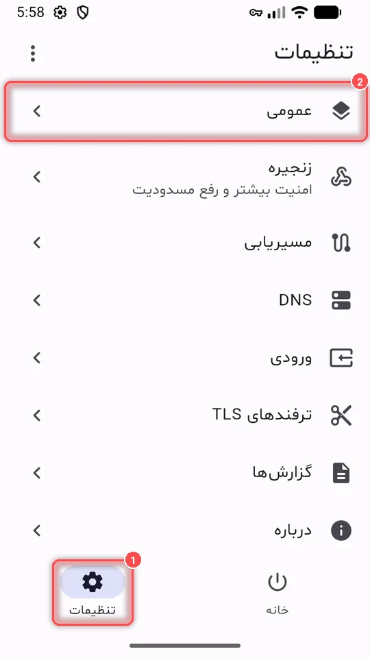

بخش `عمومی` را باز کنید. مهم‌ترین گزینه‌ها این‌ها هستند:

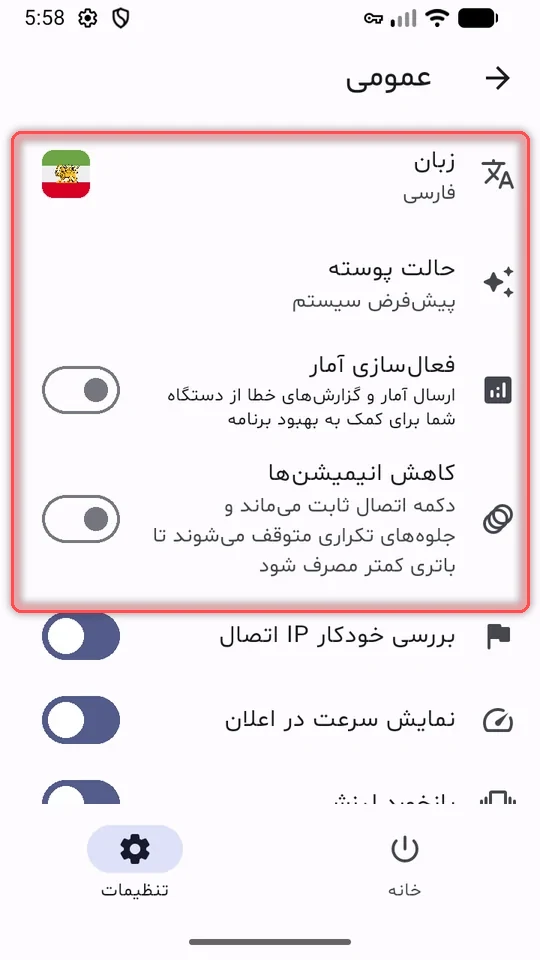

- `زبان`: زبان برنامه.
- `حالت پوسته`: `پیش‌فرض سیستم`، `حالت روشن`، `حالت تیره` یا `حالت مشکی` (کاملاً مشکی؛ در بعضی صفحه‌نمایش‌های گوشی باتری کمتری مصرف می‌کند).
- `فعال‌سازی آمار`: گزارش‌های خطای ناشناس برای کمک به سازندگان فرستاده شود. به‌طور پیش‌فرض خاموش است.
- `کاهش انیمیشن‌ها`: دکمهٔ اتصال ثابت می‌ماند و جلوه‌های تکراری متوقف می‌شوند تا باتری کمتر مصرف شود.
- `غیرفعال کردن بهینه‌سازی باتری` (اندروید): جلوی بسته شدن VPN توسط اندروید در پس‌زمینه را می‌گیرد.
- `شروع هنگام ورود به سیستم` (کامپیوتر): برنامه هنگام ورود به سیستم خودکار اجرا شود.
- `شروع در حالت کمینه` (کامپیوتر): برنامه به‌جای باز کردن پنجره، پنهان در System Tray (آیکون‌های کوچک کنار ساعت) اجرا شود.

حالت سرویس در مسیر `تنظیمات` > `ورودی` > `حالت سرویس` هم هست.

## حالت VPN روی کامپیوتر { #vpn }

در ویندوز، مک و لینوکس هم برنامه حالا مثل گوشی در حالت `VPN` شروع می‌شود: **همهٔ** برنامه‌ها، از جمله تلگرام و بازی‌ها، از هیدیفای عبور می‌کنند.

حالت VPN یک بار به اجازهٔ ادمین نیاز دارد (در لینوکس و مک به آن **root** می‌گویند). بار اولی که وصل می‌شوید، برنامه می‌پرسد «همه‌ی برنامه‌ها از فیلترشکن عبور کنند؟» و دو گزینه پیشنهاد می‌کند:

- `استفاده از حالت VPN` (پیشنهادی): همهٔ برنامه‌ها از هیدیفای عبور می‌کنند. بعد کامپیوتر اجازهٔ ادمین می‌خواهد: در ویندوز روی `Yes` بزنید و در مک و لینوکس رمز عبور را وارد کنید. از آن به بعد برنامه بدون پرسیدن وصل می‌شود. با AppImage در لینوکس، هر بار که برنامه را اجرا می‌کنید یک بار می‌پرسد.
- `استفاده از پروکسی سیستم`: اجازهٔ ادمین لازم نیست، اما فقط مرورگرها و بیشتر برنامه‌ها از هیدیفای عبور می‌کنند؛ تلگرام و چند برنامهٔ دیگر بیرون می‌مانند. بعداً می‌توانید از `تنظیمات سریع` یا `تنظیمات` > `ورودی` > `حالت سرویس` دوباره VPN را انتخاب کنید.

وقتی از حالت VPN استفاده می‌کنید، برنامه‌های VPN دیگر را خاموش کنید؛ دو VPN هم‌زمان با هم تداخل دارند. در لینوکس حالت `روتر (کل شبکه)` هم هست که ترافیک همهٔ دستگاه‌هایی را که از این کامپیوتر عبور می‌کنند به هیدیفای می‌فرستد.

اگر برنامه باز هم پیغام «دسترسی وجود ندارد» داد، آن را کامل ببندید (در System Tray روی آیکون هیدیفای راست‌کلیک کنید و `خروج` را بزنید) و با دسترسی ادمین باز کنید:

<details markdown="1"> <summary><b>اجرای برنامه با دسترسی ادمین در ویندوز</b></summary>

1. روی آیکون هیدیفای در دسکتاپ یا منوی `Start` راست‌کلیک کنید و `Run as administrator` را بزنید.

  

2. وقتی ویندوز اجازه خواست، روی `Yes` بزنید.

</details>
<br>

<details markdown="1"> <summary><b>اجرای برنامه با دسترسی ادمین در مک</b></summary>

1. اگر برنامه باز است، آن را کامل ببندید: روی آیکون هیدیفای در نوار منوی بالای صفحه (کنار ساعت) بزنید و `خروج` را انتخاب کنید.
2. برنامهٔ **Terminal** را باز کنید (در `Applications > Utilities`، یا با Spotlight آن را جستجو کنید).
3. این دستور را در Terminal بنویسید و `Return` را بزنید:

    ```bash
    sudo /Applications/Hiddify.app/Contents/MacOS/Hiddify
    ```

4. رمز عبور مک را وارد کنید و `Return` را بزنید. هنگام تایپ رمز چیزی نمایش داده نمی‌شود؛ این عادی است. برنامه با دسترسی ادمین باز می‌شود.

تا وقتی از برنامه استفاده می‌کنید، پنجرهٔ Terminal را باز نگه دارید؛ اگر Terminal را ببندید، برنامه هم بسته می‌شود.

!!! tip "اگر مک گفت «Hiddify.app» آسیب دیده است"
    این پیغام یعنی مک برنامهٔ دانلودشده را قرنطینه کرده است، نه اینکه برنامه خراب باشد. یک بار این دستور را در Terminal اجرا کنید و دوباره برنامه را باز کنید (توضیح کامل در [آموزش نصب اپ هیدیفای](How-to-install-Hiddify-app.md)):

    ```bash
    sudo xattr -rd com.apple.quarantine /Applications/Hiddify.app
    ```

</details>
<br>

<details markdown="1"> <summary><b>اجرای برنامه با دسترسی root در لینوکس</b></summary>

ترمینال را باز کنید و برنامه را با `sudo` اجرا کنید. این مثال برای فایل AppImage در پوشهٔ `Downloads` است؛ اگر فایل شما جای دیگری است، مسیر را تغییر دهید:

```bash
sudo ~/Downloads/Hiddify-Linux-x64-AppImage.AppImage
```

</details>
<br>

</div>
