<div dir="ltr" markdown="1">


# How to use the Hiddify app

This page shows you how to add your connection link to Hiddify App, connect, pick a server and change the most useful settings. It is for anyone who has installed the app and received a link from their provider or from their own Hiddify server.

## Before you start

You need:

1. Hiddify App installed on your device. If you have not installed it yet, follow [How to install the Hiddify app](How-to-install-Hiddify-app.md).
2. A connection link from your provider. This is usually your **user page** link (a personal web page that a Hiddify panel makes for each user) or a **subscription link**. No link yet? The app has free profiles too: see [Add a free profile](#add-a-free-profile).

A few words you will see on this page:

- **Profile**: one connection link saved in the app. A profile can contain many servers.
- **Subscription link**: a link that gives the app a list of servers and updates it automatically. It must start with `https://`; the app does not accept plain `http://` subscription links.
- **Config**: the settings for one single server, for example a link that starts with `vless://` or `vmess://`.
- **Proxy**: one server in your profile that your traffic can go through.


!!! note
    The app screenshots on this page come from version 5.5.6 on Android. On iPhone and on computers the steps are the same, but some screens look a little different.

## Add a profile to the app

1. Open your user page link (you got it from your provider or panel admin). It shows your remaining traffic and days, and a big connect button.

    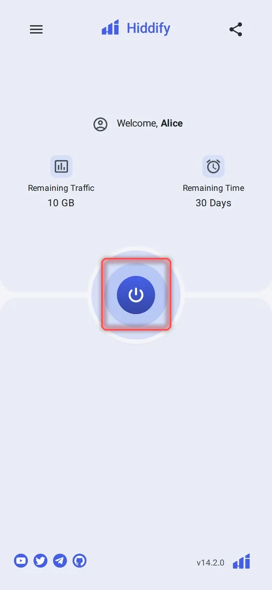

2. Tap the big button in the middle. The "Configure Your VPN" window opens.

    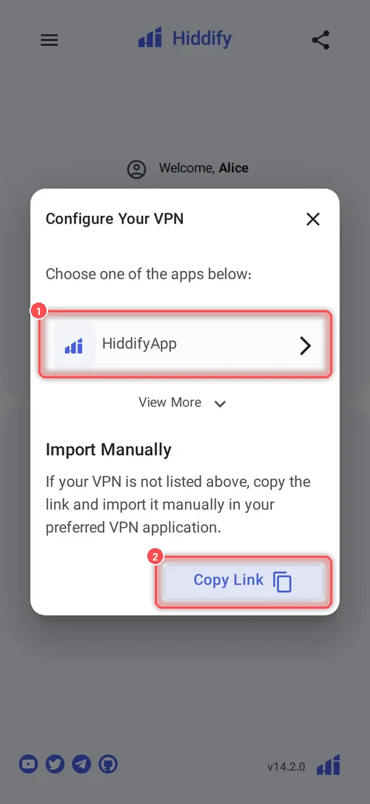

3. Tap `HiddifyApp`. The app opens and adds your profile, and you are done. If the app does not open, tap `Copy Link` at the bottom of the same window to copy your profile link, and go on with step 4.
4. Open Hiddify App. On the `Home` page, tap the `+` button at the top of the screen. The "Add profile" panel opens at the bottom.

    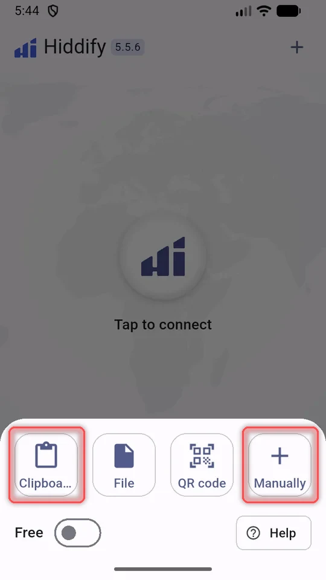

5. Add the copied link in one of these ways:
    - Tap `Clipboard`. The app reads the link you copied and adds it.
    - Or tap `Manually`, type any name in `Name`, paste the link in `URL`, and tap `Add`. You can also turn off auto update, or choose how often the app updates the profile.

        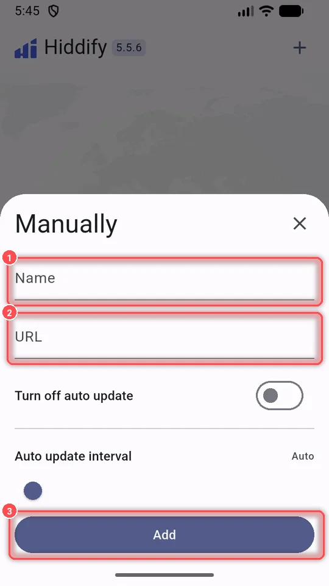

    - Or, if the link is shown as a QR code, tap `QR code` and point your camera at it.
    - Or, if you got the profile as a file, tap `File` and choose it.

When it worked, your profile appears at the top of the `Home` page. If you see "Invalid URL" or "Failed to add profile", check that you copied the whole link and that it starts with `https://`.

## Add a free profile

If you have no link, you can still try the app with a free profile:

1. Tap `+` on the `Home` page.
2. Turn on the `Free` switch at the bottom of the panel. A list of free profiles appears, for example `Warp & Psiphon`.

    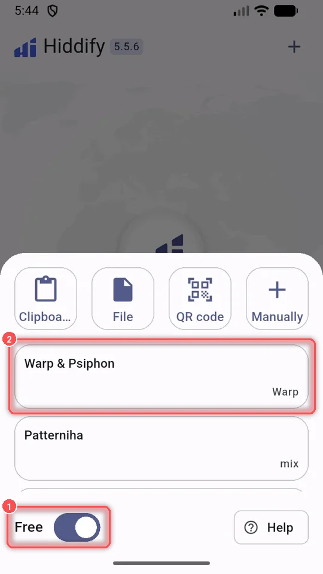

3. Tap a profile. The app shows its terms first (for `Warp & Psiphon`, the terms of Cloudflare WARP). Tap `Continue` to accept them and add the profile.

    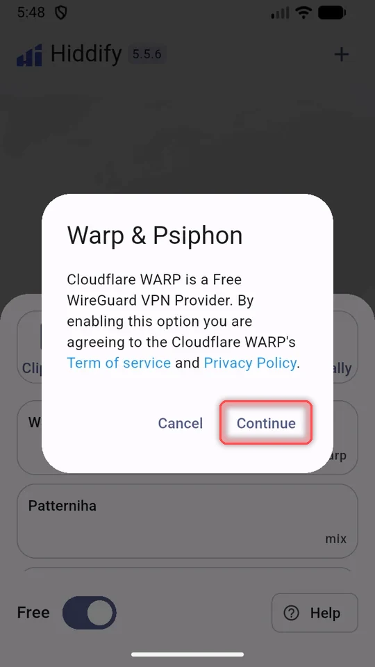

Free profiles are shared by many people and are not always fast. Use them when you have nothing else. See also [How to use WARP in the Hiddify app](How-to-use-WARP-on-Hiddify-App.md).

## Add a single config

Use this if you want to add only one server instead of a whole subscription.

1. On your user page, tap the menu button (☰) at the top and choose `All Configs`.

    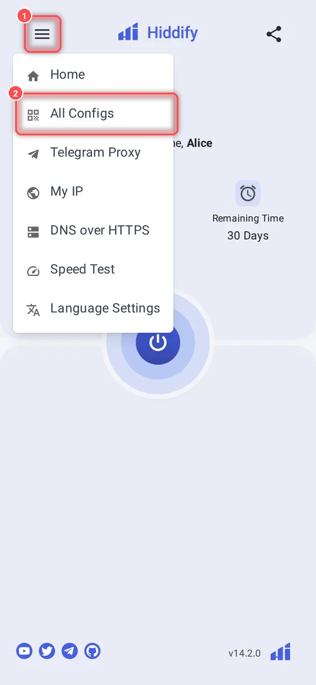

2. The page lists your subscription links first, then each single config under `Individual Configs`. Tap `Get Link` next to the config you want.

    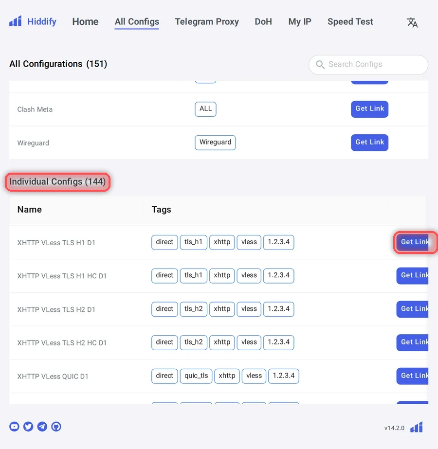

3. In the window that opens, tap `Copy Link`. (Another phone can also scan the QR code in this window.)

    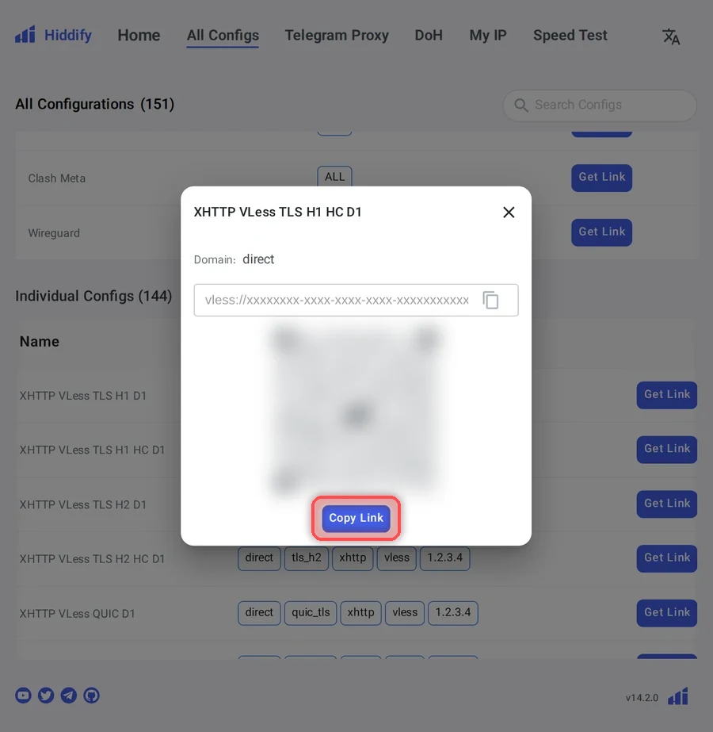

4. Open Hiddify App and tap the `+` button.
5. Tap `Clipboard`. The config is added to the app.

## Connect

1. After you add the profile from your panel, the `Home` page looks like this. The card at the top shows the active profile with the name you gave it, how much traffic you have used of your plan (here `0GiB / 10GiB`) and how many days are left.

    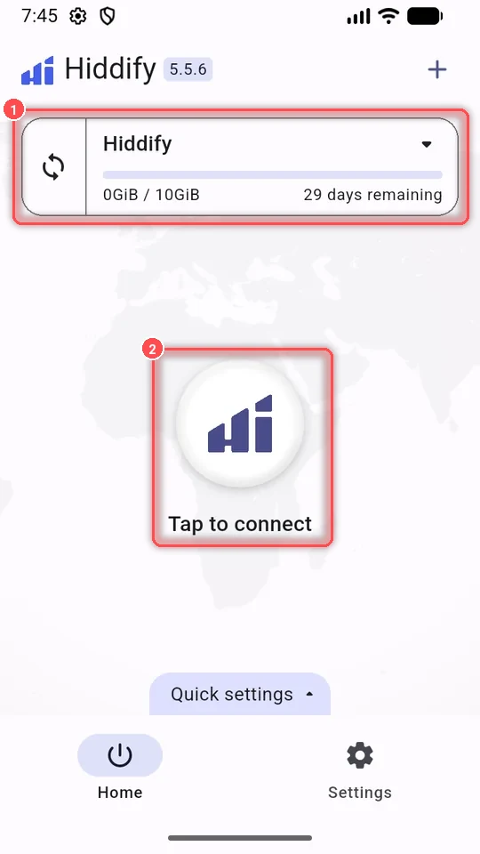

2. Tap the big connect button in the middle of the screen (`Tap to connect`).
3. The first time, your phone asks for permission:
    - On Android, the app may first ask to send notifications: tap `Allow`. Then Android shows "Connection request": tap `OK`.
    - On iPhone, tap `Allow` and enter your passcode (see [How to install the Hiddify app](How-to-install-Hiddify-app.md)).
    - On a computer, see [VPN mode on a computer](#vpn-mode-on-a-computer).

    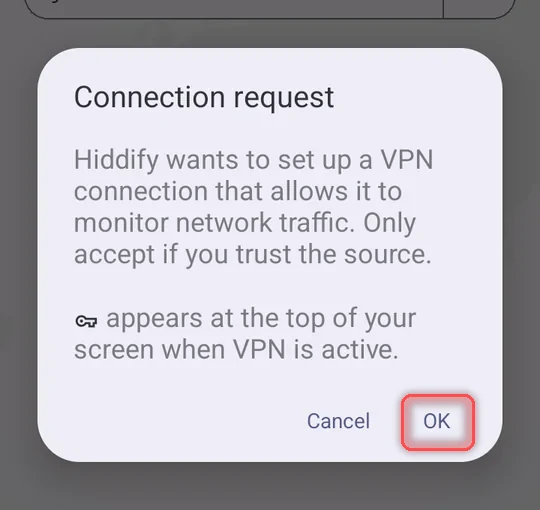

When the connection works, the button turns green and shows `Connected`, with the delay (how fast the server answers) under it. Below that, a card shows the proxy you are using right now. With a Hiddify panel profile it usually shows `Select · Auto`: the `Auto` group tests all the configs of your panel and uses the fastest one. To disconnect, tap the big button again.

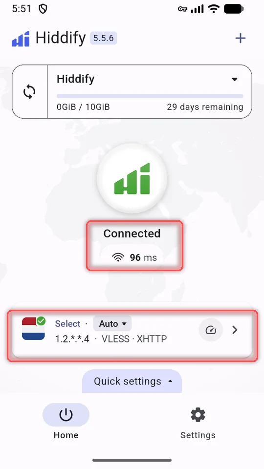

If it stays on `Connecting...` or shows an error, try another server on the `Proxies` page (see below), or tap the update button on your profile card to download a fresh server list. If nothing works, contact your provider.

## Manage profiles

- **Update a profile**: tap the update button (the two arrows) on the left of the profile card. This downloads the newest server list from your provider.
- **Switch to another profile**: tap the profile card. A list of all your profiles opens; tap the one you want. In this list, `Sort` changes the order and `Update subscriptions` updates all of them at once.

    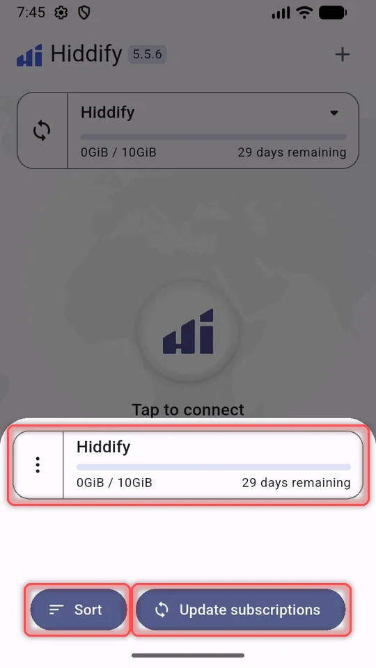

- **Pin, update, share, edit or delete a profile**: in the list, tap the three dots on the left of a profile.

    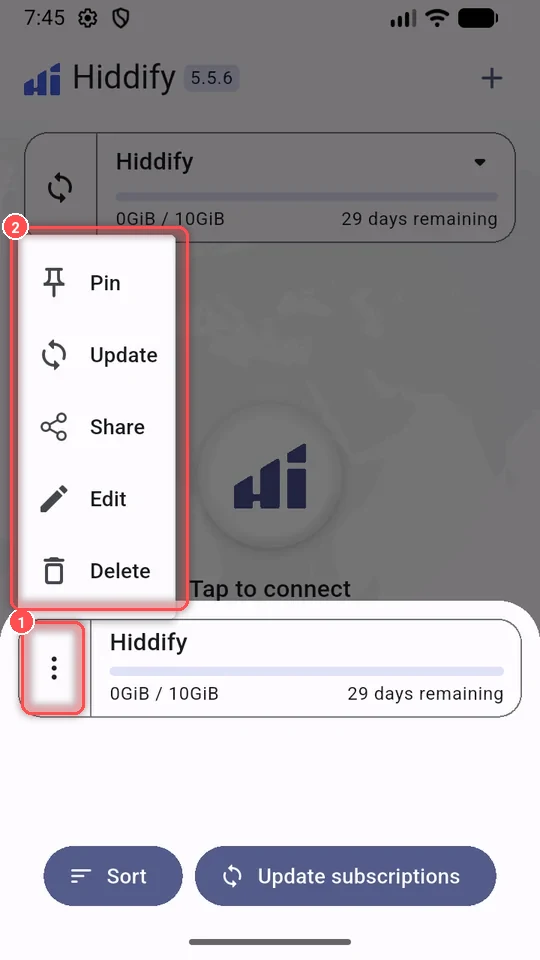

- **Share a profile**: `Share` shows a QR code that another phone can scan with Hiddify, the subscription link to copy, and `Send to TV` to send the profile to Hiddify on an Android TV.

## Check and choose a server (Proxies)

1. Connect first. Then, on the `Home` page, tap the card of the active proxy (under the connect button). The `Proxies` page opens.

    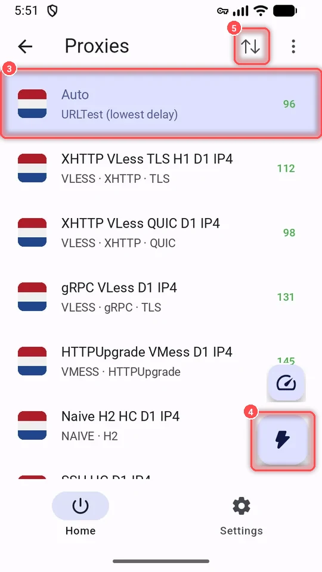

2. You see every config that your panel gives you, for example `XHTTP VLess TLS H1 D1 IP4` or `gRPC VLess D1 IP4`, with its **delay** on the right. The first entry, `Auto`, is not a server: it always uses the fastest config. Delay is how long the server takes to answer, in milliseconds (ms): lower is faster.
3. By default `Auto` is selected. To use one specific config instead, tap it; tap `Auto` to go back.
4. To measure the delay again, tap the lightning button at the bottom right (`Test delay`). The button above it (`Speed test`) measures download and upload speed.
5. To sort the list, tap the sort button at the top and choose `Default`, `Alphabetically`, `By delay`, `By usage`, `By upload speed` or `By download speed`.

    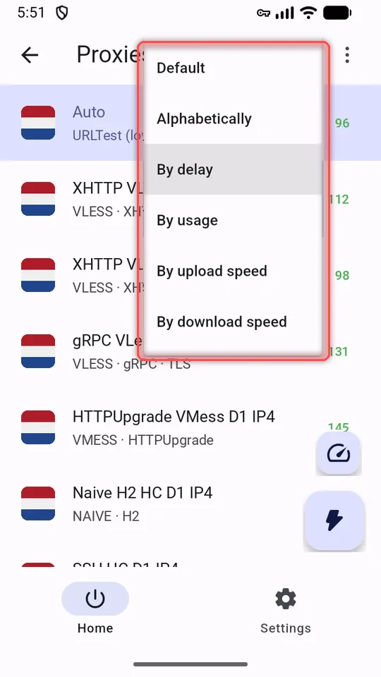

6. To see the details of a server, touch and hold it. You can also `Share` that one server or `Edit` it (the app copies it to a new profile of its own).

    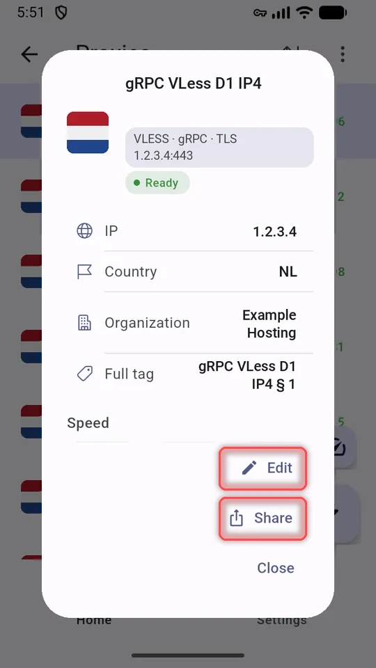

## Quick settings

On the `Home` page, tap `Quick settings` at the bottom of the screen. From here you can:

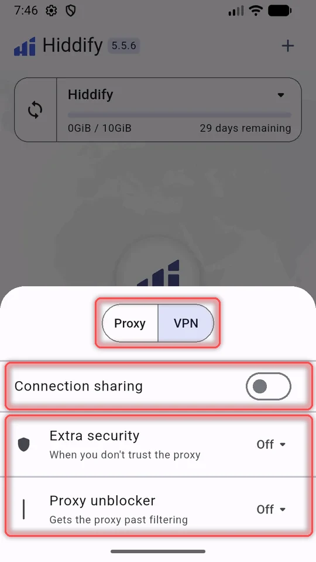

- Choose the **service mode**:
    - `VPN`: all traffic of the device goes through the app. This is the default on phones and computers.
    - `Proxy`: the app only runs a local proxy. Other apps must be set up to use it.
    - `System proxy` (computers only): browsers and most apps use the proxy automatically. See [VPN mode on a computer](#vpn-mode-on-a-computer).
- Turn on **Connection sharing**: other devices on your network can use your connection.
- **Extra security** (for when you don't trust the proxy): adds an extra layer, so the provider of your proxy can't see your traffic. Good for public and anonymous proxies. It may make the connection slower.
- **Proxy unblocker**: helps a filtered proxy connect. It is useful for a personal proxy, not for public ones, and makes the proxy a bit slower.

Leave `Extra security` and `Proxy unblocker` on `Off` unless you need them. You find the same options under `Settings` > `Chain`.

## Settings

Tap `Settings` at the bottom of the screen. The settings are grouped into `General`, `Chain`, `Routing`, `DNS`, `Inbound`, `TLS tricks`, `Logs` and `About`. Leave everything except `General` at the defaults unless your provider tells you to change it.

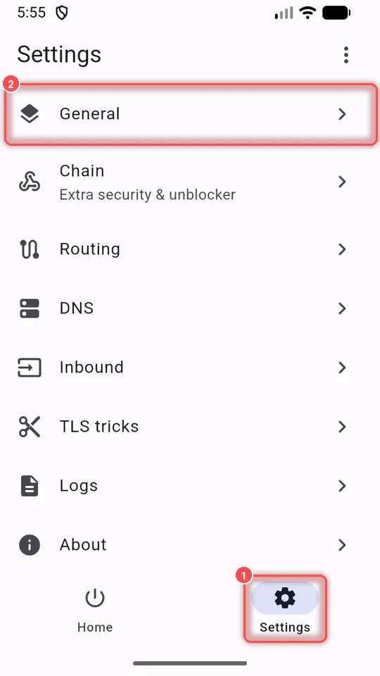

Open `General`. The most useful options are:

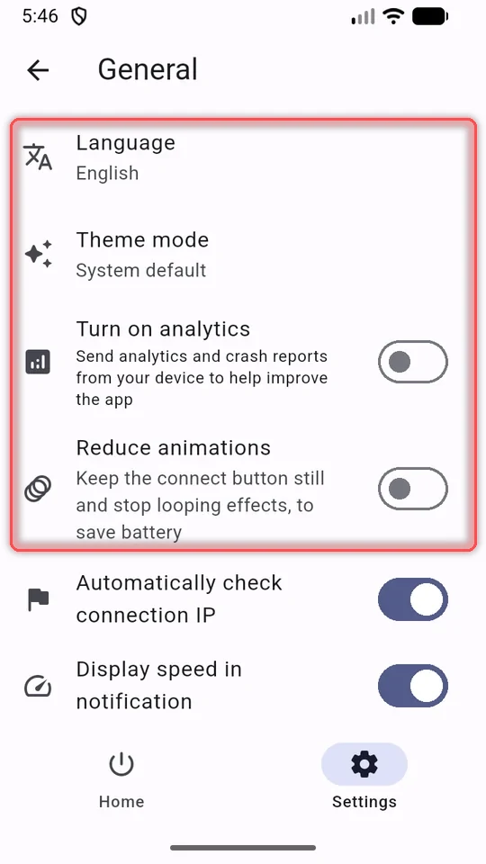

- `Language`: the language of the app.
- `Theme mode`: `System default`, `Light mode`, `Dark mode` or `Black mode` (fully black, which saves battery on some phone screens).
- `Turn on analytics`: send anonymous crash reports to help the developers. It is off by default.
- `Reduce animations`: keeps the connect button still and stops looping effects, to save battery.
- `Turn off battery optimization` (Android): stops Android from closing the VPN in the background.
- `Start at login` (computers): start the app when you log in.
- `Start minimized` (computers): start the app hidden in the system tray (the small icons next to the clock) instead of opening its window.

The service mode is also under `Settings` > `Inbound` > `Service mode`.

## VPN mode on a computer

On Windows, macOS and Linux, the app now starts in `VPN` mode, like on phones: **all** apps, including Telegram and games, go through Hiddify.

VPN mode needs administrator permission once (called **root** on Linux and macOS). The first time you connect, the app asks "Send all apps through the VPN?" and offers two choices:

- `Use VPN mode` (recommended): all apps go through Hiddify. Your computer then asks for administrator permission: click `Yes` on Windows, or enter your password on macOS and Linux. After that, the app connects without asking again. With the AppImage on Linux, it asks once each time you start the app.
- `Use system proxy`: no administrator permission is needed, but only browsers and most apps go through Hiddify; Telegram and a few other apps are left out. You can switch back to VPN later in `Quick settings` or in `Settings` > `Inbound` > `Service mode`.

Turn off other VPN apps while you use VPN mode: two VPNs at once get in each other's way. On Linux there is also a `Router (whole network)` mode, which sends the traffic of every device that this computer routes through Hiddify.

If the app still shows "Missing privilege", close it completely (right-click its icon in the system tray and click `Exit`), then open it as administrator:

<details markdown="1"> <summary><b>Open the app as administrator on Windows</b></summary>

1. Right-click the Hiddify icon on the desktop or in the `Start` menu and click `Run as administrator`.

    <div align=center>
    
    </div>

2. Click `Yes` when Windows asks for permission.

</details>
<br>

<details markdown="1"> <summary><b>Open the app as administrator on macOS</b></summary>

1. If the app is open, close it completely: click the Hiddify icon in the menu bar at the top of the screen (next to the clock) and click `Exit`.
2. Open the **Terminal** app (in `Applications > Utilities`, or search for it with Spotlight).
3. Type this command in Terminal and press `Return`:

    ```bash
    sudo /Applications/Hiddify.app/Contents/MacOS/Hiddify
    ```

4. Type your Mac password and press `Return`. Nothing appears while you type the password; that is normal. The app opens with administrator rights.

Keep the Terminal window open while you use the app: if you close Terminal, the app closes too.

!!! tip "If macOS says \"Hiddify.app\" is damaged"
    This means macOS put the downloaded app in quarantine; the app is not broken. Run this command once in Terminal and open the app again (full steps in [How to install the Hiddify app](How-to-install-Hiddify-app.md)):

    ```bash
    sudo xattr -rd com.apple.quarantine /Applications/Hiddify.app
    ```

</details>
<br>

<details markdown="1"> <summary><b>Open the app as root on Linux</b></summary>

Open a terminal and run the app with `sudo`. This example is for the AppImage in your `Downloads` folder; change the path if your file is somewhere else:

```bash
sudo ~/Downloads/Hiddify-Linux-x64-AppImage.AppImage
```

</details>
<br>

</div>
