# آموزش استفاده از وارپ روی اپ هیدیفای
این صفحه توضیح می‌دهد چطور در اپ هیدیفای از **وارپ** کلادفلر استفاده کنید: راه‌های ساده (یک پروفایل رایگان، یا یک انتخاب در تنظیمات) و راه پیشرفته (نوشتن کانفیگ `warp://` خودتان). اگر اتصال رایگان می‌خواهید، یا می‌خواهید ترافیک پروکسی‌تان را پشت وارپ پنهان کنید، از آن استفاده کنید.

**وارپ** یک سرویس VPN رایگان از کلادفلر است که بر پایهٔ **وایرگارد** (یک پروتکل VPN سریع و ساده) کار می‌کند. اپ هیدیفای خودش برایتان حساب وارپ می‌سازد و می‌تواند «نویز» (چند بستهٔ ساختگی اضافه) بفرستد تا تشخیص و مسدود کردن ترافیک وارپ برای فیلترها سخت‌تر شود.

!!! note "نوشته‌شده برای اپ هیدیفای نسخهٔ 5.9"
    این صفحه برای اپ هیدیفای نسخهٔ **5.9** (5.9.6) است. نسخه‌های قدیمی‌تر در تنظیمات یک صفحهٔ جدا به اسم `WARP` با گزینهٔ `Detour mode` داشتند؛ در نسخه‌های فعلی وارپ بخشی از `زنجیره` است که پایین‌تر توضیح داده شده.

## پیش از شروع

- اپ هیدیفای را نصب کنید: [نصب اپ هیدیفای](How-to-install-Hiddify-app.md) را ببینید.
- برای راه پیشرفته باید بدانید چطور پروفایل اضافه کنید: [آموزش استفاده از اپ هیدیفای](How-to-use-Hiddify-app.md) را ببینید.

## روش آسان: پروفایل رایگان وارپ { #free-warp-profile }

1. در صفحهٔ `خانه` روی `+` بزنید.
2. کلید `رایگان` را در پایین پنل روشن کنید و روی `WARP & Psiphon` بزنید.
3. پنجره‌ای به نام `WARP & Psiphon` پروفایل را توضیح می‌دهد. `ادامه` را بزنید. پروفایل اضافه می‌شود.
4. روی دکمهٔ بزرگ اتصال بزنید. بار اول، اندروید برای اعلان‌ها و اتصال VPN اجازه می‌خواهد؛ هر دو را اجازه بدهید.

<div style="display:flex;flex-wrap:wrap;justify-content:center;gap:16px">
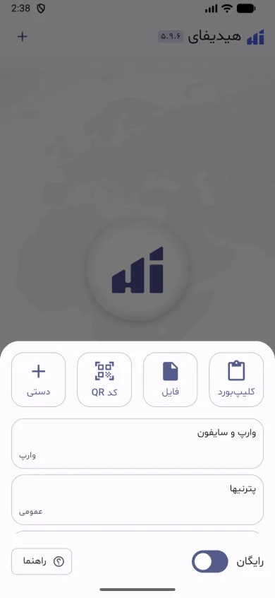
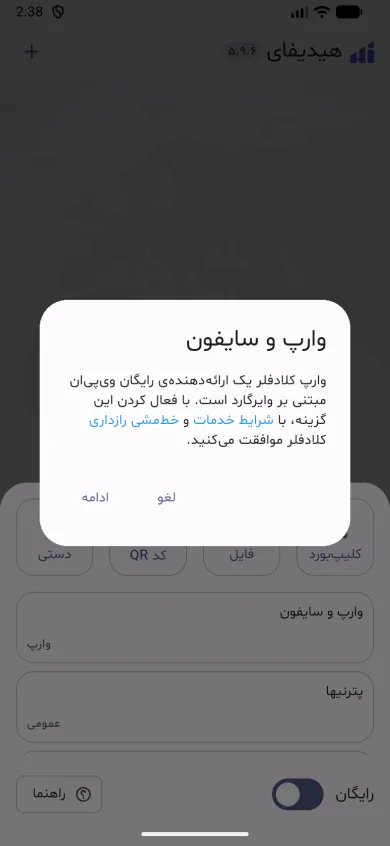
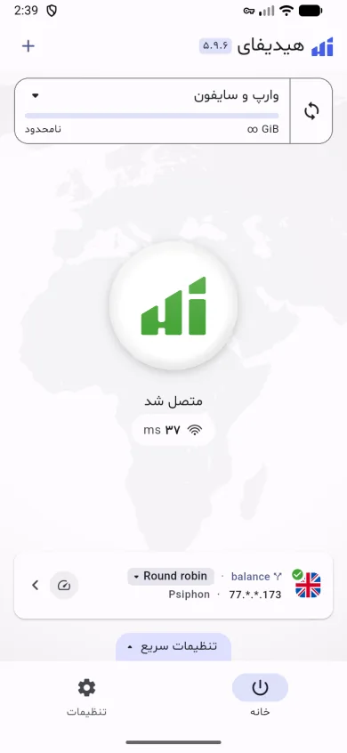
</div>


این پروفایل چند اتصال وارپ (WireGuard، MASQUE و AmneziaWG، و وارپ در وارپ) و سایفون دارد و یکی را که برای شما کار می‌کند انتخاب می‌کند (`balance · Round robin`). بخش [افزودن پروفایل رایگان](How-to-use-Hiddify-app.md#free) را هم ببینید.

## استفادهٔ هم‌زمان از وارپ و پروکسی خودتان (زنجیره) { #chain }

می‌توانید وارپ را قبل یا بعد از پروفایل خودتان بگذارید:

1. در صفحهٔ `خانه` روی `تنظیمات سریع` در پایین صفحه بزنید. (همین گزینه‌ها در `تنظیمات` > `زنجیره` هم هستند.)
2. یکی از این دو را روی `WARP` بگذارید:
    - `امنیت بیشتر` (برای وقتی به پروکسی اعتماد ندارید): اول به پروکسی خودتان وصل می‌شوید و بعد به وارپ. سایت‌ها به‌جای آی‌پی پروکسی شما یک آی‌پی کلادفلر می‌بینند و ارائه‌دهندهٔ پروکسی ترافیک شما را نمی‌بیند.
    - `رفع فیلتر پروکسی`: سرور پروکسی شما از طریق وارپ در دسترس قرار می‌گیرد. اگر آی‌پی سرور پروکسی‌تان فیلتر شده، از این استفاده کنید. برای پروکسی شخصی مفید است، نه پروکسی‌های عمومی.
3. بار اول، پیام رضایت‌نامهٔ وارپ کلادفلر (`Cloudflare WARP consent`) را بخوانید و `موافقم` را بزنید.
4. مثل همیشه وصل شوید. وقتی اتصال برقرار شد، دکمهٔ اتصال سبز می‌شود.

آن یکی را که لازم ندارید روی `خاموش` بگذارید (در فهرست اسمش `غیرفعال` است)؛ هر لایه اتصال را کمی کندتر می‌کند.

<div style="display:flex;flex-wrap:wrap;justify-content:center;gap:16px">
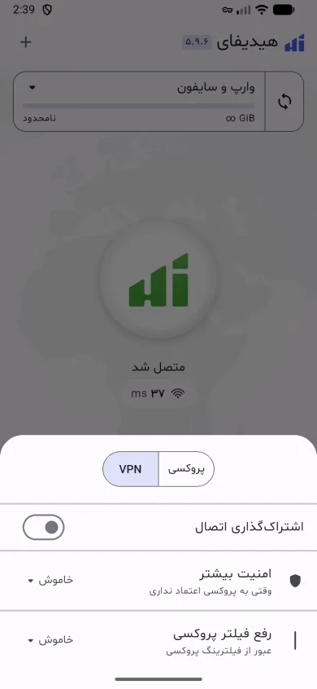
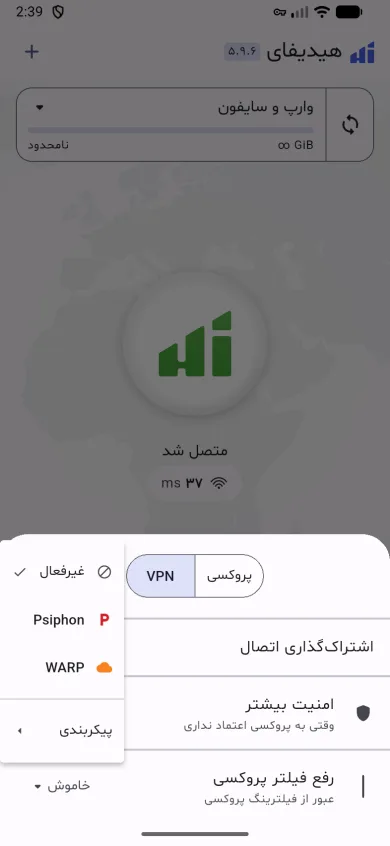
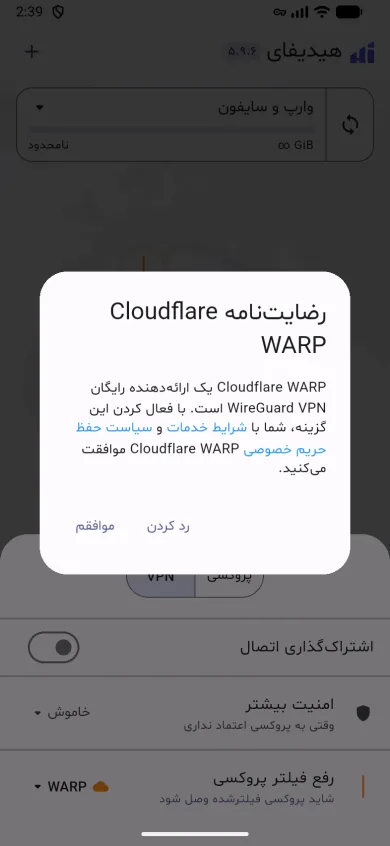
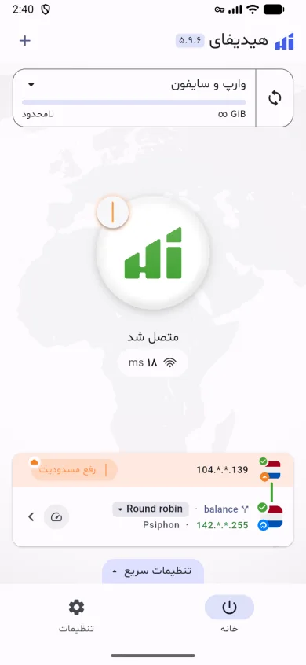
</div>

تصویر آخر `رفع فیلتر پروکسی` را روی `WARP` نشان می‌دهد؛ زیرنویس آن بعد از این کار «شاید پروکسی فیلترشده وصل شود» است.

### گزینه‌های وارپ { #warp-options }

`تنظیمات` > `زنجیره` را باز کنید (در فهرست تنظیمات نوشته شده **زنجیره / امنیت بیشتر و رفع مسدودیت**). این صفحه لایه‌ها را به ترتیب نشان می‌دهد: برنامه ← امنیت بیشتر ← پروفایل اصلی شما ← رفع مسدودیت. (در این صفحه به `رفع فیلتر پروکسی` می‌گوید **رفع مسدودیت**.) زیر لایه‌ای که از وارپ استفاده می‌کند، گزینه‌هایش را می‌بینید:

- `Tunnel`: اپ از چه راهی به وارپ وصل شود: `Auto` (پیش‌فرض)، `WireGuard`، `AmneziaWG` یا `MASQUE`.
- `کلید لایسنس`: کلید WARP+، اگر دارید.
- `MTU`: اگر نمی‌دانید به مقدار دیگری نیاز دارید، روی `Auto` بگذارید.

لایهٔ `رفع فیلتر پروکسی` گزینه‌های بیشتری دارد، چون باید از فیلتر عبور کند:

- `نقطه‌ی اتصال`: به کدام آدرس کلادفلر وصل شود: `تعیین‌شده توسط کلادفلر`، `جست‌وجو` (پیش‌فرض: اپ آدرسی را پیدا می‌کند که روی شبکهٔ شما کار کند؛ تنظیماتش زیر `جست‌وجوگر` است) یا `دستی` (آی‌پی تمیز و پورت خودتان).
- `نویز وایرگارد`: تعداد، نوع، سایز و تأخیر نویز. این‌ها مثل پارامترهای `ifp`، `ifpm`، `ifps` و `ifpd` کار می‌کنند که پایین‌تر توضیح داده شده‌اند.
- `MASQUE` و `AmneziaWG`: گزینه‌های این دو تونل.

<div style="display:flex;flex-wrap:wrap;justify-content:center;gap:16px">
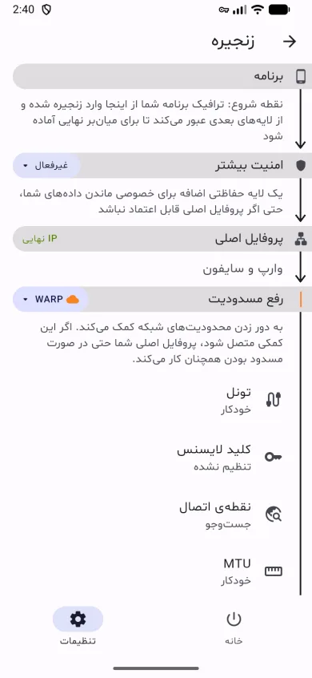
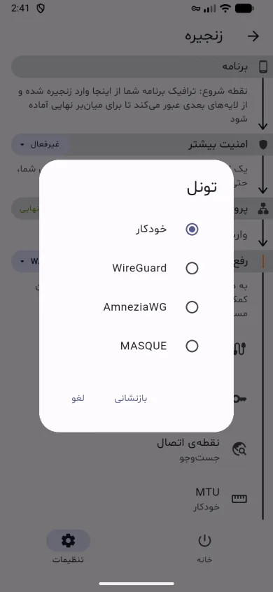
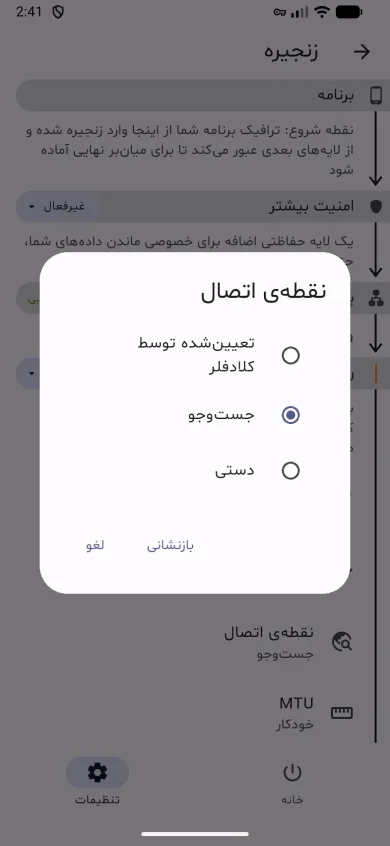
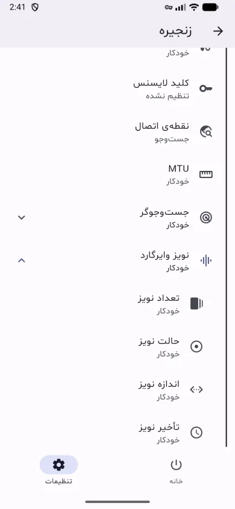
</div>


!!! tip "تست سریع"
    برای امتحان یک پروفایل آمادهٔ وارپ، صفحهٔ [hiddify.com/warp](../warp/index.md) را روی دستگاهی که اپ هیدیفای دارد باز کنید و روی لینک آن بزنید.

## روش پیشرفته: نوشتن کانفیگ وارپ { #advanced }

!!! note "نکته"
    لینک `warp://` در نسخهٔ ۵.۹.۶ هنوز کار می‌کند. آن را با `کلیپ‌بورد` اضافه کنید؛ فرم `دستی` فقط لینک اشتراک http(s) را قبول می‌کند و برای لینک `warp://` می‌گوید «Invalid URL».

می‌توانید لینک `warp://` را خودتان بسازید و مثل هر کانفیگ دیگری به اپ اضافه کنید (کپی کنید، بعد روی `+` و `کلیپ‌بورد` بزنید). بخش‌های این لینک در ادامه توضیح داده شده‌اند.

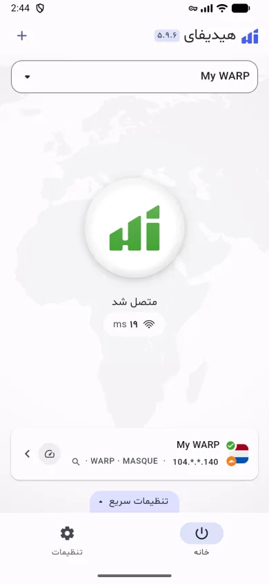


### حالت‌های نویز (`ifpm`)

نویز چند بستهٔ ساختگی است که اپ درست قبل از دست‌دهی وارپ می‌فرستد تا شروع اتصال شبیه وایرگارد به نظر نرسد. `ifpm` تعیین می‌کند این بسته‌ها چه شکلی باشند. این‌ها همان گزینه‌های `حالت نویز` در تنظیمات `زنجیره`ٔ اپ هستند:

| `ifpm` | در اپ | بسته‌های ساختگی چه شکلی‌اند |
|---|---|---|
| (خالی) | `Auto` | اگر `نقطه‌ی اتصال` روی `جست‌وجو` باشد، جست‌وجوگر نویزی را پیدا می‌کند که روی شبکهٔ شما رد می‌شود. |
| `m4` | `استاندارد` | بایت‌های تصادفی بعد از یک سرآیند کوتاه. بستهٔ پیش‌فرض خود هسته است. |
| `random` | `تصادفی` | فقط بایت‌های تصادفی، بدون سرآیند (مثل نویز Xray). |
| `quic` | `QUIC (HTTPS)` | بسته‌های واقعی شروع QUIC، شبیه باز کردن یک سایت HTTPS/3. |
| `quic-mimic` | `دست‌دهی QUIC` | رونوشتی از یک دست‌دهی واقعی QUIC. |
| `dns` | `DNS (google.com)` | پرسش‌های DNS دربارهٔ google.com. |
| `dns-cloudflare` | `DNS (cloudflare.com)` | پرسش‌های DNS دربارهٔ cloudflare.com. |
| `sip` | `SIP (تماس اینترنتی)` | شروع یک تماس تلفنی اینترنتی. |
| `stun` | `STUN (تماس تصویری)` | بسته‌هایی که یک تماس تصویری اول می‌فرستد. |

!!! tip "نکته"
    با `m4` (`استاندارد`) شروع کنید. اگر وارپ روی شبکهٔ شما وصل نشد، `quic`، `dns` یا `sip` را امتحان کنید. آموزش‌های قدیمی از حالت‌های `m1` تا `m6` و `h…`/`g…` حرف می‌زنند: نسخه‌های فعلی این‌ها را مثل `استاندارد` در نظر می‌گیرند.

### تعداد، اندازه و تأخیر بسته‌های نویز

هر کدام یک بازه (`کمینه-بیشینه`) است و اپ هر بار یک عدد تصادفی در این بازه انتخاب می‌کند.

- `ifp`: تعداد بسته‌های نویز. مثلاً `ifp=40-80` یعنی بین ۴۰ تا ۸۰ بستهٔ نویز فرستاده می‌شود.
- `ifps`: اندازهٔ هر بستهٔ نویز، به بایت. مثلاً `ifps=40-100` یعنی هر بسته بین ۴۰ تا ۱۰۰ بایت است.
- `ifpd`: فاصلهٔ زمانی بین بسته‌های نویز، به میلی‌ثانیه. مثلاً `ifpd=4-8` یعنی بین ۴ تا ۸ میلی‌ثانیه صبر می‌کند. فاصله‌های کوتاه‌تر معمولاً بهتر کار می‌کنند.

### کدام آی‌پی کلادفلر

آی‌پی کانفیگ را به یکی از این شکل‌ها تعیین کنید:

- auto4: یک IPv4 خودکار توسط کلادفلر به کانفیگ تخصیص داده می‌شود.
- auto6: یک IPv6 خودکار توسط کلادفلر به کانفیگ تخصیص داده می‌شود.
- auto: هر دو رنج IPv4 و Ipv6 توسط کلادفلر به کانفیگ تخصیص داده می‌شود.
- IPv4 تمیز: آی‌پی ورزن ۴ را می‌توان به صورت مستقیم وارد کانفیگ کرد. مثلا:
  `188.114.97.170`
  
- IPv6 تمیز: آی‌پی ورژن ۶ را بایستی با استفاده از `[]` وارد کانفیگ نمود. مثلا: `[2a01:4ef:f0:10a5::1]`

**آی‌پی تمیز** یعنی یک آی‌پی کلادفلر که روی شبکهٔ شما مسدود نیست.


!!! tip "نکته!"
    آی‌پی تمیز را می‌توانید با یک اسکنر پیدا کنید، مثلاً: [CFScanner](https://github.com/MortezaBashsiz/CFScanner)، [Quick WARP on WARP](https://github.com/azavaxhuman/Quick_WARP_on_WARP) و [Ptechgithub WARP](https://github.com/Ptechgithub/WARP). این‌ها ابزارهای جامعهٔ کاربران هستند و ساخت هیدیفای نیستند.

### نام نمایشی کانفیگ:
برای ایجاد نام نمایشی یا ریمارک نمودن کانفیگ می‌توان در انتهای کانفیگ از یک `#‍` استفاده نمود و اسم مورد نظر را اضافه نمود. دقت شود که اسم باید به صورت یک تکه باشد. مثلا:
```text
warp://auto#NAME
```

### وارپ در وارپ

با استفاده از این قابلیت می‌توان از دو وارپ مختلف استفاده نمود و یکی را در انتهای دیگری قرار داد. بدین ترتیب فرضا شما با وارپ اول متصل می‌شوید سپس از آنجا به وارپ دوم متصل می‌شوید و آی‌پی نهایی، آی‌پی وارپ دوم می‌شود. برای استفاده از این قابلیت باید از پارامتر `detour` استفاده نمود و ان را با `&&` در انتهای وارپ اول قرار داد و سپس وارپ دوم را اضافه نمود. مثلا:

```text
warp://auto&&detour=warp://auto
```

### فرمول کلی کانفیگ وارپ:
کانفیگ وارپ را می‌توان با استفاده از این فرمول ساخت. در این حالت یک کانفیگ ثابت در نرم‌افزار ایمپورت می‌شود.
```text
warp://License@IP:port?ifp=n1-n2&ifps=s1-s2&ifpd=d1-d2&ifpm=mode#name
```

مثال:

```text
warp://auto?ifp=40-80&ifps=40-100&ifpd=4-8&ifpm=m4#m4
```

در این حالت یک کانفیگ وارپ با نام نمایشی `m4` در نرم‌افزار ایمپورت می‌شود.

همچنین می‌توان دو وارپ را detour نمود. مثلا:

```text
warp://auto?ifp=40-80&ifps=40-100&ifpd=4-8&ifpm=m4#m4&&detour=warp://188.114.97.170:894?ifp=40-80&ifps=40-100&ifpd=4-8&ifpm=quic#quic
```

در این حالت یک کانفیگ با نام `m4` و یک کانفیگ detour شده برای وارپ در وارپ (WoW) با نام `quic` در نرم‌افزار ایجاد می‌شود.

در نهایت توصیه می‌شود نمونه کانفیگ‌های وارپ از [warp](https://raw.githubusercontent.com/hiddify/hiddify-app/refs/heads/main/test.configs/warp) و [warp2](https://raw.githubusercontent.com/hiddify/hiddify-app/refs/heads/main/test.configs/warp2) ملاحظه شوند.

!!! tip "نکته پایانی!"
    - برای رسیدن به کانفیگ مناسب باید با استفاده از اسکنرهای بالا آی‌پی تمیز مناسب شبکه خود را پیدا کنید و سپس مطابق با فرمول وارپ کانفیگ را بسازید. 
    - اگر وصل نشد، بازه‌ها (`ifp`، `ifps`، `ifpd`) را عوض کنید یا حالت دیگری را امتحان کنید و دوباره تست کنید.

## مقاله‌های مرتبط

- [زنجیره، امنیت بیشتر و رفع فیلتر پروکسی در اپ هیدیفای](/fa/app/Chain-Extra-security-and-Proxy-unblocker/)
- [مسیریابی در اپ هیدیفای](/fa/app/Routing-in-Hiddify-app/)
- [اشتراک‌گذاری اتصال اپ هیدیفای (پروکسی محلی و اشتراک در شبکه)](/fa/app/Share-your-connection/)
- [تنظیمات DNS و ترفندهای TLS در اپ هیدیفای](/fa/app/DNS-and-TLS-tricks-in-Hiddify-app/)
