# How to use WARP in the Hiddify app

This page explains how to use Cloudflare **WARP** in Hiddify app: the easy ways (a free profile, or one choice in the settings) and the advanced way (writing your own `warp://` config). Use it if you want a free connection, or if you want to hide your proxy traffic behind WARP.

**WARP** is a free VPN service from Cloudflare. It is based on **WireGuard**, a fast and simple VPN protocol. Hiddify app creates a WARP account for you and can add "noise" (extra fake packets) so that WARP traffic is harder for filters to detect and block.

!!! note "Written for Hiddify app 5.9"
    This page is for Hiddify app **5.9** (5.9.6). Older versions had a separate `WARP` page in the settings, with a `Detour mode`; in the current versions WARP is part of `Chain`, described below.

## Before you start

- Install Hiddify app: see [How to install the Hiddify app](How-to-install-Hiddify-app.md).
- For the advanced way, you should already know how to add a profile: see [How to use the Hiddify app](How-to-use-Hiddify-app.md).

## The easy way: the free WARP profile

1. On the `Home` page, tap `+`.
2. Turn on the `Free` switch at the bottom of the panel and tap `WARP & Psiphon`.
3. A window called `WARP & Psiphon` explains the profile. Tap `Continue`. The profile is added.
4. Tap the big connect button. The first time, Android asks to allow notifications and the VPN connection; allow both.

<div style="display:flex;flex-wrap:wrap;justify-content:center;gap:16px">
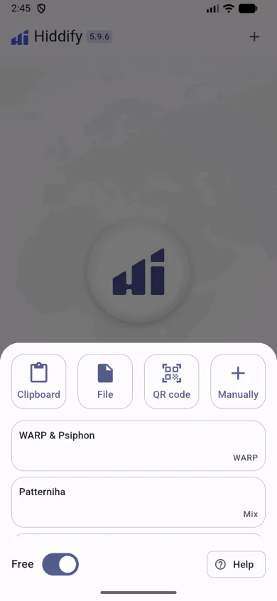
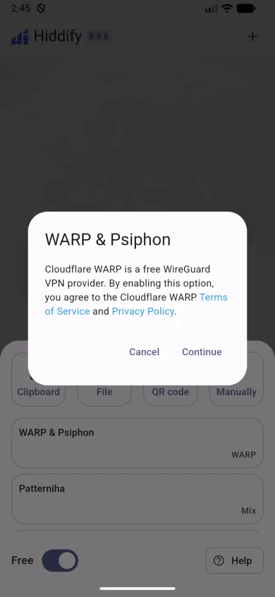
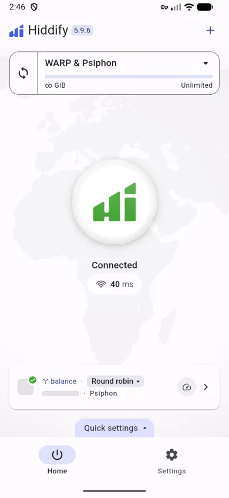
</div>


This profile has several WARP connections (WireGuard, MASQUE and AmneziaWG, and WARP in WARP) and Psiphon, and picks one that works for you (`balance · Round robin`). See [Add a free profile](How-to-use-Hiddify-app.md#add-a-free-profile).

## Use WARP together with your own proxy (Chain)

You can put WARP in front of or behind your own profile:

1. On the `Home` page, tap `Quick settings` at the bottom of the screen. (The same options are in `Settings` > `Chain`.)
2. Choose one of these and set it to `WARP`:
    - `Extra security` ("When you don't trust the proxy"): you connect to your proxy first and then to WARP. Websites see a Cloudflare IP instead of your proxy's IP, and your proxy provider can't see your traffic.
    - `Proxy unblocker` ("Gets the proxy past filtering"): your proxy server is reached through WARP. Use this if your proxy server's IP is blocked. It is useful for a personal proxy, not for public ones.
3. The first time, read the `Cloudflare WARP consent` message and tap `Agree`.
4. Connect as usual. When it works, the connect button turns green.

Leave the one you don't need on `Off` (in the list it is called `Turn off`): each layer makes the connection a little slower.

<div style="display:flex;flex-wrap:wrap;justify-content:center;gap:16px">
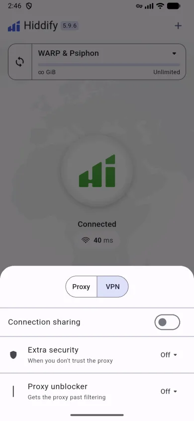
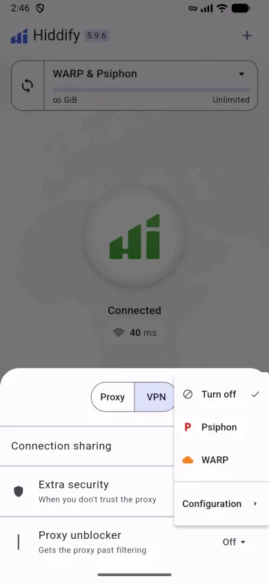
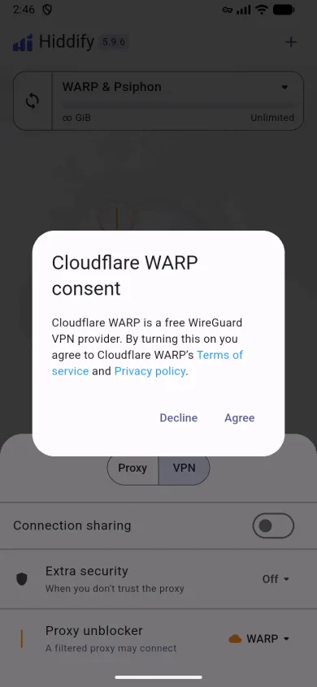
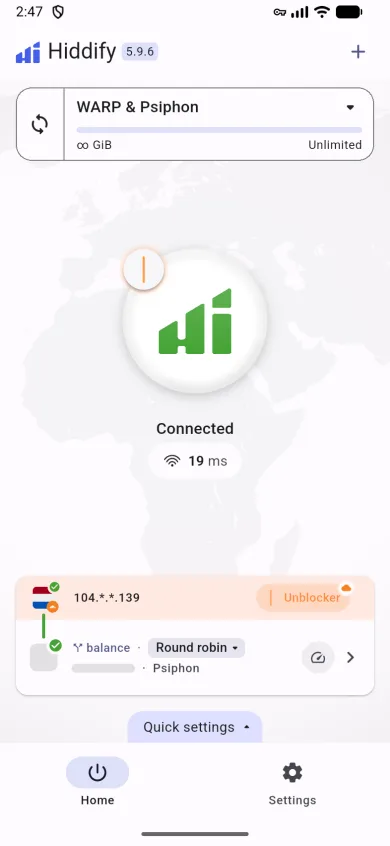
</div>

The last picture shows `Proxy unblocker` set to `WARP`; its subtitle then reads "A filtered proxy may connect".

### WARP options

Open `Settings` > `Chain` (in the list it reads **Chain / Extra security & unblocker**). The page shows the layers in order: App → Extra security → your main profile → Unblocker. (On this page `Proxy unblocker` is called **Unblocker**.) Under the layer that uses WARP you find its options:

- `Tunnel`: how the app talks to WARP: `Auto` (default), `WireGuard`, `AmneziaWG` or `MASQUE`.
- `License key`: a WARP+ key, if you have one.
- `MTU`: leave it on `Auto` unless you know you need another value.

The `Proxy unblocker` layer has more options, because it has to get past the filter:

- `Endpoint`: which Cloudflare address to connect to: `Assigned by Cloudflare`, `Scan` (default: the app looks for an address that works on your network; its settings are under `Scanner`) or `Custom` (your own clean IP and port).
- `WireGuard noise`: `Noise count`, `Noise mode`, `Noise size` and `Noise delay`. They work like the `ifp`, `ifpm`, `ifps` and `ifpd` parameters explained below.
- `MASQUE` and `AmneziaWG`: options for those two tunnels.

<div style="display:flex;flex-wrap:wrap;justify-content:center;gap:16px">
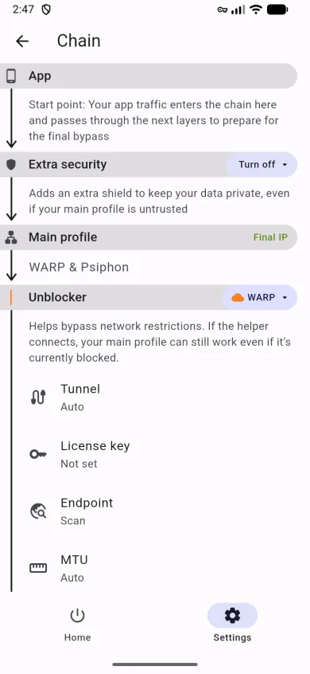
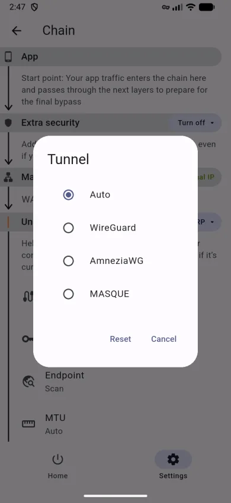
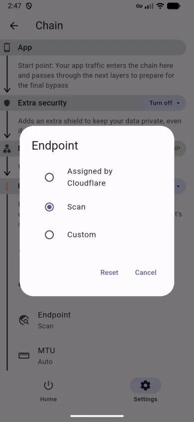
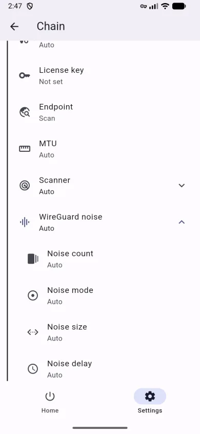
</div>


!!! tip "Quick test"
    To try a ready-made WARP profile, open [hiddify.com/warp](../warp/index.md) on a device that has Hiddify app and tap the link there.

## The advanced way: write your own WARP config

!!! note
    The `warp://` link still works in 5.9.6. Add it with `Clipboard`; the `Manually` form only takes http(s) subscription links and says "Invalid URL" for a `warp://` link.

You can build a `warp://` link yourself and add it to the app like any other config (copy it, then tap `+` and `Clipboard`). The parts of the link are explained below.

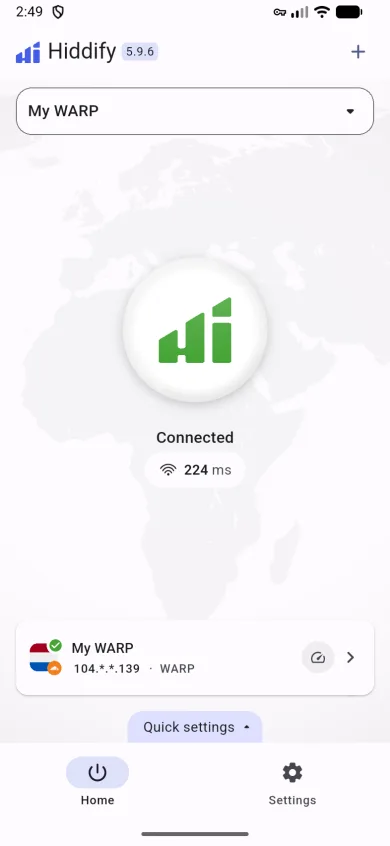


### Noise modes (`ifpm`)

Noise is a few fake packets that the app sends just before WARP's handshake, so that the start of the connection does not look like WireGuard. `ifpm` sets what these packets look like. These are the same choices as `Noise mode` in the app's `Chain` settings:

| `ifpm` | In the app | What the fake packets look like |
|---|---|---|
| (not set) | `Auto` | With `Endpoint` set to `Scan`, the scanner finds the noise that gets through on your network. |
| `m4` | `Standard` | Random bytes after a short header. This is the core's own packet. |
| `random` | `Random` | Only random bytes, with no header (like Xray's noise). |
| `quic` | `QUIC (HTTPS)` | Real QUIC Initial packets, like the start of a visit to an HTTPS/3 site. |
| `quic-mimic` | `QUIC handshake` | A copy of a real QUIC handshake. |
| `dns` | `DNS (google.com)` | DNS questions about google.com. |
| `dns-cloudflare` | `DNS (cloudflare.com)` | DNS questions about cloudflare.com. |
| `sip` | `SIP (VoIP call)` | The start of an internet phone call. |
| `stun` | `STUN (video call)` | The packets a video call sends first. |

!!! tip "Tip"
    Start with `m4` (`Standard`). If WARP does not connect on your network, try `quic`, `dns` or `sip`. Older articles mention the modes `m1` to `m6` and `h…`/`g…`: the current versions treat these like `Standard`.

### Number, size and delay of noise packets

Each of these is a range (`min-max`). Each time, the app picks a random value inside the range.

- `ifp`: how many noise packets to send. For example, `ifp=40-80` sends between 40 and 80 noise packets.
- `ifps`: the size of each noise packet, in bytes. For example, `ifps=40-100` makes each packet between 40 and 100 bytes.
- `ifpd`: the delay between noise packets, in milliseconds. For example, `ifpd=4-8` waits between 4 and 8 ms. Smaller delays usually work better.

### Which Cloudflare IP to use

- `auto4`: Cloudflare gives the config an IPv4 address automatically.
- `auto6`: Cloudflare gives the config an IPv6 address automatically.
- `auto`: Cloudflare can give either an IPv4 or an IPv6 address.
- A clean IPv4 address: type it directly. For example: `188.114.97.170`
- A clean IPv6 address: put it inside `[]`. For example: `[2a01:4ef:f0:10a5::1]`

A **clean IP** is a Cloudflare IP address that is not blocked on your network.

!!! tip "Tip"
    You can find clean IPs with a scanner, for example: [CFScanner](https://github.com/MortezaBashsiz/CFScanner), [Quick WARP on WARP](https://github.com/azavaxhuman/Quick_WARP_on_WARP), [Ptechgithub WARP](https://github.com/Ptechgithub/WARP). These are community tools, not made by Hiddify.

### Name of the config

To give the config a name, add `#` and the name at the end. The name must be one word (no spaces). For example:

```text
warp://auto#NAME
```

### WARP in WARP (WoW)

You can chain two WARP connections: you connect to the first WARP, and from there to the second one. Websites then see the IP of the second WARP. Add `&&detour=` after the first WARP config, followed by the second one. For example:

```text
warp://auto&&detour=warp://auto
```

### Putting it all together

The general form of a WARP config is:

```text
warp://License@IP:port?ifp=n1-n2&ifps=s1-s2&ifpd=d1-d2&ifpm=mode#name
```

Example:

```text
warp://auto?ifp=40-80&ifps=40-100&ifpd=4-8&ifpm=m4#m4
```

This adds a WARP config named `m4` to the app.

You can also chain two WARPs. For example:

```text
warp://auto?ifp=40-80&ifps=40-100&ifpd=4-8&ifpm=m4#m4&&detour=warp://188.114.97.170:894?ifp=40-80&ifps=40-100&ifpd=4-8&ifpm=quic#quic
```

This adds a config named `m4` that goes through a second WARP (WARP in WARP) named `quic`.

For more examples, see the official sample files [warp](https://raw.githubusercontent.com/hiddify/hiddify-app/refs/heads/main/test.configs/warp) and [warp2](https://raw.githubusercontent.com/hiddify/hiddify-app/refs/heads/main/test.configs/warp2).

!!! tip "Final tips"
    - Use one of the scanners above to find a clean IP that works on your network, then build your config with the formula above.
    - If it does not connect, change the ranges (`ifp`, `ifps`, `ifpd`) or try another mode, and test again.

## Related articles

- [Chain, Extra security and unblocker](/app/Chain-Extra-security-and-Proxy-unblocker/)
- [Routing](/app/Routing-in-Hiddify-app/)
- [Share your connection](/app/Share-your-connection/)
- [DNS and TLS tricks](/app/DNS-and-TLS-tricks-in-Hiddify-app/)
