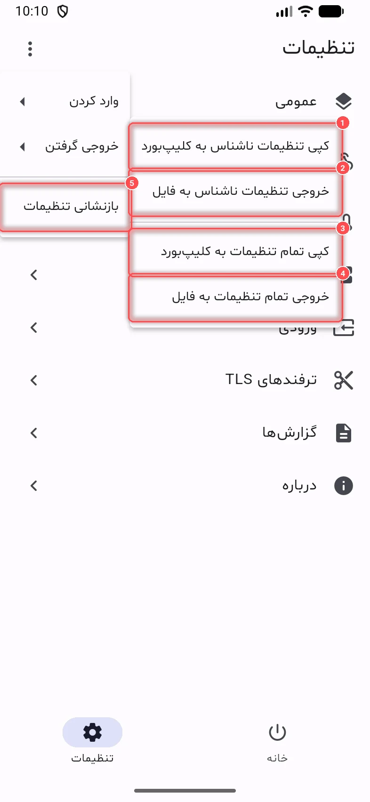
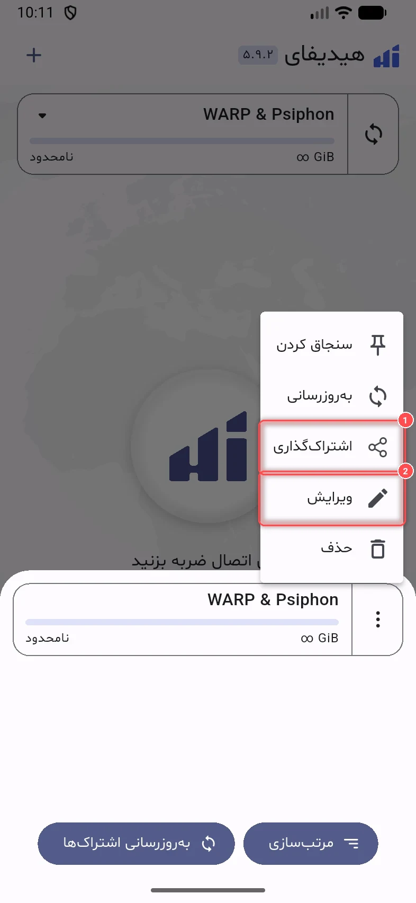
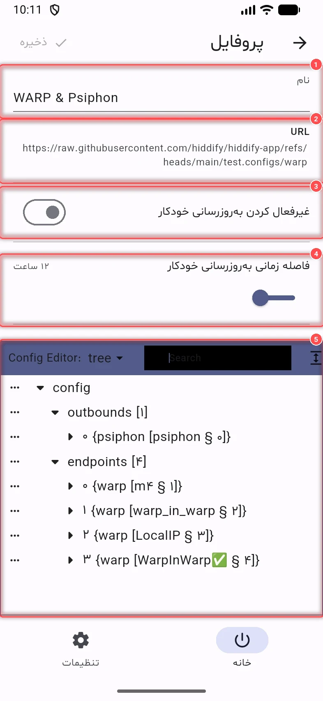

# ورود، خروج و بازنشانی تنظیمات، و ویرایش پروفایل

این صفحه نشان می‌دهد چطور همهٔ تنظیمات اپ هیدیفای را در یک فایل ذخیره کنید (برای بردن به دستگاه دیگر یا نگه داشتن یک نسخه)، چطور برشان گردانید یا به حالت پیش‌فرض بازنشانی کنید، و چطور یک پروفایل را ویرایش کنید.

!!! note "نوشته‌شده برای اپ هیدیفای نسخهٔ ۵.۹"
    این صفحه برای اپ هیدیفای **نسخهٔ ۵.۹** (۵.۹.۲) است. تصویرها از اندروید هستند؛ منوها در همهٔ سیستم‌عامل‌ها یکسان‌اند.

## خروجی گرفتن از تنظیمات

**تنظیمات** را باز کنید، **⋮** را در بالای صفحه بزنید و بعد **خروجی گرفتن** را.

1. **کپی تنظیمات ناشناس به کلیپ‌بورد**
2. **خروجی تنظیمات ناشناس به فایل**
3. **کپی تمام تنظیمات به کلیپ‌بورد**
4. **خروجی تمام تنظیمات به فایل**
5. **بازنشانی تنظیمات**: همهٔ تنظیمات را به پیش‌فرض برمی‌گرداند (به پروفایل‌ها دست نمی‌زند).

**تنظیمات ناشناس** همهٔ تنظیمات شما هستند *بدون* تنظیمات خصوصی: کلیدهای لایسنس وارپ‌پلاس در زنجیره (امنیت بیشتر و رفع مسدودیت) و رمز اشتراک در شبکهٔ محلی. وقتی تنظیماتتان را با کسی به اشتراک می‌گذارید یا به سؤالی در گروه پشتیبانی پیوست می‌کنید، از این‌ها استفاده کنید. **تمام تنظیمات** آن‌ها را هم دارد: فقط برای دستگاه‌های خودتان استفاده‌اش کنید.

فایل از نوع JSON است و تنظیمات اپ را دارد، نه پروفایل‌ها را: پروفایل‌ها را جداگانه روی دستگاه جدید اضافه کنید (یا با روش پایین به اشتراک بگذارید).

!!! tip "نکته"
    [HiddifyCli](/fa/core/) می‌تواند با این تنظیمات اجرا شود: **خروجی تمام تنظیمات به فایل** را بگیرید و فایل را با `-d` به آن بدهید.

## وارد کردن تنظیمات

**تنظیمات ← ⋮ ← وارد کردن ← وارد کردن تنظیمات از کلیپ‌بورد** یا **وارد کردن تنظیمات از فایل**. اپ اول می‌پرسد: وارد کردن، همهٔ تنظیمات شما را با مقدارهای واردشده بازنویسی می‌کند.

## ویرایش پروفایل

در صفحهٔ خانه کارت پروفایل را بزنید تا فهرست پروفایل‌ها باز شود، بعد **⋮** کنار یک پروفایل را بزنید:

- **سنجاق کردن**: پروفایل را بالای فهرست نگه می‌دارد.
- **به‌روزرسانی**: همین حالا آخرین سرورهای اشتراک را دریافت می‌کند.
- **اشتراک‌گذاری** (۱): به‌صورت کد QR یا لینک اشتراک، پیکربندی کامل (JSON، همراه با تنظیمات شما) یا **ارسال به تلویزیون** ([اپ هیدیفای روی اندروید تی‌وی](Hiddify-on-Android-TV.md) را ببینید).
- **ویرایش** (۲): صفحهٔ پروفایل را که پایین توضیح داده شده باز می‌کند.
- **حذف**: پروفایل را پاک می‌کند (قابل برگشت نیست).

1. **نام**: اسمی که در اپ نشان داده می‌شود.
2. **URL**: لینک اشتراکی که پروفایل از آن به‌روز می‌شود.
3. **غیرفعال کردن به‌روزرسانی خودکار**: به‌روزرسانی خودکار این پروفایل را متوقف می‌کند.
4. **فاصله زمانی به‌روزرسانی خودکار**: هر چند وقت یک‌بار به‌روز شود (مثلاً هر ۱۲ ساعت).
5. **Config Editor**: پیکربندی پروفایل، به‌صورت **tree** (درختی) یا **text** (متنی)، با امکان جستجو. فقط اگر قالب کانفیگ را می‌شناسید تغییرش دهید؛ یک ویرایش اشتباه می‌تواند جلوی اتصال پروفایل را بگیرد.

برای نگه داشتن تغییرات، **ذخیره** را بالای صفحه بزنید.

در کامپیوتر، صفحهٔ پروفایل گزینهٔ **مجوز ادمین** هم دارد (**هر بار بپرس**، **همیشه از ادمین استفاده کن** یا **همیشه بدون ادمین ادامه بده**): [اپ هیدیفای روی کامپیوتر](Hiddify-app-on-desktop.md) را ببینید.

فهرست پروفایل‌ها **مرتب‌سازی** (بر اساس الفبا یا آخرین به‌روزرسانی) و **به‌روزرسانی اشتراک‌ها** (همه با هم) هم دارد. اشتراک‌هایی که منقضی شده‌اند، حجمشان تمام شده یا به‌روزرسانی‌شان مدام خطا می‌دهد، با **حذف اشتراک‌های غیرفعال** یک‌جا پاک می‌شوند.

## مقاله‌های مرتبط

- [کار با اپ هیدیفای](How-to-use-Hiddify-app.md): افزودن پروفایل، اتصال و تنظیمات پایه
- [نصب اپ هیدیفای](How-to-install-Hiddify-app.md)

