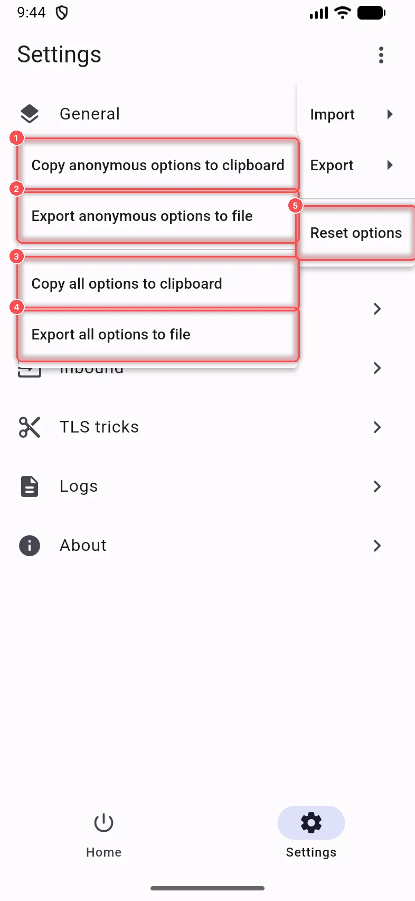
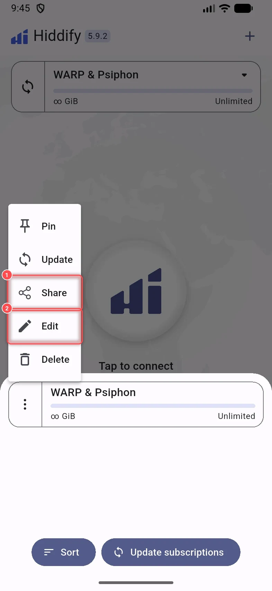
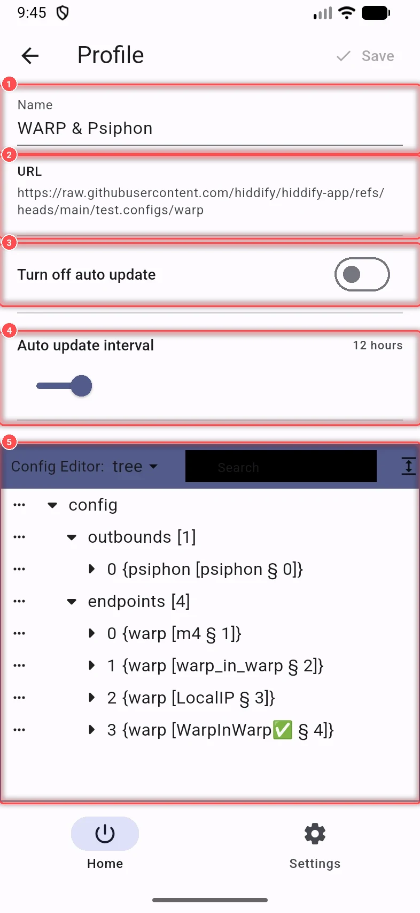

# Import, export and reset settings, and edit a profile

This page shows how to save all your Hiddify app settings to a file (to move them to another device, or to keep a copy), how to bring them back or reset them, and how to edit a profile.

!!! note "Written for Hiddify app 5.9"
    This page is for Hiddify app **5.9** (5.9.2). The screenshots come from Android; the menus are the same on every platform.

## Export your settings

Open **Settings** and tap **⋮** at the top, then **Export**.

1. **Copy anonymous options to clipboard**
2. **Export anonymous options to file**
3. **Copy all options to clipboard**
4. **Export all options to file**
5. **Reset options**: puts every setting back to its default (profiles are not touched).

**Anonymous options** are all your settings *without* your private ones: the WARP+ license keys of the chain (Extra security and Unblocker) and the local network sharing password. Use them when you share your settings with someone, or attach them to a question in a support group. **All options** include those too: use them only for your own devices.

The file is JSON. It holds the app's settings, not your profiles: add your profiles on the new device separately (or share them, see below).

!!! tip
    [HiddifyCli](/core/) can run with these settings: export **all options to file** and pass the file with `-d`.

## Import settings

**Settings → ⋮ → Import → Import options from clipboard** or **Import options from file**. The app asks first: importing overwrites all your settings with the imported values.

## Edit a profile

On the Home page, tap the profile card (or **View all profiles**), then **⋮** next to a profile:

- **Pin**: keeps it at the top of the list.
- **Update**: downloads the latest servers of the subscription now.
- **Share** (1): as a QR code or subscription link, the full configuration (JSON, your settings included), or **Send to TV** (see [Hiddify on Android TV](Hiddify-on-Android-TV.md)).
- **Edit** (2): opens the profile page below.
- **Delete**: removes it (you can't undo this).

1. **Name**: the name shown in the app.
2. **URL**: the subscription link the profile updates from.
3. **Turn off auto update**: stops automatic updates of this profile.
4. **Auto update interval**: how often it updates (for example every 12 hours).
5. **Config Editor**: the profile's configuration, as a **tree** or as **text**, with search. Change it only if you know the config format; a wrong edit can stop the profile from connecting.

Tap **Save** at the top to keep your changes.

On computers, the profile page also has **Administrator permission** (**Ask each time**, **Always use administrator permission** or **Always continue without administrator permission**): see [Hiddify on desktop](Hiddify-app-on-desktop.md).

The profiles list (Home → profile card) also has **Sort** (alphabetically or by last update) and **Update subscriptions** (all at once). Subscriptions that have expired, ran out of traffic or keep failing to update can be removed together with **Remove inactive subscriptions**.

## Related articles

- [How to use the Hiddify app](How-to-use-Hiddify-app.md): add a profile, connect, the basic settings
- [How to install the Hiddify app](How-to-install-Hiddify-app.md)
- [DNS tunnels and resolvers (Soar, DNSTT, MasterDNS)](DNS-tunnels-in-Hiddify-app.md)

