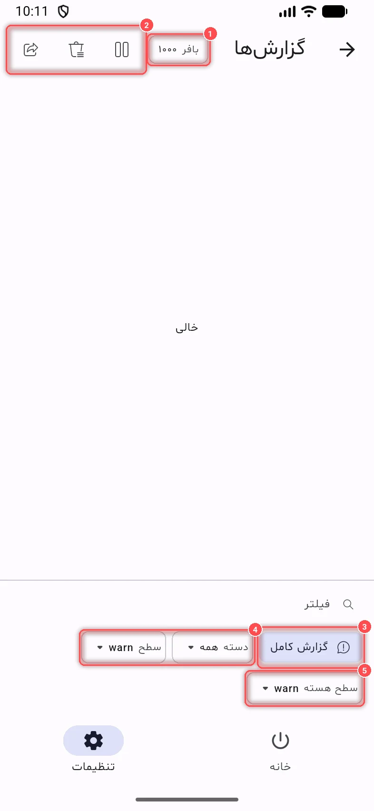
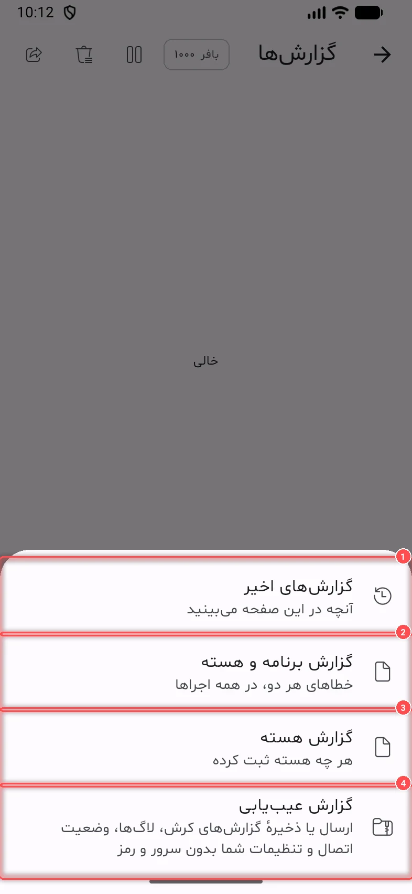
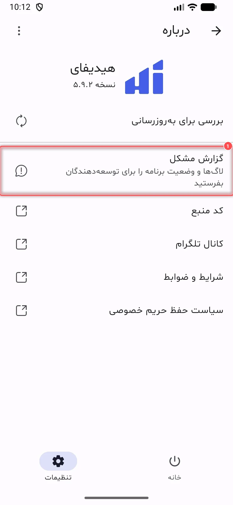
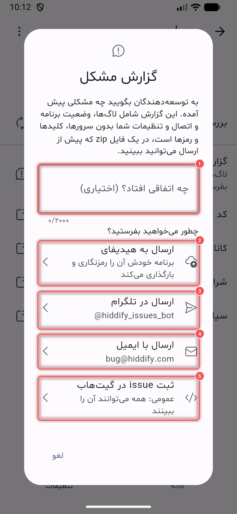

# گزارش‌ها (لاگ) و گزارش مشکل در اپ هیدیفای

وقتی چیزی کار نمی‌کند، گزارش‌ها (لاگ‌ها) می‌گویند چرا. این صفحه نشان می‌دهد گزارش‌ها کجا هستند، چطور ذخیره‌شان کنید، و چطور یک گزارش بدون سرورها و رمزهایتان برای توسعه‌دهندگان هیدیفای بفرستید.

!!! note "نوشته‌شده برای اپ هیدیفای نسخهٔ ۵.۹"
    این صفحه برای اپ هیدیفای **نسخهٔ ۵.۹** (۵.۹.۲) است. تصویرها از اندروید هستند. در کامپیوتر صفحهٔ گزارش‌ها در نوار کناری است.

## صفحهٔ گزارش‌ها

**تنظیمات ← گزارش‌ها** را باز کنید.

1. **بافر**: چند خط در صفحه نگه داشته شود.
2. مکث، پاک‌سازی و اشتراک‌گذاری گزارش‌ها.
3. **گزارش کامل**: یک گزارش برای توسعه‌دهندگان می‌سازد (پایین را ببینید).
4. **دسته** و **سطح** خط‌ها را فیلتر می‌کنند؛ کادر **فیلتر** بالای آن‌ها در خط‌ها جستجو می‌کند.
5. **سطح هسته**: هسته چقدر جزئیات بنویسد. بعد از اتصال دوباره اعمال می‌شود؛ فقط وقتی دنبال مشکلی هستید آن را روی **debug** بگذارید.

دکمهٔ اشتراک‌گذاری گزارش‌ها را ذخیره می‌کند یا می‌فرستد:

1. **گزارش‌های اخیر**: آنچه در همین صفحه می‌بینید.
2. **گزارش برنامه و هسته**: خطاهای هر دو، در همهٔ اجراها.
3. **گزارش هسته**: هر چه هسته ثبت کرده.
4. **گزارش عیب‌یابی**: گزارش‌های کرش، لاگ‌ها، وضعیت اتصال و تنظیمات شما، بدون سرورها و رمزها، در یک فایل.

اگر هسته کرش کرده باشد، گزینهٔ **کرش هسته** هم ظاهر می‌شود: آنچه هسته هنگام آخرین کرش انجام می‌داد.

!!! warning "هشدار"
    فایل‌های **گزارش‌های اخیر**، **گزارش برنامه و هسته** و **گزارش هسته** ممکن است آدرس سرورهای شما را داشته باشند. پیش از گذاشتنشان در جای عمومی نگاهشان کنید. **گزارش عیب‌یابی** و **گزارش کامل** سرورها، کلیدها و رمزها را حذف می‌کنند.

## گزارش مشکل

**تنظیمات ← درباره ← گزارش مشکل** را باز کنید، یا در صفحهٔ گزارش‌ها **گزارش کامل** را بزنید.

گزارش شامل لاگ‌ها، وضعیت برنامه و اتصال و تنظیمات شماست، بدون سرورها، کلیدها و رمزها، در یک فایل zip که پیش از ارسال می‌توانید ببینید.

1. **چه اتفاقی افتاد؟ (اختیاری)**: چه کاری کردید، چه انتظاری داشتید و به‌جای آن چه دیدید.
2. **ارسال به هیدیفای**: اپ خودش گزارش را رمزنگاری و بارگذاری می‌کند. فقط تیم هیدیفای می‌تواند بازش کند.
3. **ارسال در تلگرام**: به بات پشتیبانی. خصوصی است: فقط تیم پشتیبانی هیدیفای گزارش را می‌بیند.
4. **ارسال با ایمیل**: به تیم هیدیفای. خصوصی است.
5. **ثبت issue در گیت‌هاب**: **عمومی** است و هر کسی می‌تواند issue را بخواند و فایل را دانلود کند.

برای تلگرام، ایمیل و گیت‌هاب، اپ اول گزارش را ذخیره می‌کند و بعد مراحل را نشان می‌دهد: بات، ایمیل یا صفحهٔ گیت‌هاب را باز کنید، فایل را پیوست کنید و بفرستید.

## بعد از کرش

اگر اپ دفعهٔ قبل کرش کرده باشد، در اجرای بعدی می‌پرسد: **هیدیفای دفعهٔ قبل کرش کرد**، با همان روش‌های ارسال گزارش. فرستادن آن به توسعه‌دهندگان کمک می‌کند کرش را برطرف کنند.

## مقاله‌های مرتبط

- [کار با اپ هیدیفای](How-to-use-Hiddify-app.md): افزودن پروفایل، اتصال و تنظیمات پایه
- [نصب اپ هیدیفای](How-to-install-Hiddify-app.md)

