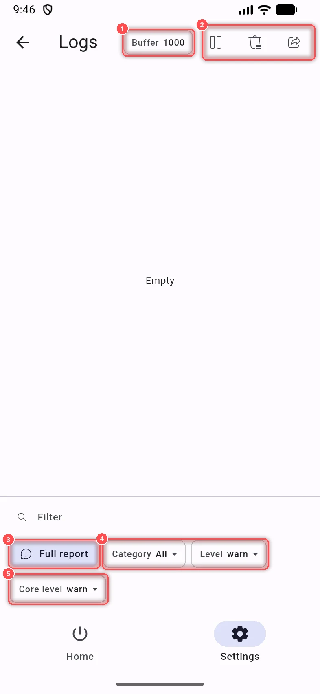
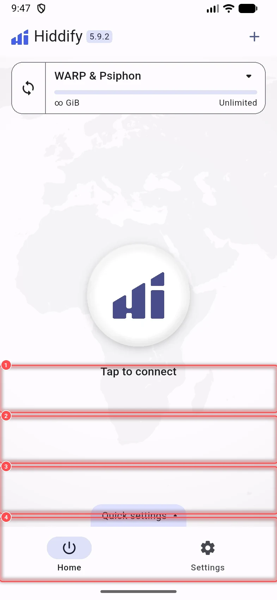
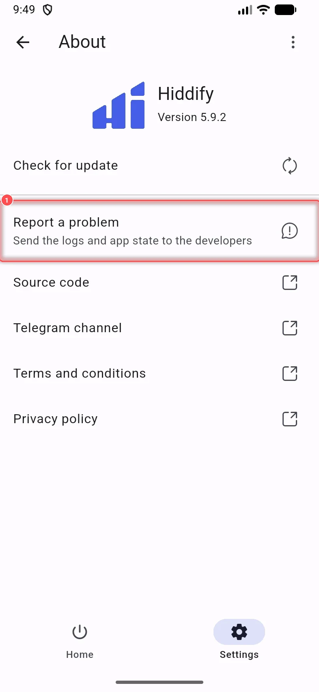
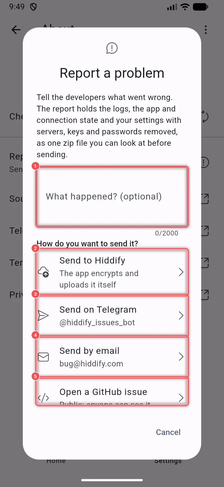

# Logs and reporting a problem in the Hiddify app

When something does not work, the logs say why. This page shows where they are, how to save them, and how to send a report to the Hiddify developers without your servers or passwords in it.

!!! note "Written for Hiddify app 5.9"
    This page is for Hiddify app **5.9** (5.9.2). The screenshots come from Android. On computers the Logs page is in the sidebar.

## The Logs page

Open **Settings → Logs**.

1. **Buffer**: how many lines are kept on the page.
2. Pause, clear and share the logs.
3. **Full report**: makes a report for the developers (see below).
4. **Category** and **Level** filter the lines; the **Filter** box above searches them.
5. **Core level**: how much the core writes. It takes effect after you reconnect; set it to **debug** only while you look for a problem.

The share button saves or sends the logs:

1. **Recent logs**: what you see on the page.
2. **App and core log**: errors from both, across runs.
3. **Core log**: everything the core recorded.
4. **Diagnostics report**: crash reports, logs, the connection state and your settings, without servers or passwords, in one file.

If the core crashed, a **Core crash** item also appears: what the core was doing when it last crashed.

!!! warning
    The **Recent logs**, **App and core log** and **Core log** files can contain your server addresses. Look at them before you post them anywhere public. The **Diagnostics report** and **Full report** remove servers, keys and passwords.

## Report a problem

Open **Settings → About → Report a problem**, or **Full report** on the Logs page.

The report holds the logs, the app and connection state and your settings, with servers, keys and passwords removed, as one zip file you can look at before sending.

1. **What happened? (optional)**: what you did, what you expected, what you saw instead.
2. **Send to Hiddify**: the app encrypts the report and uploads it itself. Only the Hiddify team can open it.
3. **Send on Telegram**: to the support bot. Private: only the Hiddify support team sees it.
4. **Send by email**: to the Hiddify team. Private.
5. **Open a GitHub issue**: **public**, anyone can read the issue and download the file.

For Telegram, email and GitHub, the app first saves the report, then shows the steps: open the bot, mail or GitHub page, attach the file and send it.

## After a crash

If the app crashed the last time, it asks at the next start: **Hiddify crashed last time**, with the same ways to send a report. Sending it helps the developers fix the crash.

## Related articles

- [How to use the Hiddify app](How-to-use-Hiddify-app.md): add a profile, connect, the basic settings
- [How to install the Hiddify app](How-to-install-Hiddify-app.md)

