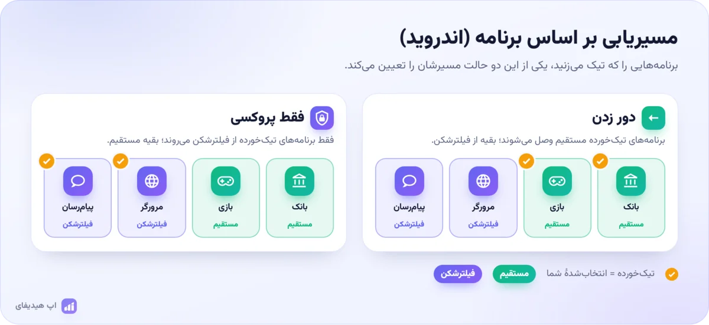
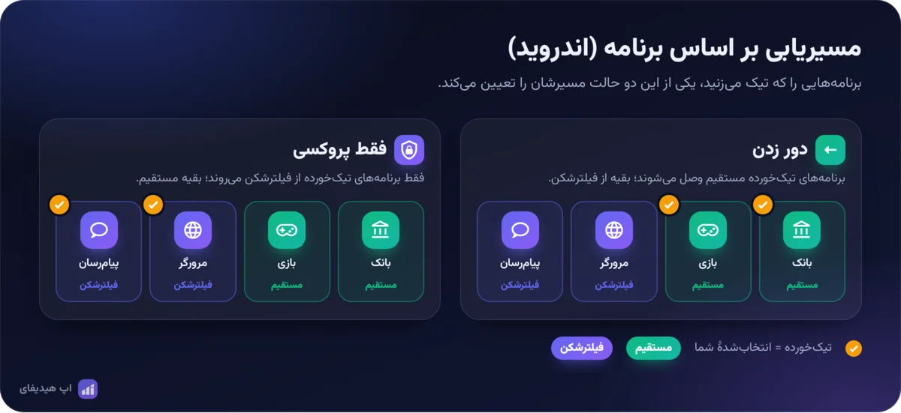
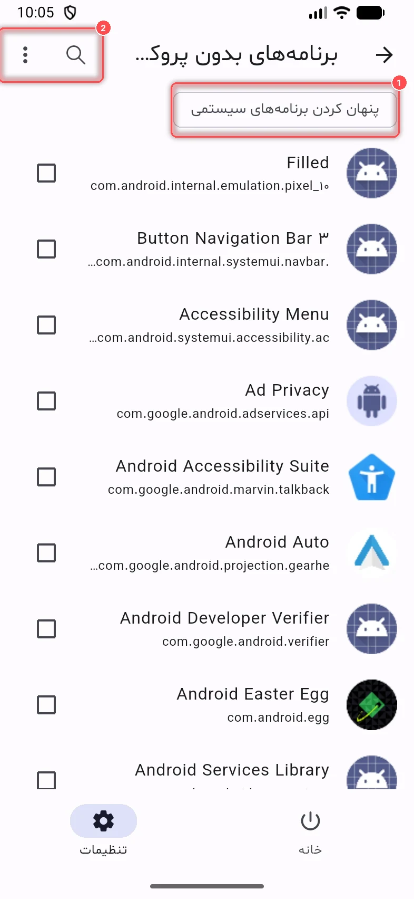
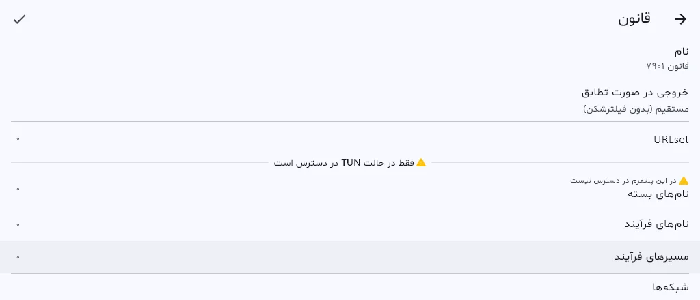

# انتخاب برنامه‌هایی که از VPN استفاده می‌کنند

همهٔ برنامه‌ها به VPN نیاز ندارند. برنامهٔ بانک ممکن است با آدرس خارجی باز نشود، بازی آنلاین کوتاه‌ترین مسیر را می‌خواهد، و یک برنامهٔ داخلی بدون دور زدن معمولاً سریع‌تر است. اپ هیدیفای اجازه می‌دهد برای هر برنامه جدا تصمیم بگیرید. دو راه برای استفاده از آن هست:

<svg aria-hidden="true" xmlns="http://www.w3.org/2000/svg" viewBox="0 0 24 24"><path d="M11.5 1 2 6v2h19V6m-5 4v7h3v-7M2 22h19v-3H2m8-9v7h3v-7m-9 0v7h3v-7H4Z"/></svg>
<b>چند برنامه بیرون از VPN بمانند</b>همه‌چیز از VPN می‌رود، به‌جز برنامه‌هایی که انتخاب می‌کنید: مثلاً بانک، یک فروشگاه داخلی یا یک بازی.

<svg aria-hidden="true" xmlns="http://www.w3.org/2000/svg" viewBox="0 0 24 24"><path d="M21 11c0 5.55-3.84 10.74-9 12-5.16-1.26-9-6.45-9-12V5l9-4 9 4v6m-9 10c3.75-1 7-5.46 7-9.78V6.3l-7-3.12L5 6.3v4.92C5 15.54 8.25 20 12 21m2.8-10V9.5C14.8 8.1 13.4 7 12 7S9.2 8.1 9.2 9.5V11c-.6 0-1.2.6-1.2 1.2v3.5c0 .7.6 1.3 1.2 1.3h5.5c.7 0 1.3-.6 1.3-1.2v-3.5c0-.7-.6-1.3-1.2-1.3m-1.3 0h-3V9.5c0-.8.7-1.3 1.5-1.3s1.5.5 1.5 1.3V11Z"/></svg>
<b>فقط چند برنامه از VPN بروند</b>فقط برنامه‌هایی که انتخاب می‌کنید از VPN می‌روند و بقیه مستقیم به اینترنت وصل می‌شوند. مثلاً فقط تلگرام و مرورگر.

<figure class="hi-diag">
<picture><source media="(max-width: 700px)" srcset="/assets/app/Routing-in-Hiddify-app/fa-diagram-modes-m-light.webp"></picture>
<picture><source media="(max-width: 700px)" srcset="/assets/app/Routing-in-Hiddify-app/fa-diagram-modes-m-dark.webp"></picture>
</figure>

روش انتخاب برنامه‌ها به دستگاه بستگی دارد: در اندروید آن‌ها را در یک فهرست تیک می‌زنید؛ در کامپیوتر نام برنامه را در یک قانون مسیریابی می‌نویسید.

## در اندروید: برنامه‌ها را در فهرست تیک بزنید { #on-android }

1. **تنظیمات ← مسیریابی** را باز کنید و **مسیریابی بر اساس برنامه** را روشن کنید.
2. حالت را انتخاب کنید:
    - **دور زدن**: برنامه‌هایی که انتخاب می‌کنید از VPN **عبور نمی‌کنند**. بقیه عبور می‌کنند.
    - **فقط پروکسی**: **فقط** برنامه‌هایی که انتخاب می‌کنید از VPN عبور می‌کنند. بقیه مستقیم وصل می‌شوند.
3. روی **انتخاب برنامه‌ها** بزنید و برنامه‌ها را تیک بزنید. **پنهان کردن برنامه‌های سیستمی** فهرست را کوتاه می‌کند و دکمهٔ جستجو برنامه را با اسمش پیدا می‌کند.

    

4. برگردید. انتخاب همان لحظه ذخیره می‌شود. اگر برنامه‌ای هنوز مثل قبل رفتار می‌کند، یک بار قطع و وصل کنید.

این روش در حالت **VPN** کار می‌کند، چون خود اندروید ترافیک هر برنامه را به داخل VPN یا بیرون از آن می‌فرستد.

### فهرست آمادهٔ منطقهٔ شما

لازم نیست همهٔ برنامه‌های داخلی را خودتان پیدا کنید. **انتخاب خودکار بر پایهٔ (منطقهٔ شما)** را روشن کنید تا اپ یک فهرست آماده از برنامه‌های منطقهٔ شما را به فهرست حالت فعلی اضافه کند. در حالت **دور زدن**، این‌ها برنامه‌هایی هستند که معمولاً باید بیرون از VPN بمانند، مثل اپ‌های بانکی.

- برنامه‌هایی که این‌طور اضافه می‌شوند برچسب **خودکار** دارند تا از انتخاب‌های خودتان جدا شوند.
- فهرست خودش به‌روز می‌ماند. دکمهٔ به‌روزرسانی کنارش (**اکنون به‌روزرسانی کن**) آن را همان لحظه به‌روز می‌کند.
- اگر برنامه‌ای را خودتان حذف کنید، حذف می‌ماند، حتی وقتی فهرست به‌روز شود.
- منطقه از گزینهٔ **منطقه** بالای صفحهٔ مسیریابی برداشته می‌شود.

### خوب است بدانید

- برنامه‌ای که بیرون از VPN است از هیچ قانون مسیریابی پیروی نمی‌کند: در فهرست برنامه‌ها کنارش نوشته می‌شود **خارج از VPN · قانون اعمال نمی‌شود**.
- منوی ⋮ فهرست برنامه‌ها می‌تواند انتخاب‌ها را **وارد کند** یا **خروجی بگیرد** (برای بردن به گوشی دیگر) یا **پاک کند**.
- برای کنترل بیشتر، یک [قانون مسیریابی](Routing-in-Hiddify-app.md#add-your-own-rule) هم می‌تواند برنامه را با **نام بسته‌اش** بشناسد، مثلاً `org.telegram.messenger`، و آن را **مستقیم**، با **فیلترشکن** یا **مسدود** کند. نام بسته همان بخش بعد از `id=` در لینک برنامه در Google Play است.

## در کامپیوتر: یک قانون با نام برنامه { #on-a-computer }

در ویندوز، مک و لینوکس فهرستی برای تیک زدن نیست. به‌جایش یک قانون مسیریابی می‌سازید که برنامه را با نام فایلش می‌شناسد. این روش فقط در حالت **VPN** کار می‌کند: ویرایشگر قانون کنار این فیلدها می‌نویسد **فقط در حالت TUN در دسترس است**.

1. **تنظیمات ← مسیریابی** را باز کنید و روی **+** (**افزودن قانون**) بزنید.
2. **خروجی در صورت تطابق** را تعیین کنید:
    - **مستقیم (بدون فیلترشکن)** برنامه را بیرون از VPN نگه می‌دارد (مثلاً یک بازی یا برنامهٔ بانک).
    - **فیلترشکن** آن را از VPN می‌فرستد.
    - **مسدود** اینترنتش را کامل قطع می‌کند.
3. روی **نام‌های فرآیند** بزنید، بعد روی **+**، نام فایل برنامه را بنویسید و **باشه** را بزنید. هر چند نام که لازم دارید اضافه کنید، هر کدام در یک ردیف.
4. روی ✓ بالای صفحه بزنید تا قانون ذخیره شود.

مثلاً قانونی که Steam (و بازی‌هایش) را بیرون از VPN نگه می‌دارد:

### نام برنامه را از کجا پیدا کنم؟

<svg aria-hidden="true" xmlns="http://www.w3.org/2000/svg" viewBox="0 0 24 24"><path d="M3 12V6.75l6-1.32v6.48L3 12m17-9v8.75l-10 .15V5.21L20 3M3 13l6 .09v6.81l-6-1.15V13m17 .25V22l-10-1.91V13.1l10 .15Z"/></svg>
<b>ویندوز</b><b>Task Manager</b> را باز کنید، روی برنامه راست‌کلیک کنید و <b>Go to details</b> را بزنید. نامی که انتخاب می‌شود همان است که باید بنویسید، مثلاً <code>chrome.exe</code> یا <code>Telegram.exe</code>.

<svg aria-hidden="true" xmlns="http://www.w3.org/2000/svg" viewBox="0 0 24 24"><path d="M21 16H3V4h18m0-2H3c-1.11 0-2 .89-2 2v12a2 2 0 0 0 2 2h7v2H8v2h8v-2h-2v-2h7a2 2 0 0 0 2-2V4a2 2 0 0 0-2-2Z"/></svg>
<b>مک</b><b>Activity Monitor</b> را باز کنید و ستون <b>Process Name</b> را نگاه کنید، مثلاً <code>Telegram</code>.

<svg aria-hidden="true" xmlns="http://www.w3.org/2000/svg" viewBox="0 0 24 24"><path d="M21.7 18.6v-1l1.1-.8c.1-.1.2-.2.1-.3l-1-1.7c0-.1-.2-.1-.3-.1l-1.2.5c-.3-.2-.6-.4-.9-.5l-.2-1.3c0-.1-.1-.2-.2-.2h-2c-.2 0-.3.1-.3.2l-.2 1.3c-.3.2-.5.3-.8.5l-1.2-.5c-.1 0-.2 0-.3.1l-1 1.7c0 .1 0 .2.1.3l1.1.8v1l-1.1.8c-.1.1-.2.2-.1.3l1 1.7c.1.1.2.1.3.1l1.2-.5c.2.2.5.4.8.5l.2 1.3c.1.1.2.2.3.2h2c.1 0 .2-.1.2-.2l.2-1.3c.3-.2.5-.3.8-.5l1.2.4c.1 0 .2 0 .3-.1l1-1.7c.1-.1.1-.2 0-.2l-1.1-.8m-3.7.9c-.8 0-1.5-.7-1.5-1.5s.7-1.5 1.5-1.5 1.5.7 1.5 1.5-.7 1.5-1.5 1.5M11 18c0-3.9 3.1-7 7-7 2 0 3.7.8 5 2.1V4c0-1.1-.9-2-2-2H3c-1.1 0-2 .9-2 2v16c0 1.1.9 2 2 2h9.3c-.8-1.1-1.3-2.5-1.3-4M3 4h18v3H3V4Z"/></svg>
<b>لینوکس</b>برنامهٔ مانیتور سیستم را باز کنید، یا در ترمینال <code>ps -e</code> را بزنید. نام، نام خود برنامه است، مثلاً <code>firefox</code>.

در ویندوز نام همیشه به `.exe` تمام می‌شود (قانون `.bat`، `.cmd` و `.com` را هم قبول می‌کند).

### فایل نصب و برنامه‌های Microsoft Store

مثال: Bing Wallpaper

BingWallpaper.exeفایلی که برای نصب دانلود می‌کنید: این <b>نه</b>

BingWallpaperApp.exeبرنامه‌ای که بعد از نصب اجرا می‌شود: نامی که باید بنویسید <b>این</b> است

- **نام برنامه‌ای را بنویسید که اجرا می‌شود، نه فایل نصب.** فایل `.msi`، یا فایل `.exe` که برای نصب چیزی دانلود کرده‌اید، فقط آن را نصب می‌کند؛ برنامه‌ای نیست که از اینترنت استفاده کند.
- **برنامه‌های Microsoft Store** هم همین‌طورند: برنامه را باز کنید و نامش را در **Task Manager ← Go to details** پیدا کنید. یا PowerShell را باز کنید و `tasklist /apps` را بزنید: همهٔ برنامه‌های Store که در حال اجرا هستند با نام `.exe`شان در ستون اول دیده می‌شوند.
- **بعضی برنامه‌ها چند برنامهٔ جدا اجرا می‌کنند.** همهٔ نام‌هایی را که برای آن برنامه می‌بینید اضافه کنید.
- **بعضی برنامه‌های Store در پس‌زمینه از طریق خود ویندوز دانلود می‌کنند** (مثلاً از طریق `svchost.exe`). آن بخش نام برنامه را ندارد و قانون آن را نمی‌گیرد.

### نام‌های فرآیند یا مسیرهای فرآیند؟

- **نام‌های فرآیند** (`chrome.exe`) تقریباً همیشه انتخاب درست است.
- **مسیرهای فرآیند** مسیر کامل را می‌گیرد، مثلاً `C:\Program Files\Google\Chrome\Application\chrome.exe`. فقط وقتی از آن استفاده کنید که دو برنامهٔ مختلف نام یکسان دارند.
- برای برنامه‌های Microsoft Store از **مسیرهای فرآیند** استفاده نکنید: این برنامه‌ها در `C:\Program Files\WindowsApps\…` در پوشه‌ای نصب می‌شوند که شمارهٔ نسخه در نامش است، پس مسیر با هر به‌روزرسانی عوض می‌شود.

## مقاله‌های مرتبط

- [مسیریابی در اپ هیدیفای](Routing-in-Hiddify-app.md)
- [اپ هیدیفای چطور سرور انتخاب می‌کند](Default-proxy-and-Balancer-in-Hiddify-app.md)
- [اپ هیدیفای روی کامپیوتر](Hiddify-app-on-desktop.md)
- [آموزش کار با اپ هیدیفای](How-to-use-Hiddify-app.md)

