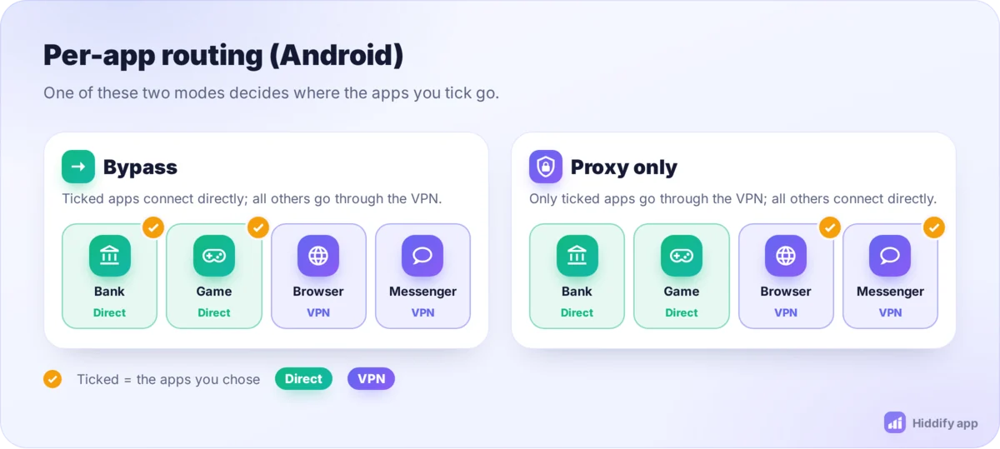
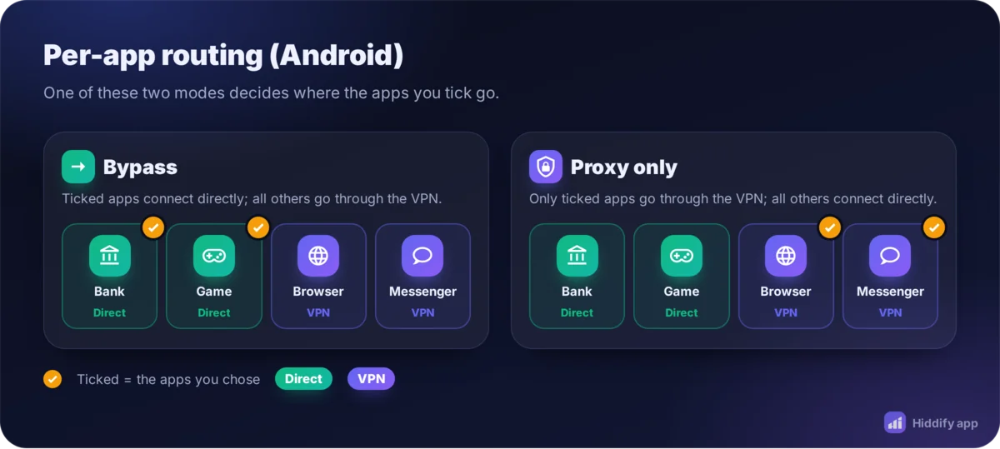
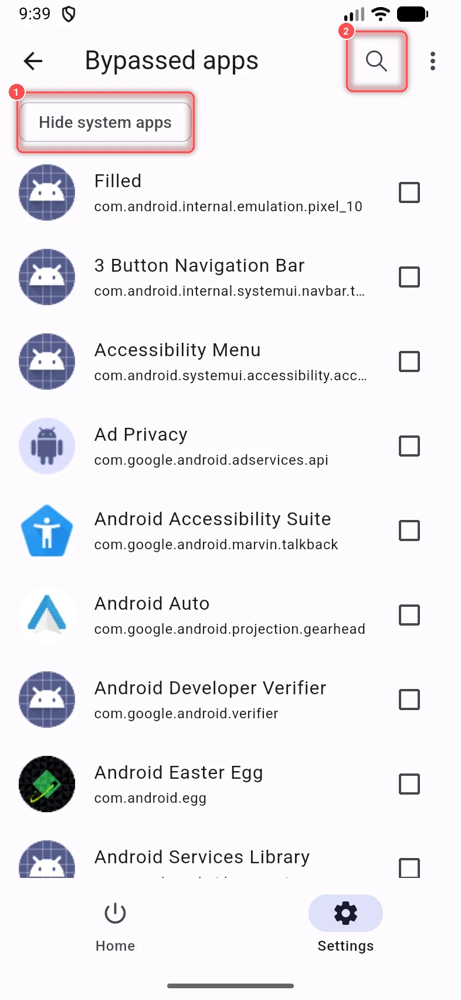
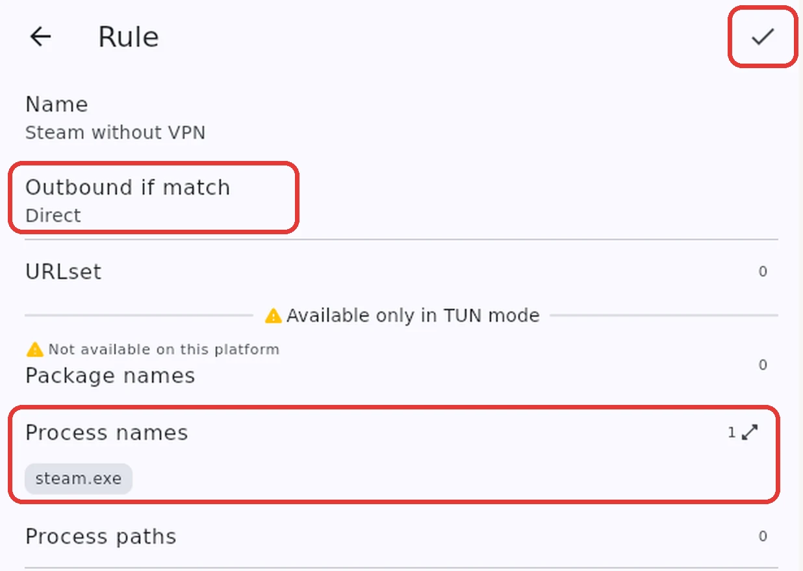

# Choose which apps use the VPN

Not every app needs the VPN. A banking app may refuse to open from a foreign address, an online game wants the shortest path, and a local app is often faster without a detour. The Hiddify app lets you decide, app by app. There are two ways to use it:

<svg aria-hidden="true" xmlns="http://www.w3.org/2000/svg" viewBox="0 0 24 24"><path d="M11.5 1 2 6v2h19V6m-5 4v7h3v-7M2 22h19v-3H2m8-9v7h3v-7m-9 0v7h3v-7H4Z"/></svg>
<b>Keep a few apps outside the VPN</b>Everything uses the VPN, except the apps you choose: for example your bank, a local shop or a game.

<svg aria-hidden="true" xmlns="http://www.w3.org/2000/svg" viewBox="0 0 24 24"><path d="M21 11c0 5.55-3.84 10.74-9 12-5.16-1.26-9-6.45-9-12V5l9-4 9 4v6m-9 10c3.75-1 7-5.46 7-9.78V6.3l-7-3.12L5 6.3v4.92C5 15.54 8.25 20 12 21m2.8-10V9.5C14.8 8.1 13.4 7 12 7S9.2 8.1 9.2 9.5V11c-.6 0-1.2.6-1.2 1.2v3.5c0 .7.6 1.3 1.2 1.3h5.5c.7 0 1.3-.6 1.3-1.2v-3.5c0-.7-.6-1.3-1.2-1.3m-1.3 0h-3V9.5c0-.8.7-1.3 1.5-1.3s1.5.5 1.5 1.3V11Z"/></svg>
<b>Send only a few apps through the VPN</b>Only the apps you choose use the VPN; everything else goes straight to the internet. For example only Telegram and your browser.

<figure class="hi-diag">
<picture><source media="(max-width: 700px)" srcset="/assets/app/Routing-in-Hiddify-app/en-diagram-modes-m-light.webp"></picture>
<picture><source media="(max-width: 700px)" srcset="/assets/app/Routing-in-Hiddify-app/en-diagram-modes-m-dark.webp"></picture>
</figure>

How you choose the apps depends on the device: on Android you tick them in a list; on a computer you write the name of the program in a routing rule.

## On Android: tick the apps in a list { #on-android }

1. Open **Settings → Routing** and turn on **App-based routing**.
2. Pick the mode:
    - **Bypass**: the apps you choose do **not** use the VPN. Everything else does.
    - **Proxy only**: **only** the apps you choose use the VPN. Everything else goes direct.
3. Tap **Choose apps** and tick the apps. **Hide system apps** keeps the list short, and the search button finds an app by its name.

    

4. Go back. The choice is saved at once. If an app still behaves as before, disconnect and connect again.

This works in **VPN** mode, because Android itself sends each app's traffic into the VPN or around it.

### The ready list for your region

You don't have to find every local app yourself. Turn on **Auto selection based on (your region)** and the app adds a ready list of apps for your region to the list of the current mode. With **Bypass**, these are apps that usually need to stay outside the VPN, such as local banking apps.

- The apps added this way carry an **Auto** tag, so you can tell them from your own.
- The list keeps itself up to date. The refresh button next to it (**Update now**) updates it at once.
- If you remove an app by hand, it stays removed, even when the list is updated.
- The region comes from **Region** at the top of the Routing page.

### Good to know

- An app outside the VPN does not follow any routing rule: the app list shows **Outside the VPN · rule won't apply** next to it.
- The ⋮ menu of the app list can **import** or **export** your selection (to move it to another phone) or **clear** it.
- For more control, a [routing rule](Routing-in-Hiddify-app.md#add-your-own-rule) can also pick an app by its **Package name**, for example `org.telegram.messenger`, and send it **Direct**, through the **Proxy**, or **Block** it. The package name is the part after `id=` in the app's Google Play link.

## On a computer: a rule with the program's name { #on-a-computer }

On Windows, macOS and Linux there is no list to tick. Instead you make a routing rule that recognizes the program by the name of its file. This works only in **VPN** mode: the rule editor shows **Available only in TUN mode** next to these fields.

1. Open **Settings → Routing** and click **+** (**Add rule**).
2. Set **Outbound if match**:
    - **Direct** keeps the program outside the VPN (for example a game or a local banking program).
    - **Proxy** sends it through the VPN.
    - **Block** cuts its internet completely.
3. Click **Process names**, then **+**, type the program's file name and click **OK**. Add as many names as you need, one per line.
4. Click the ✓ at the top to save the rule.

For example, a rule that keeps Steam (and its games) outside the VPN:

### How do I find the program's name?

<svg aria-hidden="true" xmlns="http://www.w3.org/2000/svg" viewBox="0 0 24 24"><path d="M3 12V6.75l6-1.32v6.48L3 12m17-9v8.75l-10 .15V5.21L20 3M3 13l6 .09v6.81l-6-1.15V13m17 .25V22l-10-1.91V13.1l10 .15Z"/></svg>
<b>Windows</b>Open <b>Task Manager</b>, right-click the app and choose <b>Go to details</b>. The highlighted name is the one to type, for example <code>chrome.exe</code> or <code>Telegram.exe</code>.

<svg aria-hidden="true" xmlns="http://www.w3.org/2000/svg" viewBox="0 0 24 24"><path d="M21 16H3V4h18m0-2H3c-1.11 0-2 .89-2 2v12a2 2 0 0 0 2 2h7v2H8v2h8v-2h-2v-2h7a2 2 0 0 0 2-2V4a2 2 0 0 0-2-2Z"/></svg>
<b>macOS</b>Open <b>Activity Monitor</b> and look at the <b>Process Name</b> column, for example <code>Telegram</code>.

<svg aria-hidden="true" xmlns="http://www.w3.org/2000/svg" viewBox="0 0 24 24"><path d="M21.7 18.6v-1l1.1-.8c.1-.1.2-.2.1-.3l-1-1.7c0-.1-.2-.1-.3-.1l-1.2.5c-.3-.2-.6-.4-.9-.5l-.2-1.3c0-.1-.1-.2-.2-.2h-2c-.2 0-.3.1-.3.2l-.2 1.3c-.3.2-.5.3-.8.5l-1.2-.5c-.1 0-.2 0-.3.1l-1 1.7c0 .1 0 .2.1.3l1.1.8v1l-1.1.8c-.1.1-.2.2-.1.3l1 1.7c.1.1.2.1.3.1l1.2-.5c.2.2.5.4.8.5l.2 1.3c.1.1.2.2.3.2h2c.1 0 .2-.1.2-.2l.2-1.3c.3-.2.5-.3.8-.5l1.2.4c.1 0 .2 0 .3-.1l1-1.7c.1-.1.1-.2 0-.2l-1.1-.8m-3.7.9c-.8 0-1.5-.7-1.5-1.5s.7-1.5 1.5-1.5 1.5.7 1.5 1.5-.7 1.5-1.5 1.5M11 18c0-3.9 3.1-7 7-7 2 0 3.7.8 5 2.1V4c0-1.1-.9-2-2-2H3c-1.1 0-2 .9-2 2v16c0 1.1.9 2 2 2h9.3c-.8-1.1-1.3-2.5-1.3-4M3 4h18v3H3V4Z"/></svg>
<b>Linux</b>Open the system monitor, or run <code>ps -e</code> in a terminal. The name is the program's own, for example <code>firefox</code>.

On Windows the name always ends in `.exe` (the rule also accepts `.bat`, `.cmd` and `.com`).

### Installers and Microsoft Store apps

Example: Bing Wallpaper

BingWallpaper.exethe file you download to install it: <b>not</b> this one

BingWallpaperApp.exethe program that runs afterwards: <b>this</b> is the name to type

- **Type the program that runs, not the installer.** An `.msi` file, or an `.exe` you downloaded to install something, only installs it; it is not the program that uses the internet.
- **Microsoft Store apps** work the same way: open the app, then find its name in **Task Manager → Go to details**. Or open PowerShell and run `tasklist /apps`: every running Store app is listed with its `.exe` name in the first column.
- **Some apps run more than one program.** Add every name you see for that app.
- **Some Store apps download in the background through Windows itself** (for example through `svchost.exe`). That part does not carry the app's name, so the rule does not catch it.

### Process names or Process paths?

- **Process names** (`chrome.exe`) is the right choice almost always.
- **Process paths** takes the full path, for example `C:\Program Files\Google\Chrome\Application\chrome.exe`. Use it only when two different programs have the same name.
- Don't use **Process paths** for Microsoft Store apps: they live in `C:\Program Files\WindowsApps\…`, in a folder whose name has the version number in it, so the path changes with every update.

## Related articles

- [Routing in the Hiddify app](Routing-in-Hiddify-app.md)
- [How the Hiddify app picks a server](Default-proxy-and-Balancer-in-Hiddify-app.md)
- [The Hiddify app on computers](Hiddify-app-on-desktop.md)
- [How to use the Hiddify app](How-to-use-Hiddify-app.md)

