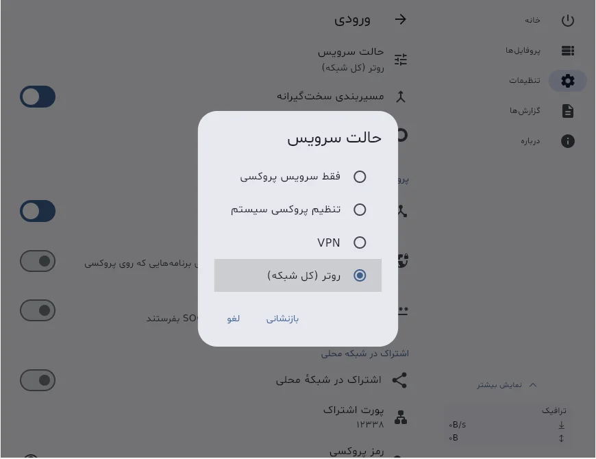
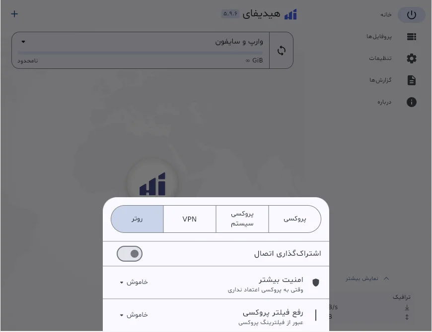
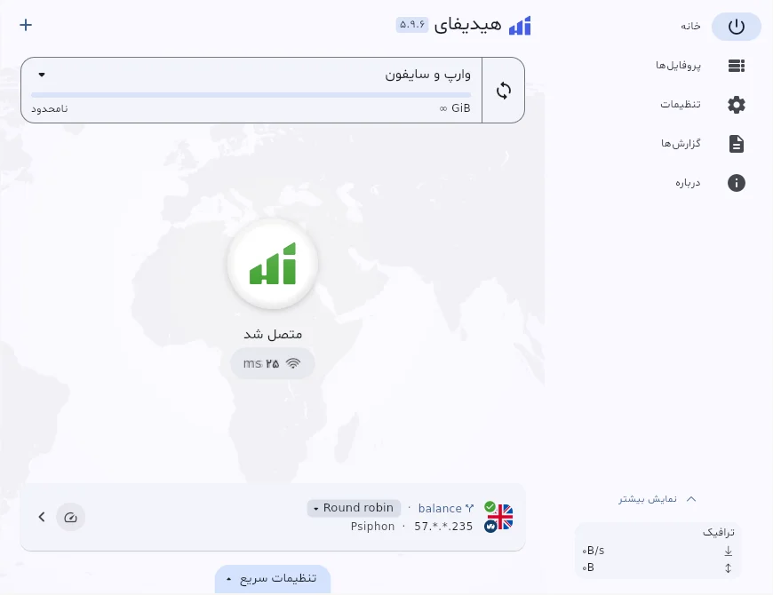

# حالت روتر در لینوکس: هیدیفای برای کل شبکه

**حالت روتر** یک کامپیوتر لینوکسی را که مسیریاب یک شبکه است (یک گیت‌وی، یک مینی‌پی‌سی بین مودم و وای‌فای، یا یک برد کوچک) به پروکسی شفاف برای همهٔ دستگاه‌های پشت آن تبدیل می‌کند. گوشی‌ها، تلویزیون‌ها، کنسول‌ها و دستگاه‌های هوشمند همه بدون هیچ برنامه یا تنظیمی روی خودشان از هیدیفای عبور می‌کنند.

!!! note "نوشته‌شده برای اپ هیدیفای نسخهٔ ۵.۹"
    حالت روتر در اپ هیدیفای **نسخهٔ ۵.۹** (۵.۹.۲) اضافه شده و فقط در **لینوکس** هست. روی روتر OpenWrt از [هستهٔ هیدیفای روی OpenWrt](How-to-use-HiddifyCli-on-OpenWrt.md) استفاده کنید؛ روی سرور لینوکسی بدون صفحه‌نمایش، [حالت روتر هسته](/fa/core/) را ببینید.

## چه چیزهایی را پوشش می‌دهد

- **TCP، UDP و ICMP** دستگاه‌های پشت گیت‌وی: وب، DNS، QUIC، بازی، تماس و پینگ.
- **DNS** روی پورت 53 را هیدیفای جواب می‌دهد، پس اسم‌ها پیش اینترنت‌دهندهٔ شما ترجمه نمی‌شوند.
- اتصال‌هایی که **از بیرون** می‌آیند کار می‌کنند: SSH یا صفحهٔ وب خود گیت‌وی، یک سرور VPN روی آن، و پورت‌فورواردها به دستگاهی پشت آن.
- شبکه‌های خود گیت‌وی و آدرس‌های خصوصی مستقیم می‌مانند، پس دستگاه‌ها همچنان به گیت‌وی و به هم دسترسی دارند.

## چه چیزهایی لازم است

- یک کامپیوتر لینوکسی که از قبل **مسیریاب** شبکهٔ شماست (دستگاه‌های دیگر آن را گیت‌وی خود می‌دانند).
- **پشتیبانی کرنل از nftables** (در نسخه‌های فعلی دبیان، اوبونتو و فدورا هست؛ خود دستور `nft` لازم نیست) و ماژول کرنل **nfqueue**، یعنی `nfnetlink_queue` (اگر `modprobe` باشد، هیدیفای خودش آن را بارگذاری می‌کند).
- `/dev/net/tun` و مجوز ادمین (root).

اگر ماژول nfqueue نباشد، حالت روتر شروع نمی‌شود و همین را می‌گوید: `router mode needs nftables and the nfqueue kernel module ...`. این پیام در **گزارش‌ها** دیده می‌شود.

## روشن کردن

1. اپ هیدیفای را روی گیت‌وی لینوکسی نصب کنید و پروفایلتان را اضافه کنید.
2. **تنظیمات ← ورودی ← حالت سرویس** را باز کنید و **روتر (کل شبکه)** را انتخاب کنید. از **تنظیمات سریع** یا منوی آیکون سینی (**روتر**) هم می‌شود آن را عوض کرد.

    

    در **تنظیمات سریع** پایین صفحهٔ خانه، آخرین دکمه از چهار دکمه است: پروکسی، پروکسی سیستم، VPN، **روتر**.

    

3. وصل شوید. مثل حالت VPN، یک بار مجوز ادمین می‌خواهد. بعد از اتصال، صفحهٔ خانه مثل همیشه **متصل شد** را نشان می‌دهد و همهٔ دستگاه‌های پشت گیت‌وی از هیدیفای عبور می‌کنند.

    

حالت روتر هنگام شروع، اگر forwarding برای IPv4 و IPv6 خاموش باشد روشنش می‌کند و هنگام قطع اتصال آن را به حالت قبل برمی‌گرداند.

!!! warning "هشدار"
    حالا همهٔ دستگاه‌های پشت گیت‌وی از پروکسی شما عبور می‌کنند. قانون **دور زدن LAN** را در [مسیریابی](Routing-in-Hiddify-app.md) روشن نگه دارید و اگر لازم است سرویس‌های محلی را با قانون مسیریابی مستقیم بفرستید.

## مقاله‌های مرتبط

- [کار با اپ هیدیفای](How-to-use-Hiddify-app.md): افزودن پروفایل، اتصال و تنظیمات پایه
- [نصب اپ هیدیفای](How-to-install-Hiddify-app.md)
- [اپ هیدیفای روی کامپیوتر](Hiddify-app-on-desktop.md)
- [اشتراک‌گذاری اتصال](Share-your-connection.md): برای چند دستگاه، اشتراک پروکسی محلی ساده‌تر است.
- [هستهٔ هیدیفای روی OpenWrt](How-to-use-HiddifyCli-on-OpenWrt.md): همین کار برای روتری که OpenWrt دارد.
- جزئیات کارکرد حالت روتر: [hiddify-core: router mode](https://github.com/hiddify/hiddify-core/blob/main/docs/router-mode.md)

