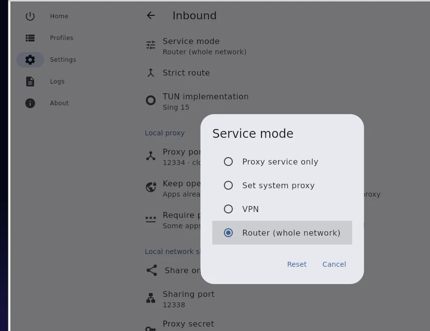
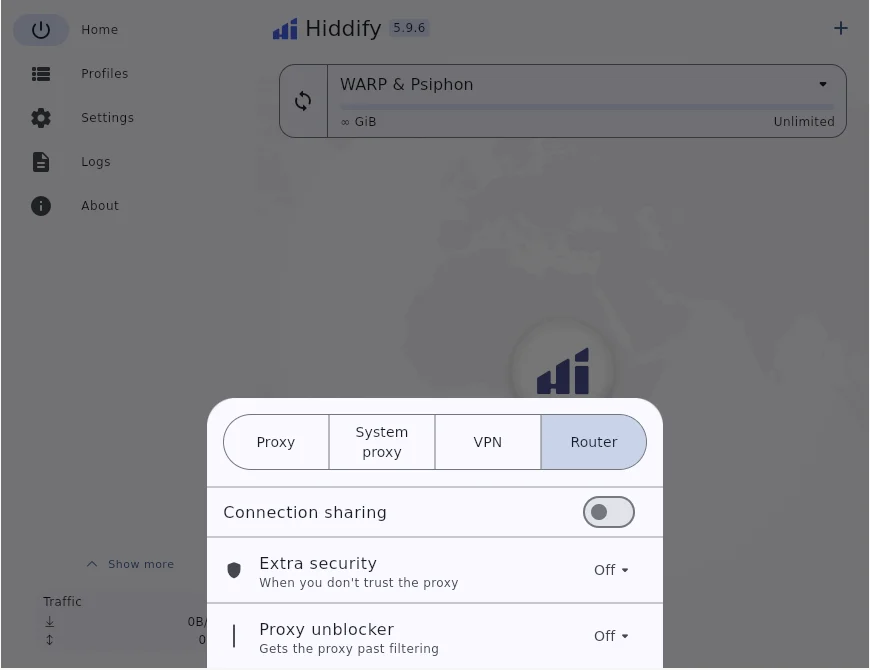
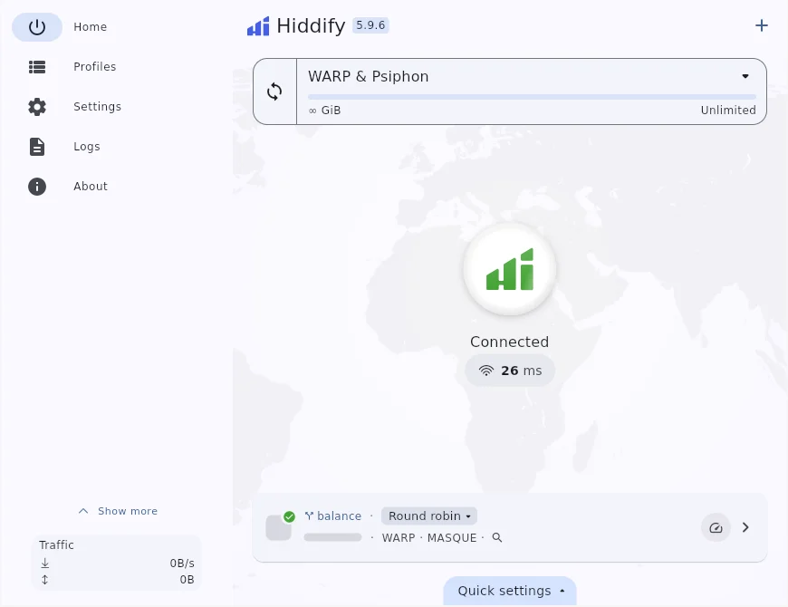

# Router mode on Linux: Hiddify for your whole network

**Router mode** turns a Linux computer that routes a network (a gateway, a mini PC between your modem and your Wi-Fi, a Raspberry Pi-like box) into a transparent proxy for every device behind it. Phones, TVs, consoles and IoT devices all go through Hiddify with no app and no settings on them.

!!! note "Written for Hiddify app 5.9"
    Router mode is new in Hiddify app **5.9** (5.9.2) and exists only on **Linux**. On a router with OpenWrt, use [Hiddify Core on OpenWrt](How-to-use-HiddifyCli-on-OpenWrt.md) instead; on a Linux server with no screen, see the [core's router mode](/core/).

## What it covers

- **TCP, UDP and ICMP** of the devices behind the gateway: web, DNS, QUIC, games, calls and ping.
- **DNS** on port 53 is answered by Hiddify, so names are not resolved by your ISP.
- Connections **from outside** keep working: SSH or the web page of the gateway itself, a VPN server on it, and port forwards to a device behind it.
- The gateway's own networks and private addresses stay direct, so the devices still reach the gateway and each other.

## What you need

- A Linux computer that already **routes** your network (the other devices use it as their gateway).
- **nftables support in the kernel** (standard on current Debian, Ubuntu and Fedora; the `nft` command itself is not needed) and the **nfqueue** kernel module, `nfnetlink_queue` (Hiddify loads it when `modprobe` is there).
- `/dev/net/tun`, and administrator (root) permission.

If the nfqueue module is missing, router mode does not start and says so: `router mode needs nftables and the nfqueue kernel module ...`. The message is in **Logs**.

## Turn it on

1. Install the Hiddify app on the Linux gateway and add your profile.
2. Open **Settings → Inbound → Service mode** and choose **Router (whole network)**. You can also switch it from **Quick settings** or the tray menu (**Router**).

    

    In **Quick settings** at the bottom of the home page, it is the last of the four buttons: Proxy, System proxy, VPN, **Router**.

    

3. Connect. Like VPN mode, it asks once for administrator permission. When it is connected, the home page shows **Connected** as usual, and every device behind the gateway now goes through Hiddify.

    

When it starts, router mode turns on IPv4 and IPv6 forwarding if they are off, and puts forwarding back as it was when you disconnect.

!!! warning
    Every device behind the gateway now goes through your proxy. Keep [Bypass LAN](Routing-in-Hiddify-app.md#built-in-rules) on, and send local services direct with routing rules if needed.

## Related articles

- [How to use the Hiddify app](How-to-use-Hiddify-app.md): add a profile, connect, the basic settings
- [How to install the Hiddify app](How-to-install-Hiddify-app.md)
- [Hiddify on desktop](Hiddify-app-on-desktop.md)
- [Share your connection](Share-your-connection.md): for a few devices, sharing the local proxy is simpler.
- [Hiddify Core on OpenWrt](How-to-use-HiddifyCli-on-OpenWrt.md): the same for a router that runs OpenWrt.
- How router mode works in detail: [hiddify-core: router mode](https://github.com/hiddify/hiddify-core/blob/main/docs/router-mode.md)

