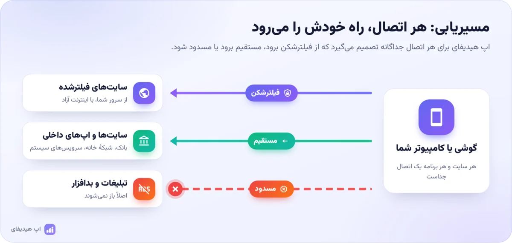
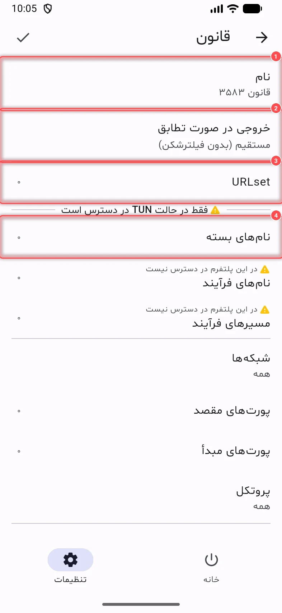
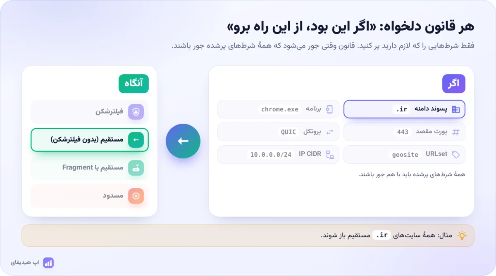
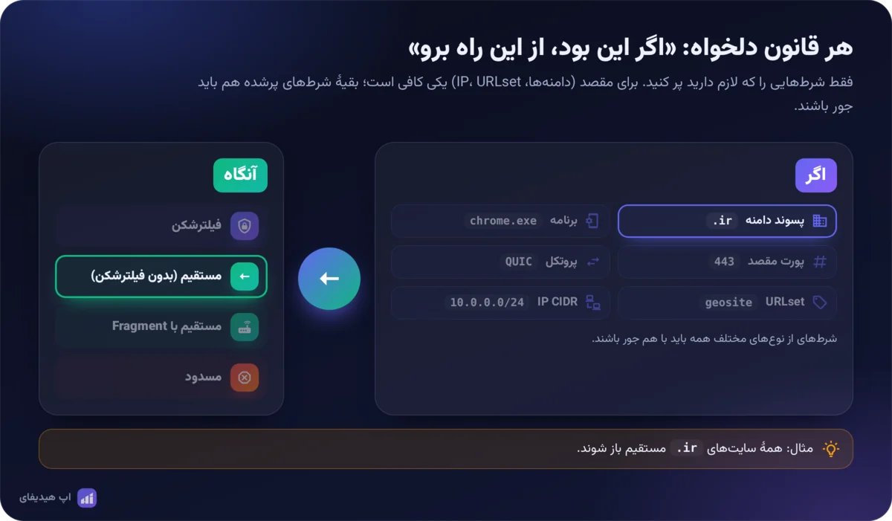
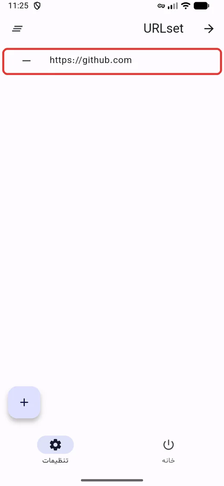
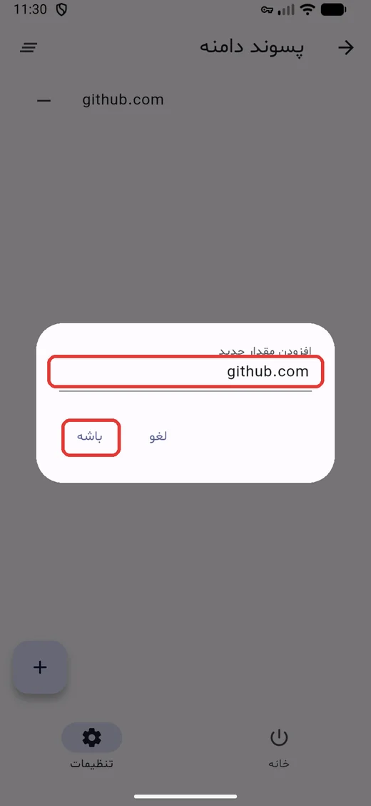
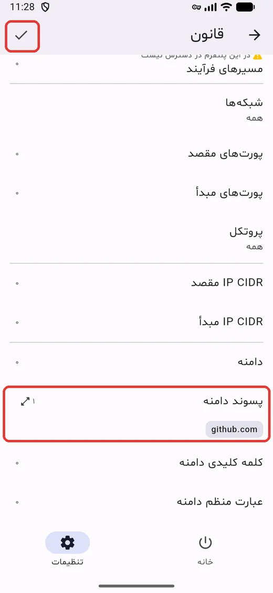

<div markdown="1" dir="rtl">

# مسیریابی در اپ هیدیفای: قانون‌های توکار و قانون‌های دلخواه

مسیریابی تعیین می‌کند کدام ترافیک از فیلترشکن عبور کند، کدام مستقیم (بدون فیلترشکن) به اینترنت برود و کدام مسدود شود. این صفحه همهٔ گزینه‌های **تنظیمات ← مسیریابی** را توضیح می‌دهد.

<figure class="hi-diag">
<picture><source media="(max-width: 700px)" srcset="/assets/app/Routing-in-Hiddify-app/fa-diagram-ways-m-light.webp"></picture>
<picture><source media="(max-width: 700px)" srcset="/assets/app/Routing-in-Hiddify-app/fa-diagram-ways-m-dark.webp"></picture>
</figure>

!!! note "نوشته‌شده برای اپ هیدیفای نسخهٔ ۵.۹"
    این صفحه برای اپ هیدیفای **نسخهٔ ۵.۹** (۵.۹.۲) است. تصویرها از اندروید هستند. همهٔ چیزهای این صفحه در همهٔ سیستم‌عامل‌ها یکسان است.

## باز کردن تنظیمات مسیریابی

**تنظیمات** را باز کنید و روی **مسیریابی** بزنید. بالای صفحه گزینه‌ها هستند و زیرشان فهرست قانون‌ها.


<div class="hi-grid c2">
<div class="hi-opt"><span class="hi-ic amber"><svg aria-hidden="true" xmlns="http://www.w3.org/2000/svg" viewBox="0 0 24 24"><path d="M16 12V4h1V2H7v2h1v8l-2 2v2h5.2v6h1.6v-6H18v-2l-2-2Z"/></svg></span><div class="tx"><b>منطقه</b><span>کشوری که در آن هستید: ایران، چین، روسیه، افغانستان، اندونزی، ترکیه، برزیل یا سایر. تعیین می‌کند کدام سایت‌ها مستقیم باز شوند (قانون توکار <b>سایت‌های …</b>) و فهرست آمادهٔ اندروید کدام برنامه‌ها را انتخاب کند.</span></div></div>
<div class="hi-opt"><span class="hi-ic green"><svg aria-hidden="true" xmlns="http://www.w3.org/2000/svg" viewBox="0 0 24 24"><path d="M16 20h4v-4h-4m0-2h4v-4h-4m-6-2h4V4h-4m6 4h4V4h-4m-6 10h4v-4h-4m-6 4h4v-4H4m0 10h4v-4H4m6 4h4v-4h-4M4 8h4V4H4v4Z"/></svg></span><div class="tx"><b>مسیریابی بر اساس برنامه</b><span>اندروید: برنامه‌هایی که از VPN نمی‌روند، یا تنها برنامه‌هایی که از آن می‌روند. ببینید: <a href="../Per-app-routing-in-Hiddify-app/">انتخاب برنامه‌هایی که از VPN استفاده می‌کنند</a>.</span></div></div>
<div class="hi-opt"><span class="hi-ic "><svg aria-hidden="true" xmlns="http://www.w3.org/2000/svg" viewBox="0 0 24 24"><path d="M12 3c-1.27 0-2.4.8-2.82 2H3v2h1.95L2 14c-.47 2 1 3 3.5 3s4.06-1 3.5-3L6.05 7h3.12c.33.85.98 1.5 1.83 1.83V20H2v2h20v-2h-9V8.82c.85-.32 1.5-.97 1.82-1.82h3.13L15 14c-.47 2 1 3 3.5 3s4.06-1 3.5-3l-2.95-7H21V5h-6.17C14.4 3.8 13.27 3 12 3m0 2a1 1 0 0 1 1 1 1 1 0 0 1-1 1 1 1 0 0 1-1-1 1 1 0 0 1 1-1m-6.5 5.25L7 14H4l1.5-3.75m13 0L20 14h-3l1.5-3.75Z"/></svg></span><div class="tx"><b>استراتژی Balancer و پروکسی پیش‌فرض</b><span>وقتی پروفایل چند سرور دارد، ترافیک از کدام برود. ببینید: <a href="../Default-proxy-and-Balancer-in-Hiddify-app/">اپ هیدیفای چطور سرور انتخاب می‌کند</a>.</span></div></div>
<div class="hi-opt"><span class="hi-ic pink"><svg aria-hidden="true" xmlns="http://www.w3.org/2000/svg" viewBox="0 0 24 24"><path d="M15 9h-2V7h2v2m7 11v2h-7a1 1 0 0 1-1 1h-4a1 1 0 0 1-1-1H2v-2h7a1 1 0 0 1 1-1h1v-2H7a2 2 0 0 1-2-2V5a2 2 0 0 1 2-2h10a2 2 0 0 1 2 2v10a2 2 0 0 1-2 2h-4v2h1a1 1 0 0 1 1 1h7M9 5H7v10h2V5m2 10h2v-4h2a2 2 0 0 0 2-2V7a2 2 0 0 0-2-2h-4v10Z"/></svg></span><div class="tx"><b>تحلیل آدرس مقصد و IPv6</b><span>دو گزینهٔ فنی؛ حالت پیش‌فرضشان برای تقریباً همه درست است. ببینید: <a href="#resolve-destination-and-ipv6">پایین‌تر</a>.</span></div></div>
</div>

## مسیریابی بر اساس برنامه (اندروید) { #app-based-routing-android }

برای اینکه برنامهٔ بانک یا یک بازی بیرون از VPN بماند، یا فقط چند برنامه از VPN بروند، **مسیریابی بر اساس برنامه** را روشن کنید و برنامه‌ها را تیک بزنید. راهنمای کامل، همراه فهرست آمادهٔ منطقهٔ شما، در مقالهٔ خودش است:

<div class="hi-grid c2">
<a class="hi-card" href="../Per-app-routing-in-Hiddify-app/"><span class="hi-ic green"><svg aria-hidden="true" xmlns="http://www.w3.org/2000/svg" viewBox="0 0 24 24"><path d="M16 20h4v-4h-4m0-2h4v-4h-4m-6-2h4V4h-4m6 4h4V4h-4m-6 10h4v-4h-4m-6 4h4v-4H4m0 10h4v-4H4m6 4h4v-4h-4M4 8h4V4H4v4Z"/></svg></span><span class="tx"><b>انتخاب برنامه‌هایی که از VPN استفاده می‌کنند</b><small>در اندروید با فهرست برنامه‌ها، در کامپیوتر با یک قانون</small></span></a>
</div>

## مسیریابی بر اساس برنامه روی کامپیوتر (ویندوز، مک، لینوکس) { #per-app-routing-on-computers-windows-macos-linux }

در کامپیوتر برنامه را با یک قانون مسیریابی انتخاب می‌کنید که نام فایل برنامه را دارد، مثلاً `chrome.exe`. اینکه نام را از کجا پیدا کنید، برای برنامه‌های Microsoft Store هم، در [انتخاب برنامه‌هایی که از VPN استفاده می‌کنند](Per-app-routing-in-Hiddify-app.md#on-a-computer) آمده است.

## استراتژی Balancer { #balancer-strategy }

وقتی پروفایل شما چند سرور دارد، اپ می‌تواند اتصال‌هایتان را بین آن‌ها پخش کند: به نوبت (**Round robin**)، یک سرور ثابت برای هر سایت (**Consistent hash**)، یا یک سرور تصادفی که تا قطع و وصل بعدی به هر سایت می‌چسبد (**Sticky session**). مثال‌های سادهٔ هر کدام:

<div class="hi-grid c2">
<a class="hi-card" href="../Default-proxy-and-Balancer-in-Hiddify-app/"><span class="hi-ic "><svg aria-hidden="true" xmlns="http://www.w3.org/2000/svg" viewBox="0 0 24 24"><path d="M12 3c-1.27 0-2.4.8-2.82 2H3v2h1.95L2 14c-.47 2 1 3 3.5 3s4.06-1 3.5-3L6.05 7h3.12c.33.85.98 1.5 1.83 1.83V20H2v2h20v-2h-9V8.82c.85-.32 1.5-.97 1.82-1.82h3.13L15 14c-.47 2 1 3 3.5 3s4.06-1 3.5-3l-2.95-7H21V5h-6.17C14.4 3.8 13.27 3 12 3m0 2a1 1 0 0 1 1 1 1 1 0 0 1-1 1 1 1 0 0 1-1-1 1 1 0 0 1 1-1m-6.5 5.25L7 14H4l1.5-3.75m13 0L20 14h-3l1.5-3.75Z"/></svg></span><span class="tx"><b>اپ هیدیفای چطور سرور انتخاب می‌کند</b><small>پروکسی پیش‌فرض و سه استراتژی Balancer، با مثال</small></span></a>
</div>

## پروکسی پیش‌فرض { #default-proxy }

تا وقتی خودتان سروری انتخاب نکرده‌اید، اپ از سریع‌ترین سرور استفاده می‌کند (**کمترین پینگ**)، ترافیک را بین همه پخش می‌کند (**توزیع بار**)، یا از اولین سرور پروفایل استفاده می‌کند (**اولین پروکسی**). جزئیات در [اپ هیدیفای چطور سرور انتخاب می‌کند](Default-proxy-and-Balancer-in-Hiddify-app.md#default-proxy) است.

## تحلیل آدرس مقصد و IPv6 { #resolve-destination-and-ipv6 }

<div class="hi-grid c2">
<div class="hi-opt"><span class="hi-ic "><svg aria-hidden="true" xmlns="http://www.w3.org/2000/svg" viewBox="0 0 24 24"><path d="M16.36 14c.08-.66.14-1.32.14-2 0-.68-.06-1.34-.14-2h3.38c.16.64.26 1.31.26 2s-.1 1.36-.26 2m-5.15 5.56c.6-1.11 1.06-2.31 1.38-3.56h2.95a8.03 8.03 0 0 1-4.33 3.56M14.34 14H9.66c-.1-.66-.16-1.32-.16-2 0-.68.06-1.35.16-2h4.68c.09.65.16 1.32.16 2 0 .68-.07 1.34-.16 2M12 19.96c-.83-1.2-1.5-2.53-1.91-3.96h3.82c-.41 1.43-1.08 2.76-1.91 3.96M8 8H5.08A7.923 7.923 0 0 1 9.4 4.44C8.8 5.55 8.35 6.75 8 8m-2.92 8H8c.35 1.25.8 2.45 1.4 3.56A8.008 8.008 0 0 1 5.08 16m-.82-2C4.1 13.36 4 12.69 4 12s.1-1.36.26-2h3.38c-.08.66-.14 1.32-.14 2 0 .68.06 1.34.14 2M12 4.03c.83 1.2 1.5 2.54 1.91 3.97h-3.82c.41-1.43 1.08-2.77 1.91-3.97M18.92 8h-2.95a15.65 15.65 0 0 0-1.38-3.56c1.84.63 3.37 1.9 4.33 3.56M12 2C6.47 2 2 6.5 2 12a10 10 0 0 0 10 10 10 10 0 0 0 10-10A10 10 0 0 0 12 2Z"/></svg></span><div class="tx"><b>تحلیل آدرس مقصد</b><span>آدرس IP هر سایت را پیش از فرستادن ترافیک روی دستگاه خودتان پیدا می‌کند. آن را <b>خاموش</b> بگذارید، مگر کسی که تنظیمات شما را می‌شناسد بخواهد روشنش کنید.</span></div></div>
<div class="hi-opt"><span class="hi-ic pink"><svg aria-hidden="true" xmlns="http://www.w3.org/2000/svg" viewBox="0 0 24 24"><path d="M15 9h-2V7h2v2m7 11v2h-7a1 1 0 0 1-1 1h-4a1 1 0 0 1-1-1H2v-2h7a1 1 0 0 1 1-1h1v-2H7a2 2 0 0 1-2-2V5a2 2 0 0 1 2-2h10a2 2 0 0 1 2 2v10a2 2 0 0 1-2 2h-4v2h1a1 1 0 0 1 1 1h7M9 5H7v10h2V5m2 10h2v-4h2a2 2 0 0 0 2-2V7a2 2 0 0 0-2-2h-4v10Z"/></svg></span><div class="tx"><b>IPv6</b><span><b>خاموش (فقط IPv4)</b> حالت پیش‌فرض و انتخاب مطمئن است. برای توضیح کامل، در اپ روی ⓘ کنارش بزنید.</span></div></div>
</div>

چرا IPv6 خاموش است؟ IPv6 نوع جدیدتر آدرس اینترنتی است. بیشتر سرورهای پروکسی در سمت خودشان IPv6 ندارند، پس سایتی که از راه IPv6 باز شود نمی‌تواند از آن‌ها عبور کند، و سایت‌هایی مثل گوگل و یوتیوب که IPv6 را ترجیح می‌دهند باز نمی‌شوند. با **خاموش**، همهٔ سایت‌ها از IPv4 قدیمی‌تر استفاده می‌کنند که همهٔ سرورها آن را می‌برند.

- **روشن، اول IPv4** و **روشن، اول IPv6** فقط از سروری IPv6 را به کار می‌برند که تست شده و واقعاً آن را می‌برد.
- ترافیک IPv6 شما همیشه داخل VPN می‌ماند؛ هیچ‌وقت از کنارش بیرون نمی‌زند.

## قانون‌های توکار { #built-in-rules }

زیر گزینه‌ها فهرست قانون‌ها آمده است. اپ چهار قانون آماده دارد؛ آیکون قفل دارند و می‌توانید هر کدام را روشن یا خاموش کنید:

<div class="hi-grid c2">
<div class="hi-opt"><span class="hi-ic green"><svg aria-hidden="true" xmlns="http://www.w3.org/2000/svg" viewBox="0 0 24 24"><path d="M10 2c-1.11 0-2 .89-2 2v3c0 1.11.89 2 2 2h1v2H2v2h4v2H5c-1.11 0-2 .89-2 2v3c0 1.11.89 2 2 2h4c1.11 0 2-.89 2-2v-3c0-1.11-.89-2-2-2H8v-2h8v2h-1c-1.11 0-2 .89-2 2v3c0 1.11.89 2 2 2h4c1.11 0 2-.89 2-2v-3c0-1.11-.89-2-2-2h-1v-2h4v-2h-9V9h1c1.11 0 2-.89 2-2V4c0-1.11-.89-2-2-2h-4m0 2h4v3h-4V4M5 17h4v3H5v-3m10 0h4v3h-4v-3Z"/></svg></span><div class="tx"><b>دور زدن LAN</b><span>شبکهٔ خانگی شما مستقیم می‌ماند: صفحهٔ مودم، پرینتر، تلویزیون، اشتراک فایل. این دستگاه‌ها در خانهٔ شما هستند، نه در اینترنت، پس VPN فقط سر راهشان می‌ایستد.</span></div></div>
<div class="hi-opt"><span class="hi-ic "><svg aria-hidden="true" xmlns="http://www.w3.org/2000/svg" viewBox="0 0 24 24"><path d="M12 18a6 6 0 0 1-6-6c0-1 .25-1.97.7-2.8L5.24 7.74A7.93 7.93 0 0 0 4 12a8 8 0 0 0 8 8v3l4-4-4-4m0-11V1L8 5l4 4V6a6 6 0 0 1 6 6c0 1-.25 1.97-.7 2.8l1.46 1.46A7.93 7.93 0 0 0 20 12a8 8 0 0 0-8-8Z"/></svg></span><div class="tx"><b>سرویس‌های اندروید</b><span>در سیستم‌عامل‌های دیگر: <b>سرویس‌های اپل</b>، <b>سرویس‌های مایکروسافت</b> یا <b>به‌روزرسانی‌های لینوکس</b>. به‌روزرسانی سیستم، فروشگاه برنامه، اعلان‌ها و همگام‌سازی ابری مستقیم می‌روند: فیلتر نیستند و حجم زیادی مصرف می‌کنند.</span></div></div>
<div class="hi-opt"><span class="hi-ic pink"><svg aria-hidden="true" xmlns="http://www.w3.org/2000/svg" viewBox="0 0 24 24"><path d="M12 2c5.5 0 10 4.5 10 10s-4.5 10-10 10S2 17.5 2 12 6.5 2 12 2m0 2c-1.9 0-3.6.6-4.9 1.7l11.2 11.2c1-1.4 1.7-3.1 1.7-4.9 0-4.4-3.6-8-8-8m4.9 14.3L5.7 7.1C4.6 8.4 4 10.1 4 12c0 4.4 3.6 8 8 8 1.9 0 3.6-.6 4.9-1.7Z"/></svg></span><div class="tx"><b>تبلیغات و بدافزار</b><span>مسدود می‌شوند: سایت‌های تبلیغاتی، بدافزار، صفحه‌های فیشینگ و استخراج‌کننده‌های پنهان رمزارز.</span></div></div>
<div class="hi-opt"><span class="hi-ic amber"><svg aria-hidden="true" xmlns="http://www.w3.org/2000/svg" viewBox="0 0 24 24"><path d="M16 12V4h1V2H7v2h1v8l-2 2v2h5.2v6h1.6v-6H18v-2l-2-2Z"/></svg></span><div class="tx"><b>سایت‌های (منطقهٔ شما)</b><span>سایت‌های داخلی مستقیم باز می‌شوند: این‌طوری سریع‌ترند و خیلی‌هایشان از خارج باز نمی‌شوند. فقط وقتی دیده می‌شود که <b>منطقه</b> روی <b>سایر</b> نباشد.</span></div></div>
</div>

### اولین قانونی که جور شود تصمیم می‌گیرد

اپ برای هر اتصال تازه قانون‌ها را از بالا به پایین، مثل یک چک‌لیست، می‌خواند و روی اولین قانونی که جور شود می‌ایستد. اگر هیچ قانونی جور نشود، اتصال از VPN می‌رود.

<div class="hi-ex"><div class="hd">مثال: example.ir را باز می‌کنید (منطقه: ایران)</div>
<div class="hi-row"><span class="n">۱</span><span class="why">دور زدن LAN: دستگاهی در خانه است؟</span><span class="hi-sv off">نه</span></div>
<div class="hi-row"><span class="n">۲</span><span class="why">سرویس‌های اندروید: سرویس سیستم است؟</span><span class="hi-sv off">نه</span></div>
<div class="hi-row"><span class="n">۳</span><span class="why">تبلیغات و بدافزار: در فهرست مسدودها هست؟</span><span class="hi-sv off">نه</span></div>
<div class="hi-row"><span class="n">۴</span><span class="why">سایت‌های ایران: سایت ایرانی است؟</span><span class="hi-sv d">بله</span><span class="to"></span><span class="hi-tag">مستقیم</span></div>
</div>

<figure class="hi-diag">
<picture><source media="(max-width: 700px)" srcset="/assets/app/Routing-in-Hiddify-app/fa-diagram-order-m-light.webp"></picture>
<picture><source media="(max-width: 700px)" srcset="/assets/app/Routing-in-Hiddify-app/fa-diagram-order-m-dark.webp"></picture>
</figure>

- قانونی که خودتان می‌سازید بالای فهرست قرار می‌گیرد، پس بر قانون‌های توکار مقدم است.
- با دستگیرهٔ ≡ ترتیب را عوض کنید.
- قانون توکار را نمی‌شود ویرایش کرد. برای تغییرش، **کپی قانون** را بزنید، کپی را ویرایش کنید و قانون اصلی را خاموش کنید.

## ساختن قانون دلخواه { #add-your-own-rule }

روی **+** (**افزودن قانون**) بزنید. هر قانون دو چیز می‌گوید: *کدام ترافیک* (شرط‌ها) و *به کجا برود* (**خروجی در صورت تطابق**).



### ترافیک به کجا برود: خروجی در صورت تطابق

<div class="hi-grid c2">
<div class="hi-opt"><span class="hi-ic "><svg aria-hidden="true" xmlns="http://www.w3.org/2000/svg" viewBox="0 0 24 24"><path d="M21 11c0 5.55-3.84 10.74-9 12-5.16-1.26-9-6.45-9-12V5l9-4 9 4v6m-9 10c3.75-1 7-5.46 7-9.78V6.3l-7-3.12L5 6.3v4.92C5 15.54 8.25 20 12 21m2.8-10V9.5C14.8 8.1 13.4 7 12 7S9.2 8.1 9.2 9.5V11c-.6 0-1.2.6-1.2 1.2v3.5c0 .7.6 1.3 1.2 1.3h5.5c.7 0 1.3-.6 1.3-1.2v-3.5c0-.7-.6-1.3-1.2-1.3m-1.3 0h-3V9.5c0-.8.7-1.3 1.5-1.3s1.5.5 1.5 1.3V11Z"/></svg></span><div class="tx"><b>فیلترشکن</b><span>از VPN، مثل همیشه.</span></div></div>
<div class="hi-opt"><span class="hi-ic green"><svg aria-hidden="true" xmlns="http://www.w3.org/2000/svg" viewBox="0 0 24 24"><path d="M4 15V9h8V4.16L19.84 12 12 19.84V15H4Z"/></svg></span><div class="tx"><b>مستقیم (بدون فیلترشکن)</b><span>مستقیم به اینترنت، بدون VPN.</span></div></div>
<div class="hi-opt"><span class="hi-ic amber"><svg aria-hidden="true" xmlns="http://www.w3.org/2000/svg" viewBox="0 0 24 24"><path d="M8 10v3h6v5H8v3l-6-5.5L8 10m14-1.5L16 3v3h-6v5h6v3l6-5.5Z"/></svg></span><div class="tx"><b>مستقیم با Fragment</b><span>مستقیم، ولی با ترفند Fragment در TLS که کمک می‌کند بعضی سایت‌های فیلترشده بدون VPN باز شوند. ببینید: <a href="../DNS-and-TLS-tricks-in-Hiddify-app/">DNS و ترفندهای TLS</a>.</span></div></div>
<div class="hi-opt"><span class="hi-ic pink"><svg aria-hidden="true" xmlns="http://www.w3.org/2000/svg" viewBox="0 0 24 24"><path d="M12 2c5.5 0 10 4.5 10 10s-4.5 10-10 10S2 17.5 2 12 6.5 2 12 2m0 2c-1.9 0-3.6.6-4.9 1.7l11.2 11.2c1-1.4 1.7-3.1 1.7-4.9 0-4.4-3.6-8-8-8m4.9 14.3L5.7 7.1C4.6 8.4 4 10.1 4 12c0 4.4 3.6 8 8 8 1.9 0 3.6-.6 4.9-1.7Z"/></svg></span><div class="tx"><b>مسدود</b><span>اتصال قطع می‌شود: سایت یا برنامه اینترنت نمی‌گیرد.</span></div></div>
</div>

### کدام ترافیک: شرط‌ها

فقط فیلدهایی را پر کنید که لازم دارید. هر فیلد در هر ردیف یک مقدار می‌گیرد.

| چه چیزی را می‌خواهید بگیرید | فیلد | مثال |
|---|---|---|
| یک سایت با همهٔ زیردامنه‌هایش | **پسوند دامنه** | `github.com`، `.ir` |
| یک آدرس دقیق | **دامنه** | `github.com` |
| هر آدرسی که یک کلمه را دارد | **کلمه کلیدی دامنه** | `github` |
| آدرس‌هایی با یک الگو (برای حرفه‌ای‌ها) | **عبارت منظم دامنه** | `^ads\.` |
| یک فهرست آماده از سایت‌های زیاد | **URLset** | لینک یک فایل فهرست ([پایین‌تر](#urlset)) |
| آدرس‌های IP | **IP CIDR مقصد** | `8.8.8.8`، `10.0.0.0/24` |
| دستگاه‌هایی از شبکهٔ شما که از اتصالتان استفاده می‌کنند | **IP CIDR مبدأ** | `192.168.1.20` |
| یک برنامه | **نام‌های بسته** (اندروید)، **نام‌های فرآیند**، **مسیرهای فرآیند** (کامپیوتر) | `org.telegram.messenger`، `chrome.exe` ([چطور](Per-app-routing-in-Hiddify-app.md)) |
| یک پورت | **پورت‌های مقصد**، **پورت‌های مبدأ** | `443`، `1:1024` |
| یک نوع ترافیک | **شبکه‌ها** (TCP یا UDP)، **پروتکل** | `QUIC`، `BitTorrent` |

فیلدها با هم این‌طور کار می‌کنند:

- **داخل یک فیلد**، یکی از مقدارها کافی است: `github.com` *یا* `gitlab.com`.
- **فیلدهای مربوط به مقصد** (چهار فیلد دامنه، **URLset** و **IP CIDR مقصد**) یک گروه حساب می‌شوند: یکی از آن‌ها کافی است.
- **هر فیلد دیگری که پر کنید هم باید جور باشد.**

<div class="hi-ex"><div class="hd">مثال: پسوند دامنه <code>github.com</code> و پورت‌های مقصد <code>22</code></div>
<div class="hi-row"><span class="hi-tag">github.com:22</span><span class="why">اتصال Git از راه SSH: هم سایت جور است هم پورت</span><span class="to"></span><span class="hi-sv d">جور است</span></div>
<div class="hi-row"><span class="hi-tag">github.com:443</span><span class="why">صفحهٔ وب: پورت جور نیست</span><span class="to"></span><span class="hi-sv off">نه</span></div>
</div>

<figure class="hi-diag">
<picture><source media="(max-width: 700px)" srcset="/assets/app/Routing-in-Hiddify-app/fa-diagram-anatomy-m-light.webp"></picture>
<picture><source media="(max-width: 700px)" srcset="/assets/app/Routing-in-Hiddify-app/fa-diagram-anatomy-m-dark.webp"></picture>
</figure>

برای ذخیره، ✓ بالای صفحه را بزنید.

!!! example "مثال: همهٔ سایت‌های `.ir` مستقیم باز شوند"
    یک قانون بسازید، **خروجی در صورت تطابق** را **مستقیم (بدون فیلترشکن)** بگذارید و در **پسوند دامنه** مقدار `.ir` را اضافه کنید. (قانون توکار **سایت‌های ایران** همین کار را، و بیشتر از آن، انجام می‌دهد.)

### URLset: فهرست‌های آماده { #urlset }

**URLset** برای فهرست‌های بلند و آمادهٔ سایت‌هاست، مثل همهٔ سایت‌های تبلیغاتی یا همهٔ سایت‌های ایرانی. این فیلد **لینک یک فایل فهرست** را می‌گیرد، نه آدرس یک سایت.

!!! danger "آدرس سایت را در URLset ننویسید"
    اپ از لینکی که به آن می‌دهید یک فایل فهرست دانلود می‌کند. آدرس یک سایت مثل `https://github.com` صفحهٔ وب است، نه فایل فهرست؛ برای همین **کل قانون از کار می‌افتد** و سایت بسته نمی‌شود، حتی اگر فیلدهای دامنه را درست پر کرده باشید. برای انتخاب سایت از **پسوند دامنه** استفاده کنید و URLset را خالی بگذارید.

    

لینک درست، لینک **خام** یک فایل فهرست قانون است: با `https://raw.githubusercontent.com/` شروع می‌شود و به `.srs` (یا `.json`) تمام می‌شود. اپ فایل را از طریق VPN دانلود می‌کند و هر چند روز یک بار به‌روزش می‌کند.

فهرست‌های خود هیدیفای در مخزن [hiddify-geo](https://github.com/hiddify/hiddify-geo/tree/rule-set)، شاخهٔ `rule-set` هستند. قانون‌های پیش‌فرض اپ هم از همین‌ها استفاده می‌کنند:

<div class="hi-grid c2">
<div class="hi-opt"><span class="hi-ic pink"><svg aria-hidden="true" xmlns="http://www.w3.org/2000/svg" viewBox="0 0 24 24"><path d="M12 2c5.5 0 10 4.5 10 10s-4.5 10-10 10S2 17.5 2 12 6.5 2 12 2m0 2c-1.9 0-3.6.6-4.9 1.7l11.2 11.2c1-1.4 1.7-3.1 1.7-4.9 0-4.4-3.6-8-8-8m4.9 14.3L5.7 7.1C4.6 8.4 4 10.1 4 12c0 4.4 3.6 8 8 8 1.9 0 3.6-.6 4.9-1.7Z"/></svg></span><div class="tx"><b><code>block/</code></b><span>تبلیغات، بدافزار، فیشینگ و استخراج رمزارز.</span></div></div>
<div class="hi-opt"><span class="hi-ic amber"><svg aria-hidden="true" xmlns="http://www.w3.org/2000/svg" viewBox="0 0 24 24"><path d="M16 12V4h1V2H7v2h1v8l-2 2v2h5.2v6h1.6v-6H18v-2l-2-2Z"/></svg></span><div class="tx"><b><code>country/</code></b><span>سایت‌ها (<code>geosite-…</code>) و IPهای (<code>geoip-…</code>) ایران، چین، روسیه، ترکیه، افغانستان، برزیل و اندونزی.</span></div></div>
</div>

مثلاً همهٔ سایت‌های ایرانی:

```
https://raw.githubusercontent.com/hiddify/hiddify-geo/rule-set/country/geosite-ir.srs
```

1. فایلی را که می‌خواهید در گیت‌هاب باز کنید.
2. **View raw** (یا **Raw**) را بزنید.
3. آدرس صفحه‌ای را که باز می‌شود کپی کنید و در **URLset** بچسبانید.

فایل‌های فهرست قانون دیگر به قالب sing-box هم کار می‌کنند. اگر جای دیگری فهرستی پیدا کردید که به آن اعتماد دارید، پیش از تکیه بر آن امتحانش کنید: با لینک اشتباه کل قانون از کار می‌افتد.

## قدم‌به‌قدم: بستن یک سایت، یا مستقیم یا با فیلترشکن باز کردنش { #step-by-step }

اینجا برای مثال گیت‌هاب را می‌بندیم. مراحل برای هر سایتی یکی است؛ فقط قدم ۳ فرق می‌کند:

- **مسدود**: سایت اصلاً باز نمی‌شود.
- **مستقیم (بدون فیلترشکن)**: سایت بدون VPN باز می‌شود، مثلاً سایت بانکی که از خارج باز نمی‌شود.
- **فیلترشکن**: سایت همیشه از VPN می‌رود، حتی اگر قانونی پایین‌تر در فهرست (مثلاً «سایت‌های منطقهٔ شما») آن را مستقیم بفرستد.

مراحل:

1. در **تنظیمات ← مسیریابی** پایین بروید تا به قانون‌ها برسید و **+** را بزنید.

    

2. روی **نام** بزنید و اسمی بنویسید که بعداً بشناسید، مثلاً `Block GitHub`.
3. روی **خروجی در صورت تطابق** بزنید و **مسدود** را انتخاب کنید (یا **مستقیم (بدون فیلترشکن)** یا **فیلترشکن**).

    <div style="display:flex;flex-wrap:wrap;justify-content:center;gap:16px">
    
    
    </div>

4. پایین بروید و روی **پسوند دامنه** بزنید، بعد **+** را بزنید. فقط اسم سایت را بنویسید: `github.com`، بدون `https://`، بدون `www` و بدون `/` در آخر. **باشه** را بزنید و با فلش برگردید.

    

5. برای ذخیره ✓ بالای صفحه را بزنید. قانون تازه بالای فهرست، روشن، دیده می‌شود.

    

6. امتحان کنید: مرورگر را کامل ببندید و سایت را دوباره باز کنید. قطع و وصل لازم نیست؛ اپ قانون را همان لحظه اعمال می‌کند. سایت مسدود چنین خطایی نشان می‌دهد:

    

کدام فیلد دامنه را پر کنید؟

- **پسوند دامنه** `github.com`: خود سایت و **همهٔ زیردامنه‌هایش** (`github.com`، `docs.github.com`، `api.github.com`). تقریباً همیشه همین درست است.
- **دامنه** `github.com`: فقط همین آدرس دقیق؛ `docs.github.com` باز می‌ماند.
- **کلمه کلیدی دامنه** `github`: هر آدرسی که این کلمه را دارد، مثلاً `githubusercontent.com` هم.

می‌توانید چند سایت را در یک قانون بگذارید: هر کدام را در یک ردیف جدا اضافه کنید.

!!! tip "اگر کار نکرد"
    - **URLset** قانون باید خالی باشد (ببینید: [URLset](#urlset)).
    - وقتی چیز تازه‌ای برای ذخیره نیست، ✓ کم‌رنگ است. اگر چیزی را عوض کرده‌اید و ✓ هنوز کم‌رنگ است، برگردید و قانون را دوباره باز کنید تا ببینید مقدارها مانده‌اند.
    - قانون‌ها از بالا به پایین بررسی می‌شوند؛ اگر قانون دیگری بالاتر از قانون شما زودتر با آن سایت جور شود، قانون خودتان را با دستگیرهٔ ≡ بالاتر ببرید.
    - در نسخه‌های قبل از ۵.۹.۹، **پسوند دامنه** فقط پسوندهایی مثل `.com` را قبول می‌کند. اپ را به‌روز کنید، یا **دامنه** `github.com` را همراه **کلمه کلیدی دامنه** `github` بگذارید.

## ذخیره، اشتراک و بازنشانی قانون‌ها

منوی ⋮ بالای صفحهٔ مسیریابی می‌تواند:

- **وارد کردن قوانین از کلیپ‌بورد** یا **وارد کردن قوانین از فایل**،
- **کپی قوانین در کلیپ‌بورد** یا **ذخیره قوانین در فایل**، برای بردن به دستگاه دیگر یا فرستادن برای کسی،
- **بازنشانی به قوانین پیش‌فرض**، برای شروع دوباره از قانون‌های توکار.

!!! warning "هشدار"
    قانون‌ها را فقط از منبعی که به آن اعتماد دارید وارد کنید: قانون‌ها تعیین می‌کنند ترافیک شما به کجا برود، و یک قانون بد می‌تواند آن را جایی بفرستد که نمی‌خواهید.

## مقاله‌های مرتبط

- [انتخاب برنامه‌هایی که از VPN استفاده می‌کنند](Per-app-routing-in-Hiddify-app.md)
- [اپ هیدیفای چطور سرور انتخاب می‌کند](Default-proxy-and-Balancer-in-Hiddify-app.md)
- [DNS و ترفندهای TLS](DNS-and-TLS-tricks-in-Hiddify-app.md)
- [زنجیره، امنیت بیشتر و رفع فیلتر پروکسی](Chain-Extra-security-and-Proxy-unblocker.md)
- [آموزش کار با اپ هیدیفای](How-to-use-Hiddify-app.md)

</div>
