

# مسیریابی در اپ هیدیفای: مسیریابی بر اساس برنامه، منطقه و قانون‌های دلخواه

مسیریابی تعیین می‌کند کدام ترافیک از فیلترشکن عبور کند، کدام مستقیم (بدون فیلترشکن) به اینترنت برود و کدام مسدود شود. این صفحه همهٔ گزینه‌های **تنظیمات ← مسیریابی** را توضیح می‌دهد.

<figure class="hi-diag">
<picture><source media="(max-width: 700px)" srcset="/assets/app/Routing-in-Hiddify-app/fa-diagram-ways-m-light.webp"></picture>
<picture><source media="(max-width: 700px)" srcset="/assets/app/Routing-in-Hiddify-app/fa-diagram-ways-m-dark.webp">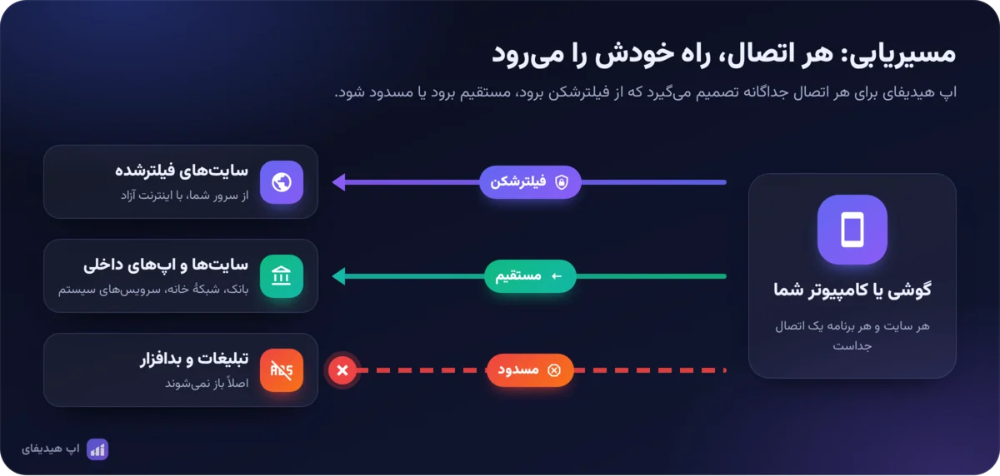</picture>
</figure>

!!! note "نوشته‌شده برای اپ هیدیفای نسخهٔ ۵.۹"
    این صفحه برای اپ هیدیفای **نسخهٔ ۵.۹** (۵.۹.۲) است. تصویرها از اندروید هستند. **مسیریابی بر اساس برنامه** فقط در اندروید هست؛ بقیهٔ گزینه‌ها در همهٔ سیستم‌عامل‌ها یکسان‌اند.

## باز کردن تنظیمات مسیریابی

**تنظیمات** را باز کنید و **مسیریابی** را بزنید.

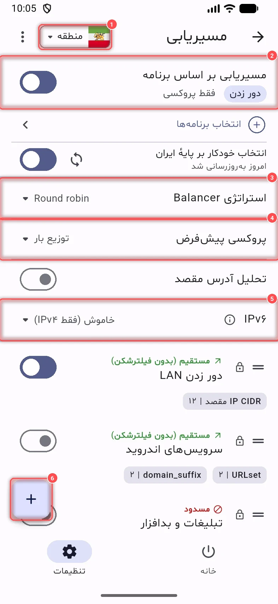

1. **منطقه**: کشوری که در آن هستید. تعیین می‌کند کدام سایت‌ها مستقیم باز شوند (قانون توکار **سایت‌های …**) و انتخاب خودکار کدام برنامه‌ها را برگزیند. گزینه‌ها: ایران، چین، روسیه، افغانستان، اندونزی، ترکیه، برزیل و سایر.
2. **مسیریابی بر اساس برنامه** (اندروید): برنامه‌هایی را انتخاب کنید که از VPN عبور نکنند، یا فقط همان‌ها از VPN عبور کنند.
3. **استراتژی Balancer**: وقتی پروفایل چند سرور دارد، ترافیک چطور بین آن‌ها پخش شود.
4. **پروکسی پیش‌فرض**: تا وقتی خودتان سروری انتخاب نکرده‌اید، کدام سرور استفاده شود.
5. **IPv6**: اصلاً از IPv6 استفاده شود یا نه.
6. **افزودن قانون** (دکمهٔ **+**): ساختن قانون دلخواه.

## مسیریابی بر اساس برنامه (اندروید)

**مسیریابی بر اساس برنامه** را روشن کنید و یکی از دو حالت را انتخاب کنید:

- **دور زدن**: برنامه‌هایی که انتخاب می‌کنید از VPN **عبور نمی‌کنند** و بقیه عبور می‌کنند. برای اپ‌های بانکی و برنامه‌های داخلی که آی‌پی خارجی را قبول نمی‌کنند مناسب است.
- **فقط پروکسی**: **فقط** برنامه‌هایی که انتخاب می‌کنید از VPN عبور می‌کنند و بقیه مستقیم وصل می‌شوند.

<figure class="hi-diag">
<picture><source media="(max-width: 700px)" srcset="/assets/app/Routing-in-Hiddify-app/fa-diagram-modes-m-light.webp">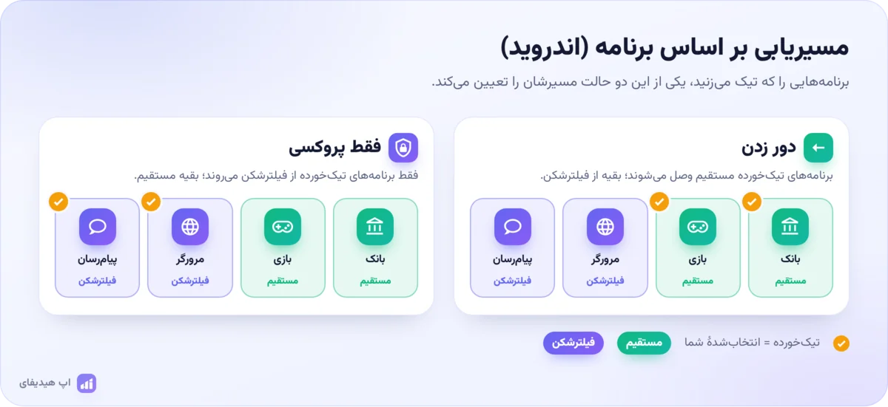</picture>
<picture><source media="(max-width: 700px)" srcset="/assets/app/Routing-in-Hiddify-app/fa-diagram-modes-m-dark.webp"></picture>
</figure>

با **انتخاب برنامه‌ها** برنامه‌ها را انتخاب کنید. **پنهان کردن برنامه‌های سیستمی** فهرست را کوتاه می‌کند و دکمهٔ جستجو برنامه را با اسمش پیدا می‌کند.

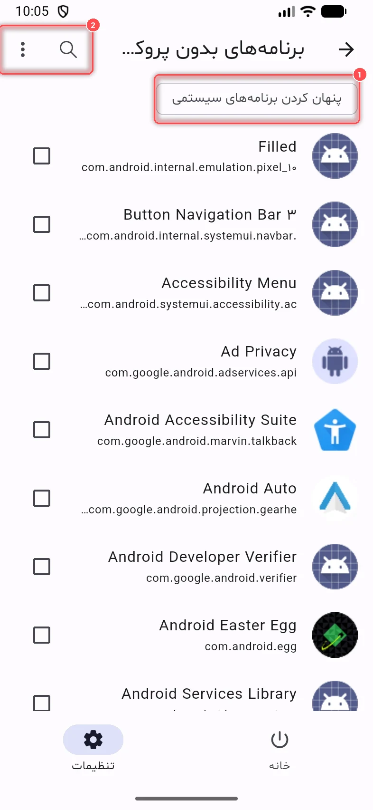

**انتخاب خودکار بر پایهٔ (منطقهٔ شما)** یک فهرست آماده از برنامه‌های مناسب منطقهٔ شما را خودکار به فهرست حالت فعلی اضافه می‌کند (برای **دور زدن**: برنامه‌هایی که معمولاً باید مستقیم وصل شوند، مثل اپ‌های بانکی) و آن را به‌روز نگه می‌دارد. برنامه‌هایی که خودتان حذف کرده‌اید حذف می‌مانند. دکمهٔ به‌روزرسانی کنار آن (**اکنون به‌روزرسانی کن**) فهرست را همان لحظه به‌روز می‌کند. برنامه‌هایی که این‌طور اضافه شده‌اند برچسب **خودکار** دارند. منوی ⋮ فهرست برنامه‌ها می‌تواند انتخاب‌ها را وارد کند، خروجی بگیرد یا پاک کند.

!!! tip "نکته"
    برنامه‌ای که بیرون از VPN است از هیچ قانون مسیریابی پیروی نمی‌کند (در فهرست برنامه‌ها نوشته می‌شود **خارج از VPN · قانون اعمال نمی‌شود**).

## مسیریابی بر اساس برنامه روی کامپیوتر (ویندوز، مک، لینوکس)

روی کامپیوتر فهرستی از برنامه‌ها برای تیک زدن وجود ندارد. برنامه‌ها را با یک قانون مسیریابی و با نام فایل اجرایی‌شان انتخاب می‌کنید. این روش فقط در حالت **VPN** کار می‌کند (ویرایشگر قانون می‌نویسد **فقط در حالت TUN در دسترس است**).

1. **تنظیمات ← مسیریابی** را باز کنید و روی **+** (**افزودن قانون**) بزنید.
2. **خروجی در صورت تطابق** را تعیین کنید: **مستقیم** برای اینکه برنامه بیرون از VPN بماند (مثلاً یک بازی یا برنامهٔ بانک)، **پروکسی** برای عبور از VPN، یا **مسدود**.
3. روی **نام‌های فرآیند** بزنید، بعد روی **+**، نام فایل برنامه را بنویسید و **باشه** را بزنید. در ویندوز نام با `.exe` تمام می‌شود، مثلاً `chrome.exe` یا `Telegram.exe`؛ در لینوکس و مک نام برنامه است، مثلاً `firefox`. هر چند نام که لازم دارید اضافه کنید.
4. روی ✓ بالای صفحه بزنید تا قانون ذخیره شود.

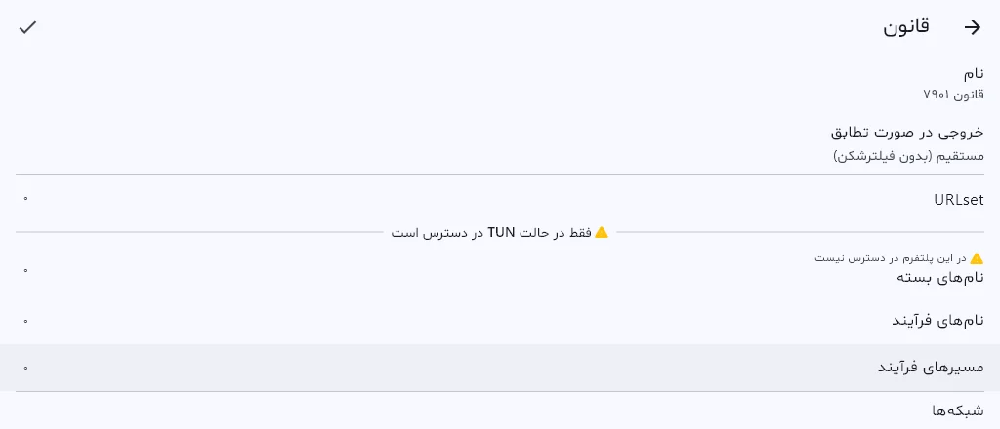

!!! tip "نام فایل برنامه را از کجا پیدا کنم؟"
    در ویندوز **Task Manager** را باز کنید، روی برنامه راست‌کلیک کنید و **Go to details** را بزنید: نامی که انتخاب می‌شود (مثلاً `chrome.exe`) همان است که باید بنویسید. **مسیرهای فرآیند** همین کار را با مسیر کامل فایل انجام می‌دهد (مثلاً `C:\Program Files\Google\Chrome\Application\chrome.exe`)، برای وقتی که دو برنامه نام یکسان دارند. **نام‌های بسته** فقط برای اندروید است.

## استراتژی Balancer

وقتی اپ ترافیک را بین چند سرور پخش می‌کند، برای هر اتصال یک سرور انتخاب می‌کند:

- **Round robin**: هر اتصال از سرور بعدی استفاده می‌کند، پس ممکن است سایت‌ها ببینند آی‌پی شما عوض می‌شود.
- **Consistent hash**: هر سایت همیشه از همان سرور استفاده می‌کند.
- **Sticky session**: هر سایت تا اتصال دوباره، یک سرور تصادفی را نگه می‌دارد.

<figure class="hi-diag">
<picture><source media="(max-width: 700px)" srcset="/assets/app/Routing-in-Hiddify-app/fa-diagram-balancer-m-light.webp">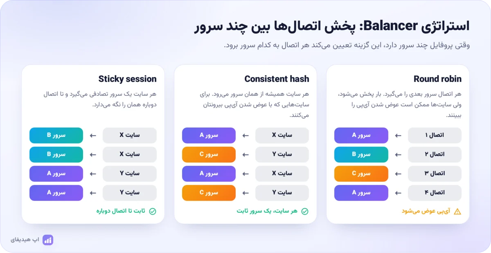</picture>
<picture><source media="(max-width: 700px)" srcset="/assets/app/Routing-in-Hiddify-app/fa-diagram-balancer-m-dark.webp">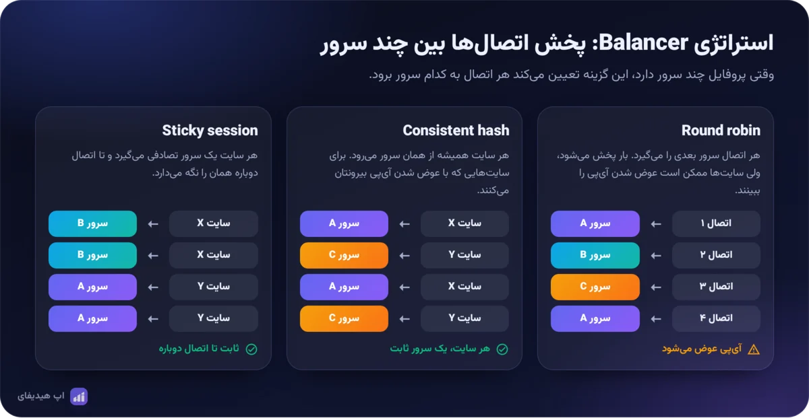</picture>
</figure>

اگر سایت‌ها مدام از حسابتان خارجتان می‌کنند یا کپچا می‌خواهند، **Consistent hash** یا **Sticky session** را امتحان کنید.

## پروکسی پیش‌فرض

تا وقتی در صفحهٔ پروکسی‌ها سروری انتخاب نکرده‌اید، اپ از این استفاده می‌کند:

- **کمترین پینگ**: سریع‌ترین سرور.
- **توزیع بار**: اتصال‌ها بین همهٔ سرورها پخش می‌شوند (با استراتژی Balancer بالا).
- **اولین پروکسی**: اولین سرور پروفایل.

## تحلیل آدرس مقصد و IPv6

- **تحلیل آدرس مقصد**: اپ آی‌پی هر سایت را پیش از فرستادن ترافیک پیدا می‌کند. اگر نمی‌دانید لازمش دارید، خاموش بگذارید.
- **IPv6**: پیش‌فرض **خاموش (فقط IPv4)** است، چون بیشتر پروکسی‌ها در خروجی‌شان IPv6 ندارند و اتصالی که پروکسی نتواند ببرد سایت‌هایی مثل گوگل و یوتیوب را خراب می‌کند. **روشن، اول IPv4** و **روشن، اول IPv6** فقط از پروکسی‌ای IPv6 استفاده می‌کنند که آزمایش نشان داده آن را می‌برد. IPv6 همیشه داخل VPN می‌ماند. برای توضیح کامل، ⓘ کنار **IPv6** را بزنید.

## قانون‌های توکار

زیر گزینه‌ها فهرست قانون‌ها آمده است. اپ قانون‌ها را از بالا به پایین بررسی می‌کند و اولین قانونی که مطابقت داشته باشد تصمیم می‌گیرد. قانون‌های توکار آیکون قفل دارند و می‌توانید هر کدام را روشن یا خاموش کنید:

- **دور زدن LAN**: شبکهٔ خانگی شما (مودم، پرینتر، تلویزیون) مستقیم می‌ماند.
- **سرویس‌های اندروید** (در سیستم‌عامل‌های دیگر: **سرویس‌های اپل**، **سرویس‌های مایکروسافت** یا **به‌روزرسانی‌های لینوکس**): سرویس‌های سیستم مستقیم وصل می‌شوند.
- **تبلیغات و بدافزار**: مسدود می‌شوند.
- **سایت‌های (منطقهٔ شما)**: سایت‌های داخلی مستقیم باز می‌شوند.

قانون توکار را نمی‌شود تغییر داد. برای تغییرش، آن را **کپی** کنید و نسخهٔ کپی را ویرایش کنید. با دستگیرهٔ ≡ ترتیب قانون‌ها را عوض کنید.

<figure class="hi-diag">
<picture><source media="(max-width: 700px)" srcset="/assets/app/Routing-in-Hiddify-app/fa-diagram-order-m-light.webp">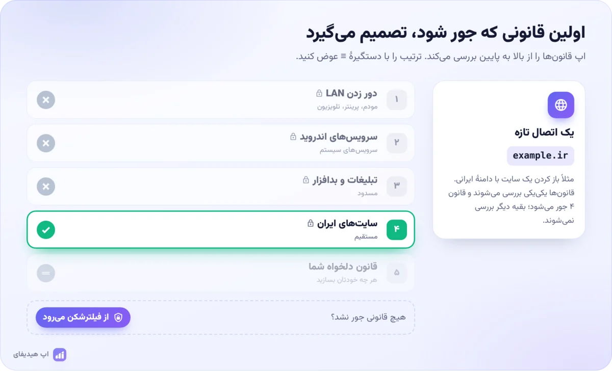</picture>
<picture><source media="(max-width: 700px)" srcset="/assets/app/Routing-in-Hiddify-app/fa-diagram-order-m-dark.webp">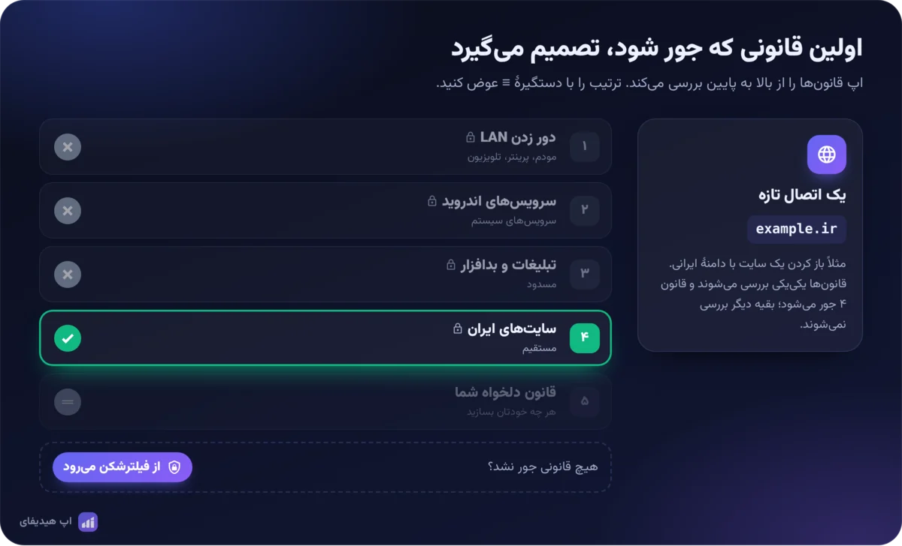</picture>
</figure>

## ساختن قانون دلخواه

**+** (**افزودن قانون**) را بزنید. هر قانون می‌گوید *کدام ترافیک* (شرط‌ها) و *به کجا برود* (**خروجی در صورت تطابق**).

1. **نام**: یک اسم برای قانون.
2. **خروجی در صورت تطابق**: **فیلترشکن**، **مستقیم (بدون فیلترشکن)**، **مستقیم با Fragment** (مستقیم، همراه با ترفند Fragment) یا **مسدود**.
3. **URLset**: لینک **فایل**‌های آمادهٔ فهرست قانون (rule set، با پسوند `.srs` یا `.json`) که هر کدام فهرست بلندی از سایت‌هاست، مثلاً فهرست سایت‌های تبلیغاتی. این فیلد برای آدرس یک سایت **نیست**؛ هشدار پایین را ببینید.
4. **نام‌های بسته** (اندروید، فقط در حالت VPN): برنامه‌ها با اسم بسته‌شان. **نام‌های فرآیند** و **مسیرهای فرآیند** همین کار را در کامپیوتر می‌کنند، مثلاً `chrome.exe` یا `/usr/lib/chromium/chromium`.

پایین‌تر می‌توانید **شبکه‌ها** (TCP یا UDP)، **پورت‌های مقصد** و **پورت‌های مبدأ** (مثلاً `443` یا `1:65000`)، **پروتکل** (TLS، HTTP، QUIC، STUN، DNS، BitTorrent)، **IP CIDR مقصد** و **IP CIDR مبدأ** (مثلاً `10.0.0.0/24`) و سایت‌ها را با **دامنه**، **پسوند دامنه** (مثلاً `.ir`)، **کلمه کلیدی دامنه** یا **عبارت منظم دامنه** هم مشخص کنید. فقط چیزی را پر کنید که لازم دارید؛ قانون وقتی مطابقت دارد که همهٔ فیلدهای پرشده مطابقت داشته باشند. برای ذخیره، ✓ بالای صفحه را بزنید.

<figure class="hi-diag">
<picture><source media="(max-width: 700px)" srcset="/assets/app/Routing-in-Hiddify-app/fa-diagram-anatomy-m-light.webp"></picture>
<picture><source media="(max-width: 700px)" srcset="/assets/app/Routing-in-Hiddify-app/fa-diagram-anatomy-m-dark.webp"></picture>
</figure>

!!! example "مثال: همهٔ سایت‌های `.ir` مستقیم باز شوند"
    یک قانون بسازید، **خروجی در صورت تطابق** را **مستقیم (بدون فیلترشکن)** بگذارید و در **پسوند دامنه** مقدار `.ir` را اضافه کنید.

!!! danger "آدرس سایت را در URLset ننویسید"
    **URLset** از لینکی که به آن می‌دهید یک *فایل* فهرست قانون دانلود می‌کند. آدرس یک سایت مثل `https://github.com` صفحهٔ وب است، نه فایل فهرست قانون؛ برای همین **کل قانون از کار می‌افتد** و سایت بسته نمی‌شود، حتی اگر فیلدهای دامنه را درست پر کرده باشید. برای انتخاب سایت از **پسوند دامنه** استفاده کنید (بخش بعد) و URLset را خالی بگذارید.

    

## قدم‌به‌قدم: بستن یک سایت، یا مستقیم یا با فیلترشکن باز کردنش

اینجا برای مثال گیت‌هاب را می‌بندیم. مراحل برای هر سایتی یکی است؛ فقط قدم ۳ فرق می‌کند:

- **مسدود**: سایت اصلاً باز نمی‌شود.
- **مستقیم (بدون فیلترشکن)**: سایت بدون VPN باز می‌شود، مثلاً سایت بانکی که از خارج باز نمی‌شود.
- **فیلترشکن**: سایت همیشه از VPN می‌رود، حتی اگر قانونی پایین‌تر در فهرست (مثلاً «سایت‌های منطقهٔ شما») آن را مستقیم بفرستد.

مراحل:

1. در **تنظیمات ← مسیریابی** پایین بروید تا به قانون‌ها برسید و **+** را بزنید.

    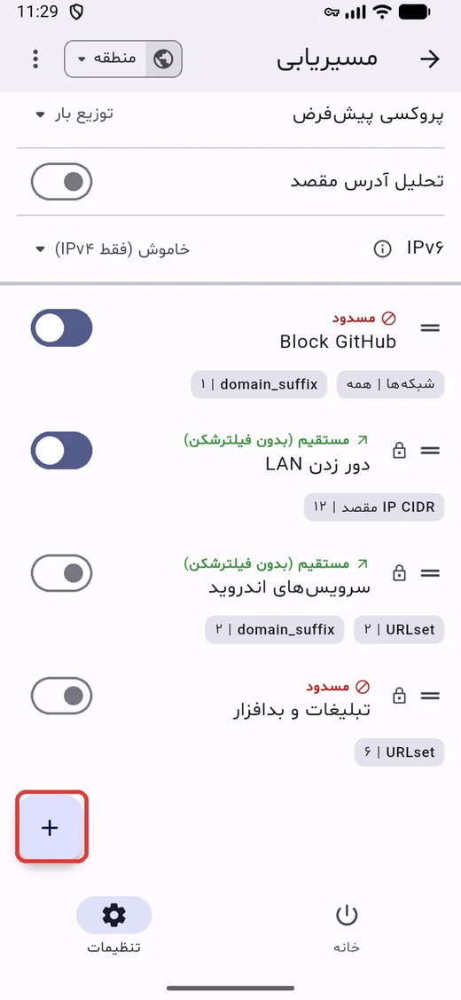

2. روی **نام** بزنید و اسمی بنویسید که بعداً بشناسید، مثلاً `Block GitHub`.
3. روی **خروجی در صورت تطابق** بزنید و **مسدود** را انتخاب کنید (یا **مستقیم (بدون فیلترشکن)** یا **فیلترشکن**).

    

    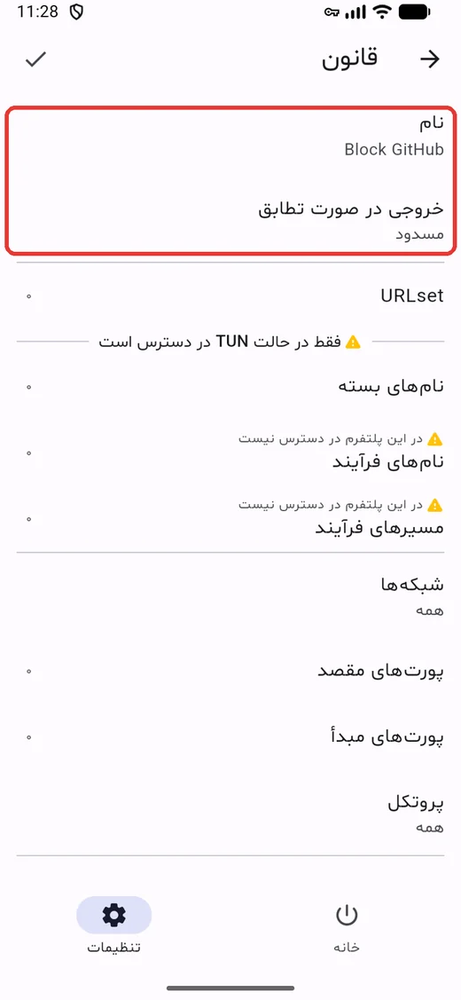
    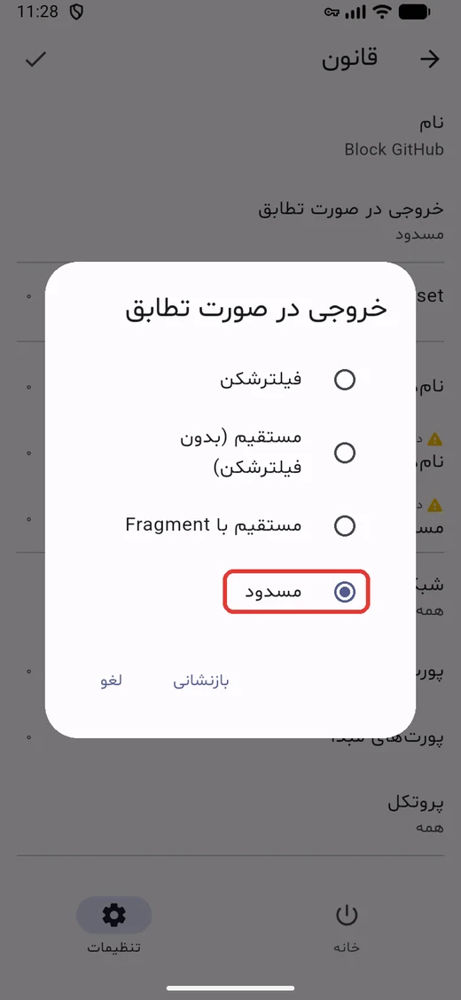
    

4. پایین بروید و روی **پسوند دامنه** بزنید، بعد **+** را بزنید. فقط اسم سایت را بنویسید: `github.com`، بدون `https://`، بدون `www` و بدون `/` در آخر. **باشه** را بزنید و با فلش برگردید.

    

5. برای ذخیره ✓ بالای صفحه را بزنید. قانون تازه بالای فهرست، روشن، دیده می‌شود.

    

6. امتحان کنید: مرورگر را کامل ببندید و سایت را دوباره باز کنید. قطع و وصل لازم نیست؛ اپ قانون را همان لحظه اعمال می‌کند. سایت مسدود چنین خطایی نشان می‌دهد:

    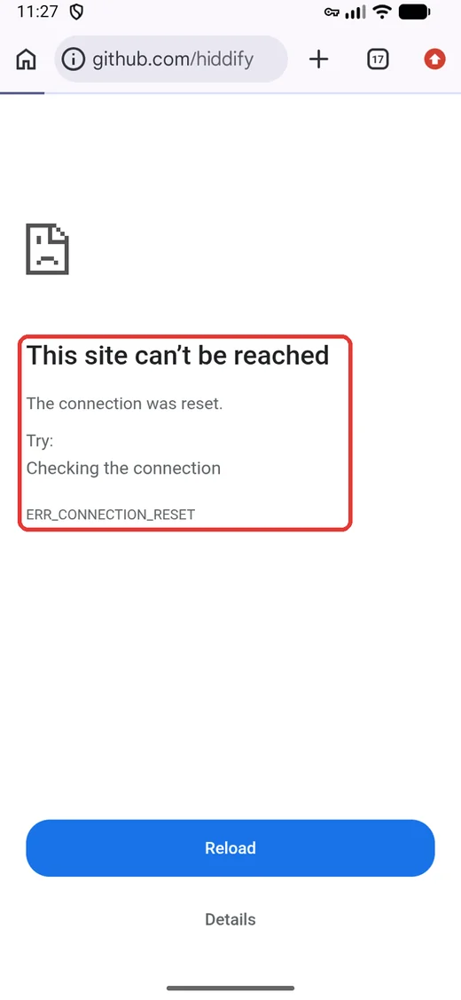

کدام فیلد دامنه را پر کنید؟

- **پسوند دامنه** `github.com`: خود سایت و **همهٔ زیردامنه‌هایش** (`github.com`، `docs.github.com`، `api.github.com`). تقریباً همیشه همین درست است.
- **دامنه** `github.com`: فقط همین آدرس دقیق؛ `docs.github.com` باز می‌ماند.
- **کلمه کلیدی دامنه** `github`: هر آدرسی که این کلمه را دارد، مثلاً `githubusercontent.com` هم.

می‌توانید چند سایت را در یک قانون بگذارید: هر کدام را در یک ردیف جدا اضافه کنید.

!!! tip "اگر کار نکرد"
    - **URLset** قانون باید خالی باشد (هشدار بالا را ببینید).
    - وقتی چیز تازه‌ای برای ذخیره نیست، ✓ کم‌رنگ است. اگر چیزی را عوض کرده‌اید و ✓ هنوز کم‌رنگ است، برگردید و قانون را دوباره باز کنید تا ببینید مقدارها مانده‌اند.
    - قانون‌ها از بالا به پایین بررسی می‌شوند؛ اگر قانون دیگری بالاتر از قانون شما زودتر با آن سایت جور شود، قانون خودتان را با دستگیرهٔ ≡ بالاتر ببرید.
    - در نسخه‌های قبل از ۵.۹.۹، **پسوند دامنه** فقط پسوندهایی مثل `.com` را قبول می‌کند. اپ را به‌روز کنید، یا **دامنه** `github.com` را همراه **کلمه کلیدی دامنه** `github` بگذارید.

منوی ⋮ صفحهٔ مسیریابی می‌تواند قانون‌ها را از کلیپ‌بورد یا فایل وارد کند، کپی کند یا در فایل ذخیره کند (برای بردن به دستگاه دیگر)، و قانون‌ها را به حالت پیش‌فرض برگرداند.

!!! warning "هشدار"
    قانون‌ها را فقط از منبعی که به آن اعتماد دارید وارد کنید: قانون‌ها تعیین می‌کنند ترافیک شما به کجا برود.

## مقاله‌های مرتبط

- [نصب اپ هیدیفای](How-to-install-Hiddify-app.md)
- [زنجیره، امنیت بیشتر و رفع فیلتر پروکسی](Chain-Extra-security-and-Proxy-unblocker.md)
- [تنظیمات DNS و ترفندهای TLS](DNS-and-TLS-tricks-in-Hiddify-app.md)
- [آموزش کار با اپ هیدیفای](How-to-use-Hiddify-app.md)

