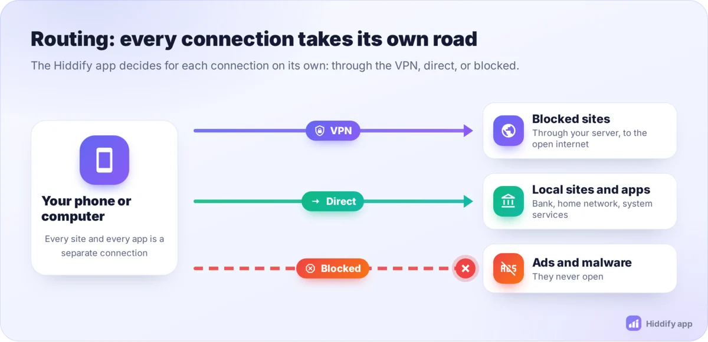
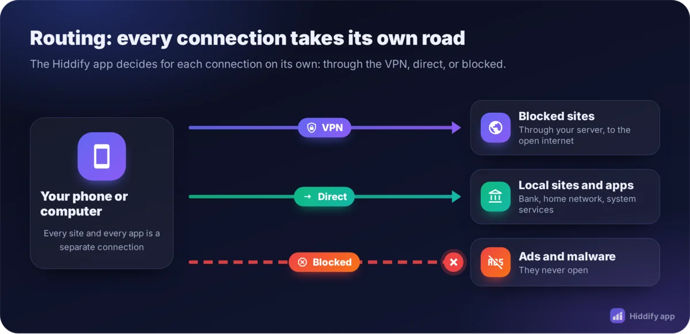
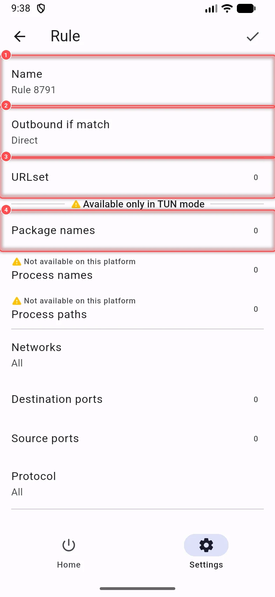
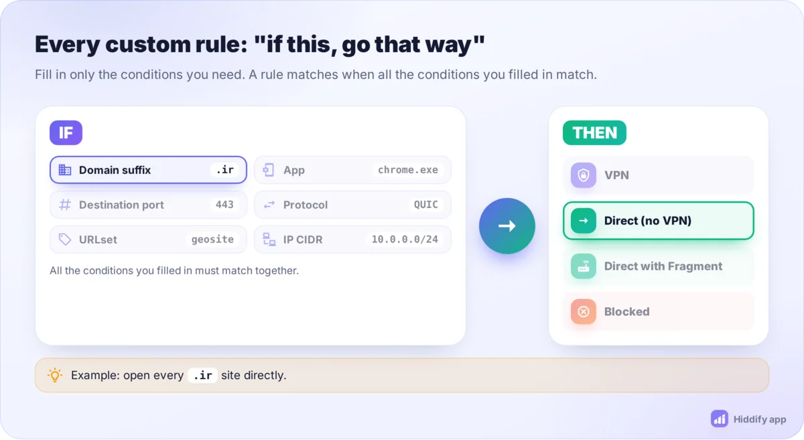
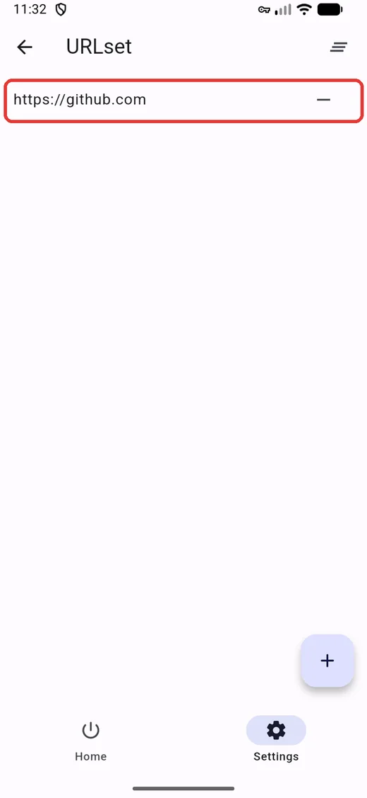
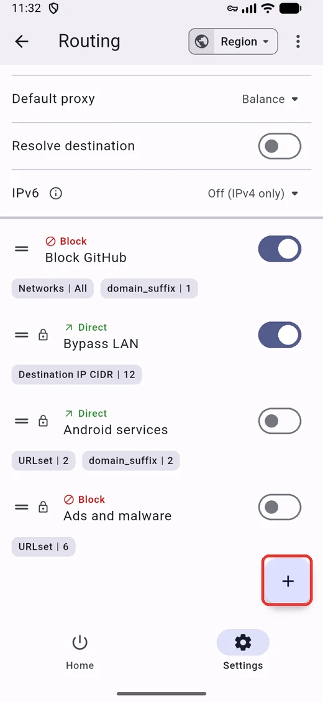
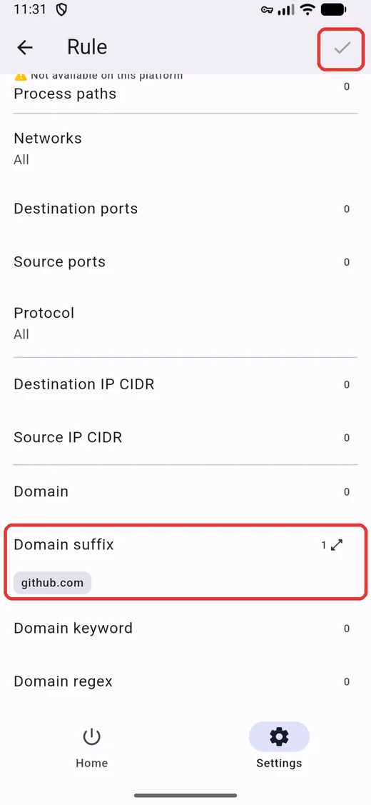
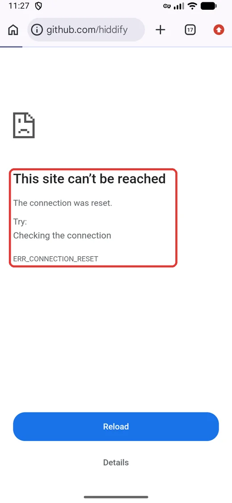

<div dir="ltr" markdown="1">

# Routing in the Hiddify app: built-in rules and your own rules

Routing decides which traffic goes through the proxy, which goes straight to the internet (direct), and which is blocked. This page explains every option of **Settings → Routing**.

<figure class="hi-diag">
<picture><source media="(max-width: 700px)" srcset="/assets/app/Routing-in-Hiddify-app/en-diagram-ways-m-light.webp"></picture>
<picture><source media="(max-width: 700px)" srcset="/assets/app/Routing-in-Hiddify-app/en-diagram-ways-m-dark.webp"></picture>
</figure>

!!! note "Written for Hiddify app 5.9"
    This page is for Hiddify app **5.9** (5.9.2). The screenshots come from Android. Everything on this page is the same on every platform.

## Open the routing settings

Open **Settings** and tap **Routing**. At the top are the options, below them the list of rules.


<div class="hi-grid c2">
<div class="hi-opt"><span class="hi-ic amber"><svg aria-hidden="true" xmlns="http://www.w3.org/2000/svg" viewBox="0 0 24 24"><path d="M16 12V4h1V2H7v2h1v8l-2 2v2h5.2v6h1.6v-6H18v-2l-2-2Z"/></svg></span><div class="tx"><b>Region</b><span>The country you are in: Iran, China, Russia, Afghanistan, Indonesia, Türkiye, Brazil or Other. It decides which sites go direct (the built-in rule <b>Sites in …</b>) and which apps the ready list for Android picks.</span></div></div>
<div class="hi-opt"><span class="hi-ic green"><svg aria-hidden="true" xmlns="http://www.w3.org/2000/svg" viewBox="0 0 24 24"><path d="M16 20h4v-4h-4m0-2h4v-4h-4m-6-2h4V4h-4m6 4h4V4h-4m-6 10h4v-4h-4m-6 4h4v-4H4m0 10h4v-4H4m6 4h4v-4h-4M4 8h4V4H4v4Z"/></svg></span><div class="tx"><b>App-based routing</b><span>Android: apps that skip the VPN, or the only apps that use it. See <a href="../Per-app-routing-in-Hiddify-app/">Choose which apps use the VPN</a>.</span></div></div>
<div class="hi-opt"><span class="hi-ic "><svg aria-hidden="true" xmlns="http://www.w3.org/2000/svg" viewBox="0 0 24 24"><path d="M12 3c-1.27 0-2.4.8-2.82 2H3v2h1.95L2 14c-.47 2 1 3 3.5 3s4.06-1 3.5-3L6.05 7h3.12c.33.85.98 1.5 1.83 1.83V20H2v2h20v-2h-9V8.82c.85-.32 1.5-.97 1.82-1.82h3.13L15 14c-.47 2 1 3 3.5 3s4.06-1 3.5-3l-2.95-7H21V5h-6.17C14.4 3.8 13.27 3 12 3m0 2a1 1 0 0 1 1 1 1 1 0 0 1-1 1 1 1 0 0 1-1-1 1 1 0 0 1 1-1m-6.5 5.25L7 14H4l1.5-3.75m13 0L20 14h-3l1.5-3.75Z"/></svg></span><div class="tx"><b>Balancer strategy and Default proxy</b><span>Which server your traffic uses when the profile has several. See <a href="../Default-proxy-and-Balancer-in-Hiddify-app/">How the Hiddify app picks a server</a>.</span></div></div>
<div class="hi-opt"><span class="hi-ic pink"><svg aria-hidden="true" xmlns="http://www.w3.org/2000/svg" viewBox="0 0 24 24"><path d="M15 9h-2V7h2v2m7 11v2h-7a1 1 0 0 1-1 1h-4a1 1 0 0 1-1-1H2v-2h7a1 1 0 0 1 1-1h1v-2H7a2 2 0 0 1-2-2V5a2 2 0 0 1 2-2h10a2 2 0 0 1 2 2v10a2 2 0 0 1-2 2h-4v2h1a1 1 0 0 1 1 1h7M9 5H7v10h2V5m2 10h2v-4h2a2 2 0 0 0 2-2V7a2 2 0 0 0-2-2h-4v10Z"/></svg></span><div class="tx"><b>Resolve destination and IPv6</b><span>Two technical options; the defaults are right for almost everyone. See <a href="#resolve-destination-and-ipv6">below</a>.</span></div></div>
</div>

## App-based routing (Android) { #app-based-routing-android }

To keep a banking app or a game outside the VPN, or to send only a few apps through it, turn on **App-based routing** and tick the apps. The full guide, with the ready list for your region, is in its own article:

<div class="hi-grid c2">
<a class="hi-card" href="../Per-app-routing-in-Hiddify-app/"><span class="hi-ic green"><svg aria-hidden="true" xmlns="http://www.w3.org/2000/svg" viewBox="0 0 24 24"><path d="M16 20h4v-4h-4m0-2h4v-4h-4m-6-2h4V4h-4m6 4h4V4h-4m-6 10h4v-4h-4m-6 4h4v-4H4m0 10h4v-4H4m6 4h4v-4h-4M4 8h4V4H4v4Z"/></svg></span><span class="tx"><b>Choose which apps use the VPN</b><small>On Android with a list of apps, on computers with a rule</small></span></a>
</div>

## Per-app routing on computers (Windows, macOS, Linux) { #per-app-routing-on-computers-windows-macos-linux }

On a computer you choose an app with a routing rule that names its program file, for example `chrome.exe`. How to find the name, also for Microsoft Store apps, is explained in [Choose which apps use the VPN](Per-app-routing-in-Hiddify-app.md#on-a-computer).

## Balancer strategy { #balancer-strategy }

When your profile has several servers, the app can spread your connections over them: in turn (**Round robin**), one fixed server per site (**Consistent hash**), or a random server that sticks to each site until you reconnect (**Sticky session**). Simple examples of each one:

<div class="hi-grid c2">
<a class="hi-card" href="../Default-proxy-and-Balancer-in-Hiddify-app/"><span class="hi-ic "><svg aria-hidden="true" xmlns="http://www.w3.org/2000/svg" viewBox="0 0 24 24"><path d="M12 3c-1.27 0-2.4.8-2.82 2H3v2h1.95L2 14c-.47 2 1 3 3.5 3s4.06-1 3.5-3L6.05 7h3.12c.33.85.98 1.5 1.83 1.83V20H2v2h20v-2h-9V8.82c.85-.32 1.5-.97 1.82-1.82h3.13L15 14c-.47 2 1 3 3.5 3s4.06-1 3.5-3l-2.95-7H21V5h-6.17C14.4 3.8 13.27 3 12 3m0 2a1 1 0 0 1 1 1 1 1 0 0 1-1 1 1 1 0 0 1-1-1 1 1 0 0 1 1-1m-6.5 5.25L7 14H4l1.5-3.75m13 0L20 14h-3l1.5-3.75Z"/></svg></span><span class="tx"><b>How the Hiddify app picks a server</b><small>Default proxy and the three Balancer strategies, with examples</small></span></a>
</div>

## Default proxy { #default-proxy }

Until you pick a server yourself, the app uses the fastest one (**Lowest ping**), spreads the traffic over all of them (**Balance**), or uses the profile's first server (**First proxy**). The details are in [How the Hiddify app picks a server](Default-proxy-and-Balancer-in-Hiddify-app.md#default-proxy).

## Resolve destination and IPv6 { #resolve-destination-and-ipv6 }

<div class="hi-grid c2">
<div class="hi-opt"><span class="hi-ic "><svg aria-hidden="true" xmlns="http://www.w3.org/2000/svg" viewBox="0 0 24 24"><path d="M16.36 14c.08-.66.14-1.32.14-2 0-.68-.06-1.34-.14-2h3.38c.16.64.26 1.31.26 2s-.1 1.36-.26 2m-5.15 5.56c.6-1.11 1.06-2.31 1.38-3.56h2.95a8.03 8.03 0 0 1-4.33 3.56M14.34 14H9.66c-.1-.66-.16-1.32-.16-2 0-.68.06-1.35.16-2h4.68c.09.65.16 1.32.16 2 0 .68-.07 1.34-.16 2M12 19.96c-.83-1.2-1.5-2.53-1.91-3.96h3.82c-.41 1.43-1.08 2.76-1.91 3.96M8 8H5.08A7.923 7.923 0 0 1 9.4 4.44C8.8 5.55 8.35 6.75 8 8m-2.92 8H8c.35 1.25.8 2.45 1.4 3.56A8.008 8.008 0 0 1 5.08 16m-.82-2C4.1 13.36 4 12.69 4 12s.1-1.36.26-2h3.38c-.08.66-.14 1.32-.14 2 0 .68.06 1.34.14 2M12 4.03c.83 1.2 1.5 2.54 1.91 3.97h-3.82c.41-1.43 1.08-2.77 1.91-3.97M18.92 8h-2.95a15.65 15.65 0 0 0-1.38-3.56c1.84.63 3.37 1.9 4.33 3.56M12 2C6.47 2 2 6.5 2 12a10 10 0 0 0 10 10 10 10 0 0 0 10-10A10 10 0 0 0 12 2Z"/></svg></span><div class="tx"><b>Resolve destination</b><span>Looks up the IP address of each site on your device before the traffic is sent. Leave it <b>off</b> unless someone who knows your setup asks you to turn it on.</span></div></div>
<div class="hi-opt"><span class="hi-ic pink"><svg aria-hidden="true" xmlns="http://www.w3.org/2000/svg" viewBox="0 0 24 24"><path d="M15 9h-2V7h2v2m7 11v2h-7a1 1 0 0 1-1 1h-4a1 1 0 0 1-1-1H2v-2h7a1 1 0 0 1 1-1h1v-2H7a2 2 0 0 1-2-2V5a2 2 0 0 1 2-2h10a2 2 0 0 1 2 2v10a2 2 0 0 1-2 2h-4v2h1a1 1 0 0 1 1 1h7M9 5H7v10h2V5m2 10h2v-4h2a2 2 0 0 0 2-2V7a2 2 0 0 0-2-2h-4v10Z"/></svg></span><div class="tx"><b>IPv6</b><span><b>Off (IPv4 only)</b> is the default and the safe choice. Tap the ⓘ next to it in the app for the full story.</span></div></div>
</div>

Why is IPv6 off? IPv6 is the newer kind of internet address. Most proxy servers have no IPv6 on their side, so a site reached over IPv6 cannot pass through them, and sites like Google and YouTube that prefer IPv6 then fail to load. With **Off**, every site uses the older IPv4, which every server carries.

- **On, IPv4 first** and **On, IPv6 first** use IPv6 only through a server that was tested and really carries it.
- Your IPv6 traffic always stays inside the VPN; it never leaks around it.

## Built-in rules { #built-in-rules }

Below the options is the list of rules. The app has four ready rules; they have a lock icon and you can switch each one on or off:

<div class="hi-grid c2">
<div class="hi-opt"><span class="hi-ic green"><svg aria-hidden="true" xmlns="http://www.w3.org/2000/svg" viewBox="0 0 24 24"><path d="M10 2c-1.11 0-2 .89-2 2v3c0 1.11.89 2 2 2h1v2H2v2h4v2H5c-1.11 0-2 .89-2 2v3c0 1.11.89 2 2 2h4c1.11 0 2-.89 2-2v-3c0-1.11-.89-2-2-2H8v-2h8v2h-1c-1.11 0-2 .89-2 2v3c0 1.11.89 2 2 2h4c1.11 0 2-.89 2-2v-3c0-1.11-.89-2-2-2h-1v-2h4v-2h-9V9h1c1.11 0 2-.89 2-2V4c0-1.11-.89-2-2-2h-4m0 2h4v3h-4V4M5 17h4v3H5v-3m10 0h4v3h-4v-3Z"/></svg></span><div class="tx"><b>Bypass LAN</b><span>Your home network stays direct: the modem's page, the printer, the TV, file sharing. These devices are in your home, not on the internet, so the VPN would only get in the way.</span></div></div>
<div class="hi-opt"><span class="hi-ic "><svg aria-hidden="true" xmlns="http://www.w3.org/2000/svg" viewBox="0 0 24 24"><path d="M12 18a6 6 0 0 1-6-6c0-1 .25-1.97.7-2.8L5.24 7.74A7.93 7.93 0 0 0 4 12a8 8 0 0 0 8 8v3l4-4-4-4m0-11V1L8 5l4 4V6a6 6 0 0 1 6 6c0 1-.25 1.97-.7 2.8l1.46 1.46A7.93 7.93 0 0 0 20 12a8 8 0 0 0-8-8Z"/></svg></span><div class="tx"><b>Android services</b><span>On other systems: <b>Apple services</b>, <b>Microsoft services</b> or <b>Linux updates</b>. System updates, the app store, notifications and cloud sync go direct: they are not filtered and use a lot of data.</span></div></div>
<div class="hi-opt"><span class="hi-ic pink"><svg aria-hidden="true" xmlns="http://www.w3.org/2000/svg" viewBox="0 0 24 24"><path d="M12 2c5.5 0 10 4.5 10 10s-4.5 10-10 10S2 17.5 2 12 6.5 2 12 2m0 2c-1.9 0-3.6.6-4.9 1.7l11.2 11.2c1-1.4 1.7-3.1 1.7-4.9 0-4.4-3.6-8-8-8m4.9 14.3L5.7 7.1C4.6 8.4 4 10.1 4 12c0 4.4 3.6 8 8 8 1.9 0 3.6-.6 4.9-1.7Z"/></svg></span><div class="tx"><b>Ads and malware</b><span>Blocked: ad sites, malware, phishing pages and hidden crypto miners.</span></div></div>
<div class="hi-opt"><span class="hi-ic amber"><svg aria-hidden="true" xmlns="http://www.w3.org/2000/svg" viewBox="0 0 24 24"><path d="M16 12V4h1V2H7v2h1v8l-2 2v2h5.2v6h1.6v-6H18v-2l-2-2Z"/></svg></span><div class="tx"><b>Sites in (your region)</b><span>Local sites go direct: they are faster that way, and many of them don't open from abroad. It shows only when <b>Region</b> is not <b>Other</b>.</span></div></div>
</div>

### The first rule that matches decides

For every new connection the app reads the rules from the top down, like a checklist, and stops at the first rule that fits. If no rule fits, the connection goes through the VPN.

<div class="hi-ex"><div class="hd">Example: you open example.ir (Region: Iran)</div>
<div class="hi-row"><span class="n">1</span><span class="why">Bypass LAN: is it a device at home?</span><span class="hi-sv off">no</span></div>
<div class="hi-row"><span class="n">2</span><span class="why">Android services: is it a system service?</span><span class="hi-sv off">no</span></div>
<div class="hi-row"><span class="n">3</span><span class="why">Ads and malware: is it on the block list?</span><span class="hi-sv off">no</span></div>
<div class="hi-row"><span class="n">4</span><span class="why">Sites in Iran: is it an Iranian site?</span><span class="hi-sv d">yes</span><span class="to"></span><span class="hi-tag">Direct</span></div>
</div>

<figure class="hi-diag">
<picture><source media="(max-width: 700px)" srcset="/assets/app/Routing-in-Hiddify-app/en-diagram-order-m-light.webp"></picture>
<picture><source media="(max-width: 700px)" srcset="/assets/app/Routing-in-Hiddify-app/en-diagram-order-m-dark.webp"></picture>
</figure>

- A rule you add yourself appears at the top, so it wins over the built-in rules.
- Drag the handle (≡) to change the order.
- A built-in rule can't be edited. To change one, use **Duplicate rule**, edit the copy, and switch the original off.

## Add your own rule { #add-your-own-rule }

Tap **+** (**Add rule**). Every rule says two things: *which traffic* (the conditions) and *where it goes* (**Outbound if match**).



### Where the traffic goes: Outbound if match

<div class="hi-grid c2">
<div class="hi-opt"><span class="hi-ic "><svg aria-hidden="true" xmlns="http://www.w3.org/2000/svg" viewBox="0 0 24 24"><path d="M21 11c0 5.55-3.84 10.74-9 12-5.16-1.26-9-6.45-9-12V5l9-4 9 4v6m-9 10c3.75-1 7-5.46 7-9.78V6.3l-7-3.12L5 6.3v4.92C5 15.54 8.25 20 12 21m2.8-10V9.5C14.8 8.1 13.4 7 12 7S9.2 8.1 9.2 9.5V11c-.6 0-1.2.6-1.2 1.2v3.5c0 .7.6 1.3 1.2 1.3h5.5c.7 0 1.3-.6 1.3-1.2v-3.5c0-.7-.6-1.3-1.2-1.3m-1.3 0h-3V9.5c0-.8.7-1.3 1.5-1.3s1.5.5 1.5 1.3V11Z"/></svg></span><div class="tx"><b>Proxy</b><span>Through the VPN, as usual.</span></div></div>
<div class="hi-opt"><span class="hi-ic green"><svg aria-hidden="true" xmlns="http://www.w3.org/2000/svg" viewBox="0 0 24 24"><path d="M4 15V9h8V4.16L19.84 12 12 19.84V15H4Z"/></svg></span><div class="tx"><b>Direct</b><span>Straight to the internet, without the VPN.</span></div></div>
<div class="hi-opt"><span class="hi-ic amber"><svg aria-hidden="true" xmlns="http://www.w3.org/2000/svg" viewBox="0 0 24 24"><path d="M8 10v3h6v5H8v3l-6-5.5L8 10m14-1.5L16 3v3h-6v5h6v3l6-5.5Z"/></svg></span><div class="tx"><b>Direct with fragment</b><span>Direct, but with the TLS fragment trick, which helps some filtered sites open without a VPN. See <a href="../DNS-and-TLS-tricks-in-Hiddify-app/">DNS and TLS tricks</a>.</span></div></div>
<div class="hi-opt"><span class="hi-ic pink"><svg aria-hidden="true" xmlns="http://www.w3.org/2000/svg" viewBox="0 0 24 24"><path d="M12 2c5.5 0 10 4.5 10 10s-4.5 10-10 10S2 17.5 2 12 6.5 2 12 2m0 2c-1.9 0-3.6.6-4.9 1.7l11.2 11.2c1-1.4 1.7-3.1 1.7-4.9 0-4.4-3.6-8-8-8m4.9 14.3L5.7 7.1C4.6 8.4 4 10.1 4 12c0 4.4 3.6 8 8 8 1.9 0 3.6-.6 4.9-1.7Z"/></svg></span><div class="tx"><b>Block</b><span>The connection is cut: the site or app gets no internet.</span></div></div>
</div>

### Which traffic: the conditions

Fill in only the fields you need. Each field takes one value per line.

| What you want to catch | Field | Example |
|---|---|---|
| A site and all its subdomains | **Domain suffix** | `github.com`, `.ir` |
| One exact address | **Domain** | `github.com` |
| Every address that contains a word | **Domain keyword** | `github` |
| Addresses that follow a pattern (for experts) | **Domain regex** | `^ads\.` |
| A ready-made list of many sites | **URLset** | a rule-set file link ([see below](#urlset)) |
| IP addresses | **Destination IP CIDR** | `8.8.8.8`, `10.0.0.0/24` |
| Devices of your network that use your connection | **Source IP CIDR** | `192.168.1.20` |
| An app | **Package names** (Android), **Process names**, **Process paths** (computers) | `org.telegram.messenger`, `chrome.exe` ([how](Per-app-routing-in-Hiddify-app.md)) |
| A port | **Destination ports**, **Source ports** | `443`, `1:1024` |
| A kind of traffic | **Networks** (TCP or UDP), **Protocol** | `QUIC`, `BitTorrent` |

How the fields work together:

- **Inside one field**, any value is enough: `github.com` *or* `gitlab.com`.
- **The fields about the destination** (the four Domain fields, **URLset** and **Destination IP CIDR**) count as one group: any one of them is enough.
- **Every other field you fill in must match too.**

<div class="hi-ex"><div class="hd">Example: Domain suffix <code>github.com</code> and Destination ports <code>22</code></div>
<div class="hi-row"><span class="hi-tag">github.com:22</span><span class="why">a Git connection over SSH: site and port both fit</span><span class="to"></span><span class="hi-sv d">matches</span></div>
<div class="hi-row"><span class="hi-tag">github.com:443</span><span class="why">the web page: the port does not fit</span><span class="to"></span><span class="hi-sv off">no</span></div>
</div>

<figure class="hi-diag">
<picture><source media="(max-width: 700px)" srcset="/assets/app/Routing-in-Hiddify-app/en-diagram-anatomy-m-light.webp"></picture>
<picture><source media="(max-width: 700px)" srcset="/assets/app/Routing-in-Hiddify-app/en-diagram-anatomy-m-dark.webp"></picture>
</figure>

Tap the ✓ at the top to save.

!!! example "Example: send every `.ir` site direct"
    Add a rule, set **Outbound if match** to **Direct**, and under **Domain suffix** add `.ir`. (The built-in rule **Sites in Iran** already does this, and more.)

### URLset: ready-made lists { #urlset }

**URLset** is for long, ready-made lists of sites, such as every ad site or every Iranian site. It takes the **link of a list file**, not a site's address.

!!! danger "Don't put a site's address in URLset"
    The app downloads a list file from the link you give it. A site's address such as `https://github.com` is a web page, not a list file, so the whole rule **stops working**: the site is not blocked, even if the domain fields are filled in correctly. To pick a site, use **Domain suffix** and keep URLset empty.

    

The right link is the **raw** link of a rule-set file: it starts with `https://raw.githubusercontent.com/` and ends in `.srs` (or `.json`). The app downloads the file through the VPN and refreshes it every few days.

Hiddify's own lists are in the [hiddify-geo](https://github.com/hiddify/hiddify-geo/tree/rule-set) repository, branch `rule-set`. The app's built-in rules use them too:

<div class="hi-grid c2">
<div class="hi-opt"><span class="hi-ic pink"><svg aria-hidden="true" xmlns="http://www.w3.org/2000/svg" viewBox="0 0 24 24"><path d="M12 2c5.5 0 10 4.5 10 10s-4.5 10-10 10S2 17.5 2 12 6.5 2 12 2m0 2c-1.9 0-3.6.6-4.9 1.7l11.2 11.2c1-1.4 1.7-3.1 1.7-4.9 0-4.4-3.6-8-8-8m4.9 14.3L5.7 7.1C4.6 8.4 4 10.1 4 12c0 4.4 3.6 8 8 8 1.9 0 3.6-.6 4.9-1.7Z"/></svg></span><div class="tx"><b><code>block/</code></b><span>Ads, malware, phishing and crypto miners.</span></div></div>
<div class="hi-opt"><span class="hi-ic amber"><svg aria-hidden="true" xmlns="http://www.w3.org/2000/svg" viewBox="0 0 24 24"><path d="M16 12V4h1V2H7v2h1v8l-2 2v2h5.2v6h1.6v-6H18v-2l-2-2Z"/></svg></span><div class="tx"><b><code>country/</code></b><span>The sites (<code>geosite-…</code>) and IP addresses (<code>geoip-…</code>) of Iran, China, Russia, Turkey, Afghanistan, Brazil and Indonesia.</span></div></div>
</div>

For example, every Iranian site:

```
https://raw.githubusercontent.com/hiddify/hiddify-geo/rule-set/country/geosite-ir.srs
```

1. Open the file you want on GitHub.
2. Tap **View raw** (or **Raw**).
3. Copy the address of the page that opens, and paste it in **URLset**.

Other rule-set files in sing-box format work too. If you find a list you trust somewhere else, test it before you rely on it: with a wrong link, the whole rule stops working.

## Step by step: block a site, or send it direct or through the proxy { #step-by-step }

Here we block GitHub as an example. The steps are the same for any site; only step 3 changes:

- **Block**: the site does not open at all.
- **Direct**: the site opens without the VPN, for example a banking site that does not open from abroad.
- **Proxy**: the site always goes through the VPN, even if a rule lower in the list (for example "Sites in your region") would send it direct.

The steps:

1. In **Settings → Routing**, scroll down to the rules and tap **+**.

    

2. Tap **Name** and write a name you will recognize, for example `Block GitHub`.
3. Tap **Outbound if match** and choose **Block** (or **Direct** or **Proxy**).

    <div style="display:flex;flex-wrap:wrap;justify-content:center;gap:16px">
    
    
    </div>

4. Scroll down and tap **Domain suffix**, then **+**. Write only the site's name, `github.com`: no `https://`, no `www`, no `/` at the end. Tap **OK**, then the back arrow.

    

5. Tap the ✓ at the top to save. The new rule appears at the top of the list, switched on.

    

6. Test it: close the browser completely and open the site again. You don't need to disconnect; the app applies the rule right away. A blocked site shows an error like this:

    

Which domain field should you use?

- **Domain suffix** `github.com`: the site **and all its subdomains** (`github.com`, `docs.github.com`, `api.github.com`). This is the right choice almost always.
- **Domain** `github.com`: only this exact address; `docs.github.com` still opens.
- **Domain keyword** `github`: every address that contains the word, for example `githubusercontent.com` too.

You can put several sites in one rule: add each one as a separate line.

!!! tip "If it does not work"
    - **URLset** of the rule must be empty (see [URLset](#urlset)).
    - The ✓ is grey when there is nothing new to save. If you changed something and the ✓ is still grey, go back and open the rule again to check that your values are there.
    - Rules are checked from top to bottom; if another rule above yours matches the site first, move yours higher with the handle (≡).
    - In versions before 5.9.9, **Domain suffix** accepts only endings like `.com`. Update the app, or use **Domain** `github.com` together with **Domain keyword** `github`.

## Save, share and reset your rules

The ⋮ menu at the top of the Routing page can:

- **Import rules from clipboard** or **Import rules from file**,
- **Copy rules to clipboard** or **Save rules to file**, to move them to another device or share them,
- **Reset to default rules**, to start again from the built-in rules.

!!! warning
    Only import rules from a source you trust: rules decide where your traffic goes, and a bad rule can send it somewhere you don't want.

## Related articles

- [Choose which apps use the VPN](Per-app-routing-in-Hiddify-app.md)
- [How the Hiddify app picks a server](Default-proxy-and-Balancer-in-Hiddify-app.md)
- [DNS and TLS tricks](DNS-and-TLS-tricks-in-Hiddify-app.md)
- [Chain, Extra security and Proxy unblocker](Chain-Extra-security-and-Proxy-unblocker.md)
- [How to use the Hiddify app](How-to-use-Hiddify-app.md)

</div>
