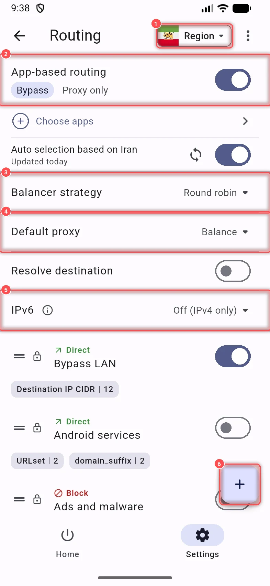
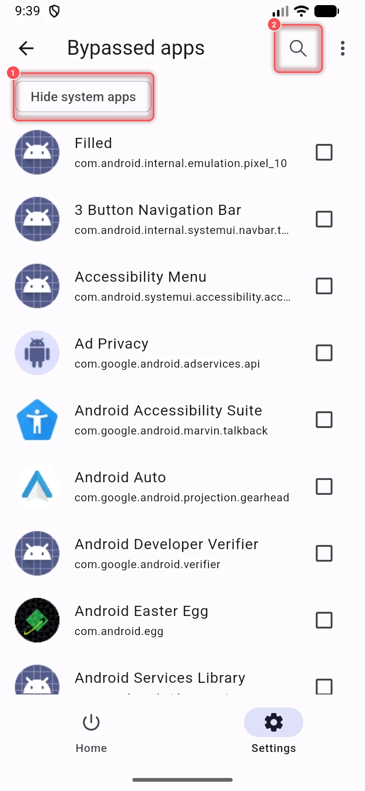
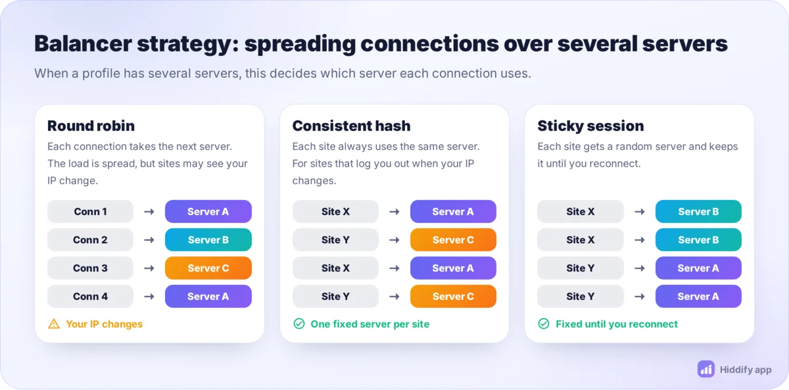
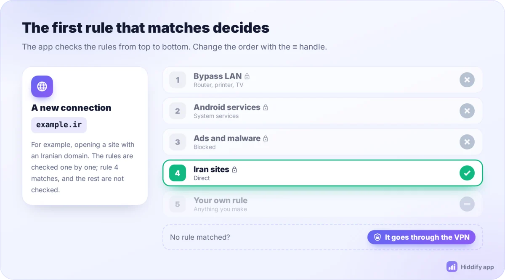
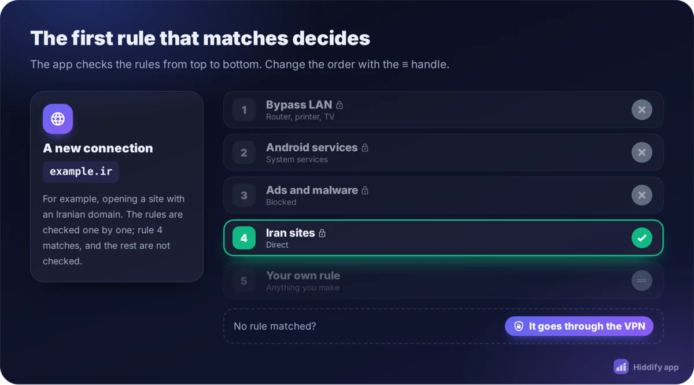
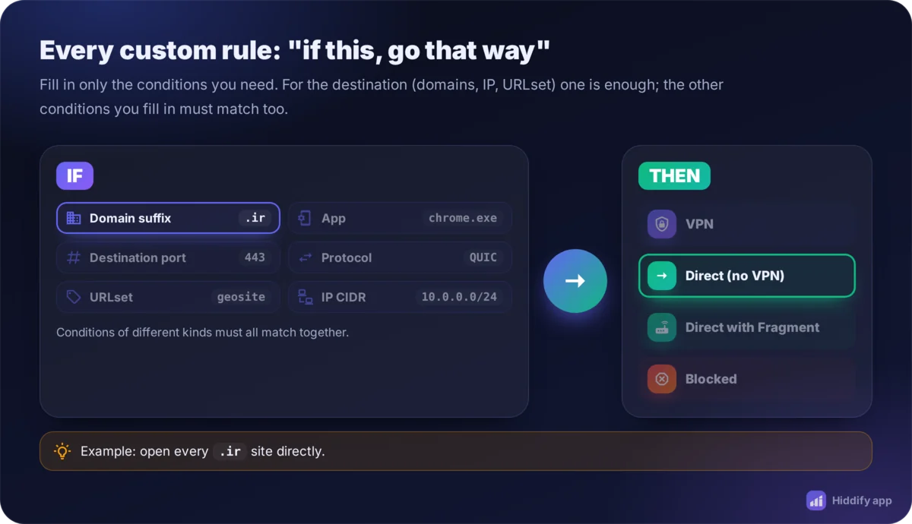
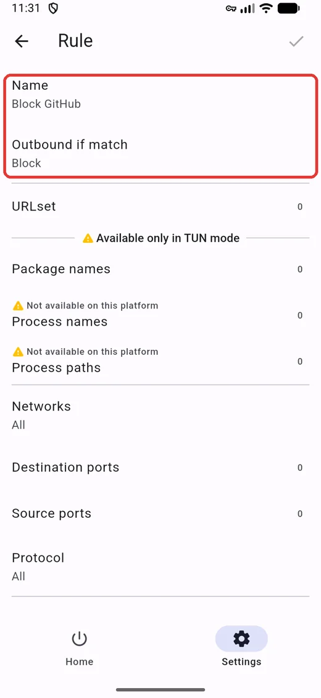
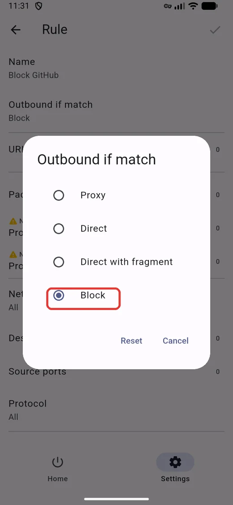
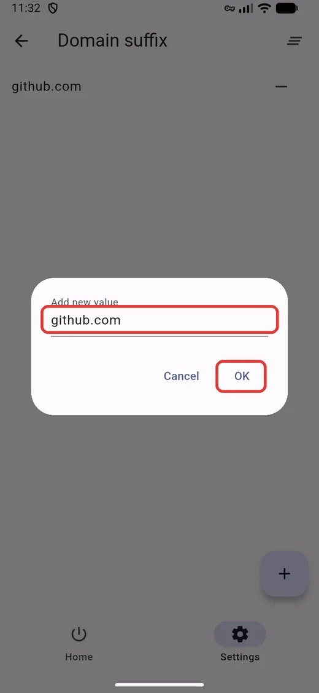

# Routing in the Hiddify app: per-app routing, regions and your own rules

Routing decides which traffic goes through the proxy, which goes straight to the internet (direct), and which is blocked. This page explains every option of **Settings → Routing**.

<figure class="hi-diag">
<picture><source media="(max-width: 700px)" srcset="/assets/app/Routing-in-Hiddify-app/en-diagram-ways-m-light.webp"></picture>
<picture><source media="(max-width: 700px)" srcset="/assets/app/Routing-in-Hiddify-app/en-diagram-ways-m-dark.webp"></picture>
</figure>

!!! note "Written for Hiddify app 5.9"
    This page is for Hiddify app **5.9** (5.9.2). The screenshots come from Android. **App-based routing** is on Android only; the rest is the same on every platform.

## Open the routing settings

Open **Settings** and tap **Routing**.

1. **Region**: the country you are in. It decides which sites go direct (the built-in rule **Sites in …**) and which apps the auto selection picks. Choices: Iran, China, Russia, Afghanistan, Indonesia, Türkiye, Brazil and Other.
2. **App-based routing** (Android): choose apps that skip the VPN, or the only apps that use it.
3. **Balancer strategy**: how traffic is spread when your profile has several servers.
4. **Default proxy**: which server is used until you pick one yourself.
5. **IPv6**: whether IPv6 is used at all.
6. **Add rule** (the **+** button): make your own rule.

## App-based routing (Android)

Turn on **App-based routing**, then pick a mode:

- **Bypass**: the apps you choose do **not** use the VPN. Everything else does. Good for banking apps and local apps that refuse foreign IPs.
- **Proxy only**: **only** the apps you choose use the VPN. Everything else goes direct.

<figure class="hi-diag">
<picture><source media="(max-width: 700px)" srcset="/assets/app/Routing-in-Hiddify-app/en-diagram-modes-m-light.webp"></picture>
<picture><source media="(max-width: 700px)" srcset="/assets/app/Routing-in-Hiddify-app/en-diagram-modes-m-dark.webp"></picture>
</figure>

Tap **Choose apps** to pick the apps. **Hide system apps** keeps the list short, and the search button finds an app by its name.

**Auto selection based on (your region)** adds a ready list of apps for your region to the list of the current mode by itself (for **Bypass**: apps that usually need to stay direct, such as local banking apps), and keeps it up to date. Apps you removed by hand stay removed. Tap the refresh button next to it (**Update now**) to update the list at once. Apps added this way have an **Auto** tag. The ⋮ menu of the app list can import, export or clear your selection.

!!! tip
    An app that is not in the VPN does not follow any routing rule (the app list shows **Outside the VPN · rule won't apply**).

## Per-app routing on computers (Windows, macOS, Linux)

On a computer there is no app list to tick. You choose apps with a routing rule, by the name of their program file. This works only in **VPN** mode (the editor shows **Available only in TUN mode**).

1. Open **Settings → Routing** and click **+** (**Add rule**).
2. Set **Outbound if match**: **Direct** to keep the app outside the VPN (for example a game or a local banking program), **Proxy** to send it through the VPN, or **Block**.
3. Click **Process names**, then **+**, type the program's file name and click **OK**. On Windows it ends in `.exe`, for example `chrome.exe` or `Telegram.exe`; on Linux and macOS it is the program's name, for example `firefox`. Add as many names as you need.
4. Click the ✓ at the top to save the rule.

!!! tip "How do I find the file name?"
    On Windows, open **Task Manager**, right-click the app and choose **Go to details**: the highlighted name (for example `chrome.exe`) is the one to type. **Process paths** does the same with the full path, for example `C:\Program Files\Google\Chrome\Application\chrome.exe`, when two programs have the same name. **Package names** is for Android only.

## Balancer strategy

When the app balances traffic over several servers, it chooses a server for each connection:

- **Round robin**: each connection uses the next server, so sites may see your IP change.
- **Consistent hash**: each site always uses the same server.
- **Sticky session**: each site keeps a random server until you reconnect.

<figure class="hi-diag">
<picture><source media="(max-width: 700px)" srcset="/assets/app/Routing-in-Hiddify-app/en-diagram-balancer-m-light.webp"></picture>
<picture><source media="(max-width: 700px)" srcset="/assets/app/Routing-in-Hiddify-app/en-diagram-balancer-m-dark.webp"></picture>
</figure>

If sites log you out or ask for a captcha again and again, try **Consistent hash** or **Sticky session**.

## Default proxy

Until you choose a server on the proxies page, the app uses:

- **Lowest ping**: the fastest one.
- **Balance**: connections are spread over all of them (with the balancer strategy above).
- **First proxy**: the profile's first server.

## Resolve destination and IPv6

- **Resolve destination**: the app finds the IP address of each site before it sends the traffic. Leave it off unless you know you need it.
- **IPv6**: **Off (IPv4 only)** is the default, because most proxies have no IPv6 at their exit, and a connection the proxy cannot carry breaks sites like Google and YouTube. **On, IPv4 first** and **On, IPv6 first** use IPv6 only through a proxy that was tested to carry it. IPv6 always stays inside the VPN. Tap the ⓘ next to **IPv6** for the full explanation.

## Built-in rules

Below the options is the list of rules. The app checks them from top to bottom, and the first rule that matches decides. Built-in rules have a lock icon; you can turn each one on or off:

- **Bypass LAN**: your home network (router, printer, TV) stays direct.
- **Android services** (on other platforms: **Apple services**, **Microsoft services** or **Linux updates**): system services go direct.
- **Ads and malware**: blocked.
- **Sites in (your region)**: local sites go direct.

A built-in rule can't be changed. To change one, **Duplicate** it and edit the copy. Drag the handle (≡) to change the order.

<figure class="hi-diag">
<picture><source media="(max-width: 700px)" srcset="/assets/app/Routing-in-Hiddify-app/en-diagram-order-m-light.webp"></picture>
<picture><source media="(max-width: 700px)" srcset="/assets/app/Routing-in-Hiddify-app/en-diagram-order-m-dark.webp"></picture>
</figure>

## Add your own rule

Tap **+** (**Add rule**). A rule says *which traffic* (the conditions) and *where it goes* (**Outbound if match**).

1. **Name**: a name for the rule.
2. **Outbound if match**: **Proxy**, **Direct**, **Direct with fragment** (direct, with the TLS fragment trick) or **Block**.
3. **URLset**: links to ready-made rule-set **files** (`.srs` or `.json`), each a long list of sites, for example a list of ad sites. This field is **not** for a site's address; see the warning below.
4. **Package names** (Android, VPN mode only): apps by their package name. **Process names** and **Process paths** are the same on computers, for example `chrome.exe` or `/usr/lib/chromium/chromium`.

Further down you can also match **Networks** (TCP or UDP), **Destination ports** and **Source ports** (for example `443` or `1:65000`), **Protocol** (TLS, HTTP, QUIC, STUN, DNS, BitTorrent), **Destination IP CIDR** and **Source IP CIDR** (for example `10.0.0.0/24`), and sites by **Domain**, **Domain suffix** (for example `.ir`), **Domain keyword** or **Domain regex**. Fill in only what you need; a rule matches when all the filled fields match. Tap the ✓ at the top to save.

<figure class="hi-diag">
<picture><source media="(max-width: 700px)" srcset="/assets/app/Routing-in-Hiddify-app/en-diagram-anatomy-m-light.webp"></picture>
<picture><source media="(max-width: 700px)" srcset="/assets/app/Routing-in-Hiddify-app/en-diagram-anatomy-m-dark.webp"></picture>
</figure>

!!! example "Example: send every `.ir` site direct"
    Add a rule, set **Outbound if match** to **Direct**, and under **Domain suffix** add `.ir`.

!!! danger "Don't put a site's address in URLset"
    **URLset** downloads a rule-set *file* from the link you give it. A site's address such as `https://github.com` is a web page, not a rule-set file, so the whole rule **stops working**: the site is not blocked, even if the domain fields are filled in correctly. To pick a site, use **Domain suffix** (next section), and keep URLset empty.

    

## Step by step: block a site, or send it direct or through the proxy

Here we block GitHub as an example. The steps are the same for any site; only step 3 changes:

- **Block**: the site does not open at all.
- **Direct**: the site opens without the VPN, for example a banking site that does not open from abroad.
- **Proxy**: the site always goes through the VPN, even if a rule lower in the list (for example "Sites in your region") would send it direct.

The steps:

1. In **Settings → Routing**, scroll down to the rules and tap **+**.

    

2. Tap **Name** and write a name you will recognize, for example `Block GitHub`.
3. Tap **Outbound if match** and choose **Block** (or **Direct** or **Proxy**).

    

    
    
    

4. Scroll down and tap **Domain suffix**, then **+**. Write only the site's name, `github.com`: no `https://`, no `www`, no `/` at the end. Tap **OK**, then the back arrow.

    

5. Tap the ✓ at the top to save. The new rule appears at the top of the list, switched on.

    

6. Test it: close the browser completely and open the site again. You don't need to disconnect; the app applies the rule right away. A blocked site shows an error like this:

    

Which domain field should you use?

- **Domain suffix** `github.com`: the site **and all its subdomains** (`github.com`, `docs.github.com`, `api.github.com`). This is the right choice almost always.
- **Domain** `github.com`: only this exact address; `docs.github.com` still opens.
- **Domain keyword** `github`: every address that contains the word, for example `githubusercontent.com` too.

You can put several sites in one rule: add each one as a separate line.

!!! tip "If it does not work"
    - **URLset** of the rule must be empty (see the warning above).
    - The ✓ is grey when there is nothing new to save. If you changed something and the ✓ is still grey, go back and open the rule again to check that your values are there.
    - Rules are checked from top to bottom; if another rule above yours matches the site first, move yours higher with the handle (≡).
    - In versions before 5.9.9, **Domain suffix** accepts only endings like `.com`. Update the app, or use **Domain** `github.com` together with **Domain keyword** `github`.

The ⋮ menu of the Routing page can **Import rules** from the clipboard or a file, **Copy rules** or **Save rules to file** (to move them to another device), and **Reset to default rules**.

!!! warning
    Only import rules from a source you trust: rules decide where your traffic goes.

## Related articles

- [How to install the Hiddify app](How-to-install-Hiddify-app.md)
- [Chain, Extra security and Proxy unblocker](Chain-Extra-security-and-Proxy-unblocker.md)
- [DNS and TLS tricks](DNS-and-TLS-tricks-in-Hiddify-app.md)
- [How to use the Hiddify app](How-to-use-Hiddify-app.md)

