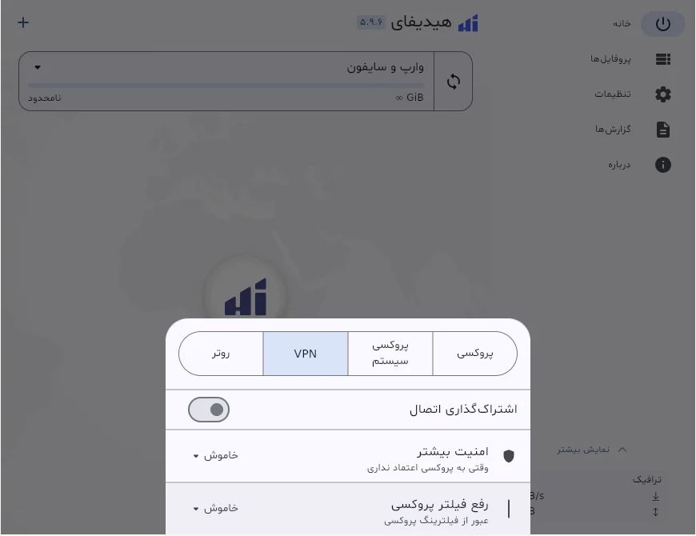
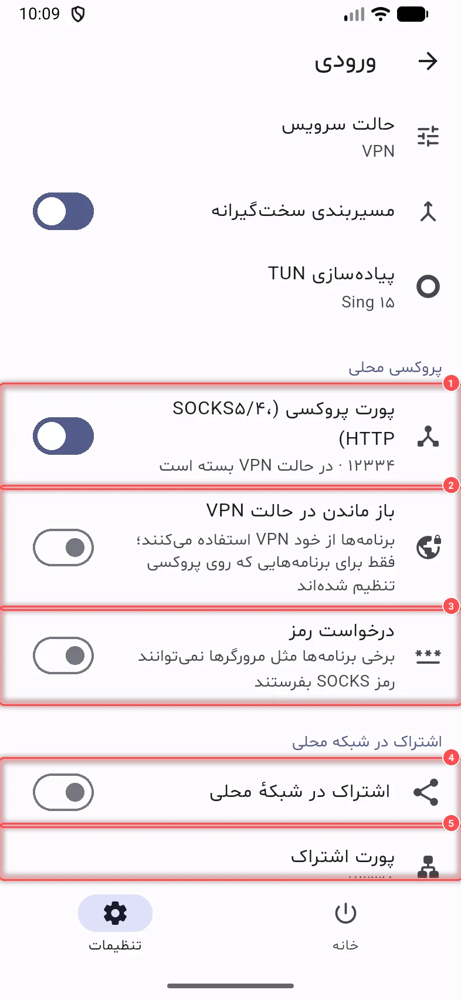
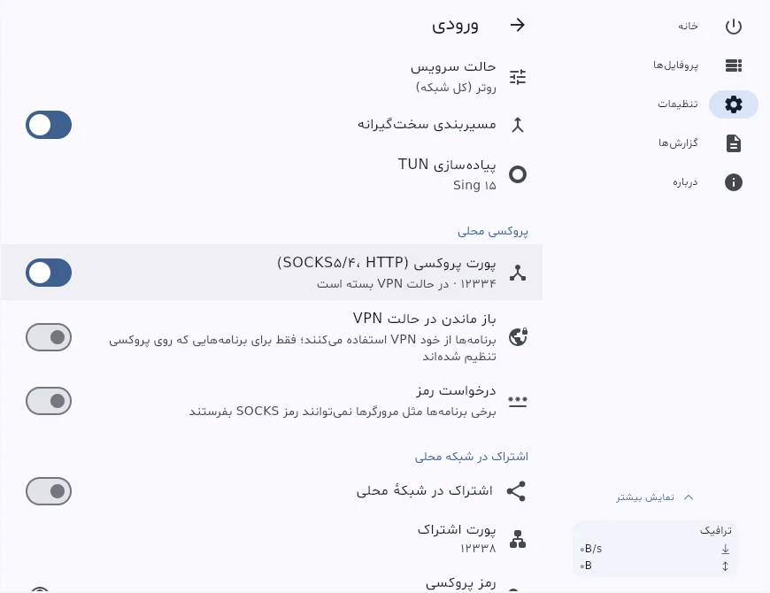
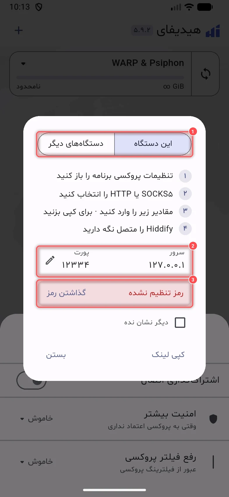
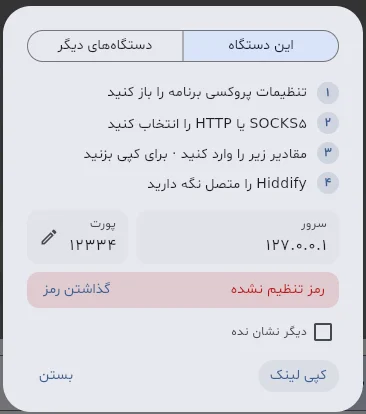
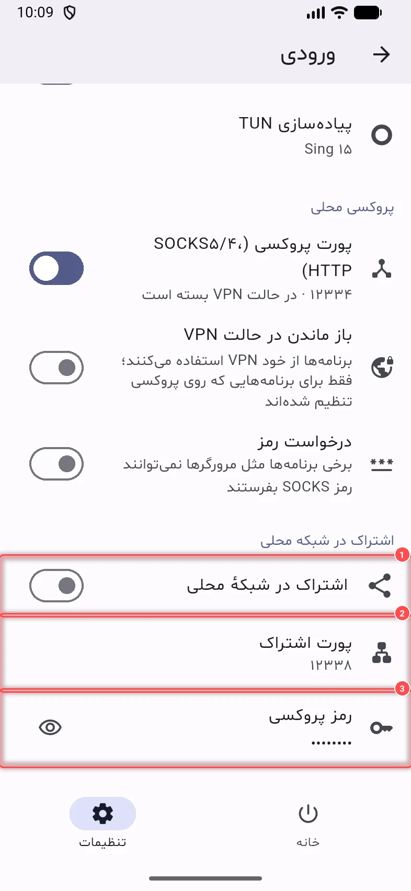
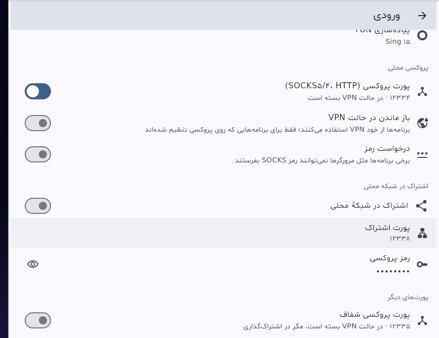
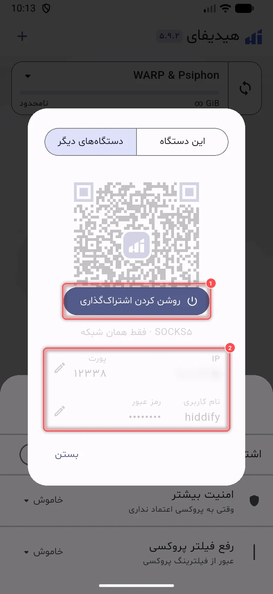
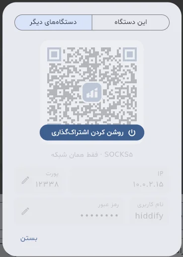

# اشتراک‌گذاری اتصال: پروکسی محلی و اشتراک در شبکهٔ محلی

اپ هیدیفای علاوه بر VPN، یک **پروکسی محلی** هم باز می‌کند که برنامه‌های دیگر همان دستگاه می‌توانند از آن استفاده کنند، و می‌تواند اتصال را با دستگاه‌های دیگر وای‌فای خانه **به اشتراک بگذارد**: لپ‌تاپ، تلویزیون، کنسول بازی. این گزینه‌ها در **تنظیمات ← ورودی** هستند.

!!! note "نوشته‌شده برای اپ هیدیفای نسخهٔ ۵.۹"
    این صفحه برای اپ هیدیفای **نسخهٔ ۵.۹** (۵.۹.۶) است. هر تصویر دو برگهٔ **گوشی** و **کامپیوتر** دارد؛ گزینه‌ها یکی است و کامپیوتر چند پورت اضافه هم دارد.

## روشن کردن سریع اشتراک‌گذاری

در صفحهٔ خانه، **تنظیمات سریع** را باز کنید و **اشتراک‌گذاری اتصال** را روشن کنید. این همان کلید **اشتراک در شبکهٔ محلی** است که پایین‌تر توضیح داده شده.

روی کامپیوتر (روی گوشی هم همین شکل است):

## صفحهٔ ورودی

**تنظیمات ← ورودی** را باز کنید.

=== "گوشی"

    

=== "کامپیوتر"

    

بالای صفحه:

- **حالت سرویس**: **VPN** (همهٔ برنامه‌ها از هیدیفای عبور می‌کنند) یا **پروکسی** (فقط برنامه‌هایی که روی پروکسی تنظیم شده‌اند؛ در کامپیوتر **تنظیم پروکسی سیستم** و در لینوکس **روتر** هم هست). [اپ هیدیفای روی کامپیوتر](Hiddify-app-on-desktop.md) را ببینید.
- **مسیربندی سخت‌گیرانه** و **پیاده‌سازی TUN**: گزینه‌های فنی VPN. تغییرشان ندهید.

زیر **پروکسی محلی**:

1. **پورت پروکسی (SOCKS5/4، HTTP)**: پروکسی محلی، به‌طور پیش‌فرض روی پورت **12334**. یک پورت برای SOCKS5، SOCKS4 و HTTP. در حالت VPN بسته است، چون برنامه‌ها خودشان از VPN استفاده می‌کنند.
2. **باز ماندن در حالت VPN**: پروکسی محلی را در حالت VPN هم باز نگه می‌دارد، برای برنامه‌هایی که روی پروکسی تنظیم شده‌اند.
3. **درخواست رمز**: برنامه‌ها باید نام کاربری و رمز بفرستند. برخی برنامه‌ها، مثل مرورگرها، نمی‌توانند رمز SOCKS بفرستند.

وقتی در **تنظیمات سریع** به حالت **پروکسی** می‌روید، اپ نشان می‌دهد چطور یک برنامه را به پروکسی محلی وصل کنید: برگهٔ **این دستگاه** مراحل، **سرور** (`127.0.0.1`) و **پورت** را نشان می‌دهد و این‌که رمز تنظیم شده یا نه (**گذاشتن رمز**). همین پنجره از راهنمای **حالت پروکسی · راهنما** در صفحهٔ خانه هم باز می‌شود.

=== "گوشی"

    

=== "کامپیوتر"

    

زیر **اشتراک در شبکه محلی**:

4. **اشتراک در شبکهٔ محلی**: دستگاه‌های دیگر شبکه هم می‌توانند از پروکسی استفاده کنند.
5. **پورت اشتراک**: پورت دستگاه‌های دیگر، به‌طور پیش‌فرض **12338**.

=== "گوشی"

    

=== "کامپیوتر"

    

**رمز پروکسی** (۳) رمز عبور پروکسی است. برای دیدنش آیکون چشم را بزنید، یا با **ساخت رمز تازه** یک رمز جدید بسازید. بدون رمز، هر برنامه‌ای روی این دستگاه، و هنگام اشتراک‌گذاری هر دستگاهی در شبکه، می‌تواند از پروکسی استفاده کند.

!!! warning "هشدار"
    وقتی روی شبکه‌ای که مال شما نیست (کافه، محل کار) اشتراک‌گذاری می‌کنید، رمز پروکسی را نگه دارید. وگرنه هر کسی در آن شبکه می‌تواند از اتصال شما استفاده کند.

## استفاده از اتصال اشتراکی روی دستگاه دیگر

1. هیدیفای را روی دستگاه اشتراک‌گذار متصل نگه دارید و هر دو دستگاه را به یک وای‌فای وصل کنید.
2. روی دستگاه اشتراک‌گذار، مقدارها را باز کنید: در **تنظیمات سریع** به **پروکسی** بروید (بار اول پنجره خودش باز می‌شود)، یا راهنمای **حالت پروکسی · راهنما** را در صفحهٔ خانه بزنید. برگهٔ **دستگاه‌های دیگر** آی‌پی، پورت، نام کاربری (پیش‌فرض `hiddify`) و رمز را برای شبکه نشان می‌دهد، همراه با یک کد QR (**SOCKS5 · فقط همان شبکه**)، و اگر اشتراک‌گذاری خاموش باشد دکمهٔ **روشن کردن اشتراک‌گذاری** را. هر مقدار را برای کپی بزنید، یا **کپی لینک** یا **لینک تلگرام** را بزنید.

    === "گوشی"

        

    === "کامپیوتر"

        

3. روی دستگاه دیگر، تنظیمات پروکسی برنامه یا سیستم را باز کنید، **SOCKS5** (یا HTTP) را انتخاب کنید و آی‌پی دستگاه اشتراک‌گذار، پورت اشتراک و در صورت تنظیم، نام کاربری و رمز را وارد کنید.

!!! tip "نکته"
    تلگرام تنظیم پروکسی خودش را دارد: **لینک تلگرام** آن را برایتان پر می‌کند.

## مقاله‌های مرتبط

- [کار با اپ هیدیفای](How-to-use-Hiddify-app.md): افزودن پروفایل، اتصال و تنظیمات پایه
- [نصب اپ هیدیفای](How-to-install-Hiddify-app.md)
- [حالت روتر در لینوکس](Router-mode-on-Linux.md): اشتراک هیدیفای با کل یک شبکه از یک گیت‌وی لینوکسی.
- [اینترنت آزاد برای همهٔ دستگاه‌های پشت روتر OpenWrt](How-to-Enable-Free-Internet-Access-for-Clients-Behind-an-OpenWrt-Router-Using-HiddifyCli.md)

