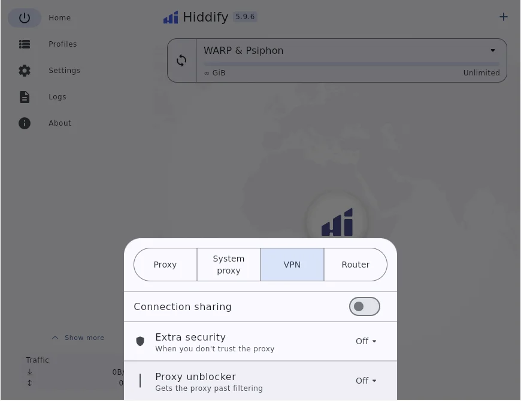
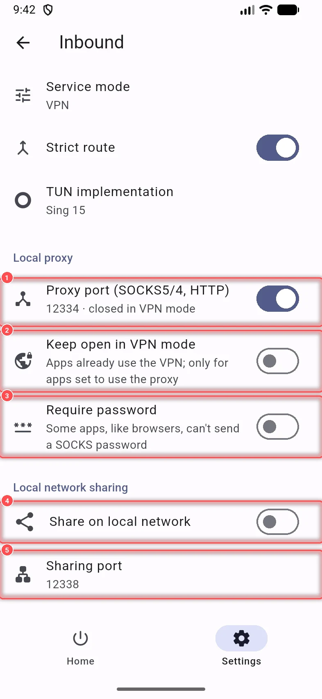
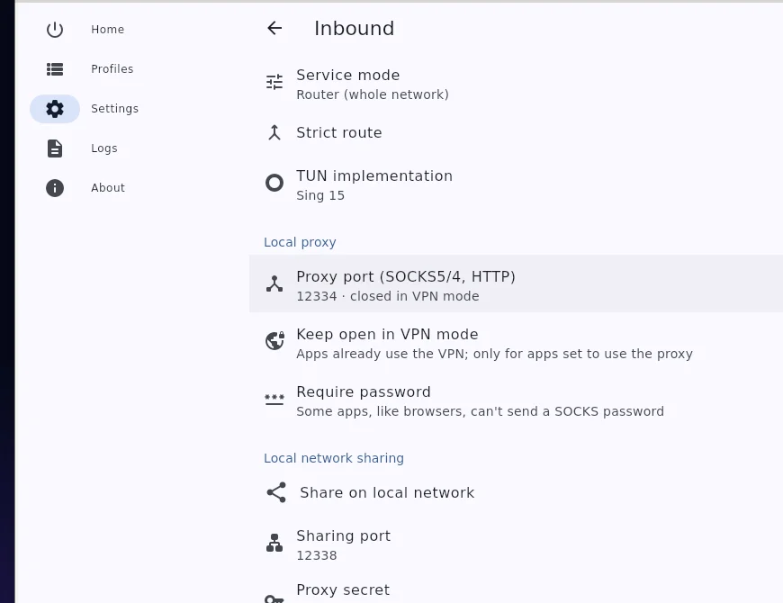
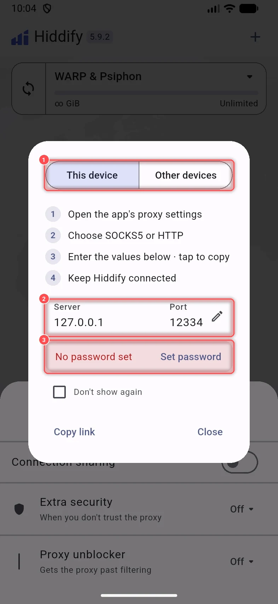
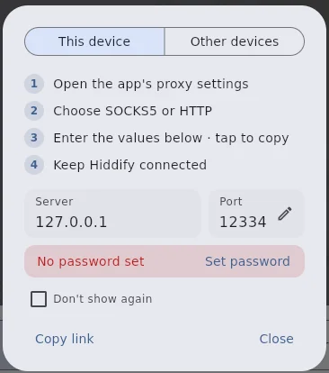
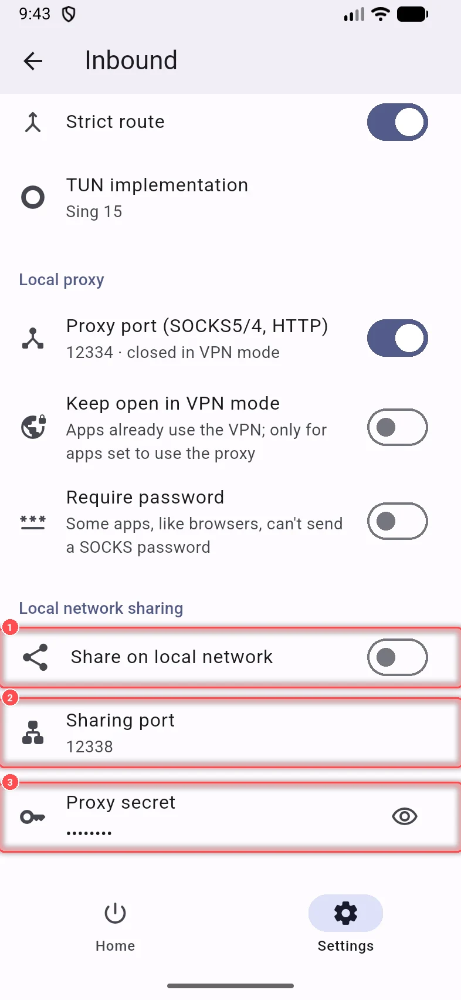
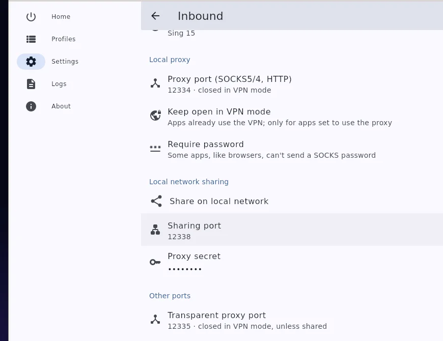
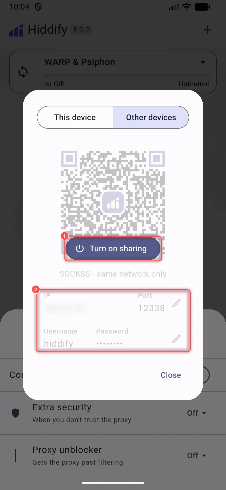
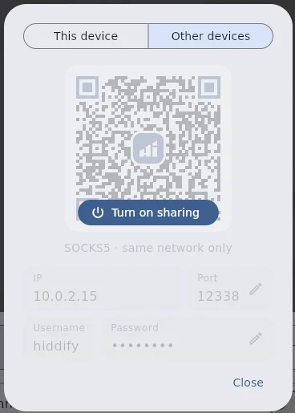

# Share your connection: local proxy and local network sharing

Besides the VPN, the Hiddify app opens a **local proxy** that other apps on the same device can use, and it can **share** the connection with other devices on your home Wi-Fi: a laptop, a TV, a game console. These options are in **Settings → Inbound**.

!!! note "Written for Hiddify app 5.9"
    This page is for Hiddify app **5.9** (5.9.6). Each picture has a **Phone** and a **Computer** tab; the options are the same, computers have a few extra ports.

## Turn sharing on quickly

On the Home page, open **Quick settings** and turn on **Connection sharing**. It is the same switch as **Share on local network** below.

On a computer (the phone looks the same):

## The Inbound page

Open **Settings → Inbound**.

=== "Phone"

    

=== "Computer"

    

At the top:

- **Service mode**: **VPN** (every app goes through Hiddify) or **Proxy** (only apps set to use the proxy; on computers also **Set system proxy**, and on Linux **Router**). See [Hiddify on desktop](Hiddify-app-on-desktop.md).
- **Strict route** and **TUN implementation**: technical VPN options. Leave them as they are.

Under **Local proxy**:

1. **Proxy port (SOCKS5/4, HTTP)**: the local proxy, on port **12334** by default. One port serves SOCKS5, SOCKS4 and HTTP. In VPN mode it is closed (**closed in VPN mode**), because apps already use the VPN.
2. **Keep open in VPN mode**: keeps the local proxy open in VPN mode too, for apps set to use a proxy.
3. **Require password**: apps must send a user name and password. Some apps, such as browsers, can't send a SOCKS password.

When you switch to **Proxy** mode (in **Quick settings**), the app shows how to point an app at the local proxy: **This device** lists the steps, the **Server** (`127.0.0.1`) and **Port**, and whether a password is set (**Set password**). The same window opens from the **Proxy mode · how to use** hint on the Home page.

=== "Phone"

    

=== "Computer"

    

Under **Local network sharing**:

4. **Share on local network**: other devices on your network can use the proxy.
5. **Sharing port**: the port for other devices, **12338** by default.

=== "Phone"

    

=== "Computer"

    

**Proxy secret** (3) is the password of the proxy. Tap the eye to see it, or **Generate new** for a new one. Without a secret, any app on this device, and any device on the network while you share, can use the proxy.

!!! warning
    Keep a proxy secret while you share on a network you don't control (a café, an office). Anyone on that network could otherwise use your connection.

## Use the shared connection on another device

1. Keep Hiddify connected on the sharing device, and put both devices on the same Wi-Fi.
2. On the sharing device, open the values to enter: switch **Quick settings** to **Proxy** (the window opens by itself the first time), or tap the **Proxy mode · how to use** hint on the Home page. **This device** shows the values for apps on the same device; **Other devices** shows the IP, port, user name (`hiddify` by default) and password for the network, with a QR code (**SOCKS5 · same network only**) and a **Turn on sharing** button if sharing is off. Tap a value to copy it, or use **Copy link** or the **Telegram link**.

    === "Phone"

        

    === "Computer"

        

3. On the other device, open the app's or system's proxy settings, choose **SOCKS5** (or HTTP), and enter the IP of the sharing device, the sharing port and, if set, the user name and password.

!!! tip
    Telegram has its own proxy setting: the **Telegram link** fills it in for you.

## Related articles

- [How to use the Hiddify app](How-to-use-Hiddify-app.md): add a profile, connect, the basic settings
- [How to install the Hiddify app](How-to-install-Hiddify-app.md)
- [Router mode on Linux](Router-mode-on-Linux.md): share Hiddify with a whole network from a Linux gateway.
- [Free internet for every device behind an OpenWrt router](How-to-Enable-Free-Internet-Access-for-Clients-Behind-an-OpenWrt-Router-Using-HiddifyCli.md)

