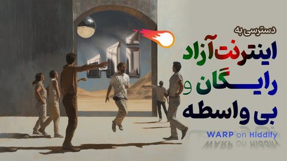
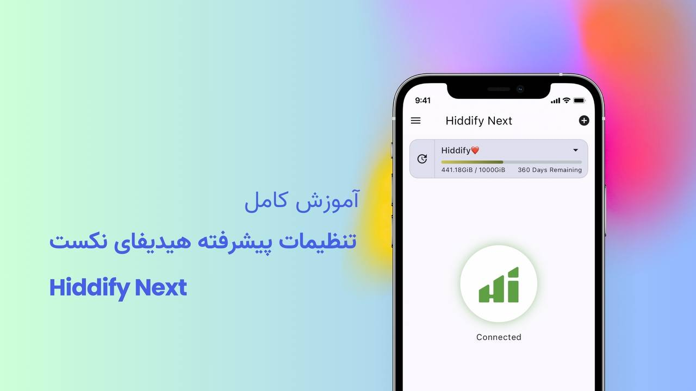
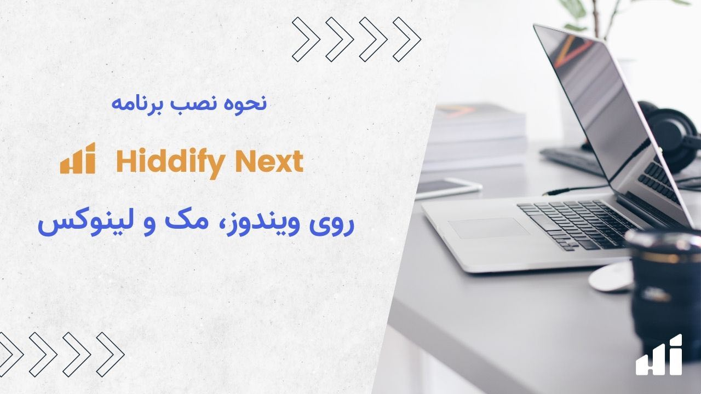

# همه آموزش‌ها و ویدیوهای مرتبط با اپ هیدیفای

اپ هیدیفای یک برنامهٔ رایگان و متن‌باز برای اتصال به پروکسی و VPN است که روی Android، iOS، Windows، macOS و Linux کار می‌کند.
در این صفحه همهٔ آموزش‌های اپ را می‌بینید: اول «نصب» و بعد «استفاده» را بخوانید.
فهرست کامل امکانات اپ در
<a class="underline underline-offset-2"
  href="https://github.com/hiddify/hiddify-app/blob/main/README_fa.md">صفحهٔ README اپ در GitHub</a> آمده است.

<section class="flex flex-col gap-5 items-center justify-center py-10">
  <section
    class=" video-card  relative w-full md:max-w-[900px] rounded-3xl border-2 border-white bg-white bg-opacity-20 shadow-lg">

    

      

        
        

          <h1 class="text-primaryText title-font text-lg mb-3">اپ هیدیفای</h1>
          

            

              

            

            <a href="/fa/app/How-to-install-Hiddify-app/" target="_blank" class="text-secondaryText text-sm">چگونه
              اپ هیدیفای را نصب کنیم</a>
          

          

            

              

            

            <a href="/fa/app/How-to-use-Hiddify-app/" target="_blank" class="text-secondaryText text-sm">چگونه
              از اپ هیدیفای استفاده کنیم
            </a>
          

          

            

              

            

            <a href="/fa/app/HiddifyCli-guide/" target="_blank" class="text-secondaryText text-sm">چگونه از
              هیدیفای‌کامندلاین استفاده کنیم</a>
          

          

            

              

            

            <a href="/fa/app/How-to-use-UDP-Turn-Relay/" target="_blank" class="text-secondaryText text-sm">چگونه
              از
              UDP Turn Relay در اپ هیدیفای استفاده کنیم</a>
          

          

            

              

            

            <a href="/fa/app/How-to-use-WARP-on-Hiddify-App/" target="_blank" class="text-secondaryText text-sm">چگونه
              از WARP در اپ هیدیفای استفاده کنیم</a>
          

          

            

              

            

            <a href="/fa/app/How-to-use-HiddifyCli-on-OpenWrt/" target="_blank" class="text-secondaryText text-sm">چگونه
              از HiddifyCli روی OpenWrt استفاده کنیم</a>
          

          

            

              

            

            <a href="/fa/app/How-to-Enable-Free-Internet-Access-for-Clients-Behind-an-OpenWrt-Router-Using-HiddifyCli/" target="_blank" class="text-secondaryText text-sm">اینترنت
              آزاد برای همهٔ دستگاه‌های پشت روتر OpenWrt</a>
          

          

            

              

            

            <a href="/fa/app/How-to-contribute-to-this-project/" target="_blank"
              class="text-secondaryText text-sm">
              چگونه به این پروژه کمک کنیم</a>
          

          

            

              

                

              

              <a href="/fa/app/URL-Scheme/" target="_blank" class="text-secondaryText text-sm">
                URL Scheme در اپ هیدیفای (انگلیسی)
              </a>
            

            

              

                

              

              <a href="/fa/core/" target="_blank" class="text-secondaryText text-sm">هسته هیدیفای</a>
            

            

              

                

              

              <a href="/fa/core/cli/" target="_blank" class="text-secondaryText text-sm">راهنمای خط فرمان HiddifyCli</a>
            

          

        

      

      

        

          

            <h1 class="text-secondaryText title-font text-base">ویدیوهای مرتبط</h1>
          

          

            <a href="https://www.youtube.com/watch?v=HOF6NJa55SI" title="هیدیفای روی تلویزیون اندروید 📺 لینک رو فقط با دوربین گوشی بفرست، بدون تایپ با کنترل">
              

                
                
              

            </a>
            <a href="https://www.youtube.com/watch?v=NGP_uC8edJI" title="Hiddify 5 full tutorial on every device 📱💻 Android, iPhone, Windows, Mac and Linux">
              

                
                
              

            </a>
            <a href="https://www.youtube.com/watch?v=UsOrJ9wMUMo" title="آموزش کامل اپ هیدیفای نسخهٔ ۵ روی همهٔ دستگاه‌ها 📱💻 اندروید، آیفون، ویندوز، مک و لینوکس">
              

                
                
              

            </a>
            <a href="https://www.youtube.com/watch?v=ywxx5AzQl-s" title="اینترنت آزاد رایگان با Hiddify! بدون نیاز به خرید VPN!">
              

                
                
              

            </a>
            <a href="https://www.youtube.com/watch?v=jrvQD5xo6PU" title="🚀 آموزش HiddifyCli برای سرورها و محیط‌های بدون دسکتاپ – سریع و آسان! 🔥">
              

                
                
              

            </a>
            <a href="https://www.youtube.com/watch?v=Br3lIHIaUVc" title="ساخت کانفیگ رایگان وارپ به صورت حرفه‌ای">
              

                
                
              

            </a>
            <a href="https://www.youtube.com/watch?v=Xv_7TDo80k4" title="فیلترشکن رایگان هیدیفای">
              

                
                
              

            </a>
            <a href="https://www.youtube.com/watch?v=NtQ0bQlIRrY">
              

                
                
              

            </a>
            <a href="https://www.youtube.com/watch?v=EjHjLQbC40E">
              

                
                
              

            </a>
            <a href="https://www.youtube.com/watch?v=vUaA1AEUy1s">
              

                
                
              

            </a>
            <a href="https://www.youtube.com/watch?v=qDbI72J-INM" title="راهنمای استفاده از اپ HiddifyNG">
              

                
                
              

            </a>
            <a href="https://www.youtube.com/watch?v=L1VxAcG_7jg" title="Tutorial for Hiddify Clash Desktop">
              

                
                
              

            </a>
            <a href="https://www.youtube.com/watch?v=Jnnx1VWMlEs" title="Tutorial for HiddifyN software">
              

                
                
              

            </a>
            <a href="https://www.youtube.com/watch?v=omGIz97mbzM" title="آموزش کامل نرم‌افزار هیدیفای کلش دسکتاپ">
              

                
                
              

            </a>
            <a href="https://www.youtube.com/watch?v=Pqactnz_PdU" title="معرفی برنامه HiddifyNG">
              

                
                
              

            </a>
            <a href="https://www.youtube.com/watch?v=qT43zDPev6o" title="HiddifyNG introduction">
              

                
                
              

            </a>
            <a href="https://www.youtube.com/watch?v=o9L2sI2T53Q" title="HiddifyN آموزش کار با نرم‌افزار دسکتاپ">
              

                
                
              

            </a>
            <a href="https://www.youtube.com/watch?v=hVcWJ8Qg1GQ" title="Tutorial for HiddifyNG (Xray based client app)">
              

                
                
              

            </a>
            <a href="https://www.youtube.com/watch?v=7B0PO3HM6Vg" title="آموزش کار با نرم‌افزار HiddifyNG">
              

                
                
              

            </a>
            <a href="https://www.youtube.com/watch?v=mUTfYd1_UCM" title="Tutorial for Hiddify android (Clash-based app)">
              

                
                
              

            </a>
            <a href="https://www.youtube.com/watch?v=8P887E-KMls" title="آموزش استفاده از نرم‌افزار هیدیفای اندروید (نسخه بر پایه کِلش)">
              

                
                
              

            </a>
          

        

      

    

  </section>

</section>

