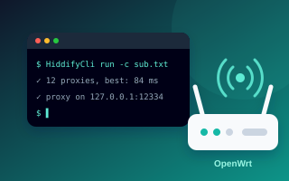
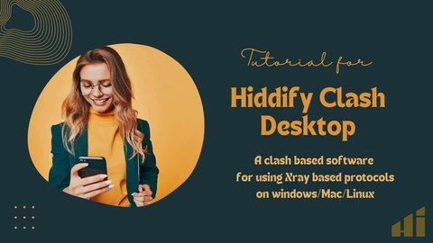

# همه آموزش‌ها و ویدیوهای مرتبط با اپ هیدیفای

اپ هیدیفای یک برنامهٔ رایگان و متن‌باز برای اتصال به پروکسی و VPN است که روی Android، iOS، Windows، macOS و Linux کار می‌کند.
در این صفحه همهٔ آموزش‌های اپ را می‌بینید: اول «نصب» و بعد «استفاده» را بخوانید.
فهرست کامل امکانات اپ در
<a class="underline underline-offset-2"
  href="https://github.com/hiddify/hiddify-app/blob/main/README_fa.md">صفحهٔ README اپ در GitHub</a> آمده است.

<!-- guide:start -->

<h2 class="hg-h">از اینجا شروع کنید</h2>

<a class="hg-card" href="/fa/app/How-to-install-Hiddify-app/"><svg aria-hidden="true" xmlns="http://www.w3.org/2000/svg" viewBox="0 0 24 24"><path d="M13 5v6h1.17L12 13.17 9.83 11H11V5h2m2-2H9v6H5l7 7 7-7h-4V3m4 15H5v2h14v-2Z"/></svg><b>نصب اپ</b><small>اندروید، iOS، ویندوز، مک و لینوکس</small></a>
<a class="hg-card" href="/fa/app/How-to-use-Hiddify-app/"><svg aria-hidden="true" xmlns="http://www.w3.org/2000/svg" viewBox="0 0 24 24"><path d="M13 5c2.21 0 4 1.79 4 4 0 1.5-.8 2.77-2 3.46v-1.22c.61-.55 1-1.35 1-2.24 0-1.66-1.34-3-3-3s-3 1.34-3 3c0 .89.39 1.69 1 2.24v1.22C9.8 11.77 9 10.5 9 9c0-2.21 1.79-4 4-4m7 15.5c-.03.82-.68 1.47-1.5 1.5H13c-.38 0-.74-.15-1-.43l-4-4.2.74-.77c.19-.21.46-.32.76-.32h.2L12 18V9c0-.55.45-1 1-1s1 .45 1 1v4.47l1.21.13 3.94 2.19c.53.24.85.77.85 1.35v3.36M20 2H4c-1.1 0-2 .9-2 2v8a2 2 0 0 0 2 2h4v-2H4V4h16v8h-2v2h2v-.04l.04.04c1.09 0 1.96-.91 1.96-2V4a2 2 0 0 0-2-2Z"/></svg><b>کار با اپ</b><small>افزودن پروفایل و اتصال</small></a>
<a class="hg-card" href="/fa/app/How-to-use-WARP-on-Hiddify-App/"><svg aria-hidden="true" xmlns="http://www.w3.org/2000/svg" viewBox="0 0 24 24"><path d="m6 7 .69.06A5.499 5.499 0 0 1 12 3a5.5 5.5 0 0 1 5.5 5.5l-.08.95c.46-.29 1-.45 1.58-.45a3 3 0 0 1 3 3 3 3 0 0 1-3 3H6a4 4 0 0 1-4-4 4 4 0 0 1 4-4m0 2a2 2 0 0 0-2 2 2 2 0 0 0 2 2h13a1 1 0 0 0 1-1 1 1 0 0 0-1-1h-3.5V8.5A3.5 3.5 0 0 0 12 5a3.5 3.5 0 0 0-3.5 3.5V9H6m16 10-3 3v-2H2v-2h17v-2l3 3"/></svg><b>اینترنت آزاد رایگان</b><small>وارپ رایگان در خود اپ</small></a>
<a class="hg-card" href="/fa/core/"><svg aria-hidden="true" xmlns="http://www.w3.org/2000/svg" viewBox="0 0 24 24"><path d="M13 19v-3h8v3h-8m-4.5-6L2.47 7h4.24l4.96 4.95c.58.59.58 1.55 0 2.12L6.74 19H2.5l6-6Z"/></svg><b>هستهٔ هیدیفای</b><small>موتور اپ در خط فرمان</small></a>

<nav class="hg-nav" aria-label="دسته‌ها">
<a href="#app" style="--c:#455fe9">اپ هیدیفای<small>۴</small></a>
<a href="#core" style="--c:#0d9488">هسته، خط فرمان و روتر<small>۵</small></a>
<a href="#developers" style="--c:#6366f1">برای توسعه‌دهندگان<small>۲</small></a>
</nav>
<section class="hg-cat" id="app" style="--c:#455fe9"><header>
<h2>اپ هیدیفای</h2>
نصب، اتصال و قابلیت‌های اپ
۴ مقاله · ۹ ویدیو
</header>

<h3>شروع</h3><ul><li><a class="hg-a" href="/fa/app/How-to-install-Hiddify-app/" data-k="app/How-to-install-Hiddify-app" data-n="2024-03-13" data-u="2026-10-23">نصب اپ هیدیفای</a></li><li><a class="hg-a" href="/fa/app/How-to-use-Hiddify-app/" data-k="app/How-to-use-Hiddify-app" data-n="2024-03-13" data-u="2026-11-11">کار با اپ هیدیفای</a></li></ul>

<h3>قابلیت‌ها</h3><ul><li><a class="hg-a" href="/fa/app/How-to-use-WARP-on-Hiddify-App/" data-k="app/How-to-use-WARP-on-Hiddify-App" data-n="2024-08-04" data-u="2026-10-22">وارپ در اپ هیدیفای</a></li><li><a class="hg-a" href="/fa/app/How-to-use-UDP-Turn-Relay/" data-k="app/How-to-use-UDP-Turn-Relay" data-n="2024-03-13">UDP Turn Relay</a></li></ul>

<h3>ویدیوها ۹</h3><button type="button" class="hg-prev" aria-label="قبلی"><svg aria-hidden="true" xmlns="http://www.w3.org/2000/svg" viewBox="0 0 24 24"><path d="M15.41 16.58 10.83 12l4.58-4.59L14 6l-6 6 6 6 1.41-1.42Z"/></svg></button><button type="button" class="hg-next" aria-label="بعدی"><svg aria-hidden="true" xmlns="http://www.w3.org/2000/svg" viewBox="0 0 24 24"><path d="M8.59 16.58 13.17 12 8.59 7.41 10 6l6 6-6 6-1.41-1.42Z"/></svg></button>

<a class="hg-v" href="https://www.youtube.com/watch?v=HOF6NJa55SI" target="_blank" rel="noopener" title="هیدیفای روی تلویزیون اندروید 📺 لینک رو فقط با دوربین گوشی بفرست، بدون تایپ با کنترل">هیدیفای روی تلویزیون اندروید 📺 لینک رو فقط با دوربین گوشی بفرست، بدون تایپ با کنترل</a><a class="hg-v" href="https://www.youtube.com/watch?v=UsOrJ9wMUMo" target="_blank" rel="noopener" title="آموزش کامل اپ هیدیفای نسخهٔ ۵ روی همهٔ دستگاه‌ها 📱💻 اندروید، آیفون، ویندوز، مک و لینوکس">آموزش کامل اپ هیدیفای نسخهٔ ۵ روی همهٔ دستگاه‌ها 📱💻 اندروید، آیفون، ویندوز، مک و لینوکس</a><a class="hg-v" href="https://www.youtube.com/watch?v=NGP_uC8edJI" target="_blank" rel="noopener" title="Hiddify 5 full tutorial on every device 📱💻 Android, iPhone, Windows, Mac and Linux">Hiddify 5 full tutorial on every device 📱💻 Android, iPhone, Windows, Mac and Linux</a><a class="hg-v" href="https://www.youtube.com/watch?v=ywxx5AzQl-s" target="_blank" rel="noopener" title="اینترنت آزاد رایگان با Hiddify! بدون نیاز به خرید VPN!">اینترنت آزاد رایگان با Hiddify! بدون نیاز به خرید VPN!</a><a class="hg-v" href="https://www.youtube.com/watch?v=Br3lIHIaUVc" target="_blank" rel="noopener" title="ساخت کانفیگ رایگان وارپ به صورت حرفه‌ای">ساخت کانفیگ رایگان وارپ به صورت حرفه‌ای</a><a class="hg-v" href="https://www.youtube.com/watch?v=Xv_7TDo80k4" target="_blank" rel="noopener" title="فیلترشکن رایگان هیدیفای">فیلترشکن رایگان هیدیفای</a><a class="hg-v" href="https://www.youtube.com/watch?v=NtQ0bQlIRrY" target="_blank" rel="noopener" title="آموزش کامل تنظیمات پیشرفته هیدیفای‌اپ HiddifyApp">آموزش کامل تنظیمات پیشرفته هیدیفای‌اپ HiddifyApp</a><a class="hg-v" href="https://www.youtube.com/watch?v=EjHjLQbC40E" target="_blank" rel="noopener" title="کار کردن با HiddifyApp">کار کردن با HiddifyApp</a><a class="hg-v" href="https://www.youtube.com/watch?v=vUaA1AEUy1s" target="_blank" rel="noopener" title="نحوه نصب برنامه Hiddify Next روی ویندوز، مک و لینوکس">نحوه نصب برنامه Hiddify Next روی ویندوز، مک و لینوکس</a>

</section>
<section class="hg-cat" id="core" style="--c:#0d9488"><header>
<h2>هسته، خط فرمان و روتر</h2>
همان موتور اپ، روی سرور، روتر و کامپیوتر بدون صفحه
۵ مقاله · ۱ ویدیو
</header>

<h3>هستهٔ هیدیفای</h3><ul><li><a class="hg-a" href="/fa/core/" data-k="core" data-n="2026-11-04" data-u="2026-11-14">هستهٔ هیدیفای</a></li><li><a class="hg-a" href="/fa/core/cli/" data-k="core/cli" data-n="2026-11-04">راهنمای دستورهای HiddifyCli</a></li><li><a class="hg-a" href="/fa/app/HiddifyCli-guide/" data-k="app/HiddifyCli-guide" data-n="2024-03-20" data-u="2024-03-21">آموزش HiddifyCli</a></li></ul>

<h3>روتر OpenWrt</h3><ul><li><a class="hg-a" href="/fa/app/How-to-use-HiddifyCli-on-OpenWrt/" data-k="app/How-to-use-HiddifyCli-on-OpenWrt" data-n="2024-12-17">نصب HiddifyCli روی OpenWrt</a></li><li><a class="hg-a" href="/fa/app/How-to-Enable-Free-Internet-Access-for-Clients-Behind-an-OpenWrt-Router-Using-HiddifyCli/" data-k="app/How-to-Enable-Free-Internet-Access-for-Clients-Behind-an-OpenWrt-Router-Using-HiddifyCli" data-n="2024-12-17">اینترنت آزاد برای همهٔ دستگاه‌های پشت روتر</a></li></ul>

<h3>ویدیوها ۱</h3><button type="button" class="hg-prev" aria-label="قبلی"><svg aria-hidden="true" xmlns="http://www.w3.org/2000/svg" viewBox="0 0 24 24"><path d="M15.41 16.58 10.83 12l4.58-4.59L14 6l-6 6 6 6 1.41-1.42Z"/></svg></button><button type="button" class="hg-next" aria-label="بعدی"><svg aria-hidden="true" xmlns="http://www.w3.org/2000/svg" viewBox="0 0 24 24"><path d="M8.59 16.58 13.17 12 8.59 7.41 10 6l6 6-6 6-1.41-1.42Z"/></svg></button>

<a class="hg-v" href="https://www.youtube.com/watch?v=jrvQD5xo6PU" target="_blank" rel="noopener" title="🚀 آموزش HiddifyCli برای سرورها و محیط‌های بدون دسکتاپ – سریع و آسان! 🔥">🚀 آموزش HiddifyCli برای سرورها و محیط‌های بدون دسکتاپ – سریع و آسان! 🔥</a>

</section>
<section class="hg-cat" id="developers" style="--c:#6366f1"><header>
<h2>برای توسعه‌دهندگان</h2>
لینک‌های اپ و مشارکت در پروژه
۲ مقاله
</header>

<h3>توسعه</h3><ul><li><a class="hg-a" href="/fa/app/URL-Scheme/" data-k="app/URL-Scheme" data-n="2024-03-13">URL Scheme اپ (انگلیسی)</a></li><li><a class="hg-a" href="/fa/app/How-to-contribute-to-this-project/" data-k="app/How-to-contribute-to-this-project" data-n="2024-03-13">مشارکت در پروژه</a></li></ul>

</section>

<b>ویدیوهای اپ‌های قدیمی هیدیفای</b><small>HiddifyNG، HiddifyN و Hiddify Clash؛ این اپ‌ها دیگر به‌روز نمی‌شوند و اپ هیدیفای جای همه‌شان را گرفته است.</small>

<h3>ویدیوها ۱۱</h3><button type="button" class="hg-prev" aria-label="قبلی"><svg aria-hidden="true" xmlns="http://www.w3.org/2000/svg" viewBox="0 0 24 24"><path d="M15.41 16.58 10.83 12l4.58-4.59L14 6l-6 6 6 6 1.41-1.42Z"/></svg></button><button type="button" class="hg-next" aria-label="بعدی"><svg aria-hidden="true" xmlns="http://www.w3.org/2000/svg" viewBox="0 0 24 24"><path d="M8.59 16.58 13.17 12 8.59 7.41 10 6l6 6-6 6-1.41-1.42Z"/></svg></button>

<a class="hg-v" href="https://www.youtube.com/watch?v=qDbI72J-INM" target="_blank" rel="noopener" title="راهنمای استفاده از اپ HiddifyNG">راهنمای استفاده از اپ HiddifyNG</a><a class="hg-v" href="https://www.youtube.com/watch?v=L1VxAcG_7jg" target="_blank" rel="noopener" title="Tutorial for Hiddify Clash Desktop">Tutorial for Hiddify Clash Desktop</a><a class="hg-v" href="https://www.youtube.com/watch?v=Jnnx1VWMlEs" target="_blank" rel="noopener" title="Tutorial for HiddifyN software">Tutorial for HiddifyN software</a><a class="hg-v" href="https://www.youtube.com/watch?v=omGIz97mbzM" target="_blank" rel="noopener" title="آموزش کامل نرم‌افزار هیدیفای کلش دسکتاپ">آموزش کامل نرم‌افزار هیدیفای کلش دسکتاپ</a><a class="hg-v" href="https://www.youtube.com/watch?v=Pqactnz_PdU" target="_blank" rel="noopener" title="معرفی برنامه HiddifyNG">معرفی برنامه HiddifyNG</a><a class="hg-v" href="https://www.youtube.com/watch?v=qT43zDPev6o" target="_blank" rel="noopener" title="HiddifyNG introduction">HiddifyNG introduction</a><a class="hg-v" href="https://www.youtube.com/watch?v=o9L2sI2T53Q" target="_blank" rel="noopener" title="HiddifyN آموزش کار با نرم‌افزار دسکتاپ">HiddifyN آموزش کار با نرم‌افزار دسکتاپ</a><a class="hg-v" href="https://www.youtube.com/watch?v=hVcWJ8Qg1GQ" target="_blank" rel="noopener" title="Tutorial for HiddifyNG (Xray based client app)">Tutorial for HiddifyNG (Xray based client app)</a><a class="hg-v" href="https://www.youtube.com/watch?v=7B0PO3HM6Vg" target="_blank" rel="noopener" title="آموزش کار با نرم‌افزار HiddifyNG">آموزش کار با نرم‌افزار HiddifyNG</a><a class="hg-v" href="https://www.youtube.com/watch?v=mUTfYd1_UCM" target="_blank" rel="noopener" title="Tutorial for Hiddify android (Clash-based app)">Tutorial for Hiddify android (Clash-based app)</a><a class="hg-v" href="https://www.youtube.com/watch?v=8P887E-KMls" target="_blank" rel="noopener" title="آموزش استفاده از نرم‌افزار هیدیفای اندروید (نسخه بر پایه کِلش)">آموزش استفاده از نرم‌افزار هیدیفای اندروید (نسخه بر پایه کِلش)</a>

<!-- guide:end -->
