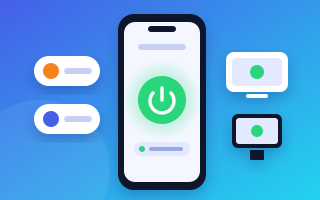
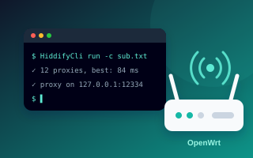
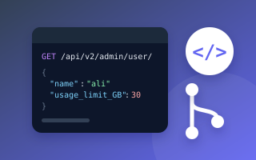
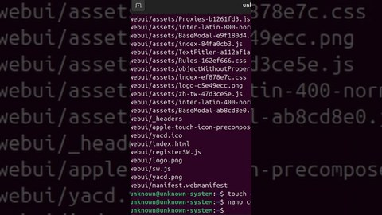
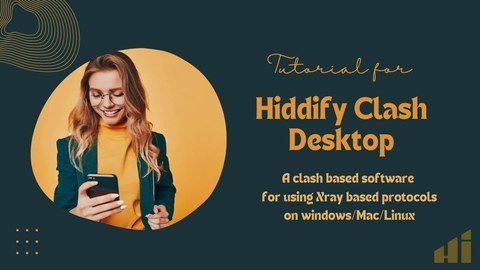
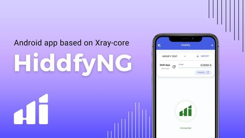

Hiddify app guide

# One tap to the open internet.

The Hiddify app is free and open source, and works with the same simplicity on Android, iOS, Windows, macOS and Linux. Everything you need to stay connected is right here.

This page lists every guide for the app: start with "How to install" and then "How to use".
For the full feature list, see the <a
  class="underline underline-offset-2"
  href="https://github.com/hiddify/hiddify-app/blob/main/README.md">app's README on GitHub</a>.

<!-- guide:start -->

<h2 class="hg-h">Start here</h2>

<a class="hg-card" href="/app/How-to-install-Hiddify-app/"><svg aria-hidden="true" xmlns="http://www.w3.org/2000/svg" viewBox="0 0 24 24"><path d="M13 5v6h1.17L12 13.17 9.83 11H11V5h2m2-2H9v6H5l7 7 7-7h-4V3m4 15H5v2h14v-2Z"/></svg><b>Install the app</b><small>Android, iOS, Windows, macOS and Linux</small></a>
<a class="hg-card" href="/app/How-to-use-Hiddify-app/"><svg aria-hidden="true" xmlns="http://www.w3.org/2000/svg" viewBox="0 0 24 24"><path d="M13 5c2.21 0 4 1.79 4 4 0 1.5-.8 2.77-2 3.46v-1.22c.61-.55 1-1.35 1-2.24 0-1.66-1.34-3-3-3s-3 1.34-3 3c0 .89.39 1.69 1 2.24v1.22C9.8 11.77 9 10.5 9 9c0-2.21 1.79-4 4-4m7 15.5c-.03.82-.68 1.47-1.5 1.5H13c-.38 0-.74-.15-1-.43l-4-4.2.74-.77c.19-.21.46-.32.76-.32h.2L12 18V9c0-.55.45-1 1-1s1 .45 1 1v4.47l1.21.13 3.94 2.19c.53.24.85.77.85 1.35v3.36M20 2H4c-1.1 0-2 .9-2 2v8a2 2 0 0 0 2 2h4v-2H4V4h16v8h-2v2h2v-.04l.04.04c1.09 0 1.96-.91 1.96-2V4a2 2 0 0 0-2-2Z"/></svg><b>Use the app</b><small>Add a profile and connect</small></a>
<a class="hg-card" href="/app/How-to-use-WARP-on-Hiddify-App/"><svg aria-hidden="true" xmlns="http://www.w3.org/2000/svg" viewBox="0 0 24 24"><path d="m6 7 .69.06A5.499 5.499 0 0 1 12 3a5.5 5.5 0 0 1 5.5 5.5l-.08.95c.46-.29 1-.45 1.58-.45a3 3 0 0 1 3 3 3 3 0 0 1-3 3H6a4 4 0 0 1-4-4 4 4 0 0 1 4-4m0 2a2 2 0 0 0-2 2 2 2 0 0 0 2 2h13a1 1 0 0 0 1-1 1 1 0 0 0-1-1h-3.5V8.5A3.5 3.5 0 0 0 12 5a3.5 3.5 0 0 0-3.5 3.5V9H6m16 10-3 3v-2H2v-2h17v-2l3 3"/></svg><b>Free WARP</b><small>Free WARP right in the app</small></a>
<a class="hg-card" href="/core/"><svg aria-hidden="true" xmlns="http://www.w3.org/2000/svg" viewBox="0 0 24 24"><path d="M13 19v-3h8v3h-8m-4.5-6L2.47 7h4.24l4.96 4.95c.58.59.58 1.55 0 2.12L6.74 19H2.5l6-6Z"/></svg><b>Hiddify Core</b><small>The app&#x27;s engine on the command line</small></a>

<nav class="hg-nav" aria-label="Categories">
<a href="#app" style="--c:#455fe9">The Hiddify app<small>14</small></a>
<a href="#core" style="--c:#0d9488">Core, command line and routers<small>6</small></a>
<a href="#developers" style="--c:#6366f1">For developers<small>2</small></a>
</nav>
<section class="hg-cat" id="app" style="--c:#455fe9"><header>
<h2>The Hiddify app</h2>
Installing, connecting and the app&#x27;s features
14 articles · 10 videos
</header>

<h3>Getting started</h3><ul><li><a class="hg-a" href="/app/How-to-install-Hiddify-app/" data-k="app/How-to-install-Hiddify-app" data-n="2024-03-13" data-u="2026-11-16">Install the Hiddify app</a></li><li><a class="hg-a" href="/app/How-to-use-Hiddify-app/" data-k="app/How-to-use-Hiddify-app" data-n="2024-03-13" data-u="2026-11-11">Use the Hiddify app</a></li><li><a class="hg-a" href="/app/Free-profiles-in-Hiddify-app/" data-k="app/Free-profiles-in-Hiddify-app" data-n="2026-11-16">Free profiles</a></li></ul>

<h3>Features</h3><ul><li><a class="hg-a" href="/app/How-to-use-WARP-on-Hiddify-App/" data-k="app/How-to-use-WARP-on-Hiddify-App" data-n="2024-08-04" data-u="2026-11-16">WARP in the Hiddify app</a></li><li><a class="hg-a hg-old" href="/app/How-to-use-UDP-Turn-Relay/">UDP Turn Relay</a>up to v2</li><li><a class="hg-a" href="/app/Chain-Extra-security-and-Proxy-unblocker/" data-k="app/Chain-Extra-security-and-Proxy-unblocker" data-n="2026-11-16">Chain, Extra security and unblocker</a></li><li><a class="hg-a" href="/app/Routing-in-Hiddify-app/" data-k="app/Routing-in-Hiddify-app" data-n="2026-11-16">Routing</a></li><li><a class="hg-a" href="/app/Share-your-connection/" data-k="app/Share-your-connection" data-n="2026-11-16">Share your connection</a></li><li><a class="hg-a" href="/app/DNS-and-TLS-tricks-in-Hiddify-app/" data-k="app/DNS-and-TLS-tricks-in-Hiddify-app" data-n="2026-11-16">DNS and TLS tricks</a></li><li><a class="hg-a" href="/app/Import-export-settings-and-edit-profile/" data-k="app/Import-export-settings-and-edit-profile" data-n="2026-11-16">Import, export settings and edit a profile</a></li><li><a class="hg-a" href="/app/Logs-and-reporting-a-problem/" data-k="app/Logs-and-reporting-a-problem" data-n="2026-11-16">Logs and reporting a problem</a></li></ul>

<h3>Platforms</h3><ul><li><a class="hg-a" href="/app/Hiddify-app-on-desktop/" data-k="app/Hiddify-app-on-desktop" data-n="2026-11-16">On Windows, macOS and Linux</a></li><li><a class="hg-a" href="/app/Hiddify-on-Android-TV/" data-k="app/Hiddify-on-Android-TV" data-n="2026-11-16">On Android TV</a></li></ul>

<h3>New</h3><ul><li><a class="hg-a" href="/app/DNS-tunnels-in-Hiddify-app/" data-k="app/DNS-tunnels-in-Hiddify-app" data-n="2026-11-20">DNS tunnels in the Hiddify app (Soar, DNSTT, MasterDNS)</a></li></ul>

<h3>Videos 10</h3><button type="button" class="hg-prev" aria-label="Previous"><svg aria-hidden="true" xmlns="http://www.w3.org/2000/svg" viewBox="0 0 24 24"><path d="M15.41 16.58 10.83 12l4.58-4.59L14 6l-6 6 6 6 1.41-1.42Z"/></svg></button><button type="button" class="hg-next" aria-label="Next"><svg aria-hidden="true" xmlns="http://www.w3.org/2000/svg" viewBox="0 0 24 24"><path d="M8.59 16.58 13.17 12 8.59 7.41 10 6l6 6-6 6-1.41-1.42Z"/></svg></button>

<a class="hg-v " href="https://www.youtube.com/watch?v=Edqx3iI0NpY" target="_blank" rel="noopener" title="آموزش کامل HiddifyCli برای سرورها (ویدئوی اصلی را از لینک بالا ببینید)"><h4 class="hg-vt" id="video-Edqx3iI0NpY">آموزش کامل HiddifyCli برای سرورها (ویدئوی اصلی را از لینک بالا ببینید)</h4>YouTube video. </a><a class="hg-v hg-v-new" href="https://www.youtube.com/watch?v=NGP_uC8edJI" target="_blank" rel="noopener" title="New video, for the current version"><h4 class="hg-vt" id="video-NGP_uC8edJI">Hiddify 5 full tutorial on every device 📱💻 Android, iPhone, Windows, Mac and Linux</h4>YouTube video. </a><a class="hg-v hg-v-new" href="https://www.youtube.com/watch?v=HOF6NJa55SI" target="_blank" rel="noopener" title="New video, for the current version"><h4 class="hg-vt" id="video-HOF6NJa55SI">هیدیفای روی تلویزیون اندروید 📺 لینک رو فقط با دوربین گوشی بفرست، بدون تایپ با کنترل</h4>YouTube video. </a><a class="hg-v hg-v-new" href="https://www.youtube.com/watch?v=UsOrJ9wMUMo" target="_blank" rel="noopener" title="New video, for the current version"><h4 class="hg-vt" id="video-UsOrJ9wMUMo">آموزش کامل اپ هیدیفای نسخهٔ ۵ روی همهٔ دستگاه‌ها 📱💻 اندروید، آیفون، ویندوز، مک و لینوکس</h4>YouTube video. </a><a class="hg-v hg-v-old" href="https://www.youtube.com/watch?v=ywxx5AzQl-s" target="_blank" rel="noopener" title="This video is for an earlier version (For Hiddify app v2 · 2025). Parts of it, or all of it, may differ from the current version."><h4 class="hg-vt" id="video-ywxx5AzQl-s">اینترنت آزاد رایگان با Hiddify! بدون نیاز به خرید VPN!</h4>YouTube video. For Hiddify app v2 · 2025</a><a class="hg-v hg-v-old" href="https://www.youtube.com/watch?v=Br3lIHIaUVc" target="_blank" rel="noopener" title="This video is for an earlier version (For Hiddify app v2 · 2024). Parts of it, or all of it, may differ from the current version."><h4 class="hg-vt" id="video-Br3lIHIaUVc">ساخت کانفیگ رایگان وارپ به صورت حرفه‌ای</h4>YouTube video. For Hiddify app v2 · 2024</a><a class="hg-v hg-v-old" href="https://www.youtube.com/watch?v=Xv_7TDo80k4" target="_blank" rel="noopener" title="This video is for an earlier version (For Hiddify app v1 · 2024). Parts of it, or all of it, may differ from the current version."><h4 class="hg-vt" id="video-Xv_7TDo80k4">فیلترشکن رایگان هیدیفای</h4>YouTube video. For Hiddify app v1 · 2024</a><a class="hg-v hg-v-old" href="https://www.youtube.com/watch?v=NtQ0bQlIRrY" target="_blank" rel="noopener" title="This video is for an earlier version (For early app versions (Hiddify Next) · 2024). Parts of it, or all of it, may differ from the current version."><h4 class="hg-vt" id="video-NtQ0bQlIRrY">آموزش کامل تنظیمات پیشرفته هیدیفای‌اپ HiddifyApp</h4>YouTube video. For early app versions (Hiddify Next) · 2024</a><a class="hg-v hg-v-old" href="https://www.youtube.com/watch?v=EjHjLQbC40E" target="_blank" rel="noopener" title="This video is for an earlier version (For early app versions (Hiddify Next) · 2023). Parts of it, or all of it, may differ from the current version."><h4 class="hg-vt" id="video-EjHjLQbC40E">کار کردن با HiddifyApp</h4>YouTube video. For early app versions (Hiddify Next) · 2023</a><a class="hg-v hg-v-old" href="https://www.youtube.com/watch?v=vUaA1AEUy1s" target="_blank" rel="noopener" title="This video is for an earlier version (For early app versions (Hiddify Next) · 2023). Parts of it, or all of it, may differ from the current version."><h4 class="hg-vt" id="video-vUaA1AEUy1s">نحوه نصب برنامه Hiddify Next روی ویندوز، مک و لینوکس</h4>YouTube video. For early app versions (Hiddify Next) · 2023</a>

</section>
<section class="hg-cat" id="core" style="--c:#0d9488"><header>
<h2>Core, command line and routers</h2>
The app&#x27;s engine on servers, routers and headless computers
6 articles · 1 videos
</header>

<h3>Hiddify Core</h3><ul><li><a class="hg-a" href="/core/" data-k="core" data-n="2026-11-04" data-u="2026-11-14">Hiddify Core</a></li><li><a class="hg-a" href="/core/cli/" data-k="core/cli" data-n="2026-11-04">Core command reference</a></li><li><a class="hg-a hg-old" href="/app/HiddifyCli-guide/">HiddifyCli tutorial</a>Earlier version</li></ul>

<h3>OpenWrt routers</h3><ul><li><a class="hg-a" href="/app/How-to-use-HiddifyCli-on-OpenWrt/" data-k="app/How-to-use-HiddifyCli-on-OpenWrt" data-n="2024-12-17" data-u="2026-11-16">Hiddify Core on OpenWrt</a></li><li><a class="hg-a" href="/app/How-to-Enable-Free-Internet-Access-for-Clients-Behind-an-OpenWrt-Router-Using-HiddifyCli/" data-k="app/How-to-Enable-Free-Internet-Access-for-Clients-Behind-an-OpenWrt-Router-Using-HiddifyCli" data-n="2024-12-17" data-u="2026-11-16">Free internet for every device behind the router</a></li><li><a class="hg-a" href="/app/Router-mode-on-Linux/" data-k="app/Router-mode-on-Linux" data-n="2026-11-16">Router mode on Linux</a></li></ul>

<h3>Videos 1</h3><button type="button" class="hg-prev" aria-label="Previous"><svg aria-hidden="true" xmlns="http://www.w3.org/2000/svg" viewBox="0 0 24 24"><path d="M15.41 16.58 10.83 12l4.58-4.59L14 6l-6 6 6 6 1.41-1.42Z"/></svg></button><button type="button" class="hg-next" aria-label="Next"><svg aria-hidden="true" xmlns="http://www.w3.org/2000/svg" viewBox="0 0 24 24"><path d="M8.59 16.58 13.17 12 8.59 7.41 10 6l6 6-6 6-1.41-1.42Z"/></svg></button>

<a class="hg-v hg-v-old" href="https://www.youtube.com/watch?v=jrvQD5xo6PU" target="_blank" rel="noopener" title="This video is for an earlier version (For Hiddify app v2 · 2025). Parts of it, or all of it, may differ from the current version."><h4 class="hg-vt" id="video-jrvQD5xo6PU">🚀 آموزش HiddifyCli برای سرورها و محیط‌های بدون دسکتاپ – سریع و آسان! 🔥</h4>YouTube video. For Hiddify app v2 · 2025</a>

</section>
<section class="hg-cat" id="developers" style="--c:#6366f1"><header>
<h2>For developers</h2>
The app&#x27;s links and contributing
2 articles
</header>

<h3>Development</h3><ul><li><a class="hg-a" href="/app/URL-Scheme/" data-k="app/URL-Scheme" data-n="2024-03-13" data-u="2026-11-16">The app&#x27;s URL scheme</a></li><li><a class="hg-a" href="/app/How-to-contribute-to-this-project/" data-k="app/How-to-contribute-to-this-project" data-n="2024-03-13" data-u="2026-11-16">Contributing to the project</a></li></ul>

</section>

<b>Videos of the old Hiddify apps</b><small>HiddifyNG, HiddifyN and Hiddify Clash. These apps are no longer updated; the Hiddify app replaces them all.</small>

<h3>Videos 11</h3><button type="button" class="hg-prev" aria-label="Previous"><svg aria-hidden="true" xmlns="http://www.w3.org/2000/svg" viewBox="0 0 24 24"><path d="M15.41 16.58 10.83 12l4.58-4.59L14 6l-6 6 6 6 1.41-1.42Z"/></svg></button><button type="button" class="hg-next" aria-label="Next"><svg aria-hidden="true" xmlns="http://www.w3.org/2000/svg" viewBox="0 0 24 24"><path d="M8.59 16.58 13.17 12 8.59 7.41 10 6l6 6-6 6-1.41-1.42Z"/></svg></button>

<a class="hg-v hg-v-old" href="https://www.youtube.com/watch?v=qDbI72J-INM" target="_blank" rel="noopener" title="This video is for an earlier version (Retired app, no longer updated · 2023). Parts of it, or all of it, may differ from the current version."><h4 class="hg-vt" id="video-qDbI72J-INM">راهنمای استفاده از اپ HiddifyNG</h4>YouTube video. Retired app, no longer updated · 2023</a><a class="hg-v hg-v-old" href="https://www.youtube.com/watch?v=L1VxAcG_7jg" target="_blank" rel="noopener" title="This video is for an earlier version (Retired app, no longer updated · 2023). Parts of it, or all of it, may differ from the current version."><h4 class="hg-vt" id="video-L1VxAcG_7jg">Tutorial for Hiddify Clash Desktop</h4>YouTube video. Retired app, no longer updated · 2023</a><a class="hg-v hg-v-old" href="https://www.youtube.com/watch?v=Jnnx1VWMlEs" target="_blank" rel="noopener" title="This video is for an earlier version (Retired app, no longer updated · 2023). Parts of it, or all of it, may differ from the current version."><h4 class="hg-vt" id="video-Jnnx1VWMlEs">Tutorial for HiddifyN software</h4>YouTube video. Retired app, no longer updated · 2023</a><a class="hg-v hg-v-old" href="https://www.youtube.com/watch?v=omGIz97mbzM" target="_blank" rel="noopener" title="This video is for an earlier version (Retired app, no longer updated · 2023). Parts of it, or all of it, may differ from the current version."><h4 class="hg-vt" id="video-omGIz97mbzM">آموزش کامل نرم‌افزار هیدیفای کلش دسکتاپ</h4>YouTube video. Retired app, no longer updated · 2023</a><a class="hg-v hg-v-old" href="https://www.youtube.com/watch?v=Pqactnz_PdU" target="_blank" rel="noopener" title="This video is for an earlier version (Retired app, no longer updated · 2023). Parts of it, or all of it, may differ from the current version."><h4 class="hg-vt" id="video-Pqactnz_PdU">معرفی برنامه HiddifyNG</h4>YouTube video. Retired app, no longer updated · 2023</a><a class="hg-v hg-v-old" href="https://www.youtube.com/watch?v=qT43zDPev6o" target="_blank" rel="noopener" title="This video is for an earlier version (Retired app, no longer updated · 2023). Parts of it, or all of it, may differ from the current version."><h4 class="hg-vt" id="video-qT43zDPev6o">HiddifyNG introduction</h4>YouTube video. Retired app, no longer updated · 2023</a><a class="hg-v hg-v-old" href="https://www.youtube.com/watch?v=o9L2sI2T53Q" target="_blank" rel="noopener" title="This video is for an earlier version (Retired app, no longer updated · 2023). Parts of it, or all of it, may differ from the current version."><h4 class="hg-vt" id="video-o9L2sI2T53Q">HiddifyN آموزش کار با نرم‌افزار دسکتاپ</h4>YouTube video. Retired app, no longer updated · 2023</a><a class="hg-v hg-v-old" href="https://www.youtube.com/watch?v=hVcWJ8Qg1GQ" target="_blank" rel="noopener" title="This video is for an earlier version (Retired app, no longer updated · 2023). Parts of it, or all of it, may differ from the current version."><h4 class="hg-vt" id="video-hVcWJ8Qg1GQ">Tutorial for HiddifyNG (Xray based client app)</h4>YouTube video. Retired app, no longer updated · 2023</a><a class="hg-v hg-v-old" href="https://www.youtube.com/watch?v=7B0PO3HM6Vg" target="_blank" rel="noopener" title="This video is for an earlier version (Retired app, no longer updated · 2023). Parts of it, or all of it, may differ from the current version."><h4 class="hg-vt" id="video-7B0PO3HM6Vg">آموزش کار با نرم‌افزار HiddifyNG</h4>YouTube video. Retired app, no longer updated · 2023</a><a class="hg-v hg-v-old" href="https://www.youtube.com/watch?v=mUTfYd1_UCM" target="_blank" rel="noopener" title="This video is for an earlier version (Retired app, no longer updated · 2023). Parts of it, or all of it, may differ from the current version."><h4 class="hg-vt" id="video-mUTfYd1_UCM">Tutorial for Hiddify android (Clash-based app)</h4>YouTube video. Retired app, no longer updated · 2023</a><a class="hg-v hg-v-old" href="https://www.youtube.com/watch?v=8P887E-KMls" target="_blank" rel="noopener" title="This video is for an earlier version (Retired app, no longer updated · 2023). Parts of it, or all of it, may differ from the current version."><h4 class="hg-vt" id="video-8P887E-KMls">آموزش استفاده از نرم‌افزار هیدیفای اندروید (نسخه بر پایه کِلش)</h4>YouTube video. Retired app, no longer updated · 2023</a>

<!-- guide:end -->
