# Hiddify's Second Anniversary

!!! abstract "In 30 seconds"
    Hiddify was born on 23 September 2022, after the internet in Iran was shut down. In two years we went
    from a few server install guides to Hiddify Manager and the Hiddify app: more than half a million active
    installs on Google Play, more than 5.7 million app downloads from GitHub and more than 24,000 stars. This
    post walks through that road step by step.

## The Story of Hiddify: From Birth to Today

_A detailed report to our dear supporters on what we did in these two years_

It was around this time two years ago when we all found ourselves in a great shock, and everyone tried to
help in any way they could. This was the beginning of our work.

These days remind us of a deep sorrow, a great grief that united us in pursuit of a right we all deserve.

<!-- more -->

!!! note "About the version numbers"
    "HiddifyManager version 1 to 8" in this post are the versions of the **Hiddify panel**; the server package had its own
    numbers then (7 to 10). Some dates and features are a little different in the release history: for the exact details
    of each version, see its own post, from [Hiddify Manager 1](Hiddify-Panel-v1.md) to [Hiddify Manager 8](Hiddify-Panel-v8.md).

**❤️ Freedom**

Internet freedom, freedom of thought, political freedom, economic freedom, and freedom in all aspects of life.

We worked for internet freedom because we believed, and still do, that this freedom brings the other freedoms
with it.

In late September 2022, after people's access to the free internet became even more restricted, we decided to
do what we could: give simple access to the internet and make things easier for the people of our country.
This was the start of the project, and Hiddify was born in those days.

### Starting after a great shock
In the first days we wrote a [review of censorship methods](https://github.com/hiddify/awesome-freedom) and a list
of [sites that sell VPS servers](https://github.com/hiddify/awesome-freedom/blob/main/vps-providers.md), and put them
in the [Awesome-Freedom repository](https://github.com/hiddify/awesome-freedom), so that anyone with a little
technical knowledge could buy a server and make their own VPN.

### The first tools
Then, in October of the same year, we made a very easy and
[free install on Microsoft Azure](https://github.com/hiddify/Hiddify-Server/wiki/Azure-%D9%86%D8%B5%D8%A8-%D8%AE%DB%8C%D9%84%DB%8C-%D8%AE%DB%8C%D9%84%DB%8C-%D8%B3%D8%B1%DB%8C%D8%B9-%D8%AF%D8%B1-%D9%85%D8%A7%DB%8C%DA%A9%D8%B1%D9%88%D8%B3%D8%A7%D9%81%D8%AA-%D8%A2%DA%98%D9%88%D8%B1).

In November we extended the project to other data centers, with quick installs on Hetzner, Oracle Cloud, Vultr
and OVH. The goal was that everyone could set up their own server without any technical knowledge.

### The first version of HiddifyManager
In December 2022 we made the first version of HiddifyManager and tried to explain very simply how to turn it on
in a client app. We also made HiddifyManager resist VPN detection bots, get a valid certificate, set safe
settings, run suitable configs and give them to the user.

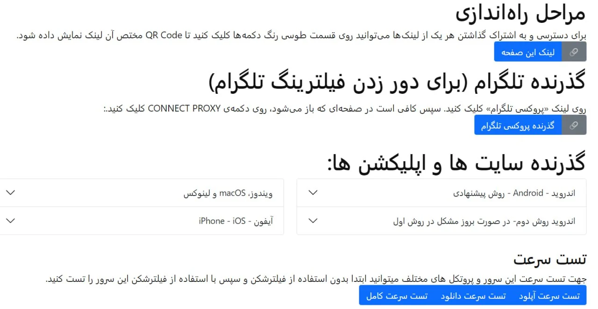

### More HiddifyManager, and the first guides
As the disastrous internet situation went on, we kept making complex ideas simpler so everyone could use them.
We also [published many articles and video tutorials](https://hiddify.com/manager), so that even complex settings
were possible for everyone.

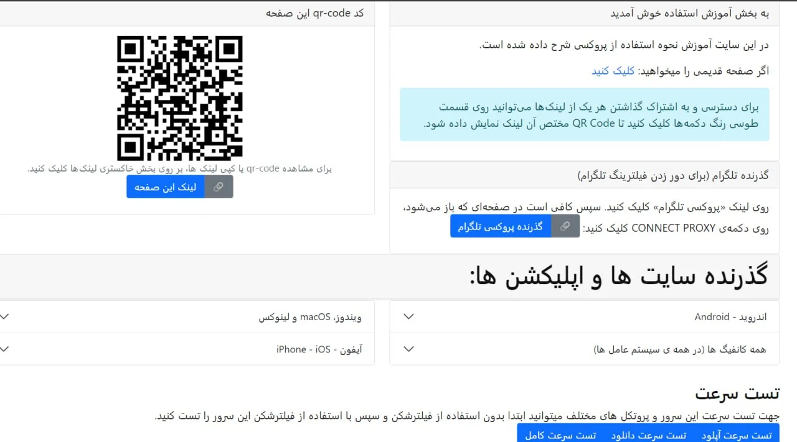

### HiddifyClash, a simpler client
On the other side, the client apps of the time were not simple enough: our parents could not use them at all.

So, as a first step, in January 2023 we made custom versions of HiddifyClash for Android and desktop, to make
connecting simpler.

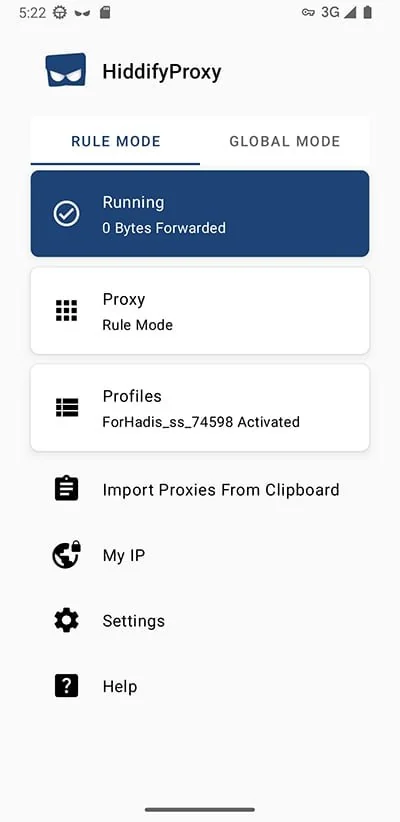

### HiddifyManager version 1
Little by little more of you joined the project, and that gave us the energy to start the
[Telegram support group](https://t.me/hiddify_board/) in February. We also added more to the panel, and in March
2023, after several early versions, HiddifyManager version 1 came out with many users and many domains; much was
redesigned and the structure got better.

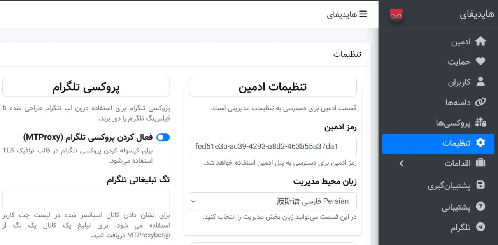

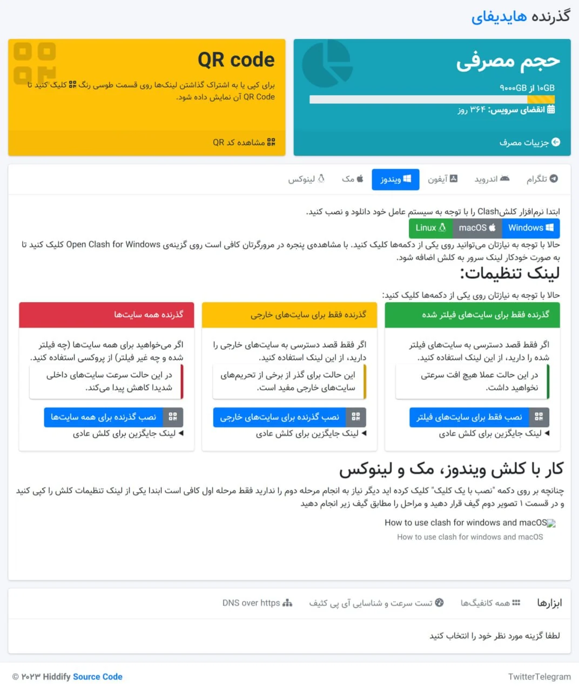

### HiddifyManager version 2
Before Nowruz 2023 (March) we released HiddifyManager version 2, with new features such as:

- a web app (PWA)
- a tutorial video in the panel when you click ❓
- choosing the ports of the protocols, renaming proxies, and fingerprints

During Nowruz we found out that [the Xray developers had added us to their list of web panels](https://github.com/xtls/xray-core#installation).
It felt very good, because they had found us themselves.

In the same days, with the help of our friends at [IRCF](https://ircf.space), we added subscription links made
automatically for the user's mobile operator to HiddifyManager 2, and the AutoCDN domain was born.

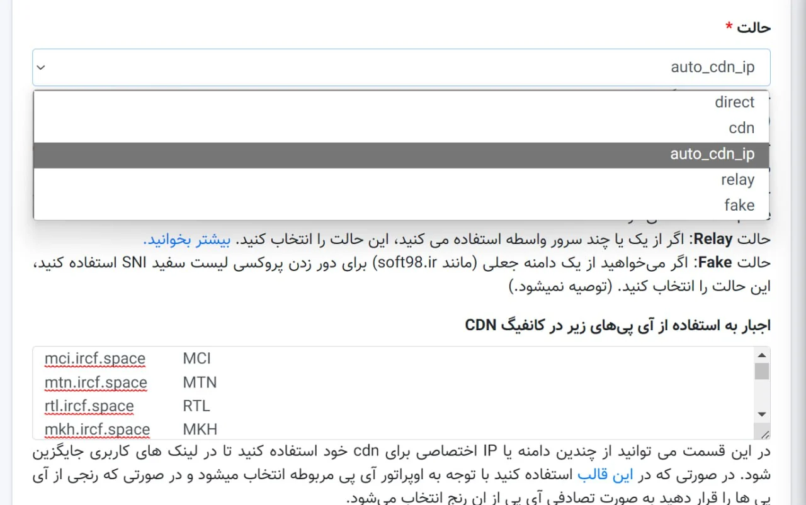

### HiddifyManager version 3
In April we redesigned the panel, and HiddifyManager version 3 came out with a focus on stability, simplicity
and beauty. In this version:

- The dashboard was redesigned: processes and system resources in separate tiles, plus online users and usage.
- Every page was redesigned, and a dark mode was added.
- Search in the settings, and other visual improvements.

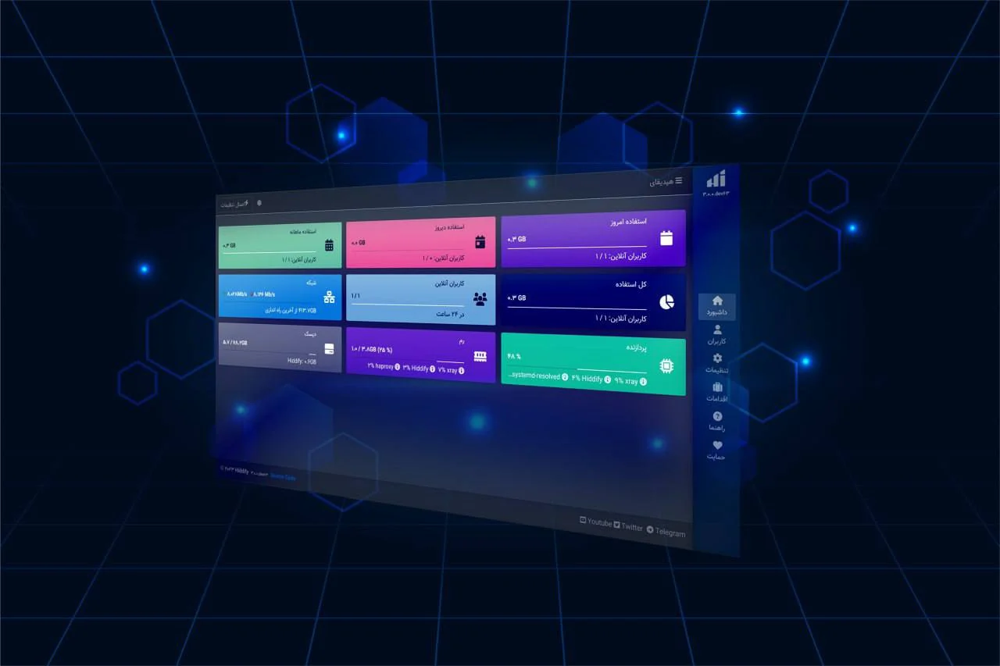

### HiddifyManager version 4
We released HiddifyManager version 4 in May. Its most important feature was support for the new Reality
protocol. It also added:

- many admins with separate permissions
- a Telegram bot connected to the panel
- a dedicated domain for the subscription link
- automatic domain setup in Cloudflare

### HiddifyManager version 5
Because you asked again and again for more protocols, we kept going, and HiddifyManager version 5 came out in
the same month with:

- the ShadowTLS v3 protocol
- a new panel theme
- a limit on how many users an admin or agent can make

### The HiddifyN and HiddifyNG apps
On the client side, after several versions of HiddifyClash, the many bugs of the Clash Meta core made us look
for another way.

After we studied and redesigned the whole client side based on performance tests, we decided to build on the
good apps already available. In April 2023 our custom HiddifyNG and HiddifyN were born, and you liked them a
lot.

For example, HiddifyNG passed 100,000 downloads on Google Play alone in less than 5 months, with a rating of 4.8
out of 5, which is remarkable for such a young app.

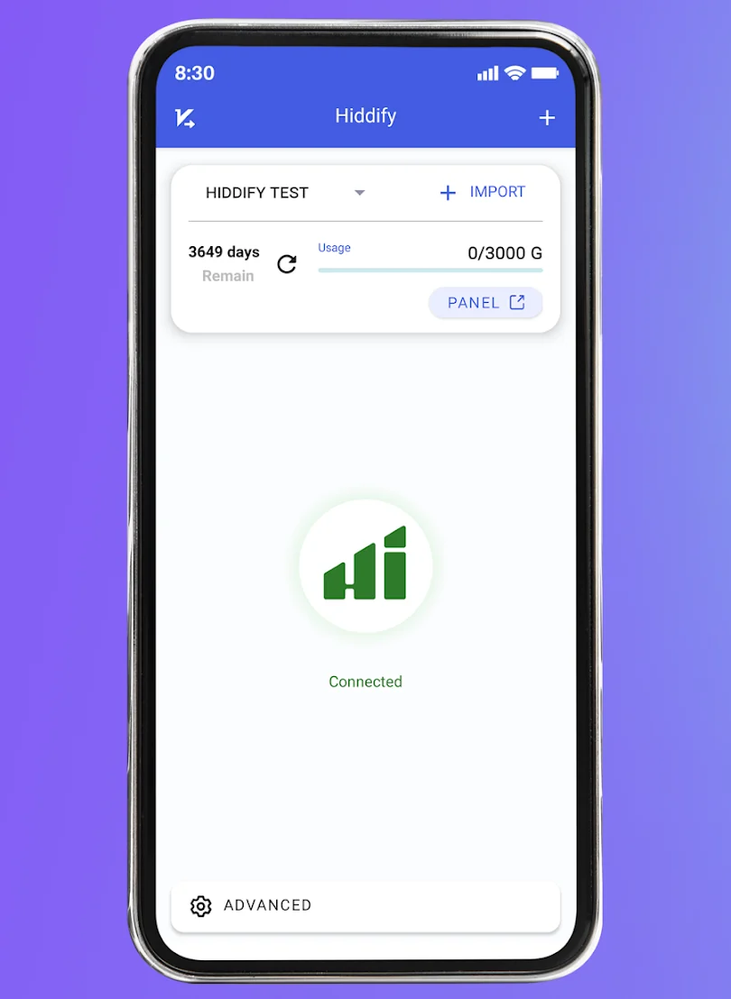

### HiddifyManager version 6
On the server side, in May 2023, version 6 added fragment and WARP+ to HiddifyManager. With WARP the server's IP
no longer leaked at the destination, and fragment, by cutting packets into pieces, made it easier to get past
the filter. The sing-box core was added too, and HiddifyManager became the only panel that supported two cores,
with accounting on both.

### HiddifyManager version 7
In June, HiddifyManager version 7 came with more protocols and important features, such as:

- many Reality and Worker domains
- a redesigned "add domain" page
- WARP version 2

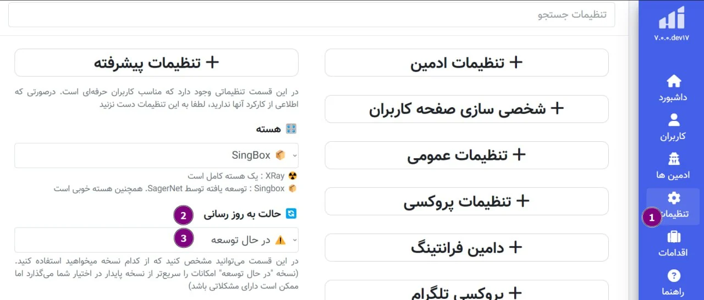

### Version 7 of HiddifyN and HiddifyNG
We kept developing the HiddifyNG and HiddifyN clients, added routing and load balancing, and released version 7
of these apps.

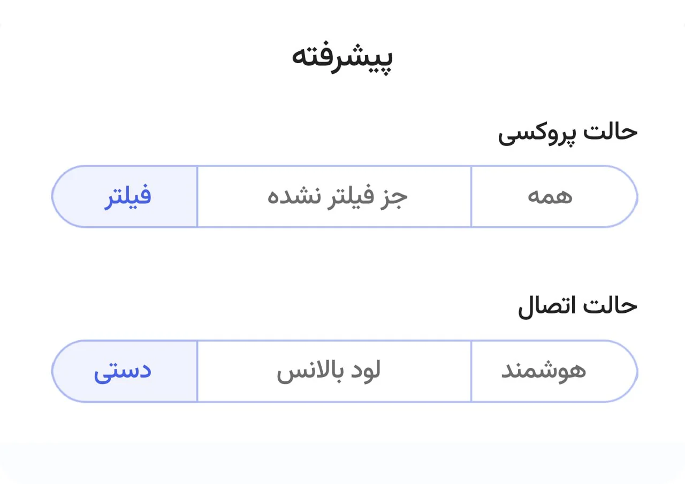

### HiddifyManager version 8
Then, on the server side, next to the earlier protocols such as VLESS, VMess, Trojan, Reality, gRPC, WebSocket and
H2, a friend helped us add the secure SSH protocol in HiddifyManager version 8, together with:

- temporary short links, in the style of Inspector Gadget
- a smart subscription link
- a simpler way to turn the VPN on from the user page

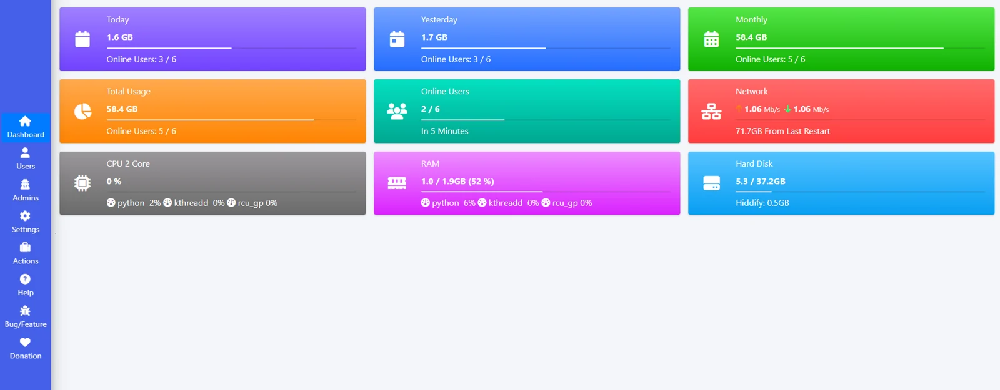

## Hiddify's first anniversary

### The start of the cross-platform Hiddify app
On our first birthday, on the client side, [we started the cross-platform Hiddify app for Android, Windows,
Linux and Mac, in October 2023](https://app.hiddify.com/).

Our goal was that developers could add new protocols to every operating system easily, and that all systems
worked the same way.

The new app was very simple, fast, and light on the system.

### The Hiddify Reality Scanner
Because of new limits on the Reality protocol, in November 2023 we made a scanner that finds, on any network,
SNIs that work for a Reality domain, to get around those limits.

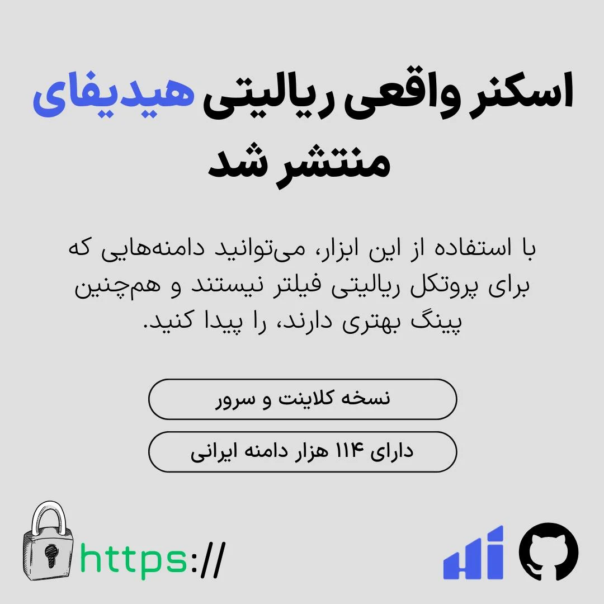

### The Hiddify app on Google Play
With HiddifyManager in a good place, we decided to focus more on the Hiddify app: more protocols and features,
and every platform, including iOS. Version 0.6 came with every protocol that worked, including Hysteria and TUIC,
and it was published on Google Play.

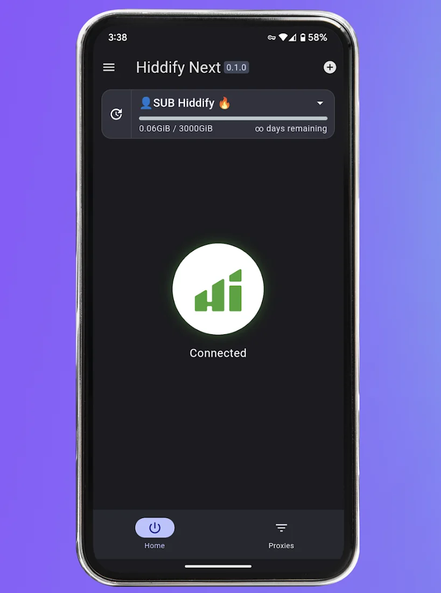

### Hiddify app 0.12
Version 0.12 came out in December 2023 with new features, such as:

- basic routing rules by region
- a redesigned logs page
- more selectors on the proxies page
- the TLS Trick feature
- BeePass support
- D-Pad support on Android TV
- support for China and Russia

### Hiddify app 0.13
With your GitHub issues and many requests, we went on, and version 0.13 came out in January 2024 with:

- bypass LAN
- sharing the VPN on the network
- support for the new core
- support for Afghanistan

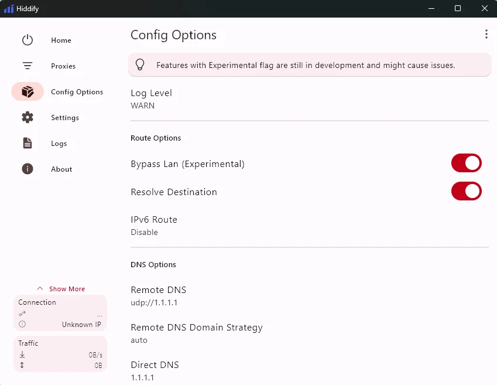

### The Hiddify app on the Microsoft Store
In February the app was officially published on the Microsoft Store, from version 0.16.7.

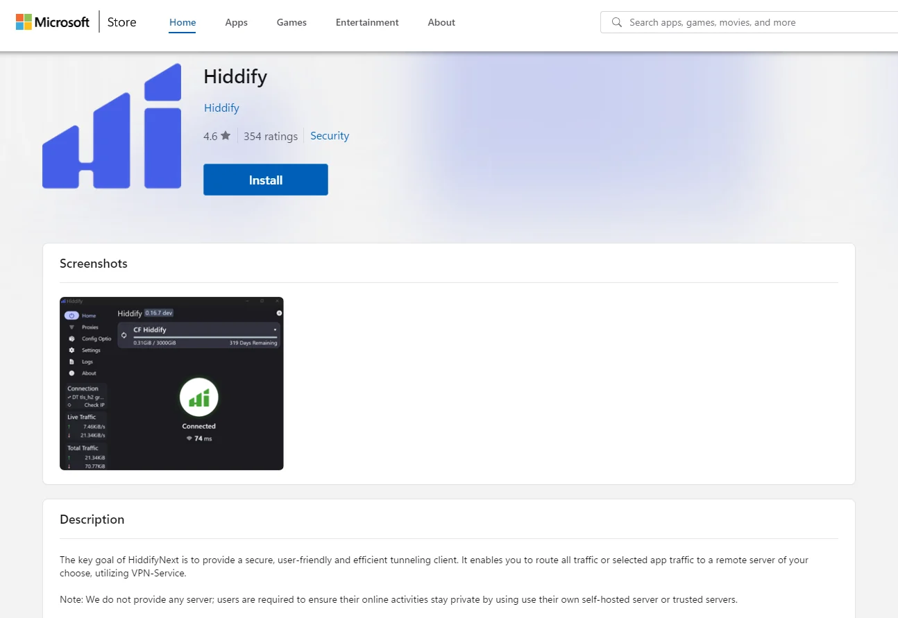

### HiddifyCli for systems without a desktop
In March we released a version of the app without a graphical interface, with every feature, so that you can
use it on servers and systems without a desktop.

### HiddifyManager version 10
With the new Hysteria 2 and TUIC 5 protocols and updates to the old ones, HiddifyManager version 10 came out in
March 2024. It brought many basic changes, such as:

- a move to an SQL database, and a much faster panel
- more security, such as stronger authentication for proxies and the panel
- a new, innovative user page

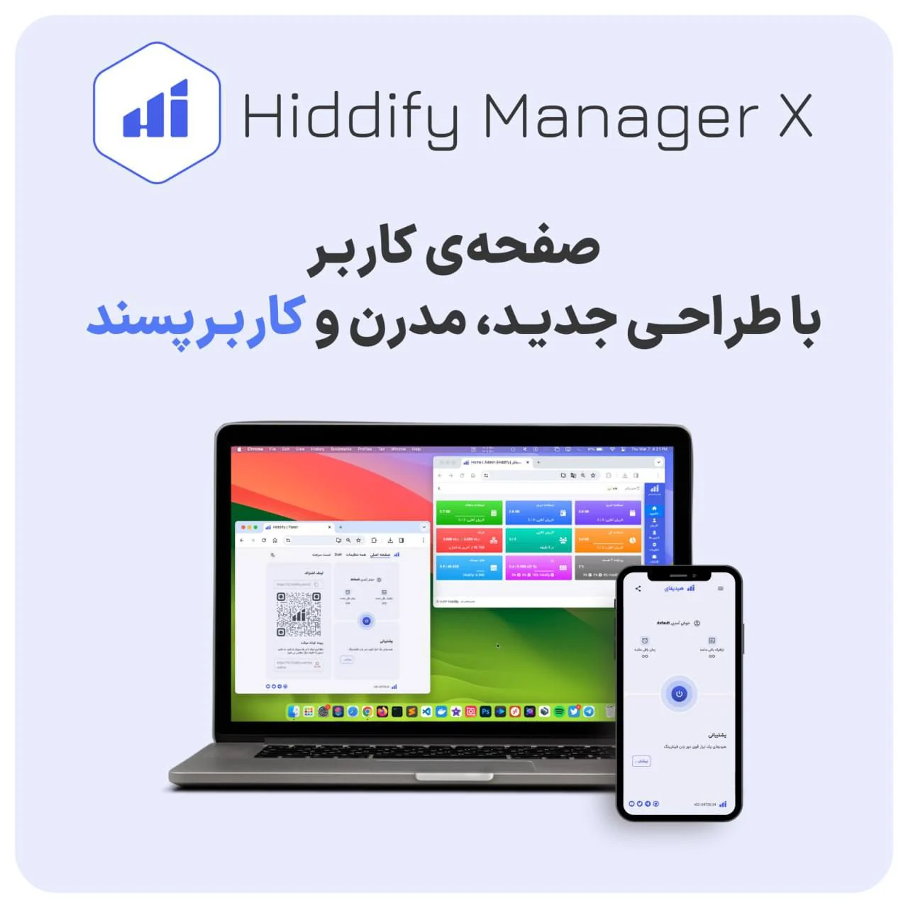

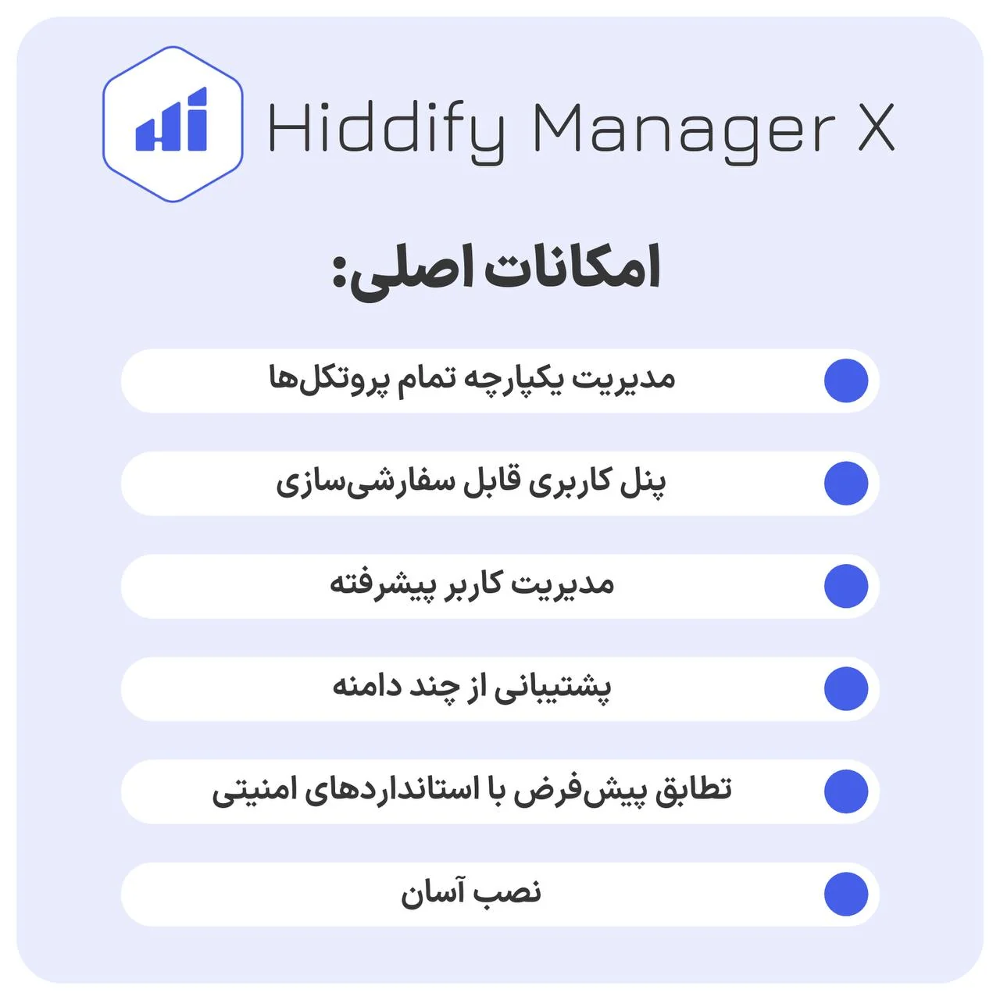

### The Hiddify app beta for iOS
At the same time, after a lot of effort, we published the Hiddify app beta for iOS on Apple's TestFlight. This
gave some of you access to the app on iOS, and we kept working to get it into the App Store.

### Hiddify app 1, for Nowruz 2024
Version 1 of the app came out with a Nowruz theme for the Persian New Year, with many new features:

- WARP support
- a VPN service on Windows and Mac
- smart fragment
- quick settings
- failover for configs
- WireGuard noise
- a delay indicator under the connect button

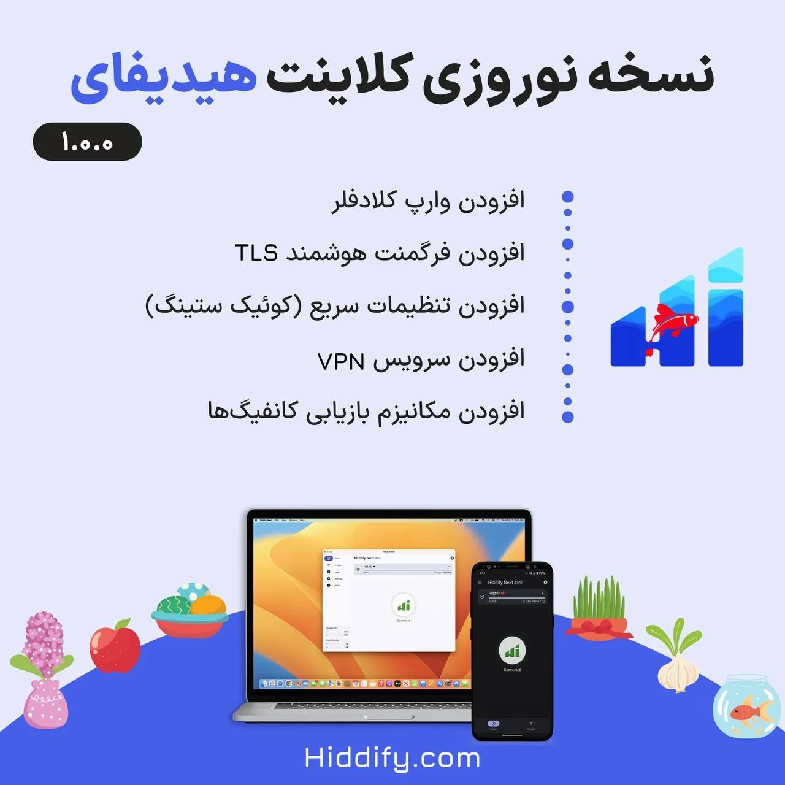

### The Hiddify relay builder
In May 2024 we released one tool to build relay (tunnel) servers more easily, with the methods that work:

- IP-Tables
- GOST
- Dokodemo-Door
- HA-Proxy
- Socat
- WST

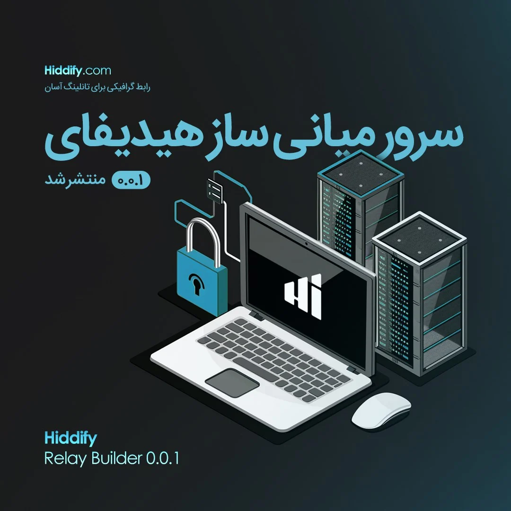

### Hiddify app 1.4
In June 2024 version 1.4 came out with new features, such as:

- reserving WARP
- syncing the WARP key with the app's own key
- better fragment

### Hiddify app 1.5
We kept going, and version 1.5 came out with:

- built-in routing with rule sets that update themselves
- an option to remove ads from websites

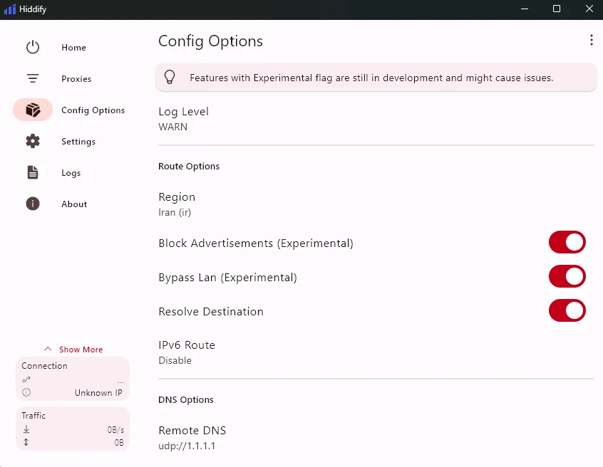

### Hiddify app 2
In August we released version 2 of the app. Its most important features:

- sing-box and Xray cores at the same time
- the new generation of filter bypass, Split HTTP
- both IPv4 and IPv6 for WireGuard
- a config editor
- more WARP modes

### An amazing record for the Hiddify app
Less than a year after the first version of the Hiddify app, its active installs on Google Play passed half a
million. The app was also downloaded more than 5.5 million times from GitHub. This was far beyond what we had
imagined, and we owe it all to your support.

## At the end of the second year
At the end of our second year we had reached:

- more than half a million active installs of the Hiddify app on Google Play
- more than 5.7 million downloads of the Hiddify app from GitHub
- more than 2 million downloads of HiddifyManager from GitHub
- more than 24,000 stars for the Hiddify project on GitHub

And this is the road we took, in short:

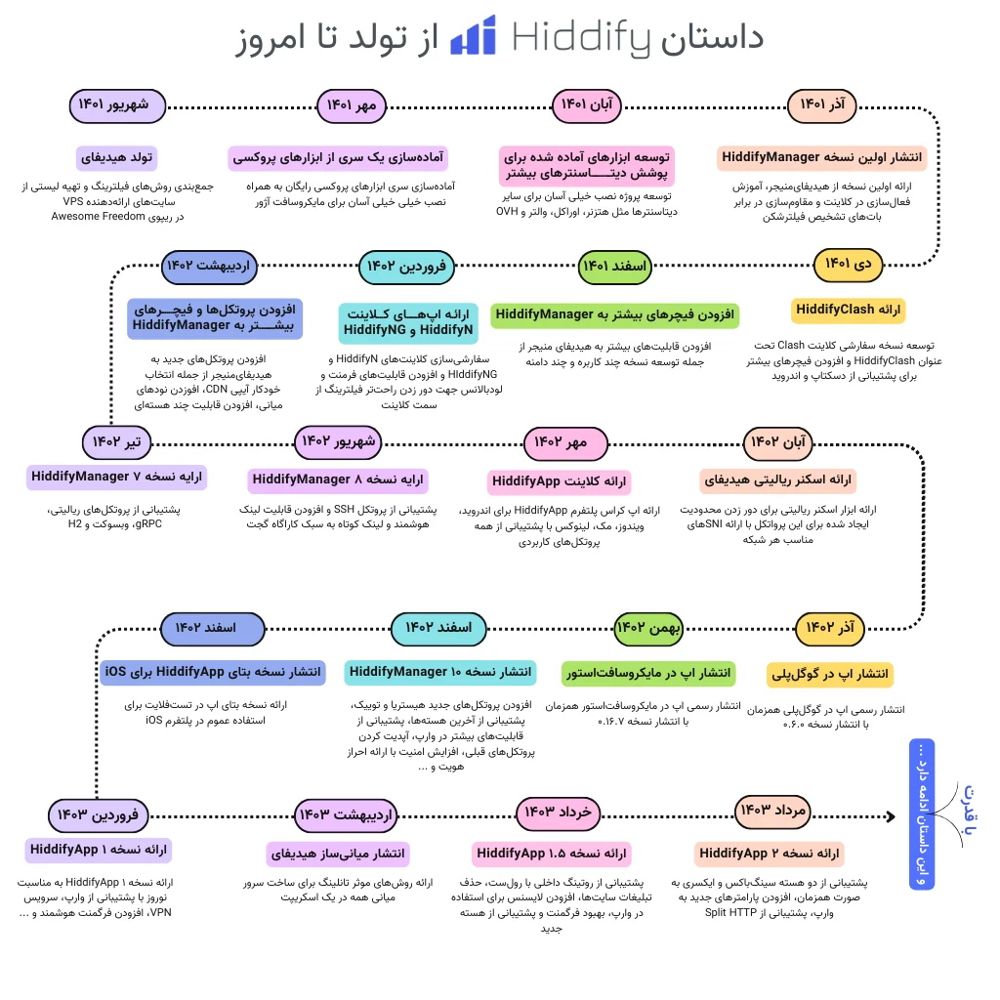

## The start of the third year

Here is a short look at our plans.

In our third year we will keep walking this hard road, and push the Hiddify app and HiddifyManager forward with
more strength.

### In the Hiddify app

- The iOS version will be in the App Store.
- New features, such as extensions for the app.
- Better fragment.
- Versions for 32-bit systems and other systems such as routers.
- New, trending protocols.
- Adaptive routing.
- A clean IP scanner.
- And hundreds of other features you will see soon.

### In HiddifyManager

- A central panel, so you can manage many servers from one panel.
- Extensions.
- New, effective protocols.
- And more features you will see.

## Last words

On this hard road, we thank from the bottom of our hearts everyone who helped in any way, so that the people of
our country could stay connected to the free internet and get out of this total darkness.

We also thank everyone who worked to give access to the free internet.

And to all of you who were always with us and never left us alone on this road: thank you, more than words can say.

Here's to the day when no one is limited and controlled by totalitarian governments.

\#Women_Life_Freedom

🕊️Hiddify, Internet Freedom Solution🕊️

## Related articles

- [One-Year Anniversary of Hiddify](1st-anniversary.md)
- [Hiddify turns four](4th-anniversary.md)
- [About us](/about-us/)
