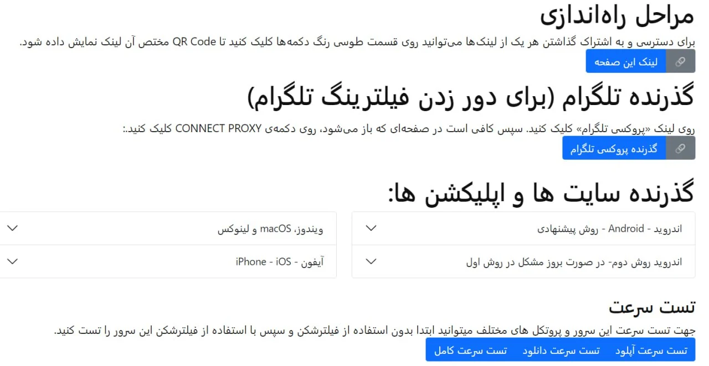

# هیدیفای‌منیجر چطور شروع شد: Hiddify Config و اولین پنل

<!-- made by .cache/blog/history_gen.py -->

!!! abstract "در ۳۰ ثانیه"
    پروژه‌ای که بعدها هیدیفای‌منیجر شد، در ۴ مهر ۱۴۰۱ با نام **Hiddify Config** شروع شد: چند اسکریپت که یک سرور
    ابری را به یک پروکسی آماده تبدیل می‌کرد. تا ۲۴ دی ۱۴۰۱ نصب با یک دستور، بیش از ده پروتکل، صفحهٔ کاربر با کد QR
    و اولین **پنل** (نسخهٔ ۵) را داشت.

<!-- more -->

## چه چیزهایی تازه بود

- **مهر ۱۴۰۱، روزهای اول:** یک پروکسی تلگرام (MTProxy) و قالب‌های یک‌کلیکی برای مایکروسافت آژور: قالب را در سرویس ابری بگذارید و یک پروکسی آماده بگیرید.
- **مهر ۱۴۰۱:** شدوساکس (با v2ray برای CDN و با faketls)، VMess، ‏TCP BBR برای سرعت، و اولین **نصب با یک دستور** روی اوبونتو.
- **مسیریابی هوشمند در Clash:** سه حالت: فقط سایت‌های فیلترشده از پروکسی، همه‌چیز به جز سایت‌های ایرانی (پیشنهادی)، یا همه‌چیز.
- **آبان و آذر ۱۴۰۱:** صفحه‌های راهنمای کاربر با کد QR، نمایش مصرف، سرورهای arm64، و تروجان.
- **بدون نیاز به دامنه:** نصب با sslip.io کار می‌کرد، فایروال را روشن می‌کرد و تا یک ساعت یک لینک موقت پروکسی روی سرور نشان می‌داد تا هر کسی بتواند شروع کند.
- **نصب یک‌کلیکی** روی اوراکل کلود (سرور رایگان)، والتر، هتزنر و OVH.
- **دی ۱۴۰۱:** هستهٔ **Xray** با لینک‌های VLESS، VMess و تروجان، با CDN و بدون آن، و تست سرعت در صفحهٔ کاربر.
- **نسخهٔ ۵ (۲۴ دی ۱۴۰۱):** اولین **پنل هیدیفای**: چند دامنه، کانفیگ‌هایی که روشن و خاموش می‌شوند، fake CDN و gRPC. نسخهٔ ۶ (بهمن) TUIC آورد و گواهی‌ها را به acme.sh برد.

## امروز

هیدیفای‌منیجر حالا در نسخهٔ ۱۴ است. آخرین نسخه را نصب کنید، یا نسخهٔ خودتان را از پنل به‌روزرسانی کنید (اول یک [پشتیبان](/fa/manager/configuration-and-advanced-settings/How-to-backup-and-restore-panel-on-Hiddify/) بگیرید).

<a class="hi-cta" href="/fa/manager/installation-and-setup/guide/">نصب هیدیفای‌منیجر</a>

??? note "برای کاربران حرفه‌ای"
    - نام مخزن تا مهر ۱۴۰۲ hiddify-config بود و امروز Hiddify-Manager است.
    - نسخه‌های ۱ تا ۶ تگ گیت ندارند؛ نسخهٔ ۵ همان ادغام «V5» در ۲۴ دی ۱۴۰۱ و نسخهٔ ۶ شاخهٔ v6 است که ۱۷ بهمن ۱۴۰۱ ادغام شد.
    - README بهمن ۱۴۰۱ بیش از ۲۰ پروتکل به‌علاوهٔ پروکسی تلگرام را فهرست می‌کند، آزموده‌شده روی اوبونتو ۲۰.۰۴ و ۲۲.۰۴ (amd64 و arm64).
    - منبع‌ها: [first commit](https://github.com/hiddify/Hiddify-Manager/commit/dacfea6a)، [one-command install](https://github.com/hiddify/Hiddify-Manager/commit/64191bde)، [Xray](https://github.com/hiddify/Hiddify-Manager/commit/9a92e0e4)، [V5](https://github.com/hiddify/Hiddify-Manager/commit/38cb41a3)

## مقاله‌های مرتبط

- [هیدیفای‌منیجر ۱: چند کاربر، چند دامنه](Hiddify-Panel-v1.md)
- [هیدیفای‌منیجر ۱۴ منتشر شد](Hiddify-Manager-v14-is-released.md)
