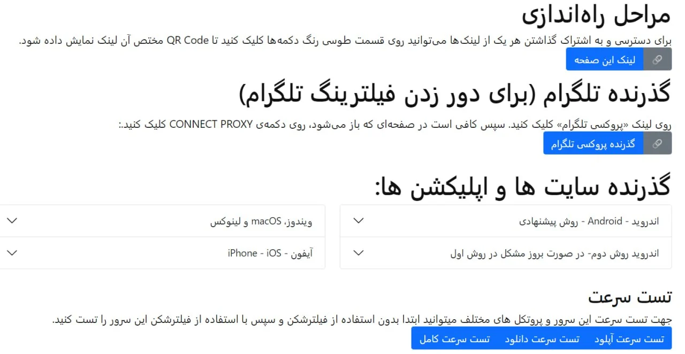

# How Hiddify Manager began: Hiddify Config and its first panel

<!-- made by .cache/blog/history_gen.py -->

!!! abstract "In 30 seconds"
    The project that became Hiddify Manager started on 26 September 2022 as **Hiddify Config**: scripts that turn
    a cloud server into a working proxy. By 14 January 2023 it had a one-command install, more than ten protocols,
    user pages with QR codes, and its first **panel** (version 5).

<!-- more -->

## What was new

- **September 2022, the first days:** a Telegram proxy (MTProxy) and one-click templates for Microsoft Azure: paste a template at the cloud provider and get a working proxy.
- **October 2022:** Shadowsocks (with v2ray for CDN, and with faketls), VMess, TCP BBR for speed, and the first **one-command install** on Ubuntu.
- **Smart routing in Clash:** three modes: only filtered sites through the proxy, everything except Iranian sites (recommended), or everything.
- **November–December 2022:** user guide pages with QR codes, usage monitoring, arm64 servers, and Trojan.
- **No domain needed:** the install worked with sslip.io, turned the firewall on, and showed a temporary proxy link on the server for an hour, so anyone could get started.
- **One-click deploy** on Oracle Cloud (free servers), Vultr, Hetzner and OVH.
- **January 2023:** the **Xray** core with VLESS, VMess and Trojan links, with and without a CDN, and a speed test on the user page.
- **Version 5 (14 January 2023):** the first **Hiddify panel**: many domains, configs you can turn on and off, fake CDN and gRPC. Version 6 (February) added TUIC and moved certificates to acme.sh.

## Today

Hiddify Manager is at version 14 now. Install the latest version, or update yours from the panel (take a [backup](/manager/configuration-and-advanced-settings/How-to-backup-and-restore-panel-on-Hiddify/) first).

<a class="hi-cta" href="/manager/installation-and-setup/guide/">Install Hiddify Manager</a>

??? note "For experts"
    - The repository was called hiddify-config until October 2023; today it is Hiddify-Manager.
    - Versions 1 to 6 have no git tags; version 5 is the "V5" merge of 14 January 2023, version 6 the v6 branch merged on 6 February 2023.
    - The README of February 2023 lists more than 20 protocols plus the Telegram proxy, tested on Ubuntu 20.04 and 22.04 (amd64, arm64).
    - Sources: [first commit](https://github.com/hiddify/Hiddify-Manager/commit/dacfea6a), [one-command install](https://github.com/hiddify/Hiddify-Manager/commit/64191bde), [Xray](https://github.com/hiddify/Hiddify-Manager/commit/9a92e0e4), [V5](https://github.com/hiddify/Hiddify-Manager/commit/38cb41a3)

## Related articles

- [Hiddify Manager 1: many users, many domains](Hiddify-Panel-v1.md)
- [Hiddify Manager 14 is out](Hiddify-Manager-v14-is-released.md)
