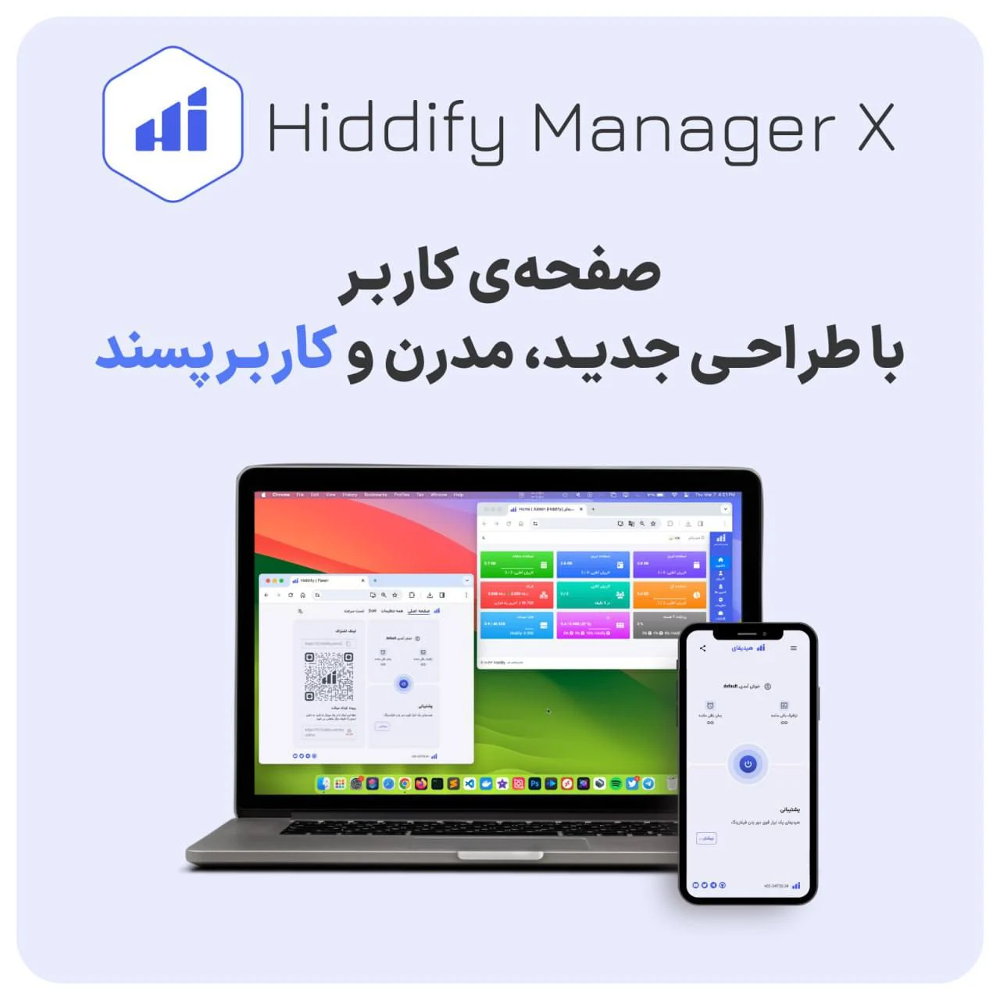
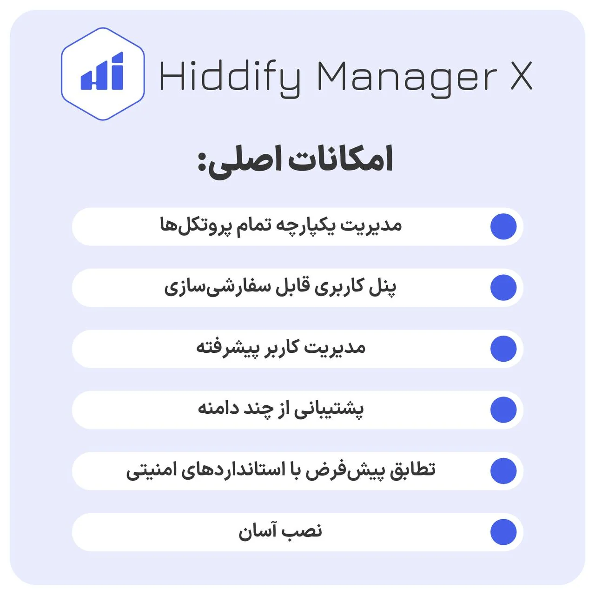

# هیدیفای‌منیجر ۱۰.۱۰: شدوساکس ۲۰۲۲، HTTPUpgrade و وایرگارد

<!-- made by .cache/blog/history_gen.py -->

!!! abstract "در ۳۰ ثانیه"
    هیدیفای‌منیجر **۱۰.۱۰** در ۱۷ اسفند ۱۴۰۲، پیش از نوروز ۱۴۰۳، منتشر شد. **شدوساکس ۲۰۲۲**، **HTTPUpgrade** و
    **وایرگارد**، یک **صفحهٔ ورود** و ورود اول امن‌تر را آورد، و از این به بعد پنل و منیجر یک شمارهٔ نسخه دارند.

<!-- more -->

## چه چیزهایی تازه بود

- **شدوساکس ۲۰۲۲**، همچنین با faketls، و ترنسپورت **HTTPUpgrade**.
- کانفیگ **وایرگارد** برای کاربران.
- **کلیدهای سراسری** برای وب‌سوکت، gRPC و HTTPUpgrade، و روشن یا خاموش کردن چند پروکسی با هم.
- **صفحهٔ ورود** و ورود قوی‌تر برای پنل و پروکسی‌ها؛ ورود اول امن‌تر.
- **وارپ برای سایت‌های دلخواه**، و Hysteria و TUIC با دامنهٔ فیک.
- **لینک اشتراک با کد QR** در فهرست کاربران ادمین، و پیام دلخواه برای کاربران.
- **API نسخهٔ ۲** برای توسعه‌دهندگان؛ زبان روسی؛ تم‌های نوروزی (۱۰.۱۲).

## امروز

هیدیفای‌منیجر حالا در نسخهٔ ۱۴ است. آخرین نسخه را نصب کنید، یا نسخهٔ خودتان را از پنل به‌روزرسانی کنید (اول یک [پشتیبان](/fa/manager/configuration-and-advanced-settings/How-to-backup-and-restore-panel-on-Hiddify/) بگیرید).

<a class="hi-cta" href="/fa/manager/installation-and-setup/guide/">نصب هیدیفای‌منیجر</a>

??? note "برای کاربران حرفه‌ای"
    - پنل ۹ هیچ‌وقت نداشتیم: بعد از پنل ۸.۸.۹۹ (۱۲ اسفند ۱۴۰۲) پنل به ۱۰.۱۰ رفت تا با بستهٔ سرور یک شماره داشته باشد.
    - نسخهٔ ۱۰.۱۱ (۲۵ اسفند ۱۴۰۲) HiddifyCli را برای اسکریپت‌های سرور همراه آورد؛ sing-box 1.8.8 و Xray 1.8.9.
    - پست دو سالگی ما به این نسخه «نسخهٔ ۱۰ هیدیفای‌منیجر» می‌گوید.
    - منبع‌ها: [panel HISTORY v10.10.10](https://github.com/hiddify/hiddifypanel/blob/main/HISTORY.md)، [HTTPUpgrade](https://github.com/hiddify/Hiddify-Manager/commit/082de5ca)

## مقاله‌های مرتبط

- [پنل هیدیفای ۸: پروکسی SSH و یک لینک هوشمند](Hiddify-Panel-v8.md)
- [هیدیفای‌منیجر ۱۰.۷۰: SplitHTTP و فرگمنت](Hiddify-Manager-v10-70-is-released.md)
- [هیدیفای‌منیجر ۱۴ منتشر شد](Hiddify-Manager-v14-is-released.md)
