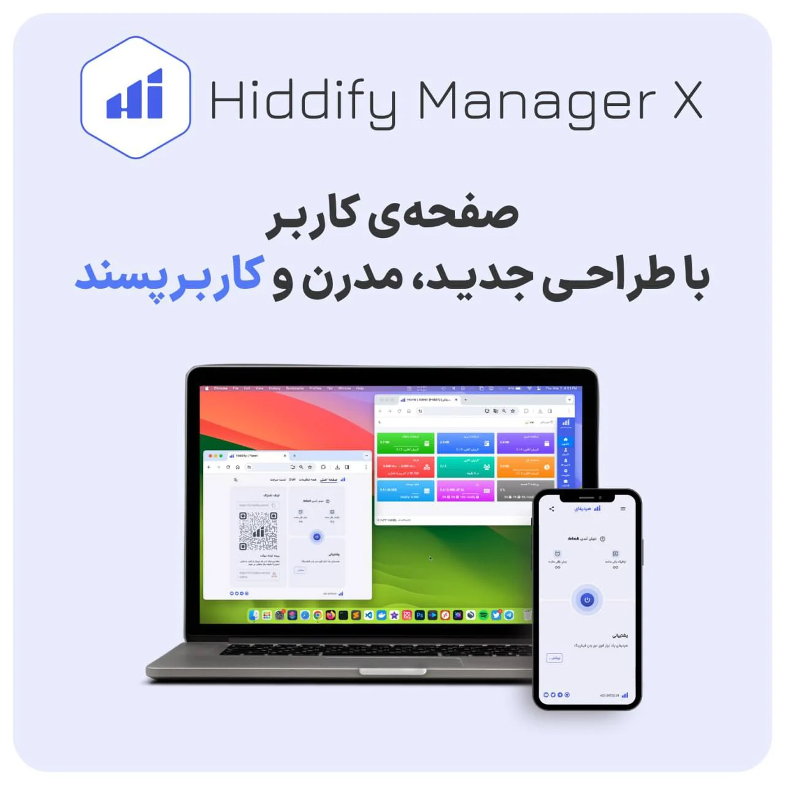
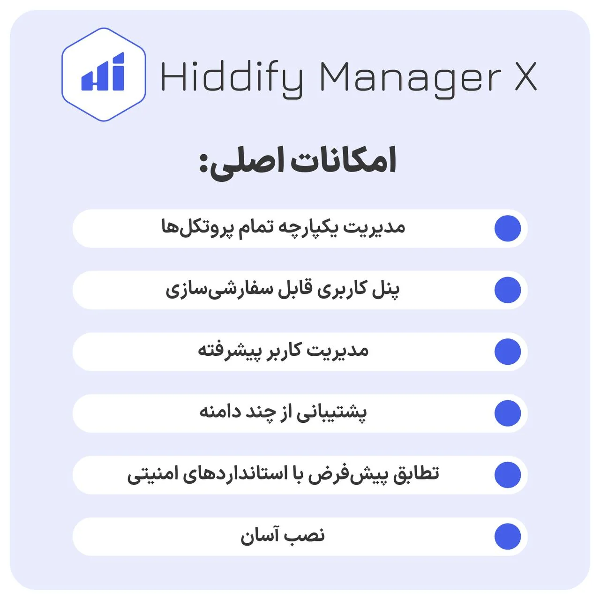

# Hiddify Manager 10.10: Shadowsocks 2022, HTTPUpgrade and WireGuard

<!-- made by .cache/blog/history_gen.py -->

!!! abstract "In 30 seconds"
    Hiddify Manager **10.10** came out on 7 March 2024, before Nowruz 2024. It added **Shadowsocks 2022**,
    **HTTPUpgrade** and **WireGuard**, a **login page** and a safer first login, and from now on the panel and the
    manager share one version number.

<!-- more -->

## What was new

- **Shadowsocks 2022**, also with faketls, and the **HTTPUpgrade** transport.
- **WireGuard** configs for users.
- **Global switches** for WebSocket, gRPC and HTTPUpgrade, and turning many proxies on or off at once.
- **A login page** and stronger login for the panel and the proxies; a safer first login.
- **WARP for custom sites**, and Hysteria and TUIC with fake domains.
- **Share links with a QR code** in the admin's user list, and a custom message for users.
- **API v2** for developers; Russian language; Nowruz themes (10.12).

## Today

Hiddify Manager is at version 14 now. Install the latest version, or update yours from the panel (take a [backup](/manager/configuration-and-advanced-settings/How-to-backup-and-restore-panel-on-Hiddify/) first).

<a class="hi-cta" href="/manager/installation-and-setup/guide/">Install Hiddify Manager</a>

??? note "For experts"
    - There was never a panel 9: after panel 8.8.99 (2 March 2024) the panel jumped to 10.10 to share one number with the server package.
    - 10.11 (15 March 2024) bundled HiddifyCli for the server scripts; sing-box 1.8.8 and Xray 1.8.9.
    - Our second-anniversary post calls this "HiddifyManager version 10".
    - Sources: [panel HISTORY v10.10.10](https://github.com/hiddify/hiddifypanel/blob/main/HISTORY.md), [HTTPUpgrade](https://github.com/hiddify/Hiddify-Manager/commit/082de5ca)

## Related articles

- [Hiddify panel 8: SSH proxy and one smart link](Hiddify-Panel-v8.md)
- [Hiddify Manager 10.70: SplitHTTP and fragment](Hiddify-Manager-v10-70-is-released.md)
- [Hiddify Manager 14 is out](Hiddify-Manager-v14-is-released.md)
