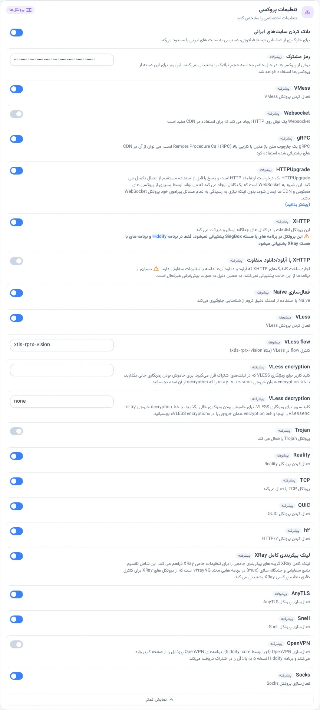

# هیدیفای‌منیجر ۱۲ منتشر شد

!!! abstract "در ۳۰ ثانیه"
    هیدیفای‌منیجر **۱۲.۰.۰** در ۲ اسفند ۱۴۰۴ منتشر شد. روش‌های اتصال تازه‌ای آورده که سخت‌تر مسدود
    می‌شوند (Mieru، Naive و HTTP/2)، یک پروکسی تلگرام که ترافیک هر کاربر را می‌شمارد، و ECH که نام سایت را
    در دست‌دادن TLS پنهان می‌کند.

<!-- more -->

## چه چیزی برای شما عوض می‌شود

- **پروتکل‌های تازه: Mieru و Naive.** دو راه دیگر برای وصل شدن کاربران. ترافیک Naive شبیه ترافیک
  معمولی مرورگر کروم است و روی QUIC هم کار می‌کند. Mieru تنظیمات جدا برای TCP و UDP دارد.
- **ترنسپورت HTTP/2 (h2)**، و ریالتی روی TCP حالا به‌طور پیش‌فرض روشن است.
- **پروکسی تلگرام (MTProxy) با شمارش ترافیک.** هر کاربر لینک پروکسی تلگرام خودش را می‌گیرد و پنل ترافیک
  آن را مثل بقیهٔ کانفیگ‌ها می‌شمارد.
- **ECH (Encrypted Client Hello).** یک تنظیم تازهٔ TLS؛ وقتی روشن باشد، لینک‌هایی که کاربران می‌گیرند ECH
  دارند و نام سایت از دید فیلتر پنهان می‌ماند.
- **تنظیمات فرگمنت** (اندازه و زمان‌بندی بسته‌ها) حالا در پنل قابل تغییر است.
- **sing-box برگشت** و کنار Xray کار می‌کند، پس اپ‌های بیشتری با همان لینک‌ها کار می‌کنند.
- **گواهی برای آدرس IP**، گواهی خودکار (ACME) بهتر، و گزینهٔ **resolve IP** برای هر دامنه.
- **پروکسی SSH** حالا UDP را هم می‌برد (UDP روی TCP).
- **اقدام‌های تازه روی کاربران** در فهرست کاربران.

پروتکل‌ها در تنظیمات پنل روشن و خاموش می‌شوند. فهرستشان در پنل امروز این‌طور است:

{ width=760 }

## باید به‌روزرسانی کنم؟

بله، اگر نسخهٔ ۱۱ دارید. اول یک [پشتیبان](/fa/manager/configuration-and-advanced-settings/How-to-backup-and-restore-panel-on-Hiddify/)
بگیرید، بعد از پنل به‌روزرسانی کنید (**اقدامات** › **به‌روزرسانی**). راهنما:
[به‌روزرسانی هیدیفای‌منیجر](/fa/manager/configuration-and-advanced-settings/How-to-update-Hiddify-panel/).
نسخه‌های تازه‌تر (۱۳ و ۱۴) هم منتشر شده‌اند، پس به‌روزرسانی شما را مستقیم به آخرین نسخه می‌برد.

<a class="hi-cta" href="/fa/manager/installation-and-setup/guide/">نصب یا به‌روزرسانی هیدیفای‌منیجر</a>

??? note "برای کاربران حرفه‌ای: تغییرات بیشتر نسخهٔ ۱۲"
    - Mieru: تنظیمات جدا برای TCP و UDP؛ Naive روی QUIC بهتر شد.
    - گزینهٔ TCP stream بدون هدر و اصلاح تنظیمات TCP در Xray.
    - ساخت یکپارچهٔ پروکسی برای sing-box و Xray؛ هستهٔ هیدیفای به‌روز شد.
    - تغییرات از ۱۱.۰.۰: [Hiddify-Manager](https://github.com/hiddify/Hiddify-Manager/compare/v11.0.0...v12.0.0)،
      [hiddifypanel](https://github.com/hiddify/hiddifypanel/compare/v11.0.0...v12.0.0).

## مقاله‌های مرتبط

- [همهٔ تنظیمات هیدیفای‌منیجر](/fa/manager/configuration-and-advanced-settings/Settings-reference/)
- [پروکسی تلگرام در هیدیفای](/fa/manager/configuration-and-advanced-settings/How-to-set-up-Telegram-proxy-on-Hiddify/)
- [به‌روزرسانی هیدیفای‌منیجر](/fa/manager/configuration-and-advanced-settings/How-to-update-Hiddify-panel/)
