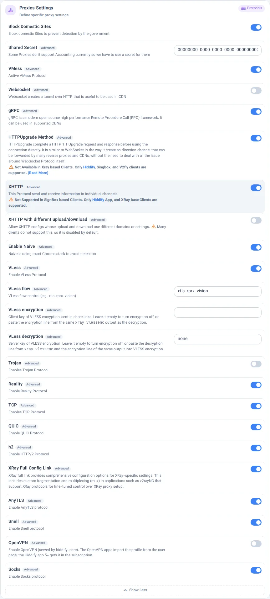

# Hiddify Manager 12 is out

!!! abstract "In 30 seconds"
    Hiddify Manager **12.0.0** came out on 21 February 2026. It adds new ways to connect that are harder
    to block (Mieru, Naive and HTTP/2), a Telegram proxy that counts each user's traffic, and ECH, which
    hides the site name in the TLS handshake.

<!-- more -->

## What changes for you

- **New protocols: Mieru and Naive.** Two more ways for your users to connect. Naive looks like normal
  Chrome traffic, also over QUIC. Mieru has its own TCP and UDP settings.
- **HTTP/2 (h2) transport**, and Reality over TCP is now on by default.
- **Telegram proxy (MTProxy) with traffic counting.** Each user gets their own Telegram proxy link, and
  the panel counts its traffic like any other config.
- **ECH (Encrypted Client Hello).** A new TLS setting; when it is on, the links your users get include
  ECH, so the name of the site is hidden from the filter.
- **Fragment settings** (size and timing of the packets) can now be changed in the panel.
- **sing-box is back** next to Xray, so more client apps work with the same links.
- **Certificates for an IP address**, better automatic certificates (ACME), and a **resolve IP** option
  for each domain.
- **SSH proxy** now also carries UDP (UDP over TCP).
- **New actions on users** in the users list.

The protocols are turned on and off in the panel settings. This is how the list looks in today's panel:

{ width=760 }

## Should I update?

Yes, if you run version 11. Take a [backup](/manager/configuration-and-advanced-settings/How-to-backup-and-restore-panel-on-Hiddify/)
first, then update from the panel (**Actions** › **Update**). See
[How to update HiddifyManager](/manager/configuration-and-advanced-settings/How-to-update-Hiddify-panel/).
Newer versions (13 and 14) are out now, so the update takes you straight to the latest one.

<a class="hi-cta" href="/manager/installation-and-setup/guide/">Install or update Hiddify Manager</a>

??? note "For experts: more changes in 12"
    - Mieru: separate TCP and UDP settings; better Naive over QUIC.
    - No-header TCP stream option and fixed TCP settings for Xray.
    - Unified proxy generation for sing-box and Xray; hiddify-core updated.
    - Changes since 11.0.0: [Hiddify-Manager](https://github.com/hiddify/Hiddify-Manager/compare/v11.0.0...v12.0.0),
      [hiddifypanel](https://github.com/hiddify/hiddifypanel/compare/v11.0.0...v12.0.0).

## Related articles

- [All settings of HiddifyManager](/manager/configuration-and-advanced-settings/Settings-reference/)
- [Telegram proxy on Hiddify](/manager/configuration-and-advanced-settings/How-to-set-up-Telegram-proxy-on-Hiddify/)
- [How to update HiddifyManager](/manager/configuration-and-advanced-settings/How-to-update-Hiddify-panel/)
