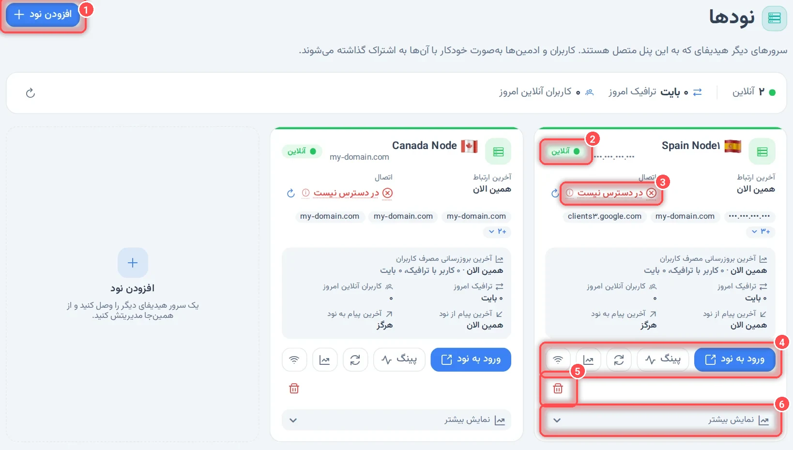

# هیدیفای‌منیجر ۱۳ منتشر شد

!!! abstract "در ۳۰ ثانیه"
    هیدیفای‌منیجر **۱۳.۰.۰** در ۴ مهر ۱۴۰۵ منتشر شد. حالا یک پنل می‌تواند **چند سرور (نود)** را بگرداند،
    **تونل‌های DNS** برای وقتی آمده‌اند که تقریباً همه‌چیز بسته است، و پنل یک **داشبورد تازه** دارد که
    کاربران و سرورها را یک‌جا نشان می‌دهد.

<!-- more -->

## چه چیزی برای شما عوض می‌شود

- **چند سرور، یک پنل (نودها).** سرورهای دیگر را به‌عنوان نود به پنل اصلی اضافه کنید. کاربران و ادمین‌ها را
  یک بار، در پنل اصلی، می‌سازید و روی همهٔ نودها کار می‌کنند. ترافیکشان روی همهٔ نودها جمع زده می‌شود، و یک
  لینک اشتراک، کانفیگ همهٔ سرورهای شما را دارد.
- **تونل‌های DNS: ‏DNSTT، VayDNS، MasterDNS و Slipstream.** این‌ها ترافیک را داخل پرسش‌های DNS می‌برند. کند
  هستند، ولی وقتی تقریباً همهٔ راه‌های دیگر بسته است، هنوز می‌توانند کار کنند.
- **داشبورد تازه** با کاربران آنلاین، نمودار مصرف و وضعیت سلامت هر نود.
- **گزینه‌های بیشتر Xray**: رمزگذاری و flow برای VLESS، و تنظیمات بیشتر ریالتی و TCP.
- **هر نوع دامنه‌ای** را می‌شود اضافه کرد، با فیلدهای اضافه که در قالب پروکسی‌های سفارشی به کار می‌آیند.
- **انتخاب چند پروکسی** در یک زمان، و سازندهٔ پروکسی سفارشی بازنویسی شد.
- **کاربران**: اقدام سریع «۷ روز»، و ادمین‌ها می‌توانند رمز را بازنشانی کنند یا لینک ادمین را دوباره بگیرند.
- **کلیک امن‌تر**: کارهای خطرناک (مثل حذف) اول تأیید می‌خواهند.
- **فونت فارسی وزیرمتن** و چیدمانی که روی گوشی بهتر کار می‌کند.

این فهرست نودها در پنل اصلی است (در پنل امروز):

{ width=760 }

## باید به‌روزرسانی کنم؟

بله. اول یک [پشتیبان](/fa/manager/configuration-and-advanced-settings/How-to-backup-and-restore-panel-on-Hiddify/)
بگیرید، بعد از پنل به‌روزرسانی کنید (**اقدامات** › **به‌روزرسانی**). راهنما:
[به‌روزرسانی هیدیفای‌منیجر](/fa/manager/configuration-and-advanced-settings/How-to-update-Hiddify-panel/).
نسخهٔ ۱۴ هم منتشر شده، پس به‌روزرسانی شما را مستقیم به آن می‌برد.

<a class="hi-cta" href="/fa/manager/installation-and-setup/guide/">نصب یا به‌روزرسانی هیدیفای‌منیجر</a>

??? note "برای کاربران حرفه‌ای: تغییرات بیشتر نسخهٔ ۱۳"
    - همگام‌سازی کاربران، گواهی‌های TLS و پروکسی‌ها بین پنل اصلی و نودها؛ پنل اصلی کانفیگ‌ها را از نودها می‌خواند.
    - مسیریابی SNI با rust-rpxy-l4 کنار HAProxy؛ تنظیمات DNS resolver و decoy upstream برای HAProxy.
    - سرویس hiddify-mysql؛ بارگذاری تنبل API هستهٔ Xray برای مصرف حافظهٔ کمتر.
    - نصب آزمایشی با داکر ([نصب هیدیفای با داکر](/fa/manager/installation-and-setup/Install-Hiddify-using-Docker/)).
    - تغییرات از ۱۲.۰.۰: [Hiddify-Manager](https://github.com/hiddify/Hiddify-Manager/compare/v12.0.0...v13.0.0)،
      [hiddifypanel](https://github.com/hiddify/hiddifypanel/compare/v12.0.0...v13.0.0).

## مقاله‌های مرتبط

- [چندسروره کردن هیدیفای‌منیجر با نودها](/fa/manager/configuration-and-advanced-settings/Multi-server-with-nodes-on-HiddifyManager/)
- [همهٔ تنظیمات هیدیفای‌منیجر](/fa/manager/configuration-and-advanced-settings/Settings-reference/)
- [به‌روزرسانی هیدیفای‌منیجر](/fa/manager/configuration-and-advanced-settings/How-to-update-Hiddify-panel/)
