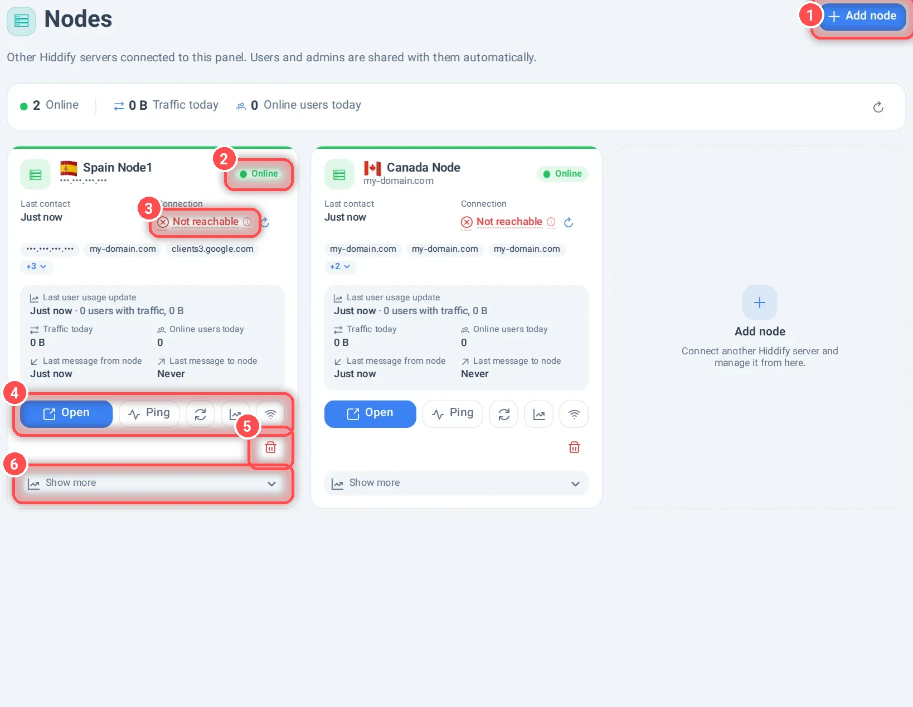

# Hiddify Manager 13 is out

!!! abstract "In 30 seconds"
    Hiddify Manager **13.0.0** came out on 26 September 2026. Now one panel can run **many servers
    (nodes)**, there are **DNS tunnels** for times when almost everything is blocked, and the panel has a
    **new dashboard** that shows your users and servers at a glance.

<!-- more -->

## What changes for you

- **Many servers, one panel (nodes).** Add other servers as nodes of your main panel. You add users and
  admins once, on the main panel, and they work on every node. Their traffic on all nodes is added up, and
  one subscription link has configs for all your servers.
- **DNS tunnels: DNSTT, VayDNS, MasterDNS and Slipstream.** These carry traffic inside DNS questions.
  They are slow, but they can still work when almost every other way is blocked.
- **New dashboard** with online users, usage charts and the health of each node.
- **More Xray options**: VLESS encryption and flow, and more Reality and TCP settings.
- **Any kind of domain** can be added, with extra fields you can use in your own proxy templates.
- **Choose more than one proxy** at a time, and a reworked custom proxy maker.
- **Users**: a "7 days" quick action, and admins can reset a password or get the admin link again.
- **Safer clicks**: dangerous actions (like deleting) ask you to confirm first.
- **Persian font Vazirmatn** and a layout that works better on phones.

This is the nodes list of the main panel (in today's panel):

{ width=760 }

## Should I update?

Yes. Take a [backup](/manager/configuration-and-advanced-settings/How-to-backup-and-restore-panel-on-Hiddify/)
first, then update from the panel (**Actions** › **Update**). See
[How to update HiddifyManager](/manager/configuration-and-advanced-settings/How-to-update-Hiddify-panel/).
Version 14 is out now, so the update takes you straight to it.

<a class="hi-cta" href="/manager/installation-and-setup/guide/">Install or update Hiddify Manager</a>

??? note "For experts: more changes in 13"
    - Parent/child sync of users, TLS certificates and proxies; the parent reads configs from its children.
    - SNI routing with rust-rpxy-l4 next to HAProxy; DNS resolver and decoy upstream settings for HAProxy.
    - A hiddify-mysql service; lazy loading of the Xray API for lower memory use.
    - Experimental Docker install ([Install Hiddify using Docker](/manager/installation-and-setup/Install-Hiddify-using-Docker/)).
    - Changes since 12.0.0: [Hiddify-Manager](https://github.com/hiddify/Hiddify-Manager/compare/v12.0.0...v13.0.0),
      [hiddifypanel](https://github.com/hiddify/hiddifypanel/compare/v12.0.0...v13.0.0).

## Related articles

- [Multi-server with nodes on Hiddify Manager](/manager/configuration-and-advanced-settings/Multi-server-with-nodes-on-HiddifyManager/)
- [All settings of HiddifyManager](/manager/configuration-and-advanced-settings/Settings-reference/)
- [How to update HiddifyManager](/manager/configuration-and-advanced-settings/How-to-update-Hiddify-panel/)
