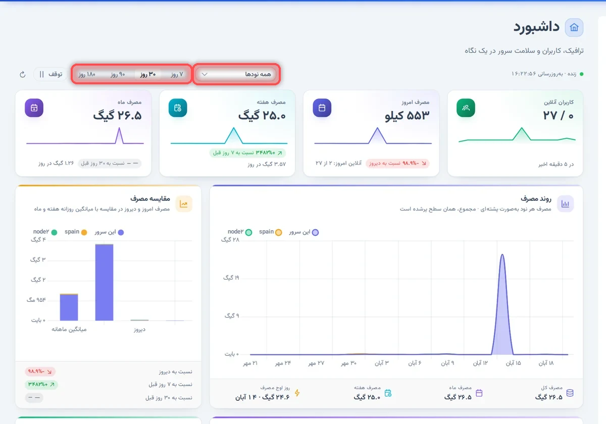
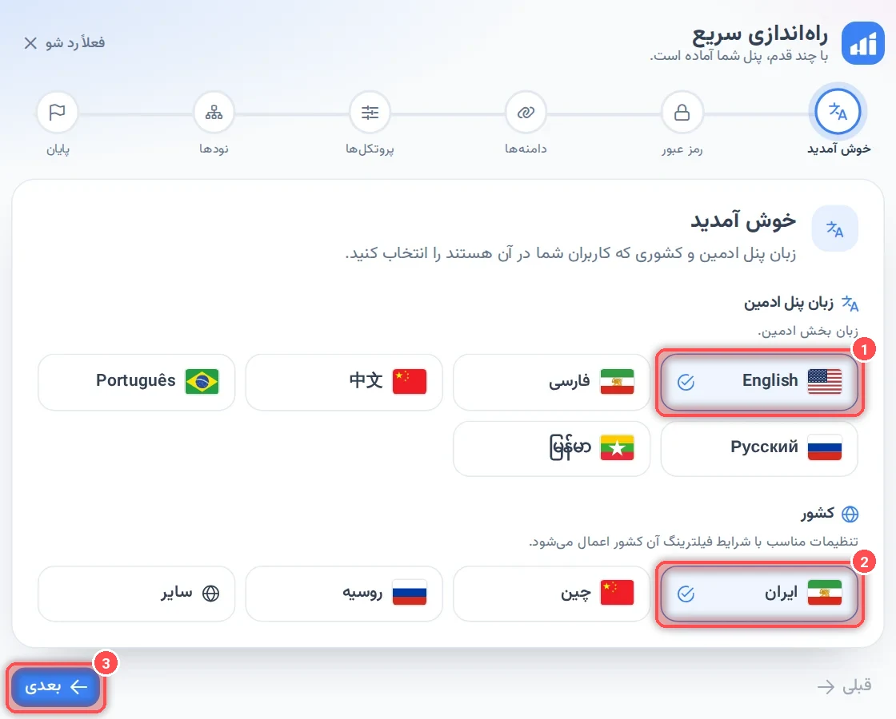

# هیدیفای‌منیجر ۱۴ منتشر شد

!!! abstract "در ۳۰ ثانیه"
    هیدیفای‌منیجر **۱۴.۰.۰** در ۲۶ مهر ۱۴۰۵ و **۱۴.۲.۰** در ۱۵ آبان ۱۴۰۵ منتشر شد. پنل **ظاهری تازه و
    ساده‌تر** با **راه‌اندازی سریع** دارد، و **Hysteria، TUIC و OpenVPN**، یک **پروکسی تلگرام** تازه و
    **مدیریت خروجی‌ها** (وارپ، Tor و بقیه) را یک‌جا آورده است.

<!-- more -->

## چه چیزی برای شما عوض می‌شود

- **پنل ادمین تازه.** صفحه‌های مرتب‌تر، **راه‌اندازی سریع** برای سرور تازه، و می‌شود آن را **مثل یک اپ** روی
  گوشی یا کامپیوتر نصب کرد (PWA).
- **صفحهٔ پروتکل‌ها** برای روشن و خاموش کردن هر پروتکل در یک جا.
- **پروتکل‌های تازه: Hysteria و TUIC**، تروجان با ریالتی، و از ۱۴.۲ **OpenVPN** (‏UDP و TCP).
- **پروکسی تلگرام با موتور تازه (telemt)**، به‌صورت پروکسی وب برای تلگرام وب هم.
- **مدیریت خروجی‌ها**: ترافیک را از راه وارپ، Tor یا یک سرور دیگر بیرون بفرستید، با یک خروجی پیش‌فرض برای
  هر ادمین. اگر Tor در دسترس نباشد، پنل خبر می‌دهد.
- **ECH برای هر دامنه**: ECH کلودفلر را فقط جایی روشن کنید که لازم دارید.
- کانفیگ‌های **وایرگارد** را می‌شود به‌صورت فایل `.conf` گرفت (اگر چند تا باشند، یک `.zip`).
- **کاربران**: کپی کد QR به‌صورت تصویر، افزودن محدودیت به چند کاربر با هم، و (۱۴.۲) انتخاب اینکه کاربر
  تازه بالای فهرست برود یا پایین آن.
- **ادمین‌ها** (۱۴.۲): ترافیک کاربران هر ادمین مثل کاربران با دورهٔ بازنشانی شمرده می‌شود؛ فیلتر ادمین‌ها
  بر اساس دسترسی.
- **ویرایشگر جعبهٔ پشتیبانی** (۱۴.۲): متنی را که کاربران در صفحهٔ خود می‌بینند با ویرایشگر داخلی و
  طرح‌های آماده بنویسید.
- **مسدود کردن BitTorrent** (۱۴.۲): یک کلید که روی همهٔ هسته‌ها کار می‌کند.

داشبورد تازه:

{ width=760 }

و راه‌اندازی سریع برای سرور تازه:

{ width=760 }

## باید به‌روزرسانی کنم؟

بله. نسخهٔ ۱۴ همان نسخه‌ای است که الان پشتیبانی می‌کنیم. اول یک
[پشتیبان](/fa/manager/configuration-and-advanced-settings/How-to-backup-and-restore-panel-on-Hiddify/) بگیرید،
بعد از پنل به‌روزرسانی کنید (**اقدامات** › **به‌روزرسانی**). راهنما:
[به‌روزرسانی هیدیفای‌منیجر](/fa/manager/configuration-and-advanced-settings/How-to-update-Hiddify-panel/).

برای سرور تازه از **اوبونتو ۲۶.۰۴ یا ۲۴.۰۴** استفاده کنید. اوبونتو ۲۲.۰۴ هنوز کار می‌کند، ولی فقط وقتی
سراغش بروید که سرویس‌دهنده چیز تازه‌تری ندارد ([پیش‌نیازها](/fa/manager/installation-and-setup/Installation-prerequisites/)).

<a class="hi-cta" href="/fa/manager/installation-and-setup/guide/">نصب یا به‌روزرسانی هیدیفای‌منیجر</a>

??? note "برای کاربران حرفه‌ای: تغییرات بیشتر نسخهٔ ۱۴"
    - کانفیگ Clash Meta در لینک اشتراک (proxy_v3)، با قالب‌های Hysteria و TUIC.
    - بررسی webhook secret ربات تلگرام؛ دامنه‌های پروکسی وب تلگرام با wildcard hostهای telemt (۱۴.۲).
    - بازنویسی فایروال با هدایت پورت دامنه‌ها؛ مدیریت بهتر IPv6.
    - ۱۴.۲: سرور MySQL/MariaDB و Redis بیرونی؛ محدودیت حجم لاگ با journald و logrotate؛ درخواست‌های decoy اول به
      HTTPS می‌روند؛ Xray 26.10.31، hiddify-core 5.3.0 و telemt 3.5.16.
    - تغییرات: [۱۳.۰.۰ تا ۱۴.۰.۰](https://github.com/hiddify/hiddifypanel/compare/v13.0.0...v14.0.0)،
      [۱۴.۰.۰ تا ۱۴.۲.۰](https://github.com/hiddify/hiddifypanel/compare/v14.0.0...v14.2.0) (پنل)؛
      [Hiddify-Manager](https://github.com/hiddify/Hiddify-Manager/compare/v13.0.0...v14.2.0).

## مقاله‌های مرتبط

- [پیکربندی درست پنل هیدیفای](/fa/manager/configuration-and-advanced-settings/How-to-configure-Hiddify-panel-properly/)
- [خروجی‌ها در هیدیفای‌منیجر](/fa/manager/configuration-and-advanced-settings/How-to-use-Outbounds-on-HiddifyManager/)
- [پروکسی تلگرام در هیدیفای](/fa/manager/configuration-and-advanced-settings/How-to-set-up-Telegram-proxy-on-Hiddify/)
- [پیش‌نیازهای نصب](/fa/manager/installation-and-setup/Installation-prerequisites/)
