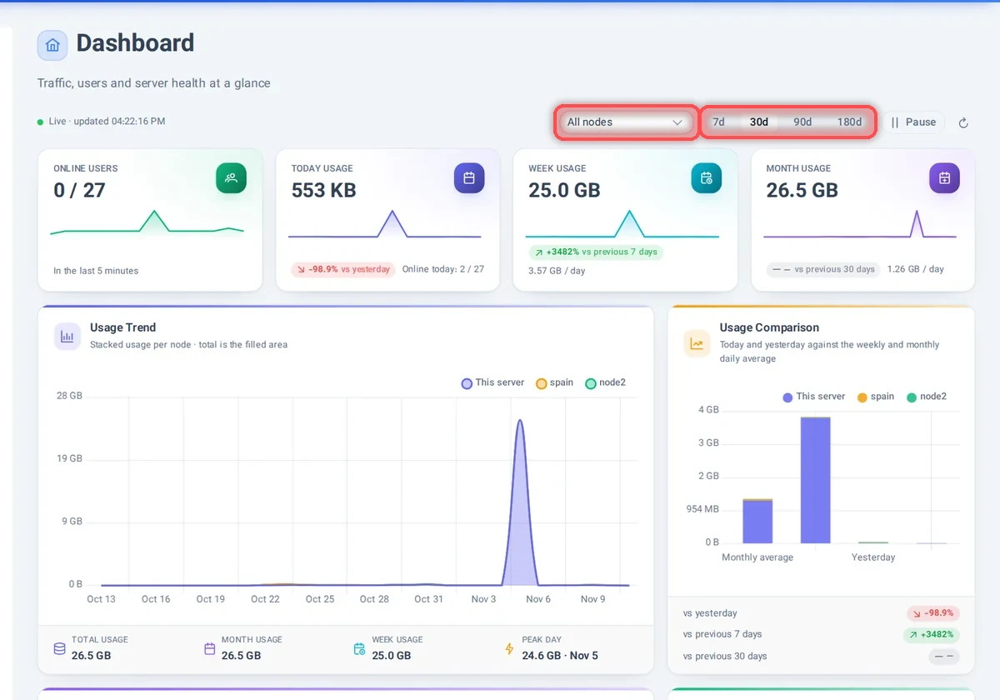
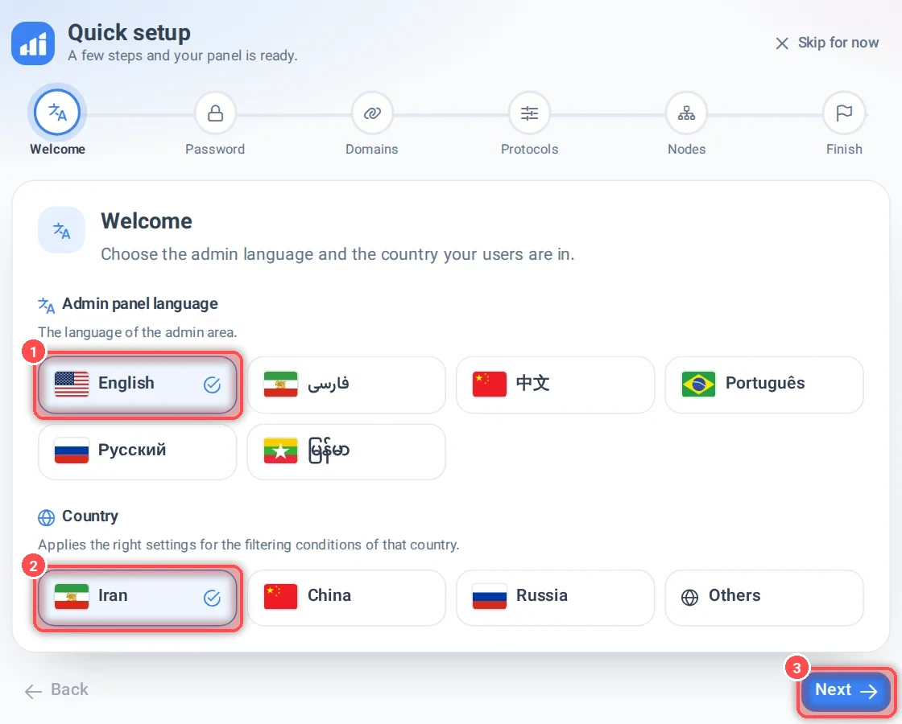

# Hiddify Manager 14 is out

!!! abstract "In 30 seconds"
    Hiddify Manager **14.0.0** came out on 18 October 2026, and **14.2.0** on 6 November 2026. The panel
    has a **new, simpler look** with a **quick setup**, and it adds **Hysteria, TUIC and OpenVPN**, a new
    **Telegram proxy**, and an **outbound manager** (WARP, Tor and more) in one place.

<!-- more -->

## What changes for you

- **A new admin panel.** Cleaner pages, a **quick setup** for a new server, and it can be **installed like
  an app** on your phone or computer (PWA).
- **A Protocols page** to turn each protocol on or off in one place.
- **New protocols: Hysteria and TUIC**, Trojan with Reality, and, since 14.2, **OpenVPN** (UDP and TCP).
- **Telegram proxy, new engine (telemt)**, also as a web proxy for Telegram Web.
- **Outbound manager**: send traffic out through WARP, Tor or another server, with a default per admin.
  The panel tells you if Tor is not available.
- **ECH per domain**: turn Cloudflare ECH on only where you need it.
- **WireGuard** configs can be downloaded as `.conf` files (a `.zip` when there are several).
- **Users**: copy a QR code as an image, add limits to many users at once, and (14.2) choose whether new
  users go to the top or the end of the list.
- **Admins** (14.2): each admin's users' traffic is counted with a reset period, like users; filter
  admins by permission.
- **Support box editor** (14.2): write the text users see on their page with a built-in editor and
  ready-made designs.
- **Block BitTorrent** (14.2): one switch that works on every core.

The new dashboard:

{ width=760 }

And the quick setup for a new server:

{ width=760 }

## Should I update?

Yes. Version 14 is the one we support now. Take a
[backup](/manager/configuration-and-advanced-settings/How-to-backup-and-restore-panel-on-Hiddify/) first,
then update from the panel (**Actions** › **Update**); see
[How to update HiddifyManager](/manager/configuration-and-advanced-settings/How-to-update-Hiddify-panel/).

For a new server, use **Ubuntu 26.04 or 24.04**. Ubuntu 22.04 still works, but use it only when your
provider has nothing newer ([prerequisites](/manager/installation-and-setup/Installation-prerequisites/)).

<a class="hi-cta" href="/manager/installation-and-setup/guide/">Install or update Hiddify Manager</a>

??? note "For experts: more changes in 14"
    - Clash Meta configs in the subscription (proxy_v3), with Hysteria and TUIC templates.
    - Telegram bot webhook secret check; Telegram web proxy domains served by telemt wildcard hosts (14.2).
    - Firewall rework with domain port redirection; better IPv6 handling.
    - 14.2: external MySQL/MariaDB and Redis server; journald and logrotate limits; decoy requests go to
      HTTPS first; Xray 26.10.31, hiddify-core 5.3.0, telemt 3.5.16.
    - Changes: [13.0.0 → 14.0.0](https://github.com/hiddify/hiddifypanel/compare/v13.0.0...v14.0.0),
      [14.0.0 → 14.2.0](https://github.com/hiddify/hiddifypanel/compare/v14.0.0...v14.2.0) (panel);
      [Hiddify-Manager](https://github.com/hiddify/Hiddify-Manager/compare/v13.0.0...v14.2.0).

## Related articles

- [How to configure the Hiddify panel properly](/manager/configuration-and-advanced-settings/How-to-configure-Hiddify-panel-properly/)
- [Outbounds in HiddifyManager](/manager/configuration-and-advanced-settings/How-to-use-Outbounds-on-HiddifyManager/)
- [Telegram proxy on Hiddify](/manager/configuration-and-advanced-settings/How-to-set-up-Telegram-proxy-on-Hiddify/)
- [Installation prerequisites](/manager/installation-and-setup/Installation-prerequisites/)
