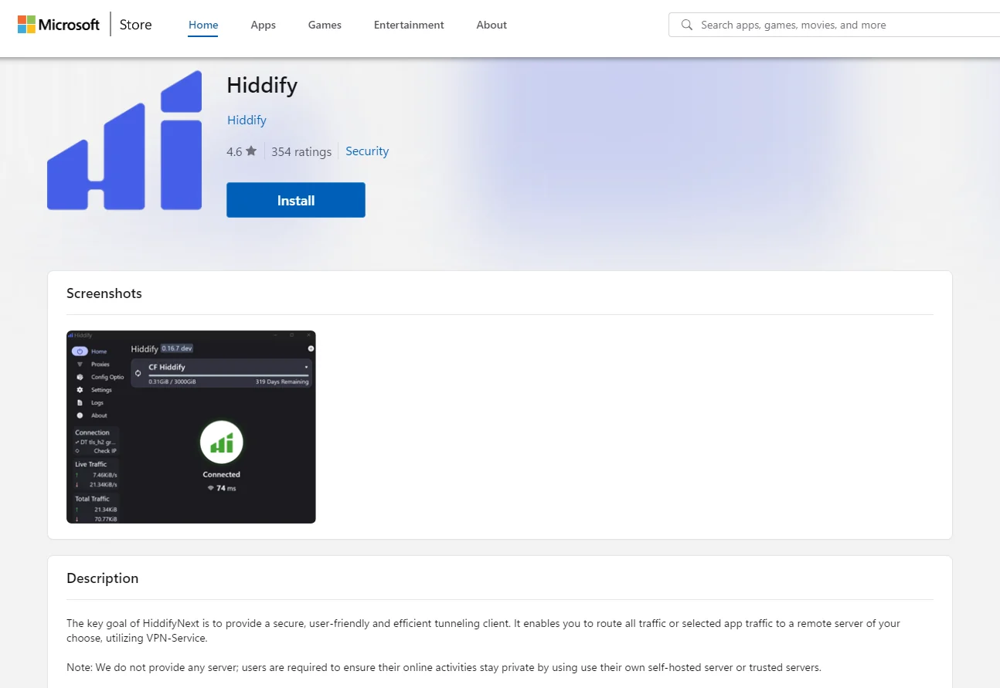

# Hiddify Next 0.14–0.16: iOS beta, WARP and the Microsoft Store

<!-- made by .cache/blog/history_gen.py -->

!!! abstract "In 30 seconds"
    On 14 January 2024 the first **iOS beta** of Hiddify Next came out on Apple's **TestFlight**. Two weeks later
    **0.15** added **WARP** links (`warp://`), and in February the app was on the **Microsoft Store** and got its
    new name, **Hiddify**.

<!-- more -->

## What was new

- **iOS beta on TestFlight** (0.14), and an iOS URL scheme (0.14.1).
- **WARP links** (0.15): `warp://auto`, or your own key and clean IP.
- **WireGuard noise**, and pasting Clash or sing-box configs directly (0.15).
- **Microsoft Store** (February 2024, from 0.16.7).
- **New name and icon: Hiddify** (0.16), with WARP and Mux to try, and connection info on the home page.
- **Spanish** and **Chinese (Taiwan)** languages.

## Today

The Hiddify app is at version 5 now, with free profiles, Chain and connection sharing. Download the latest version.

<a class="hi-cta" href="/app/How-to-install-Hiddify-app/">Download the Hiddify app</a>

??? note "For experts"
    - The iOS work was a community contribution by GFWFighter and Amir Mohammadi.
    - Sources: [0.15.3 release](https://github.com/hiddify/hiddify-app/releases/tag/v0.15.3), [0.16.0.dev release](https://github.com/hiddify/hiddify-app/releases/tag/v0.16.0.dev)

## Related articles

- [Hiddify Next 0.12–0.13: TLS Tricks, Android TV and LAN sharing](Hiddify-Next-v0-12-is-released.md)
- [Hiddify app 1.0: the name is Hiddify](Hiddify-app-v1-is-released.md)
- [How to use WARP in the Hiddify app](/app/How-to-use-WARP-on-Hiddify-App/)
- [Hiddify app 5 is out](Hiddify-app-v5-is-released.md)
