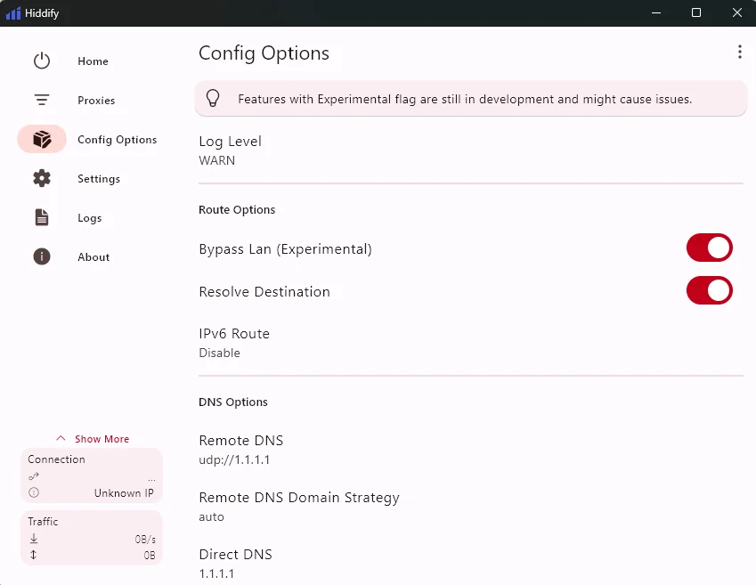

# Hiddify Next 0.12 و 0.13: ترفند TLS، اندروید تی‌وی و اشتراک در شبکه

<!-- made by .cache/blog/history_gen.py -->

!!! abstract "در ۳۰ ثانیه"
    Hiddify Next **0.12** در ۲۹ آذر ۱۴۰۲ با **ترفند TLS** منتشر شد: شروع اتصال TLS را تکه‌تکه و جابه‌جا می‌کند تا
    حتی دامنهٔ فیلترشده هم شاید رد شود. با کنترل **اندروید تی‌وی** هم کار می‌کند. **۰.۱۳** (دی ۱۴۰۲) **اشتراک در
    شبکهٔ محلی** را آورد.

<!-- more -->

## چه چیزهایی تازه بود

- **ترفند TLS** (آزمایشی): فرگمنت TLS و SNI با حروف درهم.
- **اندروید تی‌وی:** جابه‌جایی با دکمه‌های جهت کنترل.
- **اعلان** با نام پروفایل و سرعت در اندروید.
- پشتیبانی از **BeePass**.
- **دور زدن شبکهٔ محلی** و **اشتراک VPN در شبکه** (۰.۱۳).
- **Ctrl+V** روی کامپیوتر پروفایل را از کلیپ‌بورد اضافه می‌کند، و به‌روزرسانی همهٔ اشتراک‌ها با هم (۰.۱۳).
- **منطقهٔ افغانستان** (۰.۱۲.۳).

## امروز

اپ هیدیفای حالا در نسخهٔ ۵ است، با پروفایل‌های رایگان، زنجیره و اشتراک اتصال. آخرین نسخه را دانلود کنید.

<a class="hi-cta" href="/fa/app/How-to-install-Hiddify-app/">دانلود اپ هیدیفای</a>

??? note "برای کاربران حرفه‌ای"
    - نسخهٔ ۰.۱۳.۶ (۱۷ دی ۱۴۰۲) اولین ۰.۱۳ پایدار بود؛ گزینهٔ مسیریابی DNS و احراز هویت ساده برای آدرس اشتراک را هم آورد.
    - منبع‌ها: [0.12.0 release](https://github.com/hiddify/hiddify-app/releases/tag/v0.12.0)، [CHANGELOG](https://github.com/hiddify/hiddify-app/blob/main/CHANGELOG.md)

## مقاله‌های مرتبط

- [Hiddify Next 0.11: ‏VPN، پروکسی سیستم یا فقط پروکسی](Hiddify-Next-v0-11-is-released.md)
- [Hiddify Next 0.14 تا 0.16: بتای iOS، وارپ و مایکروسافت‌استور](Hiddify-Next-iOS-beta-and-WARP.md)
- [ترفندهای DNS و TLS در اپ هیدیفای](/fa/app/DNS-and-TLS-tricks-in-Hiddify-app/)
- [اپ هیدیفای ۵ منتشر شد](Hiddify-app-v5-is-released.md)
